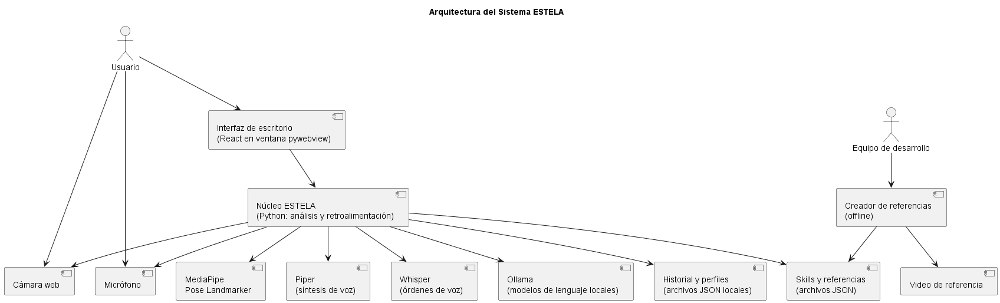
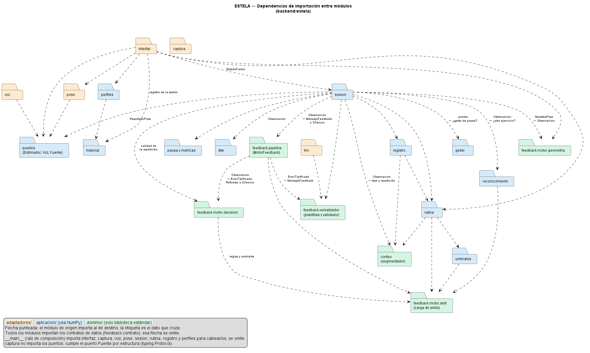
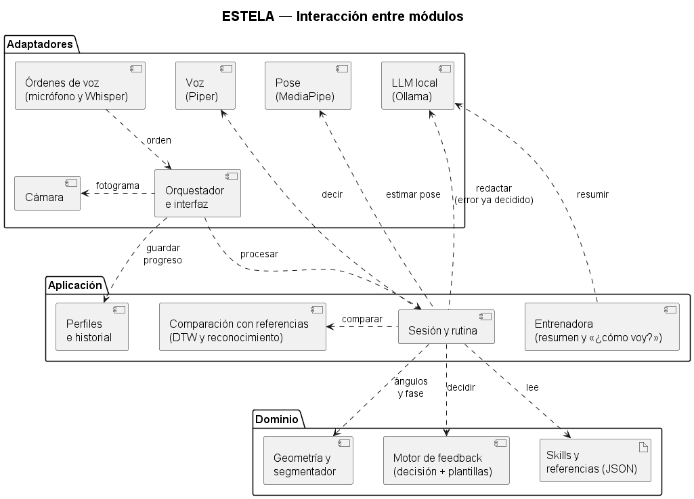
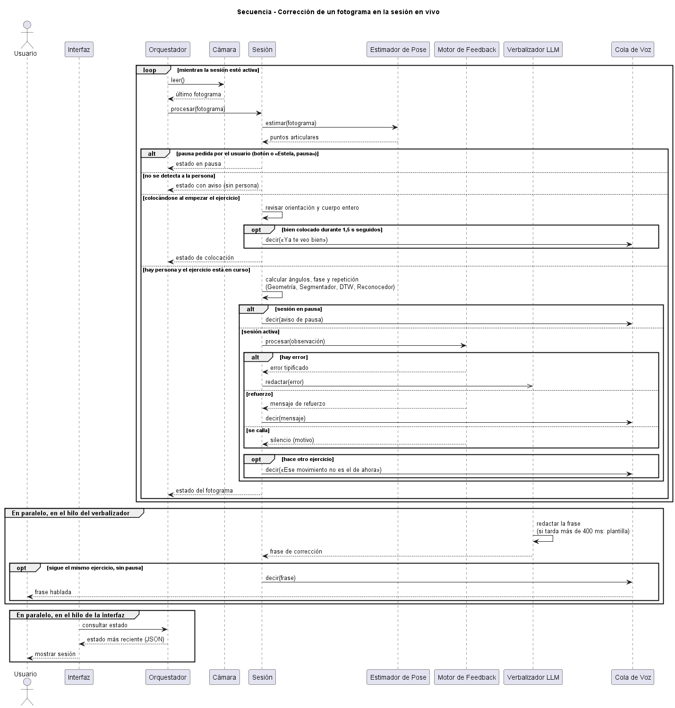
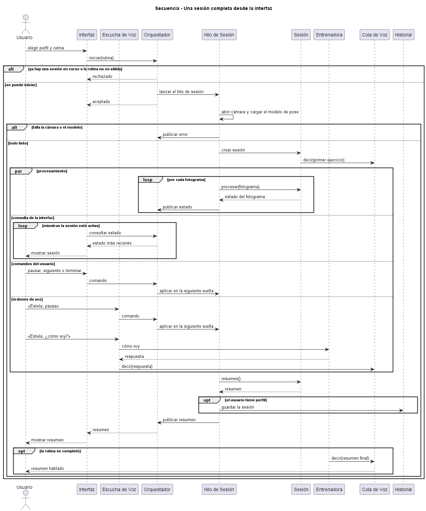
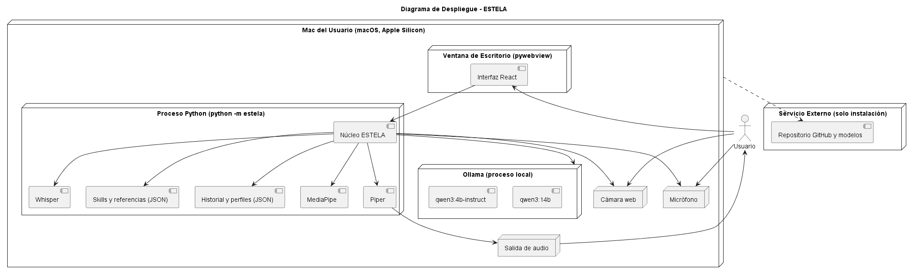

# ESTELA — Informe final

**Proyecto final · Ingeniería de Sistemas · Universidad del Norte · periodo 202630**

**Estudiantes:** Isabella Arrieta Juliao · Natalia Carpintero Leal · Paula Núñez Zarante
**Tutores:** Ph.D. Margarita Gamarra · Augusto Salazar Silva

> **Nota para el equipo.** Esta versión toma como base la rama `feature/mac-flujo` (17-nov-2026) y las mediciones del Mac Studio M2 Ultra (16 y 17-nov-2026). Los recuadros **[ESPACIO PARA COMPLETAR]** que quedan corresponden a lo que todavía no se ha medido: las sesiones anotadas con participantes y las órdenes de voz con micrófono real. El cuestionario de usabilidad (tres participantes, 20-nov-2026) ya está en la sección 13.3.3. Los recuadros **[REVISAR]** señalan cifras que solo constan en los mensajes de *commit* o en el `ESTADO.md` del Mac (sus archivos de resultados no están en git) y que conviene confirmar antes de entregar.

## Resumen / Abstract

Muchas personas hacen ejercicio por su cuenta, siguiendo videos o rutinas aprendidas, sin nadie que observe si lo están haciendo bien. Los videos no ven a quien los sigue, las aplicaciones de conteo dicen cuántas repeticiones se hicieron pero no cómo, y los productos que sí analizan la técnica suelen requerir hardware propio, pertenecen al área clínica o no explican dónde procesan la imagen.

ESTELA es una aplicación de escritorio que usa una sola cámara para observar a una persona mientras realiza una rutina de calentamiento de cuatro ejercicios: *jumping jacks*, abducción de cadera de pie, zancada atrás estática y plancha sobre antebrazos. Mientras la persona se mueve, la aplicación le da indicaciones habladas en español sobre su técnica. Todo el procesamiento ocurre en el computador de la persona y el video no se guarda.

Para lograrlo, ESTELA identifica puntos del cuerpo en cada imagen, calcula ángulos y distancias, cuenta las repeticiones y compara cada repetición con una ejecución de referencia. Un motor de reglas decide si hay un error que vale la pena comunicar o si es mejor no hablar, por ejemplo cuando la cámara no ve bien la parte del cuerpo que habría que corregir. Después, una frase redactada de antemano se convierte en voz con un sintetizador local. La información de cada ejercicio vive en archivos de configuración, lo que permitió cambiar la marcha por la zancada sin modificar el núcleo del sistema. La versión final añade perfiles locales con historial de sesiones, que guardan solo datos de actividad y nunca imágenes ni medidas del cuerpo.

En el equipo final, un Mac Studio con M2 Ultra, la aplicación aprovecha la capacidad adicional para tres funciones que siguen sin decidir qué error ocurrió: un modelo de lenguaje local que redacta las correcciones con otras palabras, una «entrenadora» que resume cada ejercicio al terminarlo y órdenes de voz («Estela, pausa») reconocidas en el propio equipo. Todas pasan por un validador y, si fallan o tardan, la aplicación vuelve a las plantillas.

El proyecto se desarrolló de forma iterativa, registrando las decisiones de diseño y resolviendo las dudas técnicas con experimentos definidos antes de medir. En un banco de casos sintéticos, el motor no nombró nunca una parte del cuerpo distinta de la detectada y no corrigió ejecuciones correctas. En el Mac Studio, con videos públicos, la estimación de pose tardó 20,7 ms en el percentil 95, el sistema sostuvo la tasa de imágenes del video sin descartar ninguna y la voz empezó 0,03 s después de detectar el error, frente a 3,93 s antes de corregir la cola de voz. Ejecutar al mismo tiempo la pose, el modelo de lenguaje, la voz y el reconocimiento de órdenes no cambió el tiempo de la pose. En una evaluación de usabilidad con tres participantes, la versión final obtuvo una puntuación SUS media de 91,7 sobre 100, y las tres personas consideraron adecuada la cantidad de indicaciones; el principal problema fue la información que solo aparece en pantalla, como el contador. Queda pendiente medir la exactitud de las correcciones frente a personas reales, que requiere sesiones anotadas.

## 1. Introducción

La actividad física regular es importante para la salud, pero una parte considerable de la población adulta no alcanza los niveles recomendados. La Organización Mundial de la Salud estima que el 31 % de los adultos del mundo, cerca de 1 800 millones de personas, no realiza suficiente actividad física, y que la cifra podría llegar al 35 % en 2030 [1]. En Colombia, la prevalencia de actividad física insuficiente en adultos pasó del 24,8 % en 2000 al 34,5 % en 2022 [2].

Ante este panorama, la tecnología para el ejercicio ha pasado de ofrecer solo contenidos y rutinas a acompañar a la persona mientras se ejercita. Este cambio es posible porque hoy existen técnicas de estimación de pose que funcionan en tiempo real con una cámara común y un computador de uso general [12], [14], y motores de síntesis de voz que no necesitan conexión a internet [32].

Las soluciones disponibles se pueden agrupar en tres familias. Los videos y bibliotecas de rutinas muestran el movimiento, pero no observan a quien lo realiza. Las herramientas de conteo miden ángulos para contar repeticiones, pero no evalúan la técnica [16]. Por último, algunos sistemas sí analizan la ejecución con una cámara, como Kaia Health en rehabilitación [22], [33], o Tempo y Peloton Guide en entrenamiento [20], [23]. En la revisión de la sección 5 no se encontró una solución que combine indicaciones habladas en español durante el ejercicio, procesamiento local y una política explícita para no corregir cuando la medida no es confiable.

El reto de ESTELA no es solo detectar errores, sino decidir cuáles comunicar y en qué momento. La literatura señala dos riesgos. El primero es corregir algo que la cámara no podía ver, lo que produce mensajes bien redactados pero falsos [26], [27]. El segundo es hablar demasiado, lo que en el aprendizaje motor se asocia con que la persona dependa de las indicaciones [3]. Por eso, en ESTELA, callar es una respuesta válida del sistema, y el motivo de cada silencio queda registrado.

Este informe presenta el estado final del prototipo y reúne lo trabajado en los informes 1 y 2. Respecto al Informe 2 hay cinco cambios principales. Primero, la zancada atrás estática reemplazó a la marcha con elevación de rodillas. Segundo, la aplicación guarda perfiles locales con historial de sesiones. Tercero, cada perfil puede guardar rutinas personalizadas con nombre. Cuarto, la sesión incorporó controles y avisos que respondieron a la evaluación con usuarios del Informe 2. Quinto, el sistema se midió y se adaptó al equipo final, el Mac Studio M2 Ultra: allí la pose usa la tarjeta gráfica y se activan un modelo de lenguaje local y las órdenes de voz, funciones que un portátil común no puede ejecutar a tiempo junto con el análisis de la cámara. La sección 14.6 resume lo que aportó el Mac.

## 2. Marco conceptual

ESTELA resuelve una cadena de cuatro tareas. Primero debe **percibir** el cuerpo de la persona en la imagen. Luego debe **comparar** su movimiento con una referencia del ejercicio. Después debe **decidir** si alguna diferencia es un error que merece comunicarse. Por último, debe **comunicar** esa decisión en español hablado. Esta sección explica los conceptos necesarios para entender cada tarea.

Las cuatro tareas no tienen la misma dificultad. Percibir el cuerpo es hoy un problema con herramientas disponibles. En cambio, decidir qué corregir y cuándo callar sigue siendo un problema abierto, tanto en visión por computador como en aprendizaje motor. Por eso ESTELA separa estas tareas en módulos independientes que se comunican mediante estructuras de datos bien definidas, a las que en este informe llamamos *contratos*. Gracias a esa separación, el módulo que decide las correcciones se puede probar sin cámara y el estimador de pose se puede cambiar sin tocar la lógica de corrección.

### 2.1 Estimación de pose humana

La estimación de pose consiste en localizar, en una imagen, puntos del cuerpo como hombros, codos, caderas, rodillas y tobillos. A estos puntos se les llama *keypoints* o *landmarks*. ESTELA trabaja con una sola cámara convencional, sin sensores de profundidad ni marcadores en el cuerpo, lo que se conoce como estimación monocular.

El proyecto usa **MediaPipe Pose Landmarker**, un estimador de Google basado en los modelos BlazePose, diseñado para ejecutarse en el propio dispositivo [12], [13], [21]. MediaPipe entrega dos tipos de coordenadas. Las *coordenadas de imagen* indican la posición del punto en la foto. Las *coordenadas de mundo* estiman la posición en metros, con origen en el centro de la cadera. ESTELA prefiere estas últimas porque un ángulo calculado con ellas no cambia si la persona se mueve dentro del encuadre o se acerca a la cámara.

Cada punto viene acompañado de un valor de **visibilidad**, que indica qué tan confiable es su ubicación. Este valor es la base de la decisión de no corregir cuando la cámara no ve bien una articulación (sección 2.7).

Es importante aclarar que el estimador de pose no resuelve el problema de ESTELA por sí solo. Indica dónde están los puntos del cuerpo, pero no dice si el movimiento es correcto ni genera indicaciones. Además, la profundidad que entrega es una estimación hecha desde una sola vista, no una medición real, y por eso su fiabilidad depende de la orientación de la persona (sección 2.3).

### 2.2 Ángulos articulares y medidas normalizadas

Las coordenadas de los puntos no sirven para comparar a dos personas, porque dependen de la estatura, de la longitud de las extremidades y de la distancia a la cámara. Por eso ESTELA transforma los puntos en medidas que describen la forma del movimiento, como hacen otros sistemas de análisis de ejercicio [6], [7], [9].

La medida principal es el **ángulo articular**. Se calcula con tres puntos, por ejemplo cadera, rodilla y tobillo para la rodilla, y no depende del tamaño de la persona ni de su posición en la imagen. ESTELA también usa **distancias normalizadas**, que dividen una distancia entre una longitud del propio cuerpo. Por ejemplo, la separación de los pies en los *jumping jacks* se divide entre el ancho de los hombros, y la longitud del paso en la zancada se divide entre el largo de la pierna. Así, ninguna medida se expresa en píxeles ni en metros.

Cada medida tiene un nombre fijo, como `rodilla_izq` o `tronco_inclinacion`, que no depende del estimador. Este vocabulario cerrado permite que el sistema rechace cualquier mensaje que mencione una parte del cuerpo que no está en la lista, lo que protege frente al tipo de error descrito en la sección 2.7.

### 2.3 Planos del cuerpo y qué puede ver una sola cámara

La anatomía describe el movimiento sobre tres planos. El **plano sagital** divide el cuerpo en izquierda y derecha, y contiene los movimientos de flexión y extensión, como doblar la rodilla en una zancada. Se observa bien de perfil. El **plano frontal** divide el cuerpo en parte delantera y trasera, y contiene los movimientos laterales, como separar la pierna en la abducción de cadera. Se observa bien de frente. El **plano transversal** es horizontal y contiene las rotaciones, que una sola cámara no puede medir con fiabilidad porque dependen de la profundidad.

De aquí surge el concepto de **observabilidad monocular**: no todas las medidas se pueden obtener con una cámara desde cualquier posición. Una medida del plano frontal vista de perfil, o una del plano sagital vista de frente, puede tener un error tan grande como el propio umbral de corrección (sección 14.2).

Por eso, en ESTELA, la orientación de la persona es parte del diseño. Cada ejercicio indica si debe hacerse de frente o de perfil, y cada regla indica en qué plano se puede observar. Si la persona no está en la orientación correcta, el sistema no evalúa esa regla. Prefiere callar antes que afirmar algo que no puede ver.

### 2.4 Comparación con una referencia: Dynamic Time Warping

Para saber si un movimiento se parece al de referencia no basta con comparar imagen por imagen. La persona no se mueve a la misma velocidad que el video de referencia, no empieza en el mismo instante y puede bajar despacio y subir rápido. Una comparación directa mostraría diferencias que no son errores de técnica, sino de ritmo.

ESTELA usa **Dynamic Time Warping (DTW)** para resolver esto. Es una técnica creada originalmente para el reconocimiento de voz [15] que permite comparar dos movimientos aunque se realicen a velocidades diferentes. DTW encuentra qué momento del movimiento de la persona corresponde a qué momento de la referencia y entrega además un costo que resume qué tan distintos son. Con esa correspondencia, el sistema puede preguntarse, por ejemplo, qué ángulo de rodilla tenía la persona en el instante en que la referencia estaba en el punto más bajo. DTW ya se ha usado en otros sistemas de análisis de ejercicio [7], [9].

DTW se diseñó para secuencias completas, pero durante una sesión el movimiento llega imagen por imagen. Por eso ESTELA compara solo la repetición en curso y necesita saber dónde empieza y termina cada repetición, y en qué **fase** está la persona (por ejemplo, bajando, en el punto más bajo o subiendo). Esto también importa para las reglas: muchas solo tienen sentido en una fase del movimiento.

### 2.5 Reglas, umbrales y severidad

Con las medidas de la persona y las de la referencia, falta decidir qué diferencia se considera un error. ESTELA lo hace con **reglas**. Una regla relaciona una medida con una condición y un **umbral**. Por ejemplo, en los *jumping jacks*, si el ángulo máximo de los hombros en una repetición es menor de 100°, la regla identifica el error «brazos que no llegan arriba». Las reglas están en los archivos de configuración de cada ejercicio, no en el código del motor.

Elegir el umbral es un problema abierto. En AIFit, un sistema de referencia en este campo, el umbral es un valor global ajustado a mano [6]. En la literatura de aprendizaje motor aparece el mismo problema con el nombre de *bandwidth feedback*: corregir solo cuando el error supera un margen de tolerancia, sin una forma establecida de fijar ese margen [3]. Por esta razón, los umbrales de ESTELA son provisionales y deben calibrarse con datos reales.

Cada error tiene además una **severidad** (leve, moderada o alta) que depende de cuánto se supera el umbral y cambia la forma del mensaje. Si varias reglas se activan a la vez, el sistema elige solo una según una prioridad única por ejercicio. Así, ante la misma secuencia de datos, el sistema toma siempre las mismas decisiones, una propiedad que llamamos **determinismo**.

### 2.6 Retroalimentación durante el ejercicio: qué decir y cuándo callar

En aprendizaje motor, la **retroalimentación aumentada** es la información sobre el movimiento que la persona recibe de una fuente externa, como un entrenador o una aplicación. Puede referirse al resultado (cuántas repeticiones se completaron) o a la ejecución (cómo se hizo el movimiento). ESTELA se enfoca en la ejecución, que es justamente lo que no ofrecen las aplicaciones de conteo. La revisión de Sigrist et al. es la referencia principal del proyecto sobre este tema [3].

El momento también importa. La retroalimentación **concurrente** se da durante el movimiento y la **terminal**, al terminarlo. ESTELA busca la concurrente, porque el problema es que la persona no recibe correcciones mientras se mueve. Sin embargo, la literatura advierte que corregir todo el tiempo puede generar dependencia: la persona deja de prestar atención a sus propias sensaciones y rinde peor cuando la ayuda desaparece. Esto se conoce como *hipótesis de la guía*, y por eso se recomienda reducir la frecuencia de las indicaciones a medida que la persona mejora [3].

A partir de estas ideas, ESTELA define una **política de silencio**. El silencio no es la ausencia de respuesta, sino una respuesta con un motivo registrado. La política incluye un tiempo mínimo entre mensajes, un tiempo mayor antes de repetir el mismo error, la exigencia de ver el error en varias repeticiones seguidas antes de hablar, un intervalo que crece cada vez que se repite un mensaje, un máximo de repeticiones del mismo mensaje y la opción de silenciar fases enteras del movimiento.

### 2.7 Confianza, abstención y fallo silencioso

El error más peligroso de un sistema de este tipo no es un mensaje mal redactado. Es un mensaje bien redactado, que nombra la parte del cuerpo y el lado de forma convincente, pero basado en una medida que la cámara no podía ver. A este caso lo llamamos **fallo silencioso**, porque ninguna revisión del texto lo detecta. La literatura lo documenta en sistemas basados en modelos de lenguaje, que a veces confunden la parte del cuerpo [26] o tienen dificultades para distinguir izquierda y derecha [27].

ESTELA se defiende con un principio sencillo: antes de preguntar si una medida está mal, pregunta si la puede ver. Para eso usa dos señales. La primera es la **confianza** de cada medida, que se calcula como la visibilidad más baja entre los puntos que intervienen. Por ejemplo, si el tobillo está tapado, el ángulo de la rodilla no tiene confianza intermedia: no es válido. La segunda señal es la orientación de la persona respecto a la cámara (sección 2.3).

Si alguna de las dos falla, el motor se **abstiene**: no corrige y registra el motivo. Estos motivos sirven además como indicador de la calidad de la captura. Muchos silencios por orientación indican que la cámara está mal ubicada, y muchos por baja confianza indican oclusiones o mala iluminación.

### 2.8 Cómo se genera el mensaje

Hay varias formas de convertir un error detectado en una frase. Se pueden usar reglas y plantillas redactadas de antemano, un clasificador entrenado, un modelo de lenguaje, un modelo multimodal que mira directamente las imágenes, o un enfoque híbrido que separa la detección del error de su redacción [6], [26], [29], [30].

Dos hallazgos de la literatura orientaron la decisión de ESTELA. El primero es que la calidad del mensaje depende más de detectar bien el error que del tamaño del modelo de lenguaje: un modelo pequeño con una buena detección supera a uno mucho mayor que no la tiene [26]. El segundo es que los modelos multimodales de uso general todavía no son confiables para analizar posturas finas [27], [28]. Además, un modelo entrenado solo con ejemplos de errores tiende a señalar errores en ejecuciones correctas, lo que se conoce como **sobrecorrección** [26].

Por eso ESTELA separa las dos tareas. El **motor de decisión** determina el error, el lado, la parte del cuerpo y la severidad. El **verbalizador** solo convierte esa información en una frase y no tiene acceso a los ángulos ni a las imágenes, de modo que no puede inventar un error. El verbalizador principal usa plantillas en español. Como alternativa, el proyecto implementó un verbalizador con un modelo de lenguaje local, que se ejecuta con Ollama [39] y cuya salida debe seguir un formato fijo [31]. Un validador revisa cada frase antes de decirla: si nombra un lado o una parte del cuerpo distinta de la detectada, si usa vocabulario médico o si tarda más del tiempo límite, el sistema usa la plantilla.

El mismo principio se aplica a la **entrenadora**, una función que al terminar cada ejercicio redacta un breve resumen con cifras que el sistema ya calculó (repeticiones hechas, objetivo, avisos) y propone una acción de una lista cerrada: repetir, descansar, seguir o terminar. El modelo no ve ángulos ni imágenes y nunca habla mientras el ejercicio está en marcha. Si la persona menciona dolor o una lesión, la respuesta es un texto fijo, sin modelo.

### 2.9 Voz, latencia y procesamiento local

La **síntesis de voz** (*text-to-speech*, TTS) convierte el mensaje en audio. ESTELA usa **Piper**, un motor que funciona sin conexión y tiene voces en español [32]; la voz elegida, `es_MX-claude-high`, declara licencia Apache-2.0. Piper reemplazó al candidato del Informe 1 [18], cuyo soporte de español era limitado. Para no retrasar las correcciones, la aplicación sintetiza todas las frases posibles al iniciar la sesión, y durante el ejercicio solo reproduce audio ya generado.

La **latencia** es el tiempo que tarda el sistema en responder. En ESTELA es una condición de validez: si una corrección llega cuando la repetición ya terminó, deja de ser concurrente. Por eso se mide por etapas y se reportan percentiles, no solo promedios. El percentil 95 (p95) indica el tiempo que no se supera en el 95 % de los casos y describe mejor los retrasos que la persona percibe. Como referencia para los tiempos de respuesta se usaron los límites clásicos de usabilidad [4].

El camino inverso, de la voz de la persona a una orden, se llama **reconocimiento automático del habla** (*automatic speech recognition*, ASR). ESTELA usa Whisper, un modelo de reconocimiento entrenado con gran cantidad de audio en varios idiomas [40], ejecutado localmente con whisper.cpp [41]. Para que una conversación cercana no active el sistema, solo cuenta lo que empieza por la **palabra de llamada** «Estela». El texto reconocido se traduce a una orden de una lista cerrada (pausa, seguir, siguiente, anterior, terminar, «¿cómo voy?», entre otras) con reglas fijas, sin modelo de lenguaje. Si no se reconoce una orden, el sistema no adivina y pide repetir.

El **procesamiento local** tiene dos justificaciones. Desde lo técnico, elimina la latencia y la variabilidad de la red. Desde lo legal, la Ley 1581 de 2012 clasifica los datos biométricos como datos sensibles [5], y procesar el video y el audio en el equipo sin enviarlos ni guardarlos reduce su exposición.

### 2.10 La *skill*: la configuración de cada ejercicio

Todo lo que ESTELA sabe sobre un ejercicio está en un archivo de configuración que el proyecto llama *skill*. Contiene las fases del movimiento, la orientación esperada, las medidas necesarias, la política de silencio y las reglas con sus umbrales, severidades, planos, partes del cuerpo, lados y prioridades. La idea es que **añadir un ejercicio sea añadir un archivo**, sin modificar el motor.

Como los umbrales están en estos archivos, cada uno puede indicar de dónde salió su valor: de una calibración, de una fuente bibliográfica, de la revisión de la especialista o de una estimación provisional. El cargador de *skills* revisa el archivo al iniciar y se detiene con un error si encuentra un valor desconocido o dos reglas con la misma prioridad. Así se evita ejecutar un ejercicio mal definido.

### 2.11 Glosario

| Término | Significado en ESTELA |
| --- | --- |
| *Keypoint* o *landmark* | Punto del cuerpo localizado por el estimador de pose en cada imagen. |
| Visibilidad | Valor que indica qué tan confiable es la ubicación de un punto. |
| Confianza de una medida | Visibilidad más baja entre los puntos que forman la medida. Si falta, se toma como cero. |
| Ángulo articular | Ángulo entre dos segmentos del cuerpo que comparten una articulación. |
| Distancia normalizada | Distancia dividida entre una longitud del propio cuerpo. |
| Planos frontal, sagital y transversal | Planos del cuerpo que determinan desde qué orientación se puede observar una medida. |
| Observabilidad monocular | Posibilidad de medir algo con fiabilidad usando una sola cámara en una orientación dada. |
| DTW | Técnica que compara dos movimientos aunque tengan velocidades distintas [15]. |
| Fase | Tramo del movimiento, como bajar, punto más bajo o subir. |
| Regla y umbral | Condición sobre una medida y valor a partir del cual se considera error. |
| Severidad | Nivel del error (leve, moderada o alta). |
| Error tipificado | Resultado del motor: error, parte del cuerpo, lado, severidad, fase y repetición. |
| Retroalimentación concurrente o terminal | Indicación durante el movimiento o al terminarlo. |
| Política de silencio | Reglas que deciden cuándo el sistema no habla. |
| Abstención | Decisión de no evaluar una regla por baja confianza u orientación incorrecta. |
| Fallo silencioso | Mensaje bien redactado pero basado en una medida que la cámara no veía. |
| Sobrecorrección | Señalar un error en una ejecución correcta [26]. |
| Verbalizador | Módulo que convierte el error en una frase, sin ver ángulos ni imágenes. |
| *Skill* | Archivo con toda la configuración de un ejercicio. |
| Determinismo | Las mismas entradas producen siempre las mismas decisiones. |
| p95 | Valor que no se supera en el 95 % de las mediciones. |
| Perfil local | Nombre, color, meta semanal y rutinas de una persona, guardados solo en el equipo. |
| Historial de sesiones | Registro por sesión de fecha, objetivo, repeticiones, duración, pausas e indicaciones dichas, sin datos del cuerpo. |
| Aviso de operación | Mensaje de la sesión (colocación, encuadre, pausa) que no evalúa la técnica. |
| Entrenadora | Función que, al cerrar cada ejercicio, resume cifras ya calculadas y propone una acción de una lista cerrada. |
| ASR | Reconocimiento automático del habla: convierte la voz de la persona en texto. |
| Palabra de llamada | «Estela» al inicio de una orden de voz; lo que no empieza así se ignora. |
| Delegado GPU | Opción de MediaPipe que ejecuta el estimador de pose en la tarjeta gráfica en lugar del procesador. |

## 3. Planteamiento del problema

### 3.1 Descripción del problema

Cuando una persona sin experiencia hace ejercicio por su cuenta, no tiene cómo saber si su postura, su alineación o la amplitud de sus movimientos son correctas. Quien sigue un video en casa o repite una rutina de memoria puede cometer errores sin notarlos, y por eso tampoco sabe qué debería ajustar.

El problema tiene tres causas. La primera es que no hay nadie que observe el movimiento y lo compare con una ejecución correcta. La segunda es que la mayoría del contenido digital de ejercicio funciona en un solo sentido: muestra cómo hacer el movimiento, pero no recibe información sobre cómo lo está haciendo la persona. La tercera es la demora. Incluso si la persona se graba para revisar después, la corrección llega cuando el movimiento ya terminó, y tanto el momento como la forma de la retroalimentación influyen en el aprendizaje motor [3].

El problema afecta principalmente a personas de 14 a 70 años que empiezan a hacer ejercicio sin acompañamiento profesional. La relevancia de esta población se apoya en la alta prevalencia de actividad física insuficiente en Colombia, que en los adultos llegó al 34,5 % en 2022 [2]. La consecuencia es que la persona pierde oportunidades de corregirse mientras se mueve y repite los mismos errores sin que nadie los señale.

Desde el punto de vista técnico, el problema no es trivial. Un estimador de pose indica dónde están las articulaciones, pero no dice si el movimiento es correcto, no lo compara con una referencia y no genera indicaciones [13], [14]. Construir esas etapas, y hacerlo sin corregir sobre medidas que la cámara no puede ver, es el núcleo de este proyecto.

### 3.2 Restricciones y supuestos de diseño

Las restricciones del proyecto se mantienen desde el Informe 1. En la versión final cambiaron dos: ahora varias personas pueden usar el mismo equipo con su propio perfil, y la aplicación guarda un historial de actividad por perfil.

| Restricción | Descripción |
| --- | --- |
| Tiempo y equipo | Un semestre académico (periodo 202630), con entrega final en la semana 16. Tres estudiantes con dedicación parcial. Por eso se priorizó tener pocos ejercicios bien resueltos y medidos. |
| Hardware | El equipo final es un Mac Studio con M2 Ultra, 24 núcleos y 128 GB de memoria unificada [19], con macOS 26.3.2. Las cifras de la sección 14 se midieron en él. Durante el desarrollo, cada integrante midió en su propio portátil; esas cifras se presentan como secundarias. La aplicación sigue funcionando en Windows y Linux, pero sin las funciones que dependen del Mac. |
| Micrófono | Opcional. Solo se usa para las órdenes de voz; si no hay micrófono, la sesión funciona con botones y teclado. |
| Procesamiento local | Toda la inferencia ocurre en el equipo. Durante la sesión no se envía ninguna imagen ni dato del cuerpo a servicios externos. La red solo se usa para instalar dependencias y descargar modelos. |
| Cámara | Una sola cámara convencional. |
| Personas | Una persona frente a la cámara en cada sesión. Varias personas pueden turnarse en el mismo computador, cada una con su perfil. Los perfiles no tienen contraseña y la aplicación lo advierte. |
| Orientación | Cada ejercicio se hace de frente o de perfil, según los errores que se quieren observar. |
| Datos | El video no se guarda. Si la persona eligió un perfil, se guarda en el equipo un historial con fecha, objetivo, repeticiones, duración, pausas e indicaciones recibidas, nunca imágenes ni medidas del cuerpo. El audio del micrófono tampoco se guarda: de lo que no es una orden solo se cuenta cuántas palabras tenía. Toda grabación de personas para referencias o pruebas requiere consentimiento informado (Ley 1581 de 2012 [5]) y no se sube al repositorio. Como esa ley establece reglas especiales para los datos de menores de edad, las sesiones de validación se hicieron solo con personas mayores de 18 años. |
| Latencia | Objetivos medibles definidos en la sección 4: pose en ≤ 33 ms (p95), al menos 25 imágenes por segundo y voz en ≤ 1 s desde la detección (p95). |
| Responsabilidad | ESTELA no hace diagnósticos médicos ni fisioterapéuticos, no reemplaza a un instructor y sus mensajes no deben sugerir lo contrario. El panel de progreso tampoco evalúa la salud. |

El proyecto parte de tres supuestos:

1. **Hay una referencia utilizable para cada ejercicio.** El sistema usa seis referencias procesadas antes de la sesión: *jumping jacks*, abducción izquierda y derecha, zancada izquierda y derecha, y plancha. Las de la zancada provienen de videos grabados por el equipo a personas que dieron su autorización. Las demás provienen de videos públicos, que no indican una licencia explícita; la de abducción, además, está grabada a 18 imágenes por segundo.
2. **La técnica se puede describir con reglas sobre ángulos y distancias.** Los criterios fueron revisados por una especialista en educación física. Los valores numéricos de los umbrales siguen siendo provisionales hasta calibrarlos con datos.
3. **Es posible validar con participantes.** Se previó trabajar con cinco personas de la población objetivo realizando la rutina completa en un entorno controlado.

Las sesiones se diseñaron para las siguientes condiciones de uso:

| Condición | Valor de referencia | Motivo |
| --- | --- | --- |
| Distancia a la cámara | 2,0 m a 3,5 m | El cuerpo completo debe verse en la imagen. |
| Iluminación | 150 a 300 lux, luz difusa o frontal | Las sombras fuertes y el contraluz reducen la visibilidad de los puntos. |
| Ropa | Ajustada y con contraste respecto al fondo | La ropa holgada tapa caderas, rodillas y tobillos. |
| Personas en la imagen | Una, con el cuerpo completo visible | El prototipo analiza una sola persona. |
| Ruido ambiental | Menos de 55 dBA | La persona debe poder oír las indicaciones. |

### 3.3 Alcance

**El proyecto incluye:**

- Una aplicación de escritorio para una persona por sesión, dirigida a personas de 14 a 70 años que se inician en el ejercicio, con todo el procesamiento en el equipo.
- Cuatro ejercicios, cada uno con su orientación: *jumping jacks* (de frente), abducción de cadera de pie con una serie por pierna (de frente), zancada atrás estática con una serie por pierna (de perfil) y plancha sobre antebrazos (de perfil).
- La detección de un catálogo cerrado de dieciocho tipos de error de técnica (sección 4.3), con la opción de no corregir cuando la medida no es confiable.
- Indicaciones habladas en español durante el ejercicio, avisos de colocación y pausa, y mensajes de felicitación solo cuando todo lo que se pudo revisar estaba bien.
- Una interfaz con selección de perfil, elección o personalización de la rutina, la sesión en vivo con una guía visual animada y un resumen final.
- Perfiles locales con historial y un panel «Mi progreso», que se pueden borrar desde la aplicación.
- En el Mac Studio: pose en la tarjeta gráfica, redacción opcional de las correcciones con un modelo de lenguaje local, la entrenadora entre ejercicios y órdenes de voz con la palabra «Estela». Las tres últimas se pueden apagar y tienen respaldo determinista.
- La medición del sistema como parte del trabajo: tiempos por etapa, imágenes por segundo, motivos de silencio y, con datos anotados, precisión y recobrado.
- La validación con participantes en un entorno controlado.

**El proyecto no incluye:**

- Diagnóstico médico, fisioterapia ni rehabilitación, ni una puntuación de la técnica en el panel de progreso.
- Otros ejercicios. La sentadilla, la rotación de tronco, la elevación de brazos y la marcha con elevación de rodillas quedaron retiradas, aunque su configuración se conserva.
- Varias personas frente a la cámara al mismo tiempo, varias cámaras, versión web o móvil, contraseñas o sincronización de perfiles entre equipos.
- Datos del cuerpo en el perfil, como edad, peso, estatura o foto.
- Servicios en la nube durante la sesión.
- Un modelo de lenguaje o multimodal que decida qué error ocurrió o si se debe hablar. En ESTELA el modelo de lenguaje solo redacta lo que el motor ya decidió.
- Una conversación libre con la aplicación. Las órdenes de voz son una lista cerrada.
- La selección automática del ejercicio. El ejercicio lo define la rutina; el reconocedor de la sección 10 solo emite un aviso opcional.

## 4. Objetivos

### 4.1 Objetivo general

Diseñar, implementar y validar en un entorno controlado un prototipo de escritorio con procesamiento local que, con una sola cámara, analice la ejecución de cuatro ejercicios (*jumping jacks*, abducción de cadera, zancada atrás estática y plancha) y entregue retroalimentación visual y hablada en español durante su práctica, evaluando su viabilidad con métricas de desempeño técnico y de latencia.

### 4.2 Objetivos específicos

- **OE1.** Procesar la estimación de pose en tiempo real, con al menos 25 imágenes por segundo y un tiempo de estimación de pose de p95 ≤ 33 ms, midiendo el tiempo de cada etapa del sistema.
- **OE2.** Detectar las desviaciones de técnica del catálogo base de los cuatro ejercicios (sección 4.3) con una precisión de al menos 0,80 y un recobrado de al menos 0,70 por ejercicio, frente a la anotación de referencia.
- **OE3.** Implementar reglas de abstención y control de la sobrecorrección que logren 0 % de mensajes no respaldados por la medida y como máximo 10 % de sobrecorrección.
- **OE4.** Generar indicaciones habladas en español que acierten el error, el lado y la parte del cuerpo en al menos el 90 % de los casos, con un tiempo p95 ≤ 1 s entre la detección y el inicio de la voz.
- **OE5.** Desarrollar una guía visual animada (tipo *stick figure*) a partir de las referencias de movimiento, para acompañar los cuatro ejercicios en la interfaz.

Las metas numéricas son las mismas del Informe 2. Lo que cambió es el conjunto de errores del OE2, porque la marcha fue reemplazada por la zancada.

### 4.3 Errores evaluados por ejercicio

El catálogo final tiene **dieciocho tipos de error**, que se aplican mediante **veintinueve reglas** en seis archivos de configuración. La abducción y la zancada tienen un archivo por pierna, y algunos errores se revisan por separado en cada lado. Los criterios provienen de la revisión de la especialista en educación física. Los umbrales son los que usa el código actualmente y siguen siendo provisionales.

| Ejercicio y vista | Error | Cómo se mide | Catálogo |
| --- | --- | --- | --- |
| *Jumping jacks* (de frente) | Brazos que no llegan arriba | Ángulo máximo de los hombros en la repetición menor de 100° | Base |
|  | Apertura de pies insuficiente | Separación de los tobillos entre ancho de hombros menor de 0,9 | Base |
|  | Codos doblados | Ángulo del codo durante la apertura menor de 90° | Base |
|  | Sin salto | La cadera sube menos de 0,20 veces la longitud del tronco | Añadido |
| Abducción de cadera, por pierna (de frente) | Abducción insuficiente | Separación máxima de la pierna menor de 16°; no se dice si hay compensación | Base |
|  | Tronco inclinado al lado contrario | Inclinación lateral del tronco mayor de 8° | Base |
|  | Cadera que sube | Inclinación de la pelvis mayor de 6° | Base |
| Zancada atrás estática, por pierna (de perfil) | Tronco muy inclinado | Inclinación del tronco mayor de 30° al bajar | Base |
|  | Profundidad insuficiente | Ángulo mínimo de la rodilla visible mayor de 125° | Base |
|  | Paso corto | Distancia entre tobillos entre largo de la pierna menor de 0,4 | Base |
|  | Paso largo | La misma medida mayor de 1,4 | Base |
| Plancha sobre antebrazos (de perfil) | Cadera hundida | La cadera cae por debajo de la línea hombro–tobillo (> 0,07) | Base |
|  | Cadera elevada | La cadera sube por encima de esa línea (< −0,15) | Base |
|  | Hombros adelantados | Hombros por delante de los codos (> 0,20) | Base |
|  | Hombros retrasados | Hombros por detrás de los codos (< −0,20) | Base |
|  | Cabeza desalineada | Ángulo entre el tronco y el cuello mayor de 30° | Base |
|  | Codo lejos de 90° | Ángulo del codo visible fuera de 75°–105° | Añadido |
|  | Rodilla doblada | Ángulo de la rodilla visible menor de 165° | Añadido |

Los quince errores marcados como «base» son la referencia del OE2: sobre ellos se calculan la precisión y el recobrado. El Informe 2 había comprometido trece errores, dos de ellos de la marcha. Al retirar la marcha salieron esos dos y entraron los cuatro de la zancada, de modo que el catálogo base pasó de trece a quince. Los tres errores «añadidos» se implementaron después, con umbrales provisionales, y no forman parte de las metas de precisión.

**Por qué se cambió la marcha por la zancada.** En las pruebas del equipo, la marcha con elevación de rodillas, que se graba de perfil, no captaba bien las piernas: al estar una pierna delante de la otra, el estimador confundía la izquierda con la derecha. Ese error afecta directamente a reglas que dependen del lado, como «rodilla izquierda baja». La zancada también se hace de perfil, pero sus errores principales (profundidad, inclinación del tronco y longitud del paso) se pueden medir con la pierna que la cámara ve mejor y con los dos tobillos, sin depender de distinguir cuál rodilla sube en cada momento.

**Cómo se mide la zancada.** Como la zancada se hace de perfil, la cámara solo ve con claridad la pierna más cercana. Por eso la profundidad se mide en esa rodilla, sea la de adelante o la de atrás. Además, la profundidad se evalúa solo cuando la longitud del paso es adecuada: con un paso demasiado corto o demasiado largo, la persona no puede bajar bien, y lo que conviene corregir es el paso. Los umbrales siguen dos criterios de la especialista en educación física: no exigir que la rodilla llegue a 90° y no imponer una distancia fija entre los pies. Con esos criterios, la profundidad se corrige cuando la rodilla no baja de 125° (antes, 110°) y el paso, cuando queda por fuera de 0,4 a 1,4 veces el largo de la pierna (antes, de 0,6 a 1,2).

Quedan fuera del alcance los criterios de dinámica compleja, como la pérdida de equilibrio o el ritmo, y la rodilla que se va hacia adentro en la zancada, que solo se puede ver de frente.

## 5. Estado del arte / soluciones relacionadas

### 5.1 Criterio de la revisión

Se revisaron veinte fuentes académicas y técnicas, entre productos comerciales, sistemas basados en reglas o en comparación con una referencia, y modelos de lenguaje y multimodales. Cada una se comparó con cuatro características de ESTELA: procesamiento local, retroalimentación durante el ejercicio, voz en español y una política explícita para no corregir cuando la medida no es confiable. Se usaron fuentes primarias, como artículos revisados por pares, *preprints* y documentación oficial. No se compararon cifras entre fuentes, porque cada una usa tareas, datos y equipos distintos.

### 5.2 Productos comerciales

**Kaia Health (Motion Coach)** es el antecedente comercial más cercano. Según un estudio publicado en el *Journal of Medical Internet Research*, usa la cámara frontal del teléfono, estima la pose en el dispositivo sin que el video salga de él y da indicaciones de audio y visuales en tiempo real, priorizadas según el riesgo de lesión [33]. En una prueba con 24 pacientes, el acuerdo entre la aplicación y fisioterapeutas fue de κ = 0,726 [33]. Sin embargo, está orientado a la rehabilitación clínica y el estudio no reporta tiempos de respuesta ni un mecanismo para dejar de corregir cuando la imagen no es confiable.

**Tempo** combina un sensor 3D con modelos de inteligencia artificial. Según su documentación, sus indicaciones aparecen en pantalla de forma intermitente, con más frecuencia cuando la persona es nueva en el ejercicio o muestra fatiga [24]. Esa idea se parece a la política de silencio de ESTELA. La documentación consultada no indica dónde se procesa la imagen ni describe indicaciones habladas, y no se encontró una evaluación independiente.

**Peloton Guide** se presentó en 2021 como una cámara con inteligencia artificial que se conecta al televisor y recomienda clases, con la opción de cubrir la cámara y apagar el micrófono [20]. No se publican detalles sobre cómo procesa la imagen ni evaluaciones independientes de su retroalimentación.

En conjunto, estos productos muestran que analizar el ejercicio con una cámara ya es una práctica establecida. Sin embargo, solo Kaia tiene una evaluación revisada por pares, y ninguno publica tiempos de respuesta de extremo a extremo ni una política para no corregir.

### 5.3 Sistemas académicos basados en reglas o en una referencia

**Pose Trainer** usa estimación de pose, geometría y DTW para comparar la ejecución con ejemplos, y reporta valores de F1 entre 0,73 y 1,00 en cuatro ejercicios; requiere un equipo con GPU [7]. **Yeh y Yang** combinan OpenPose, reglas y DTW, con cinco niveles de retroalimentación, y reportan 99,9 % en posturas estáticas y 99,0 % en movimientos dinámicos, ejecutándose en una NVIDIA Jetson Nano con cámara web, aunque con pocos datos de prueba y sensibilidad al fondo y al ángulo de la cámara [9]. Ambos son antecedentes directos del uso de DTW en ESTELA, pero miden si clasifican bien, no si el mensaje es correcto ni si llega a tiempo.

**OffiStretch** compara la pose de la persona con una pose objetivo en ejercicios de estiramiento y muestra la retroalimentación como un espejo aumentado. En su estudio, el desempeño fue similar con y sin retroalimentación, aunque esta aumentó la motivación, y los fisioterapeutas consideraron que debía mejorar [34]. Este resultado muestra que mostrar correcciones no garantiza que la persona mejore, y justifica que ESTELA mida si lo que dice es correcto.

**SiTrEx** compara secuencias de puntos con una referencia mediante una red neuronal y entrega indicadores de similitud por articulación, con una exactitud de 94,4 ± 0,8 %; no indica si funciona en tiempo real [36]. **Khadtare et al.** usan MediaPipe y OpenCV para corregir sentadillas y planchas, pero no reportan cifras de exactitud ni de tiempo [37]. **AIFit** genera retroalimentación en lenguaje natural a partir de pose 3D, con un umbral global ajustado a mano [6]. Otros trabajos de clasificación y conteo [8], [16], la revisión de Phalke et al. [10] y conjuntos de datos como FLAG3D [11] completan el panorama, pero no corrigen la técnica durante el ejercicio.

En este grupo, la retroalimentación suele ser visual, textual o una puntuación, y la incertidumbre del estimador no se usa como motivo para callar. Solo [9] funciona en un dispositivo de borde y ninguno reporta el tiempo entre la detección y la entrega del mensaje.

### 5.4 Retroalimentación en lenguaje natural y modelos multimodales

**CoachMe** genera instrucciones comparando la ejecución con una referencia. Muestra que un modelo pequeño con una detección estructurada supera a GPT-4o, y documenta dos fallos que ESTELA tomó como requisitos: se equivoca de parte del cuerpo en el 17,2 % de los casos y señala errores en el 30,4 % de las ejecuciones correctas, porque se entrenó solo con instrucciones correctivas [26]. **UbiPhysio** integra comprensión de acciones y retroalimentación en lenguaje natural [29], y **PoseFix** genera correcciones en lenguaje natural entre poses 3D estáticas [30]. Ninguno trabaja en español ni da indicaciones habladas durante el movimiento.

Los **modelos multimodales** de uso general son otra opción, pero la evidencia reciente no los recomienda para corregir en tiempo real. **QEVD** plantea la retroalimentación en vivo como un problema de qué decir y cuándo decirlo, y muestra las limitaciones de estos modelos en esa tarea [28]. **FormCoach** evalúa estos modelos con 1 700 pares de videos anotados por expertos y encuentra diferencias importantes frente a un entrenador humano [35]. **Human-MME** muestra que todos los modelos evaluados tienen dificultades para distinguir izquierda y derecha [27]. Para ESTELA este fallo es crítico: decir «tu rodilla derecha» cuando se trata de la izquierda es un mensaje bien escrito pero falso.

De este grupo se extraen dos conclusiones. La calidad del mensaje depende más de detectar bien el error que del tamaño del modelo [26], y decidir cuándo hablar sigue siendo un problema abierto [28]. Ambas respaldan el diseño de ESTELA: detección con reglas, abstención antes de hablar y, si se usa un modelo de lenguaje, solo para redactar un error ya decidido.

### 5.5 Comparación

La tabla resume lo que cada fuente documenta. «No documentado» significa que la fuente no lo menciona, no que la característica no exista.

| Antecedente | Procesamiento local | Idioma | Momento y forma | Manejo de la incertidumbre | Latencia reportada | Tipo de evidencia |
| --- | --- | --- | --- | --- | --- | --- |
| Kaia Motion Coach [33] | Sí, en el teléfono | No documentado | Durante el ejercicio, audio y visual | No documentado | No | Artículo revisado por pares (n = 24) |
| Tempo [24] | No documentado | No documentado | Durante el ejercicio, visual intermitente | Frecuencia limitada | No | Documentación del fabricante |
| Peloton Guide [20] | No documentado | No documentado | No documentado | No documentado | No | Comunicado del fabricante |
| Pose Trainer [7] | Equipo con GPU | No documentado | No documentado | No | No | Informe técnico |
| Yeh y Yang [9] | Sí, Jetson Nano | No documentado | Niveles de retroalimentación | No | No | Artículo revisado por pares |
| OffiStretch [34] | No documentado | No documentado | Durante el ejercicio, visual | No | No | Artículo con estudio de usuarios |
| SiTrEx [36] | No documentado | — | No documentado | No | No | Artículo revisado por pares |
| AIFit [6] | No documentado | Inglés | No documentado | Umbral ajustado a mano | No | Artículo revisado por pares |
| CoachMe [26] | No documentado | Inglés | Sobre el video ya grabado | No; 30,4 % de sobrecorrección | No | Artículo revisado por pares |
| QEVD [28] | No documentado | Inglés | Durante el ejercicio | Es su objeto de estudio | No comparable | Benchmark revisado por pares |
| FormCoach [35] | No documentado | No documentado | En tiempo real, según el resumen | No | No | Preprint |
| **ESTELA** | Sí, por diseño | Español, por voz | Durante el ejercicio, una corrección a la vez | Sí, con motivo registrado | Sí: 0,03 s de la detección a la voz (p95, Mac Studio) | Prototipo validado con banco sintético, video y participantes (sección 14) |

### 5.6 Qué aporta ESTELA

La revisión muestra que existen soluciones locales con retroalimentación en tiempo real, sobre todo en el área clínica. Sin embargo, no se encontró ninguna que combine procesamiento local, indicaciones habladas en español, una política explícita para no corregir cuando la imagen no es confiable y un tiempo de respuesta definido como criterio de aceptación.

Cada una de estas características responde a una necesidad concreta. Las indicaciones deben llegar a tiempo para que sirvan durante el movimiento. El español responde a la población objetivo. El procesamiento local protege datos biométricos sensibles según la Ley 1581 de 2012. Además, separar la detección de la redacción permite evaluar por separado cada una de esas partes. Por estas razones, ESTELA ocupa un espacio que las soluciones revisadas no cubren.

## 6. Solución propuesta

### 6.1 Enfoque general

ESTELA es una aplicación de escritorio que observa a una persona con una cámara mientras realiza una rutina de calentamiento y le da indicaciones habladas en español sobre su técnica. En lugar de usar un único modelo que lo haga todo, la aplicación divide el trabajo en cuatro pasos: percibir el cuerpo, comparar el movimiento con una referencia, decidir si hay algo que corregir y comunicarlo. Cada paso se puede desarrollar, probar y mejorar por separado.

La idea central de la solución es que **solo el motor de reglas decide qué error ocurrió**. El verbalizador, que redacta el mensaje, recibe únicamente el error ya decidido y no puede añadir información propia. Además, el motor prefiere no hablar cuando no está seguro de lo que ve. Esta combinación busca que las indicaciones sean pocas, oportunas y correctas.

Toda la solución se ejecuta en el computador de la persona. Ninguna imagen ni dato del cuerpo sale del equipo, lo que responde tanto a la necesidad de responder rápido como a la protección de los datos biométricos.

### 6.2 Qué se construyó

Al abrir ESTELA, la aplicación pregunta «¿Quién entrena hoy?». La persona puede elegir su perfil, crear uno con su nombre, un color y una meta semanal, o entrenar sin perfil. En este último caso no se guarda nada. Después puede empezar la rutina recomendada, elegir una rutina que haya guardado o armar una nueva escogiendo ejercicios y repeticiones.

Antes de cada ejercicio, la aplicación indica si la persona debe ponerse de frente o de perfil y verifica que su cuerpo completo se vea en la cámara. Durante el ejercicio, la pantalla muestra la imagen de la cámara con el esqueleto detectado, una figura animada que muestra cómo debe hacerse el movimiento, el conteo de repeticiones correctas y con error, y la última indicación, con la parte del cuerpo resaltada. Si el sistema no está evaluando, la pantalla explica por qué. La persona puede pausar con un botón, con la barra espaciadora o levantando el brazo derecho durante tres segundos, y puede pasar al ejercicio siguiente o volver al anterior.

En el Mac Studio, la persona también puede dar estas órdenes con la voz, sin acercarse al computador: basta decir «Estela, pausa», «Estela, siguiente» o «Estela, ¿cómo voy?». La cabecera de la sesión indica si el micrófono está escuchando y, al oír «Estela», la pantalla muestra «Te escucho… di la orden». Al terminar cada ejercicio, la entrenadora resume lo realizado y propone seguir, repetir, descansar o terminar.

Al terminar, el resumen muestra lo realizado en cada ejercicio y las indicaciones recibidas. Si la persona entrenó con un perfil, la sesión se guarda en su historial y el panel «Mi progreso» muestra su constancia, su avance hacia la meta semanal, el tiempo en movimiento y las indicaciones que más recibió. El panel aclara que estas cifras no miden la técnica ni son una evaluación de salud.

Cada ejercicio está definido en un archivo de configuración (*skill*). El cambio de la marcha por la zancada mostró la utilidad de este diseño: bastó con mover los archivos de configuración, crear las referencias de la zancada y ajustar una medida existente, sin modificar el motor de decisión, el verbalizador ni la voz.

La aplicación también está preparada para seguir funcionando cuando un componente falla. Cuando una articulación queda tapada, el motor deja de evaluar las reglas que dependen de ella; cuando Piper no está disponible, la voz pasa a la del sistema operativo o al texto en pantalla; y cuando un ejercicio no tiene referencia, solo se usan las reglas que no dependen de ella. Del mismo modo, si el modelo de lenguaje no responde a tiempo se usa la plantilla, si la tarjeta gráfica no arranca la pose se ejecuta en el procesador y si no hay micrófono la sesión continúa sin órdenes de voz. Un fallo al guardar el historial tampoco impide ver el resumen (sección 9.9).

### 6.3 Usuarios objetivo

El usuario principal es una persona de 14 a 70 años que empieza a hacer ejercicio por su cuenta, sin un instructor. Esta persona sabe qué movimiento debe hacer, pero no tiene forma de saber, mientras lo hace, si lo está haciendo bien. La versión final considera además un caso frecuente en casa: varias personas que comparten el mismo computador y se turnan frente a la cámara, cada una con su perfil.

Existe también un rol técnico, el del equipo de desarrollo, que prepara las referencias y los archivos de configuración de cada ejercicio. Este rol trabaja antes de la sesión y no interviene durante el uso normal.

ESTELA no busca reemplazar a un entrenador ni a una plataforma de rehabilitación. Atiende el espacio intermedio entre no tener ninguna observación y necesitar supervisión profesional.

### 6.4 Propuesta de valor

ESTELA ofrece **indicaciones habladas en español durante el ejercicio, con todo el procesamiento en el computador de la persona**. Esta propuesta se apoya en tres decisiones:

1. **Usar bien los recursos del equipo.** El único modelo pesado que se ejecuta en cada imagen es el estimador de pose; las demás etapas son reglas y cálculos simples.
2. **No depender de internet.** La voz se genera localmente con Piper, las órdenes de voz se reconocen con Whisper en el equipo, el modelo de lenguaje se ejecuta con Ollama en el mismo computador, y los perfiles y el historial también se guardan allí.
3. **Preferir callar antes que equivocarse.** El sistema no corrige cuando no ve bien una articulación o cuando la persona no está en la orientación adecuada, y registra el motivo.
4. **Aprovechar un equipo más potente sin cambiar quién decide.** En el Mac Studio, la memoria y la tarjeta gráfica permiten ejecutar a la vez la pose, un modelo de lenguaje, la síntesis y el reconocimiento de voz. Estas funciones mejoran la forma de comunicar, pero la decisión sobre el error sigue siendo del motor de reglas.

Como se vio en la sección 5, existen antecedentes clínicos con procesamiento local e indicaciones de audio [33], pero no se encontró uno que combine español, una política explícita de abstención y un tiempo de respuesta medido como criterio de aceptación.

### 6.5 Relación con el problema y el alcance

La solución responde a las tres causas del problema descritas en la sección 3.1. La falta de un observador se cubre con la cámara y el estimador de pose funcionando durante toda la sesión. El contenido que funciona en un solo sentido se reemplaza por un ciclo que observa, compara, decide y responde. La demora se elimina porque las indicaciones se dan mientras ocurre el movimiento.

El historial y el panel de progreso no forman parte de esa respuesta, sino de una necesidad que señalaron los participantes en las pruebas del Informe 2: ver su evolución entre sesiones. Se añadieron sin cambiar el análisis de cada imagen y sin guardar información del cuerpo.

La solución también respeta los límites del alcance. ESTELA no diagnostica, no analiza a varias personas a la vez, no depende de la nube y no puntúa la técnica. Estas exclusiones permitieron concentrar el trabajo en un problema que se pudiera resolver y medir en un semestre.

## 7. Metodología de desarrollo

### 7.1 Enfoque

El proyecto se desarrolló con **prototipado iterativo guiado por evidencia**. Se eligió este enfoque porque había muchas dudas técnicas, como qué se puede medir con una sola cámara o qué tiempos de respuesta son alcanzables, y un plazo fijo de un semestre. Por eso cada decisión importante debía apoyarse en datos y poder cambiarse si aparecía nueva evidencia.

El trabajo se organizó en un tablero Kanban en ClickUp. En el repositorio de GitHub, una regla automática rechaza los *commits* que no incluyen el identificador de su tarea, lo que permite rastrear cada cambio. El código se integró mediante *pull requests* hacia una rama de pruebas llamada `test`.

Las decisiones de diseño se registraron en documentos llamados ADR (*Architecture Decision Records*), que explican el contexto, las alternativas y las consecuencias de cada decisión. La siguiente tabla resume los nueve registros del proyecto, para que las menciones a ellos en este informe se puedan entender sin consultar el repositorio.

| Registro | Decisión | Estado |
| --- | --- | --- |
| ADR-001 | El motor de reglas decide qué error ocurrió y las plantillas lo redactan. Un modelo de lenguaje solo podría redactar un error ya decidido, y solo si iguala a las plantillas en exactitud. | Propuesta, condicionada al experimento EXP-001 |
| ADR-002 | Formato de los datos que recibe el motor: medidas con nombre fijo, confianza entre 0 y 1 y orientación de la persona. | Propuesta |
| ADR-003 | Primera versión completa de la aplicación (cámara, pose, motor y voz) y objetivo de 33 ms por imagen. | Propuesta e implementada |
| ADR-004 | Comparación con una referencia mediante DTW, umbrales relativos a esa referencia y papeles permitidos al modelo de lenguaje. | Aceptada |
| ADR-005 | Solo se incluyen ejercicios cuyos errores principales se ven con una cámara, y cada uno tiene una orientación definida. Dos enmiendas: la zancada salió del catálogo y después volvió en lugar de la marcha. | Aceptada |
| ADR-006 | Un solo motor para todos los ejercicios; se descartan SpinePose y la red neuronal BiLSTM; solo se felicita lo que se pudo comprobar. | Aceptada |
| ADR-007 | Organización del código en tres capas (dominio, aplicación y adaptadores) y separación entre la lógica y la interfaz. | Aceptada |
| ADR-008 | Historial de sesiones y panel «Mi progreso», guardados solo en el equipo y sin datos del cuerpo. | Propuesta |
| ADR-009 | Perfiles locales para que varias personas usen el mismo equipo. | Propuesta |

Las preguntas que necesitaban datos se trataron como experimentos (EXP), con la pregunta, las alternativas, las métricas y el criterio de decisión definidos antes de medir, para evitar acomodar las conclusiones a los resultados. La sección 13.4 describe cada experimento.

Por último, el sistema se dividió en módulos que se comunican con estructuras de datos bien definidas. Esto permitió que el equipo trabajara en paralelo en la percepción, en el motor de decisión y en la aplicación, y que cada módulo se probara con datos simulados.

### 7.2 Iteraciones

| Iteración y fechas | Qué se construyó o decidió | Cómo se validó | Qué cambió por lo encontrado |
| --- | --- | --- | --- |
| 0 · agosto – 3 sep. | Investigación, Informe 1 y enfoque del módulo de retroalimentación (ADR-001) | Revisión de literatura | Se separó la detección de la redacción y se descartó usar un modelo multimodal para decidir errores [26], [27] |
| 1 · hasta 18 sep. | Contrato de datos del módulo (ADR-002), motor de reglas, plantillas y banco de casos sintéticos | EXP-001 con plantillas y EXP-002 sobre observabilidad | El motor revisa la confianza y la orientación antes de buscar errores; se decidió usar una cámara con orientación por ejercicio |
| 2 · 23–24 sep. | Primera versión de la aplicación completa (ADR-003) | Tiempo de pose en un portátil | El objetivo de 33 ms se fijó para verificarse en el equipo final |
| 3 · 3–5 oct. | Conjunto de ejercicios para una cámara (ADR-005), uso de la referencia y papel del modelo de lenguaje (ADR-004), motor único (ADR-006) | Nueva ejecución de EXP-001 y EXP-008 | Se corrigió un error de la herramienta de medición; se descartó SpinePose; se decidió felicitar solo lo que se pudo comprobar |
| 4 · 6–11 oct. | Catálogo de errores revisado por la especialista, referencias, DTW, interfaz y arquitectura en capas (ADR-007) | Revisión de la especialista | Umbrales de amplitud más permisivos; la zancada se retiró temporalmente por falta de referencia |
| 5 · 12–13 oct. | Herramienta de medición del sistema | Medición sobre 21 videos públicos | Se identificaron el DTW y la cola de voz como causas de retraso |
| 6 · 13–21 oct. | DTW incremental, guía visual animada, selección de ejercicios, reconocedor de ejercicio (EXP-010) | Medición del nuevo DTW sobre diez videos | El tiempo del DTW dejó de crecer con la duración de la repetición |
| 7 · 22 oct. – 6 nov. | Fase de colocación, motivo visible cuando no se evalúa, repeticiones correctas y con error, pausa manual y por gesto, ejercicio anterior, elección de cámara, cambio en la cola de voz | Pruebas automáticas y revisión de la interfaz | Respuesta a los hallazgos de la evaluación con usuarios del Informe 2 |
| 8 · 6–16 nov. | Zancada en lugar de la marcha, perfiles, historial, «Mi progreso» y rutinas guardadas (ADR-008, ADR-009) | Pruebas automáticas; ajuste de umbrales de la zancada con videos | Umbrales de la zancada más permisivos, según los criterios de la especialista |
| 9 · 16–17 nov. | Puesta en marcha en el Mac Studio: medición completa del sistema, pose en la tarjeta gráfica, modelo de lenguaje con Ollama, entrenadora, órdenes de voz con Whisper y pronunciación de palabras en inglés | Herramienta de medición en el Mac; comparación de motores de voz con audio sintético; medición con todo funcionando a la vez; pruebas de uso por una integrante del equipo | Se corrigió una fuga de memoria de la tarjeta gráfica; el modelo de lenguaje pasó a redactar fuera del ciclo de cada imagen; las órdenes de voz interrumpen lo que ESTELA está diciendo |

> **[ESPACIO PARA COMPLETAR]** Fila con las sesiones con participantes, si se realizan antes de la entrega.

### 7.3 Validaciones y ajustes

Cuatro tipos de validación guiaron la evolución del prototipo. La primera fue **geométrica**. El experimento de observabilidad (EXP-002) mostró que medir un movimiento tridimensional sobre una imagen plana puede producir errores de hasta 79° en un ángulo, según la orientación. Este resultado llevó a elegir ejercicios observables con una cámara, a definir una orientación para cada uno y a crear la regla que suspende la evaluación cuando la persona no está en la posición correcta.

La segunda fue la **revisión técnico-deportiva**. Una especialista en educación física revisó el catálogo de errores y los umbrales. A partir de sus observaciones se dejaron de lado los umbrales estrictos e iguales para todos, y se adoptaron límites mínimos más permisivos. El mismo criterio se aplicó después a la zancada.

La tercera fue la **validación de rendimiento**. La herramienta de medición reprodujo videos a través de la aplicación real y encontró las dos causas de retraso del sistema, que se corrigieron en el código. Después se repitió la medición en el Mac Studio, con los mismos videos, para confirmar el efecto de las correcciones en el equipo final. La cuarta fue la **validación con usuarios**, que orientó la mayoría de los cambios de la interfaz y se presenta en la sección 13. Las pruebas de una integrante del equipo con el micrófono en el Mac orientaron los ajustes de las órdenes de voz.

## 8. Requerimientos

Los requerimientos RF-01 a RF-15 y RNF-01 a RNF-10 vienen del Informe 2 y se actualizaron al catálogo final. Los requerimientos RF-16 a RF-23 y RNF-11 a RNF-12 se añadieron con los cambios de la versión final; RF-21 a RF-23 corresponden a las funciones del Mac Studio. La sección 13 explica cómo se verificó cada uno.

### 8.1 Funcionales

| ID | El sistema debe… | Cómo se verifica | Prioridad |
| --- | --- | --- | --- |
| RF-01 | Permitir elegir la rutina (recomendada, guardada o personalizada) antes de empezar, sin depender de un reconocimiento automático. | Elección en la interfaz antes de activar la cámara. | Alta |
| RF-02 | Capturar video de una cámara o un archivo y descartar imágenes viejas si el análisis se atrasa. | Medición de imágenes descartadas y retraso acumulado. | Alta |
| RF-03 | Estimar la pose y calcular ángulos y distancias con nombre fijo y confianza. | Pruebas con coordenadas conocidas. | Alta |
| RF-04 | Identificar las fases y contar repeticiones (o segundos en la plancha), distinguiendo las correctas de las que tuvieron error. | Pruebas del segmentador y de la sesión. | Alta |
| RF-05 | Comparar la repetición en curso con la referencia mediante DTW. | Pruebas con DTW activado y desactivado. | Media |
| RF-06 | Evaluar durante el ejercicio los errores del catálogo de los cuatro ejercicios. | Banco sintético y sesiones anotadas. | Alta |
| RF-07 | No corregir cuando la confianza es baja o la orientación no permite ver la medida. | Registro del motivo de silencio. | Alta |
| RF-08 | Controlar la frecuencia de las correcciones (tiempo entre mensajes, evidencia, máximo de repeticiones). | Pruebas de la política de silencio. | Alta |
| RF-09 | Generar indicaciones en español con plantillas, verificando que el lado y la parte del cuerpo coincidan con el error. | Validación automática del mensaje. | Alta |
| RF-10 | Sintetizar la voz con Piper en el equipo, con respaldo a la voz del sistema o a texto. | Prueba de respaldo ante fallo. | Alta |
| RF-11 | Dar avisos de operación (colocación, encuadre, pausa, ejercicio que sigue) separados de las correcciones. | Pruebas de la sesión. | Media |
| RF-12 | Mostrar pantallas de inicio, sesión y resumen, con la indicación actual y el motivo cuando no se evalúa. | Pruebas del contrato con la interfaz. | Alta |
| RF-13 | Mostrar una guía visual animada creada a partir de la referencia de cada ejercicio. | Revisión de la interfaz. | Media |
| RF-14 | Felicitar solo cuando todas las reglas que se pudieron revisar estaban bien. | Banco sintético. | Media |
| RF-15 | No guardar imágenes ni puntos del cuerpo; solo métricas generales. | Revisión de los archivos generados. | Alta |
| RF-16 | Permitir crear, editar, elegir y borrar perfiles locales, y entrenar sin perfil. | Pruebas de perfiles. | Media |
| RF-17 | Guardar por perfil un historial mínimo de cada sesión, mostrarlo en «Mi progreso» y permitir borrarlo. | Pruebas de historial. | Media |
| RF-18 | Permitir guardar hasta diez rutinas con nombre por perfil. | Pruebas de perfiles. | Baja |
| RF-19 | Permitir pausar y reanudar (botón, tecla o gesto), ir al ejercicio anterior o siguiente, reiniciar y terminar. | Pruebas de la sesión y del orquestador. | Media |
| RF-20 | Avisar, de forma opcional, cuando el movimiento no corresponde al ejercicio elegido. | Experimento EXP-010. | Baja |
| RF-21 | Redactar, de forma opcional, las correcciones con un modelo de lenguaje local, validando cada frase y usando la plantilla si falla o tarda. | Pruebas del validador y caídas a plantilla registradas en el resumen. | Baja |
| RF-22 | Resumir cada ejercicio al terminarlo y proponer una acción de una lista cerrada, sin hablar con el ejercicio en marcha. | Pruebas de la entrenadora y hoja de comparación a ciegas. | Baja |
| RF-23 | Reconocer en el equipo órdenes de voz de una lista cerrada, precedidas por «Estela», con el mismo efecto que los botones. | Banco de audio sintético y pruebas de la sesión. | Media |

### 8.2 No funcionales

| ID | Atributo | El sistema debe… | Criterio medible |
| --- | --- | --- | --- |
| RNF-01 | Rendimiento | Analizar la pose con fluidez y sin acumular retraso. | Al menos 25 imágenes por segundo y pose en ≤ 33 ms (p95). |
| RNF-02 | Oportunidad | Dar la indicación mientras ocurre el error. | ≤ 1 s entre la detección y el inicio de la voz (p95). |
| RNF-03 | Exactitud | Coincidir con la evaluación humana. | Precisión ≥ 0,80, recobrado ≥ 0,70 por ejercicio y ≥ 90 % de mensajes correctos. |
| RNF-04 | Seguridad del mensaje | Evitar correcciones falsas o con el lado equivocado. | 0 % de mensajes no respaldados y ≤ 10 % de sobrecorrección. |
| RNF-05 | Privacidad | Procesar las imágenes solo en el equipo. | Ninguna imagen ni dato biométrico enviado fuera. |
| RNF-06 | Disponibilidad | Funcionar sin conexión. | Sesión completa sin red. |
| RNF-07 | Determinismo | Tomar las mismas decisiones ante las mismas entradas. | 100 % de coincidencia al repetir. |
| RNF-08 | Mantenibilidad | Permitir añadir o cambiar ejercicios con configuración. | Un ejercicio nuevo sin modificar el motor. |
| RNF-09 | Usabilidad | Dar indicaciones claras, sin lenguaje clínico y de una en una. | Frases cortas y comprensibles en español. |
| RNF-10 | Portabilidad | Funcionar en los sistemas operativos del proyecto. | Windows, Linux y macOS. |
| RNF-11 | Protección de datos locales | Guardar solo lo necesario, con aviso y opción de borrar. | Lista cerrada de campos, sin datos del cuerpo y borrado por perfil. |
| RNF-12 | Coexistencia de cargas | Ejecutar el modelo de lenguaje, la voz y el reconocimiento de órdenes sin retrasar la pose. | El p95 de la pose no cambia al encender estas funciones. |

## 9. Evaluación de alternativas

Antes de construir el sistema se compararon varias formas de implementar sus partes principales: el estimador de pose, la configuración de la cámara, la forma de decidir y redactar las correcciones, la voz y la respuesta ante fallos. Esta sección presenta esas comparaciones, la opción elegida en cada caso y la evidencia que la respalda, incluidas las decisiones tomadas después del Informe 2.

### 9.1 Criterios de comparación

Las preguntas de evaluación propuestas para el curso (desempeño bajo carga, acoplamiento y disponibilidad) están pensadas para sistemas cliente-servidor con muchos usuarios simultáneos. ESTELA, en cambio, es una aplicación de escritorio que atiende a una persona por sesión. Por eso cada criterio se tradujo a la propiedad equivalente en este sistema:

| Criterio propuesto | Cómo se interpreta en ESTELA |
| --- | --- |
| Latencia y *throughput* | Tiempo de cada etapa y de la detección a la voz (p50 y p95), e imágenes por segundo que el sistema procesa sin acumular retraso. |
| Comportamiento bajo carga | No hay usuarios simultáneos. La carga es la competencia entre etapas que comparten el mismo equipo: la pose en cada imagen y, de forma esporádica, el modelo de lenguaje, la voz y el reconocimiento de órdenes. |
| Dependencia de servicios externos | Durante la sesión debe ser nula. La red solo se usa en la instalación. |
| Acoplamiento | Qué partes hay que cambiar si se reemplaza un componente. |
| Disponibilidad | Capacidad de terminar la sesión con indicaciones válidas aunque un componente falle o la medida no sea confiable. |

A estos criterios se sumaron tres propios del problema: la **observabilidad** (si la cámara puede ver la medida que la regla necesita), la **exactitud del contenido** (que el mensaje nombre el error, el lado y la parte del cuerpo correctos, sin corregir a quien lo hace bien) y la **ejecución local con licencia compatible**. Las restricciones del proyecto actuaron como filtro: una alternativa que enviara imágenes fuera del equipo se documentó, pero no se evaluó.

### 9.2 Estimador de pose

El Informe 1 dejó abierta la elección entre MediaPipe Pose Landmarker [12], [13] y RTMPose [14]. Ambos se probaron con videos y con cámara web.

| Criterio | MediaPipe Pose Landmarker | RTMPose |
| --- | --- | --- |
| Coordenadas | En la imagen y en metros, en 3D, con origen en la cadera | Solo en la imagen, en 2D |
| Confianza por punto | Visibilidad entre 0 y 1 | Puntaje que en las pruebas del equipo superó 1, por lo que no se puede usar como probabilidad sin calibrarlo |
| Puntos del pie | Incluye talón y punta | No los incluye en la versión probada |
| Personas | Diseñado para una persona | Varias personas |
| Ejecución local | Modelo incluido en el repositorio | Descarga los modelos de un servidor externo en el primer uso |

Se eligió **MediaPipe**. La razón no es la velocidad, porque las cifras publicadas de ambos no son comparables entre sí. La razón es que entrega lo que el motor necesita: coordenadas 3D para calcular ángulos que no dependen del encuadre, una confianza que se puede usar para decidir cuándo callar y los puntos del pie para medir la separación de los pies y la longitud del paso. La capacidad de RTMPose para varias personas no aporta en un sistema que atiende a una sola.

### 9.3 Una cámara o varias

En una reunión de seguimiento se recomendó no limitar el sistema a una sola cámara. Para decidirlo con datos, el experimento de observabilidad (sección 13.4) midió cuánto error produce calcular un ángulo sobre la imagen según la orientación de la persona. En la sentadilla vista de frente, el error en el ángulo de la rodilla llegó a 79°, cuando el umbral de profundidad era de 15°. Además, en la sentadilla ninguna orientación permitía ver a la vez la rodilla que se va hacia adentro y la profundidad. En los demás ejercicios sí existía una orientación válida para todas sus reglas.

| Alternativa | Qué resuelve | Costo |
| --- | --- | --- |
| A. Una cámara y no evaluar las reglas que la orientación no permite ver | Evita afirmar lo que no se ve | El sistema calla más |
| B. Una cámara y una orientación definida por ejercicio | Todas las reglas del ejercicio son observables | Una instrucción más por ejercicio; no sirve para la sentadilla |
| C. Una cámara y la sentadilla en dos series (de frente y de perfil) | Cubre la sentadilla | Ninguna repetición recibe una revisión completa |
| D. Dos cámaras, cada regla evaluada con la vista que la ve mejor | Evita reorientarse entre ejercicios | Duplica la estimación de pose, que es la etapa más costosa |
| E. Dos o más cámaras con reconstrucción 3D | Mide también las rotaciones | Exige calibrar y sincronizar las cámaras |

Se eligió **una cámara con orientación definida por ejercicio y abstención por orientación (A y B)**. Con esa configuración se pueden observar los errores principales de los cuatro ejercicios elegidos sin hardware adicional y sin duplicar la carga de la pose. La sentadilla y la rotación de tronco se retiraron del catálogo porque ninguna configuración con una cámara permitía evaluarlas bien.

### 9.4 Cómo decidir y redactar la corrección

Esta es la decisión en la que el diseño final más se aparta del Informe 1, que proponía un modelo multimodal sobre las imágenes para interpretar el movimiento y un modelo de lenguaje para decidir qué corregir. Se compararon seis alternativas.

| Alternativa | Exactitud del contenido según la evidencia | Sobrecorrección | Datos necesarios | Resultado |
| --- | --- | --- | --- | --- |
| A. Reglas y plantillas | Determinista; depende de los umbrales | 0 % en el banco sintético | Ninguno, salvo calibrar los umbrales | Elegida |
| B. Clasificador de errores y plantillas | Cerca del 80 % en AIFit [6] | Depende del clasificador | Videos con errores etiquetados, que el proyecto no tiene | Descartada |
| C. Modelo de lenguaje sobre los ángulos | En CoachMe, 17,2 % de mensajes con la parte del cuerpo equivocada [26] | 30,4 % en ejecuciones correctas [26] | Ninguno | Descartada como decisor |
| D. Modelo multimodal sobre las imágenes | Todos los modelos evaluados confunden izquierda y derecha [27] | Mensajes genéricos y repetitivos [28] | Ajuste con datos propios [28] | Descartada |
| E. Modelo de lenguaje en la nube | Inferior a un modelo pequeño con detección estructurada [26] | — | Ninguno | Descartada: envía datos fuera del equipo |
| F. Reglas que deciden y modelo de lenguaje local que solo redacta | La de A, porque el modelo no decide el error | La de A | Ninguno | Implementada como opción en el Mac |

Se eligió **A como base y F como opción**. El motor de reglas decide el error, el lado, la parte del cuerpo y si se debe hablar, y el modelo de lenguaje solo puede redactar ese error con otras palabras. La medición en el Mac respaldó esta separación: entre el 6 y el 7 % de las frases escritas por un modelo de lenguaje nombraban mal el lado o lo omitían (sección 14.4). Por eso cada frase pasa por un validador y, si falla, se usa la plantilla. El modelo de lenguaje solo reemplazará a las plantillas de forma definitiva si iguala su exactitud en sesiones anotadas, mantiene en 0 % los mensajes no respaldados y cabe en el tiempo de respuesta; en caso de empate, se mantienen las plantillas.

### 9.5 Voz y órdenes de voz

Para la síntesis de voz, el Informe 1 proponía Kokoro-82M [18]. Su documentación indica que el soporte de español es limitado, con tres voces y una advertencia de los autores sobre la calidad en idiomas distintos del inglés. Piper [32] ofrece voces de español latinoamericano y funciona sin conexión, por lo que se eligió **Piper**. Como las plantillas forman un conjunto cerrado de frases, el audio se genera al iniciar la sesión y durante el ejercicio solo se reproduce.

Para las órdenes de voz se compararon tres reconocedores en el Mac con el mismo conjunto de 98 clips de audio. Se eligió **whisper.cpp *small***, porque fue el que menos órdenes falsas dio y el más rápido. Las cifras están en la sección 14.4.

### 9.6 Síntesis de las decisiones

La siguiente tabla resume todas las alternativas evaluadas, incluidas las de las secciones anteriores.

| Pregunta | Opciones evaluadas | Opción elegida | Motivo |
| --- | --- | --- | --- |
| ¿Qué estimador de pose usar? | MediaPipe, RTMPose | MediaPipe | Entrega coordenadas 3D y la visibilidad de cada punto, que el sistema necesita, y está pensado para funcionar en el dispositivo. |
| ¿Qué variante de MediaPipe y en qué procesador? | *lite*, *full*, *heavy*; procesador (CPU) o tarjeta gráfica (GPU) | *heavy* en GPU en el Mac; *lite* en CPU en los demás equipos | En el Mac, *heavy* en CPU tarda 58,4 ms (p95) y no cumple; en GPU baja a unos 13–14 ms. En un portátil, solo *lite* cumple, y no en todos. |
| ¿Qué servidor para el modelo de lenguaje? | llama.cpp (`llama-server`), Ollama | Ollama | Permite exigir que la respuesta siga un esquema JSON fijo. El modo `llama-server` se conserva en el código. |
| ¿Qué modelo de lenguaje? | Qwen3 4B y 14B, Llama 3.3 70B | Qwen3 4B para las correcciones y Qwen3 14B para la entrenadora [38] | El 4B redacta en 185 ms (p95) y cabe en el tiempo límite de 400 ms. Como entrenadora, el 14B tardó 1,2 s de mediana y el 70B, 3,3 s; el validador aceptó 17 y 18 de 20 resúmenes, respectivamente. La calidad juzgada por personas no se ha medido. |
| ¿Qué reconocedor de órdenes de voz? | whisper.cpp *small*, mlx-whisper *large-v3-turbo*, faster-whisper *small* | whisper.cpp *small* [41] | 64 de 72 órdenes reconocidas, ninguna confundida, 1 orden falsa de 26 clips sin orden y 69 ms (p95). El modelo grande acierta más (71 de 72), pero da más órdenes falsas y tarda más del doble. |
| ¿Qué motor de voz? | Kokoro, Piper | Piper | Tiene mejor soporte para español y funciona sin conexión. |
| ¿Cómo comparar con la referencia? | DTW clásico, DTW con banda, DTW incremental | DTW incremental | Su tiempo no crece con la duración de la repetición. |
| ¿Cómo redactar los mensajes? | Plantillas, modelo de lenguaje local | Plantillas | Son predecibles y rápidas. El modelo de lenguaje queda como opción en el Mac hasta compararlo con las plantillas en sesiones anotadas. |
| ¿Cómo saber qué ejercicio hace la persona? | Elección en la rutina, reconocimiento automático | Elección en la rutina | Si un reconocedor se equivoca, el sistema aplica las reglas de otro ejercicio y todas sus correcciones serían falsas. El reconocedor queda como aviso opcional (sección 14.5). |
| ¿Qué umbrales usar? | Fijos, relativos a la referencia | Fijos por defecto | Los relativos necesitan calibrarse con datos anotados. |
| ¿Qué ejercicio de perfil usar? | Marcha, zancada | Zancada | En la marcha, el estimador confundía la pierna izquierda con la derecha. |
| ¿Dónde guardar el historial? | Almacenamiento del navegador, archivos de experimentos, SQLite, archivos JSON Lines | JSON Lines, un archivo por perfil | Guarda solo lo necesario, no mezcla datos de experimentos y no requiere una base de datos. |
| ¿Cómo proteger los perfiles? | Contraseña o PIN, un solo perfil, perfiles sin contraseña | Perfiles sin contraseña, con aviso | Una contraseña sería desproporcionada para un prototipo local, y un PIN sin cifrado daría una seguridad aparente. |

Los perfiles y el historial amplían el alcance del Informe 2, que los dejaba fuera, y por eso se registraron como decisiones propias (ADR-008 y ADR-009, sección 7.1). Las opciones del Mac se eligieron con mediciones en ese equipo, pero el uso del modelo de lenguaje en vivo sigue sujeto a la comparación con las plantillas descrita en la sección 9.4. Por esa razón, la aplicación enciende estas funciones por defecto solo en el Mac y conserva las plantillas como respaldo en todos los casos.

### 9.7 Desempeño bajo carga

La carga de ESTELA es un flujo continuo de video procesado en un solo equipo. Esto fija dos presupuestos. El primero es por imagen: para no acumular retraso, el análisis de cada imagen debe terminar, en el percentil 95, antes de que llegue la siguiente, es decir, en unos 33 ms a 30 imágenes por segundo. El segundo es por evento: desde que se detecta un error hasta que empieza la voz debe pasar menos de 1 s, que es el límite clásico para que una respuesta no interrumpa el flujo de la interacción [4].

| Etapa | Cuándo se ejecuta | Tiempo medido en el Mac Studio (p95, salvo que se indique) |
| --- | --- | --- |
| Estimación de pose | En cada imagen | 20,7 ms (*full* en CPU); 13–14 ms (*heavy* en GPU) |
| Geometría | En cada imagen | 0,22 ms |
| DTW incremental | En cada imagen | 0,05 ms |
| Decisión | En cada imagen | 0,04 ms |
| Redacción con plantillas | Solo al hablar | 0,35 ms (banco sintético, en un portátil) |
| Redacción con modelo de lenguaje | Solo al hablar, en un hilo aparte | 185 ms |
| Síntesis con Piper | Al iniciar la sesión | 52,6 ms por frase (mediana) |
| Reconocimiento de una orden de voz | Solo al hablar la persona, en un hilo aparte | 69 ms por orden |

La tabla muestra que el desempeño depende casi por completo de la estimación de pose, la única etapa costosa que se ejecuta en cada imagen. Las demás etapas costosas son esporádicas y trabajan en hilos propios, de modo que no detienen el análisis. Esta es una ventaja del diseño elegido en la sección 9.4: un modelo multimodal dentro del ciclo habría añadido una segunda carga continua sobre las imágenes. Además, la captura conserva solo la imagen más reciente. Si el análisis se atrasa, el sistema pierde imágenes, pero no acumula retraso.

### 9.8 Acoplamiento

Durante la sesión, ESTELA no depende de ningún servicio externo. Dentro del sistema, los módulos se comunican mediante estructuras de datos con un formato fijo, y todo el conocimiento de cada ejercicio está en archivos de configuración. La siguiente tabla muestra qué cambia al sustituir cada componente.

| Componente que se sustituye | Qué cambia | Qué no cambia |
| --- | --- | --- |
| Estimador de pose | La traducción de sus puntos a los nombres del sistema, dentro de su adaptador | Motor, ejercicios, verbalizador y voz |
| Verbalizador (plantillas o modelo de lenguaje) | La implementación detrás de la misma interfaz | La detección del error y la política de silencio |
| Motor de voz | Su adaptador | Todo lo anterior |
| Reconocedor de órdenes de voz | Su adaptador | La sesión, que recibe la orden igual que si viniera de un botón |
| Ejercicio | Un archivo de configuración y su referencia | El código del sistema |

El acoplamiento que sigue existiendo está entre los archivos de configuración y el cálculo de medidas: una regla solo puede usar las medidas que la geometría sabe calcular (sección 10.1.2.2).

### 9.9 Disponibilidad y tolerancia a fallos

En una aplicación de escritorio, la disponibilidad no se mide como el tiempo en línea de un servidor, sino como la capacidad de terminar la sesión con indicaciones válidas. El fallo más grave de ESTELA no es que se detenga, sino que diga una corrección falsa con apariencia de certeza. Por eso, ante la duda, el sistema calla.

| Fallo | Efecto en la sesión | Mecanismo | Estado |
| --- | --- | --- | --- |
| Articulación tapada o encuadre parcial | Las reglas que dependen de ella no se evalúan | Silencio con el motivo «confianza baja» | Probado: 100 % en el banco |
| Orientación incorrecta | La regla no se evalúa | Silencio con el motivo «plano no observable» | Probado: 100 % en el banco |
| El modelo de lenguaje falla, tarda o redacta mal | Ninguno perceptible | Validador y plantilla de respaldo | Probado en el Mac con Ollama apagado |
| Piper no está disponible | La voz cambia | Voz del sistema operativo o texto en pantalla | Probado |
| La tarjeta gráfica no arranca | La pose usa el procesador | Cambio a *full* en CPU | Implementado; no se pudo provocar en el equipo |
| No hay micrófono | No hay órdenes de voz | Botones, teclado y gesto del brazo | Implementado |
| Falla el guardado del historial | El resumen se muestra igual | El error se registra sin detener la sesión | Probado |
| Falla el equipo completo | Se interrumpe la sesión | La aplicación funciona en un portátil, con menos funciones | Restricción conocida |

> **[REVISAR]** Confirmar si el equipo acepta ADR-008 y ADR-009, y si quiere registrar en un ADR (o en una enmienda de ADR-003 y ADR-004) la configuración del Mac: *heavy* en GPU con imagen reducida a 640 px, el modelo de lenguaje por Ollama, la entrenadora y las órdenes de voz.

## 10. Diseño y arquitectura

### 10.1 Arquitectura

#### 10.1.1 Descripción general de la arquitectura

ESTELA es una **aplicación de escritorio que se ejecuta completa en el computador de la persona**. No sigue un modelo cliente-servidor, no usa servicios en la nube y no tiene una base de datos. La lógica está escrita en Python y la interfaz está hecha en React, y se muestra en una ventana nativa gracias a pywebview. Los perfiles y el historial se guardan en archivos dentro del mismo equipo.

Internamente, el código se organiza en tres capas siguiendo el patrón de **puertos y adaptadores** (*Ports and Adapters*). La idea de este patrón es que la lógica principal no dependa de las herramientas externas. La capa de **dominio** contiene lo esencial: el cálculo de medidas, el conteo de repeticiones, el motor de decisión, el verbalizador y los archivos de configuración de cada ejercicio. La capa de **aplicación** coordina la sesión, la rutina, las pausas, la comparación con DTW, el reconocedor de ejercicio, el historial, los perfiles, la entrenadora y la traducción de lo que dice la persona a una orden. La capa de **adaptadores** conecta el sistema con la cámara, MediaPipe, la voz, el micrófono y Whisper, la interfaz y el modelo de lenguaje. Una prueba automática verifica que el dominio y la aplicación nunca dependan directamente de estas herramientas (ADR-007).

Durante una sesión, ESTELA funciona como una cadena de pasos que se repite con cada imagen de la cámara. Primero estima la pose, luego calcula las medidas, identifica la fase y la repetición, compara con la referencia, decide si hay algo que decir y, si es así, lo envía a la voz. La captura de la cámara y la voz trabajan en hilos separados para no detener el análisis.

Antes de las sesiones hay una preparación que se hace una sola vez por ejercicio. Un programa procesa el video de referencia, extrae las repeticiones y elige la más representativa. En la plancha, que es un ejercicio estático, se usa la postura promedio. La referencia también guarda los puntos del cuerpo con los que la interfaz anima la figura de guía.

Esta arquitectura es consecuencia directa de las alternativas elegidas en la sección 9. Como MediaPipe se conecta mediante un adaptador, se podría cambiar de estimador sin tocar el dominio. Como el verbalizador se conecta por una interfaz común, las plantillas se pueden reemplazar por el modelo de lenguaje sin cambiar la decisión. Además, el DTW y las reglas relativas a la referencia se pueden activar o desactivar al iniciar la aplicación.

La misma separación permitió adaptar la aplicación al Mac sin crear una versión distinta. Al arrancar, un único punto del código (`config.defectos`) detecta si el equipo es un Mac con Apple Silicon. Si lo es, enciende la pose *heavy* en la tarjeta gráfica, el verbalizador con modelo de lenguaje, la entrenadora y las órdenes de voz; en los demás equipos deja la configuración anterior. Cualquier opción indicada al iniciar tiene prioridad, y si falta algo, como Ollama, un modelo o el micrófono, la aplicación vuelve a la opción básica y lo avisa.

#### 10.1.2 Componentes del sistema e interacción

##### 10.1.2.1 Descripción de componentes

La siguiente tabla presenta los componentes principales, su ubicación en el código y los requerimientos con los que se relacionan.

| Componente | Capa | Qué hace | Requerimientos |
| --- | --- | --- | --- |
| Fuente de video | Adaptador | Lee la cámara o un archivo de video y entrega siempre la imagen más reciente. | RF-02 |
| Estimador de pose | Adaptador | Usa MediaPipe para obtener 33 puntos del cuerpo con su visibilidad. | RF-03 |
| Geometría | Dominio | Calcula ángulos y distancias con su confianza y estima la orientación de la persona. | RF-03, RF-07 |
| Segmentador | Dominio | Identifica la fase del movimiento y cuenta las repeticiones o los segundos. | RF-04 |
| Alineador DTW | Aplicación | Compara la repetición en curso con la referencia. En la plancha usa la postura promedio. | RF-05 |
| Reconocedor de ejercicio | Aplicación | Avisa si la persona parece estar haciendo otro ejercicio. Está desactivado por defecto. | RF-20 |
| Motor de decisión | Dominio | Revisa la confianza y la orientación, evalúa las reglas y aplica la política de silencio y de felicitaciones. | RF-06 a RF-08, RF-14 |
| Verbalizador y validador | Dominio | Convierte el error en una frase en español y rechaza mensajes con el lado o la parte del cuerpo equivocados. | RF-09 |
| Verbalizador con modelo de lenguaje | Adaptador | Redacta el error con un modelo local mediante Ollama, en un hilo aparte; si falla o tarda más de 400 ms, se usa la plantilla. Encendido por defecto solo en el Mac. | RF-21 |
| Entrenadora | Aplicación y adaptador | Al cerrar cada ejercicio, redacta un resumen con cifras ya calculadas y propone una acción de una lista cerrada; un validador revisa cifras, partes del cuerpo y vocabulario. | RF-22 |
| Órdenes de voz | Aplicación y adaptador | Escucha el micrófono, reconoce el habla con whisper.cpp y traduce a una orden con reglas fijas. La orden entra por el mismo camino que los botones. | RF-19, RF-23 |
| Cola y motor de voz | Adaptador | Reproduce las frases con Piper, que se sintetizan al iniciar; las correcciones no esperan detrás de los avisos y las órdenes de la persona interrumpen lo que suena. Un diccionario adapta la pronunciación de palabras en inglés («*jumping jacks*»). | RF-10, RNF-02 |
| Sesión y rutina | Aplicación | Coordina cada imagen, la colocación, las pausas, el paso entre ejercicios y el resumen. | RF-01, RF-11, RF-19 |
| Historial | Aplicación | Guarda una línea por sesión con los campos permitidos y calcula el panel de progreso. | RF-17, RNF-11 |
| Perfiles | Aplicación | Crea, edita y borra perfiles y guarda sus rutinas. | RF-16, RF-18 |
| Orquestador e interfaz | Adaptador e interfaz | Ejecuta la sesión, envía su estado a la interfaz y muestra las pantallas de perfil, inicio, sesión, resumen y progreso. | RF-12, RF-13 |
| *Skills* y referencias | Archivos de configuración | Contienen todo lo que el sistema sabe de cada ejercicio. | RNF-08 |
| Creación de referencias | Programa independiente | Construye la referencia de un ejercicio a partir de un video. | RF-05, RF-13 |

La Figura 1 muestra la arquitectura completa a alto nivel. En ella conviene observar tres aspectos. Primero, todos los componentes, incluidos MediaPipe, Piper y el servidor opcional del modelo de lenguaje, funcionan dentro del computador de la persona. Segundo, la interfaz y el núcleo de análisis solo intercambian órdenes y estados. Tercero, las referencias se preparan antes de la sesión. La figura corresponde a la versión del Mac e incluye el micrófono con Whisper, Ollama, y los perfiles y el historial, que son archivos locales que la capa de aplicación lee al empezar y escribe al terminar la sesión. Ollama y whisper.cpp ocupan el mismo lugar que el servidor opcional del modelo de lenguaje: son procesos o bibliotecas del mismo computador.



**Figura 1. Diagrama de arquitectura del sistema.** Actores, componentes principales y servicios de terceros. Todo se ejecuta en el equipo del usuario y la preparación de referencias ocurre fuera de la sesión.

##### 10.1.2.2 Interacción entre módulos

Los módulos se comunican pasándose estructuras de datos con un formato fijo. El estimador entrega los puntos del cuerpo y su visibilidad. La geometría los convierte en una **observación** con ángulos, distancias, confianza y orientación. El segmentador y el DTW añaden la fase, la repetición y los valores de la referencia. Con esto, el motor de decisión produce uno de tres resultados: un **error tipificado**, una **felicitación** o un **silencio** con su motivo. Si hay un error, el verbalizador lo convierte en un mensaje. Por último, la sesión reúne todo en un estado que se envía a la interfaz. Los módulos del dominio no se conocen entre sí: es la sesión la que pasa la información de uno a otro.

En el sistema hay tres flujos de datos con ritmos diferentes. El primero ocurre con cada imagen de la cámara y va desde la pose hasta la voz. El segundo envía el estado a la interfaz; si la interfaz va más lenta, se salta estados en lugar de acumular retraso. El tercero ocurre una vez por sesión: al empezar se cargan el perfil, la rutina y las referencias, y al terminar se guarda el historial. En el Mac hay un cuarto flujo, que va del micrófono a la sesión: el audio se corta en frases, Whisper lo convierte en texto y, si empieza por «Estela», se traduce a una orden. Esa orden llega a la sesión por el mismo camino que un botón, de modo que la sesión no necesita saber si vino de la pantalla o de la voz.

En cuanto a las dependencias, el dominio no depende de ninguna herramienta externa. La aplicación define las interfaces que necesita, como el estimador, la voz y la fuente de video, y los adaptadores las implementan. Gracias a esto, el acoplamiento entre módulos es bajo: el motor se probó con datos sintéticos, la sesión con un estimador y una voz simulados, y la interfaz con un backend simulado.

El principal punto de acoplamiento está entre los archivos de configuración y la geometría. Una regla solo puede usar las medidas que la geometría sabe calcular, así que una medida nueva obliga a modificar ambos. Por ejemplo, para la zancada fue necesario corregir la forma de calcular la longitud del paso. Además, hoy el sistema no comprueba al iniciar que cada medida mencionada en una regla exista: si no existe, la regla simplemente no se evalúa.

La Figura 2 muestra qué módulos dependen de cuáles, obtenido directamente del código. Lo más importante es que ninguna flecha sale del dominio hacia las otras capas, lo que confirma la separación descrita.



**Figura 2. Dependencias entre módulos.** Cada flecha indica que un módulo usa a otro, y su etiqueta muestra el dato que pasa entre ellos. El color indica la capa.

La Figura 3 muestra cómo colaboran los módulos dentro de cada capa. En ella se puede ver que solo los adaptadores usan tecnologías externas y que la sesión accede al estimador y a la voz únicamente a través de sus interfaces.



**Figura 3. Diagrama de interacción entre módulos.** Tecnologías externas, adaptadores, aplicación y dominio, con las interfaces que cada componente ofrece o necesita.

##### 10.1.2.3 Comportamiento

La secuencia más importante es lo que ocurre con **cada imagen de la cámara**, que muestra la Figura 4. El orquestador toma la imagen más reciente y se la entrega a la sesión. Si no hay una persona, la sesión muestra un aviso y no llama al motor. Si hay una persona, calcula las medidas, actualiza el conteo y la comparación con la referencia. Si la persona se está colocando o la sesión está en pausa, el motor no corrige. En cualquier otro caso, el motor decide y, si hay un mensaje, lo deja en la cola de voz sin esperar a que se pronuncie.



**Figura 4. Secuencia del análisis de una imagen.** Orden de las llamadas, hilo que ejecuta cada parte y casos en que no se llama al motor.

La segunda secuencia es el **control de la sesión desde la interfaz**, que muestra la Figura 5. Al pulsar «Comenzar», la interfaz envía la rutina elegida. El orquestador la valida, prepara las frases de voz y abre la cámara. Si algo falla, por ejemplo porque la cámara está ocupada, la interfaz muestra el motivo. Durante la sesión, la interfaz pide el estado de forma continua, y las órdenes de la persona, como pausar o pasar al siguiente ejercicio, se aplican en la siguiente imagen. Al terminar, el sistema cierra la cámara, calcula el resumen y lo guarda en el historial del perfil con el que empezó la sesión.



**Figura 5. Secuencia del control de una sesión.** Inicio, consulta del estado, órdenes del usuario y cierre con el resumen.

**¿El flujo es eficiente?** Cada imagen se analiza una sola vez. La conversión de la imagen para la interfaz se hace en un hilo distinto al del análisis, y el historial se guarda una única vez al final. No se encontraron pasos innecesarios en el camino principal.

**¿Hay problemas de latencia o cuellos de botella?** Las mediciones de la sección 14.3 mostraron cuatro. El primero es la estimación de pose, que es la etapa más lenta, aunque cumple el tiempo objetivo en el Mac. El segundo era el DTW, que recalculaba toda la repetición en cada imagen y se volvía más lento cuanto más larga era. Se reemplazó por una versión incremental, cuyo tiempo no crece. El tercero era la cola de voz, en la que una corrección podía esperar varios segundos a que terminara el anuncio del ejercicio. Se modificó para que las correcciones no esperen detrás de los avisos.

El cuarto apareció en el Mac. En la primera versión, el modelo de lenguaje redactaba la corrección dentro del ciclo de cada imagen, y en 10 de 7 694 imágenes el análisis superó los 33 ms, con un máximo de 314 ms. Por eso se cambió el diseño: el motor sigue decidiendo dentro del ciclo de cada imagen, pero la redacción se pide a un hilo aparte. Cuando la frase vuelve, la sesión la muestra y la dice solo si la persona sigue en el mismo ejercicio, sin pausa ni colocación. Si llega una corrección nueva mientras otra espera, la más reciente la sustituye. El efecto de estas mejoras en la sesión completa se presenta en la sección 14.

**¿La interacción refleja un buen desacoplamiento?** Sí. El motor se probó sin cámara, la sesión con componentes simulados y la interfaz con un backend simulado. Además, los perfiles, el historial, la entrenadora y las órdenes de voz se añadieron al final sin modificar el motor de decisión ni el dominio. Las órdenes de voz se probaron con audio sintético generado por síntesis de voz, sin grabar a ninguna persona.

## 11. Implementación

### 11.1 Stack tecnológico

| Tecnología | Uso en ESTELA | Por qué se eligió |
| --- | --- | --- |
| Python 3.10 o superior | Toda la lógica | Tiene herramientas maduras de visión y audio. El dominio usa solo la biblioteca estándar, para que sea fácil de probar. |
| MediaPipe Pose Landmarker | Estimación de pose; en el Mac, con el delegado GPU (Metal) | Funciona en el dispositivo y entrega coordenadas 3D y visibilidad por punto [12], [13]. En el Mac, la GPU permite usar el modelo más preciso dentro del tiempo objetivo. |
| NumPy | DTW, reconocedor y métricas | Permite cálculos numéricos rápidos. |
| OpenCV | Lectura de la cámara y de videos | Es la herramienta más usada para captura de video. |
| Piper con la voz `es_MX-claude-high` | Voz | Voz en español que funciona sin conexión, con licencia Apache-2.0 [32]. |
| pywebview, React, TypeScript y Vite | Interfaz | Permiten una interfaz moderna dentro de una ventana nativa, sin un servidor web propio. |
| Archivos JSON y JSON Lines | Perfiles e historial | El volumen de datos es pequeño, los archivos se pueden revisar con un editor y no requieren una base de datos. |
| Ollama con Qwen3 4B y 14B | Verbalizador con modelo de lenguaje y entrenadora (encendidos por defecto en el Mac) | Ejecuta modelos de lenguaje en el equipo y obliga a que la respuesta siga un esquema JSON [38], [39]. Se fijó un contexto de 2 048 *tokens*, porque sin ese límite el modelo de 4B ocupaba 43 GB de memoria. |
| llama.cpp (`llama-server`) | Alternativa al servidor anterior | Permite limitar la salida con una gramática [31]. Se conserva en el código y en el banco de EXP-001. |
| whisper.cpp (modelo *small*) y sounddevice | Órdenes de voz (encendidas por defecto en el Mac) | Reconoce el habla en el equipo, con aceleración Metal en el Mac, y da el mismo texto en pasadas repetidas [40], [41]. |
| pytest y el ejecutor de pruebas de Node | Pruebas | Pruebas del backend y de la lógica de la interfaz. |
| Git, GitHub y ClickUp | Gestión | Control de versiones y seguimiento de tareas. |

La elección de estas tecnologías siguió tres criterios: que todo funcione en el equipo, que cada etapa se pueda medir por separado y que las herramientas pesadas queden aisladas en los adaptadores. El único modelo de inteligencia artificial que se ejecuta en cada imagen es el estimador de pose. El modelo de lenguaje y el reconocedor de voz trabajan en hilos propios y solo cuando hay algo que redactar o escuchar.

### 11.2 Componentes

La tabla resume el estado de cada componente al cierre del proyecto.

| Componente | Estado | Diferencia con el diseño |
| --- | --- | --- |
| Captura de cámara y video | Completo. La cámara se elige desde Ajustes. | — |
| Estimador de pose | Completo, con tres variantes, en CPU o GPU. | En la GPU del Mac se corrigió una fuga de memoria reduciendo la imagen a 640 px y renovando el detector cada 1 800 imágenes. |
| Geometría | Completa. La longitud del paso se corrigió para la zancada. | La interfaz oculta los ángulos de puntos poco visibles. |
| Segmentador | Completo, con conteo de repeticiones correctas y con error. | — |
| Referencias | Seis referencias activas, incluidas las de la zancada. | La zancada no tenía referencia en el Informe 2. |
| DTW incremental | Completo y desactivable. | Reemplazó a la versión que recalculaba toda la repetición. |
| Motor de decisión | Completo. | — |
| Configuración de ejercicios | Completa: 18 tipos de error y 29 reglas, con umbrales provisionales. | La marcha se retiró y la zancada volvió al catálogo. |
| Umbrales relativos a la referencia | Implementados, desactivados por defecto. | Falta calibrarlos con datos anotados. |
| Verbalizador por plantillas | Completo. | — |
| Verbalizador con modelo de lenguaje | Implementado con Ollama; encendido por defecto en el Mac y apagado en los demás equipos. Redacta fuera del ciclo de cada imagen. | Su adopción definitiva depende de compararlo con las plantillas en sesiones anotadas (sección 9.4). |
| Entrenadora | Implementada; encendida por defecto en el Mac. Resume cada ejercicio, propone una acción y contesta «¿cómo voy?». | No estaba en el Informe 2. Cambia el flujo entre ejercicios y no tiene ADR propio. |
| Órdenes de voz | Implementadas; encendidas por defecto en el Mac, en modo «Estela». Incluyen pausa, seguir, siguiente, anterior, reiniciar, terminar, «repite eso», silencio y activar ángulos o reconocimiento. | No estaban en el Informe 2. Probadas con audio sintético; falta medirlas con micrófono real. |
| Voz | Completa. Las correcciones no esperan detrás de los avisos, las órdenes de la persona interrumpen lo que suena, la voz se puede silenciar y las palabras en inglés se pronuncian a la española. | Cambios hechos para reducir el tiempo de respuesta y a partir de las pruebas en el Mac. |
| Sesión y rutina | Completas, con colocación, pausas manual y por gesto, y ejercicio anterior. | Cambios tras la evaluación con usuarios. |
| Reconocedor de ejercicio | Implementado, desactivado por defecto. | Daba falsas alarmas con variaciones del ejercicio correcto. |
| Historial y «Mi progreso» | Completos. | No estaban en el alcance del Informe 2. |
| Perfiles y rutinas guardadas | Completos. | No estaban en el alcance del Informe 2. |
| Interfaz | Completa: perfiles, inicio, sesión, resumen con panel técnico y progreso. | — |
| Guía visual | Completa para los cuatro ejercicios. | — |
| Herramienta de medición | Completa. | — |

La versión final del backend tiene **656 pruebas automáticas**, y todas pasan. Una prueba adicional necesita Whisper y solo se ejecuta en el Mac. Otras 12 pruebas, que miden el rendimiento con videos, se ejecutan por separado, y la interfaz tiene 24 pruebas propias. En el Informe 2 el backend tenía 269 pruebas; el aumento corresponde sobre todo a los perfiles, el historial, las rutinas guardadas, el reconocedor, los controles de la sesión, la entrenadora, el modelo de lenguaje y las órdenes de voz.

Hay cinco diferencias importantes entre el diseño y lo implementado. Los umbrales relativos a la referencia están construidos, pero desactivados hasta que los experimentos confirmen su valor. El verbalizador con modelo de lenguaje está encendido en el Mac, aunque su adopción definitiva depende de compararlo con las plantillas. El reconocedor de ejercicio quedó desactivado por defecto, porque avisaba en situaciones en las que no debía. Se añadieron componentes que no estaban previstos en el Informe 2: el historial, los perfiles, la entrenadora y las órdenes de voz. Por último, la configuración por defecto depende del equipo: en el Mac se encienden las funciones que este puede ejecutar a tiempo.

### 11.3 Integraciones

ESTELA no se conecta con servicios en la nube, bases de datos remotas ni sistemas de inicio de sesión. Se trata de una decisión de diseño orientada a proteger los datos biométricos y a evitar los retrasos de la red. Todas sus integraciones son locales y la tabla resume su estado.

| Integración | Funcionamiento | Estado |
| --- | --- | --- |
| MediaPipe | El adaptador de pose traduce los 33 puntos de MediaPipe a los nombres que usa el resto del sistema. | Operativa en todos los equipos |
| Piper | La cola de voz genera todas las frases al iniciar la sesión y durante el ejercicio solo las reproduce. Si Piper falla, se usa la voz del sistema operativo o el texto en pantalla. | Operativa en todos los equipos |
| Interfaz | pywebview permite que la interfaz llame a funciones de Python para iniciar, pausar, avanzar o terminar la sesión, y para gestionar perfiles, historial y rutinas. | Operativa en todos los equipos |
| Perfiles e historial | Los perfiles se guardan en un archivo local y el historial de cada perfil en un archivo propio. Ninguno se sube al repositorio. | Operativa en todos los equipos |
| Ollama (modelo de lenguaje) | La comunicación se hace por HTTP dentro del mismo equipo (`127.0.0.1`). El modelo se precarga al arrancar y, si Ollama lo descarga de memoria por inactividad, se recarga en segundo plano. Si no responde a tiempo, se usa la plantilla. | Operativa en el Mac |
| whisper.cpp y micrófono | El micrófono se abre con sounddevice y solo se escucha mientras ESTELA no está hablando, salvo en el modo opcional «interrumpir». El audio no sale del equipo y no se guarda. | Operativa en el Mac; falta medirla con micrófono real |

## 12. Despliegue y operación

ESTELA es una aplicación de escritorio y, por lo tanto, no requiere un servidor ni una infraestructura en la nube. En su versión actual se ejecuta desde el código fuente del repositorio, en Windows, Linux o macOS. No se empaquetó en contenedores, porque la aplicación necesita acceso directo a la cámara, al micrófono y a la salida de audio del equipo. La conexión a internet solo es necesaria durante la instalación, para descargar las dependencias y los modelos; las sesiones funcionan sin conexión. El equipo final de operación es el Mac Studio, donde se activan todas las funciones; en los demás equipos la aplicación funciona con la configuración básica.

> **[ESPACIO PARA COMPLETAR]** Ejecutable de la aplicación: formato (por ejemplo, `.exe` para Windows o `.app` para macOS), herramienta de empaquetado, qué incluye (modelos de pose y de voz) y qué sigue necesitando instalación aparte (Ollama y sus modelos). Si el ejecutable queda listo, la sección 12.2 debe describir primero esa forma de instalación y dejar la instalación desde el código como alternativa.

### 12.1 Requisitos

- Python 3.10 o superior y Git.
- Una cámara web, o un video si se quiere probar sin cámara.
- Salida de audio. En Linux puede requerir PortAudio.
- El componente de ventanas del sistema: WebView2 en Windows, el del sistema en macOS, y WebKitGTK o Qt en Linux. Si no está disponible, se puede usar una ventana simple con `--interfaz opencv`.
- No hace falta Node.js para ejecutar la aplicación, porque la interfaz ya compilada está en el repositorio.

### 12.2 Instalación y puesta en marcha

La primera vez se descarga el repositorio, se crea un entorno de Python, se instalan las dependencias y se descargan los modelos de pose y de voz:

```bash
git clone https://github.com/isaAJ05/ESTELA.git
cd ESTELA/backend
python3 -m venv .venv
source .venv/bin/activate            # En Windows: .venv\Scripts\Activate.ps1
pip install -e ".[voz,interfaz,dev]"
python scripts/descargar_modelos.py
python -m estela
```

Las siguientes veces basta con activar el entorno y ejecutar `python -m estela`. En Windows, si PowerShell no permite activar el entorno, se habilita una vez con `Set-ExecutionPolicy -Scope CurrentUser RemoteSigned`.

**En el Mac Studio** hacen falta dos pasos más. El primero es descargar también el modelo de órdenes de voz. El segundo es instalar Ollama y descargar los dos modelos de lenguaje:

```bash
python scripts/descargar_modelos.py --voz-entrada   # en el Mac también descarga la pose heavy
ollama pull qwen3:4b-instruct-2507-q4_K_M           # correcciones
ollama pull qwen3:14b                               # entrenadora
python -m estela
```

Con eso, `python -m estela` arranca con la configuración del Mac sin opciones adicionales. Si falta Ollama, un modelo, la GPU o el micrófono, la aplicación avisa y sigue con la opción básica correspondiente.

> **[REVISAR]** `Instalación.md` todavía no describe la instalación de Ollama ni de whisper.cpp en el Mac. Confirmar estos pasos en el equipo y añadirlos a la guía.

### 12.3 Operación

Al abrir la aplicación, la persona elige quién entrena. Si usa un perfil, cada sesión con la cámara se guarda en su historial; si entrena sin perfil, no se guarda nada. Luego elige la rutina y sigue los avisos de colocación y la figura de guía.

Algunas opciones útiles al iniciar la aplicación:

| Comando | Qué hace |
| --- | --- |
| `python -m estela` | Abre la aplicación con perfiles y la rutina recomendada. |
| `python -m estela --ejercicio zancada_atras_izq --repeticiones 6` | Practica un solo ejercicio. En la plancha, el número son segundos. |
| `python -m estela --video archivo.mp4` | Usa un video en lugar de la cámara, sin perfiles ni historial. |
| `python -m estela --modelo full --delegado cpu` | Cambia la variante del estimador de pose y dónde se ejecuta (`lite` en CPU por defecto; `heavy` en GPU en el Mac). |
| `python -m estela --verbalizador plantillas --entrenadora no` | Apaga el modelo de lenguaje y la entrenadora (útil para comparar con las plantillas). |
| `python -m estela --voz-entrada no` | Apaga las órdenes de voz. Con `--voz-entrada-modo pausa` solo se escucha en pausa y entre ejercicios. |
| `python -m estela --voz texto` | Muestra las indicaciones en pantalla sin audio. |
| `python -m estela --sin-dtw` | Desactiva la comparación con la referencia. |
| `python -m estela --sin-historial` | Desactiva los perfiles y el historial. |
| `python -m estela --guardar-metricas` | Guarda un resumen técnico de la sesión para experimentos, sin imágenes ni puntos del cuerpo. |
| `pytest` | Ejecuta las pruebas automáticas, sin cámara. |

Durante la sesión, la barra espaciadora pausa o reanuda, `N` y `P` pasan al ejercicio siguiente o anterior, `R` reinicia el ejercicio, `Esc` termina y `D` muestra información técnica, como las imágenes por segundo y el tiempo de cada etapa. Si la voz de Piper no está disponible, la aplicación usa la voz del sistema y, si tampoco existe, muestra las frases en pantalla. En el Mac, las mismas acciones se pueden pedir con la voz («Estela, pausa», «Estela, siguiente», «Estela, terminar»), y la sección Micrófono de los ajustes permite elegir la entrada, ver su nivel y probar qué entendería el sistema sin ejecutar la orden.

La aplicación solo escribe dos tipos de archivos: los perfiles e historiales, que se pueden borrar desde «Mi perfil» y «Mi progreso», y los resúmenes técnicos de experimentos, si se piden. Ninguno contiene imágenes ni puntos del cuerpo.

La Figura 6 muestra dónde se ejecuta cada parte. Todo ocurre en un único computador. La interfaz y el servidor del modelo de lenguaje (Ollama en el Mac) se comunican con Python dentro del mismo equipo, y la cámara, el micrófono y los parlantes se conectan directamente a él.



**Figura 6. Despliegue de ESTELA.** Componentes en ejecución, dispositivos conectados y archivos locales. Durante la sesión ningún dato sale del equipo.

## 13. Validación

ESTELA se validó en cuatro niveles. Primero se probó cada componente por separado. Después se probó la sesión completa, tanto con componentes simulados como con videos reales. Luego se evaluó la experiencia de uso con participantes. Por último, las preguntas que necesitaban datos se resolvieron con experimentos definidos antes de medir.

Para medir el sistema, el proyecto construyó una herramienta propia en `backend/feedback_testing/`. Esta herramienta reproduce videos a través de la aplicación real y calcula las imágenes por segundo, el tiempo de cada etapa, el retraso acumulado, los motivos de silencio y, cuando hay anotaciones, la precisión y el recobrado. Los resultados se presentan en la sección 14.

### 13.1 Pruebas por componentes

El criterio de éxito de estas pruebas es que todas pasen sin cámara, sin tarjeta gráfica y sin conexión, y que den el mismo resultado cada vez que se ejecutan. La tabla resume qué se probó en cada componente.

| Componente | Qué se probó |
| --- | --- |
| Geometría | Ángulos y distancias con coordenadas conocidas, puntos tapados y la longitud del paso de la zancada. |
| Segmentador | Conteo de repeticiones y cambios de fase en ejercicios cíclicos, alternantes y estáticos. |
| DTW | Que la versión incremental dé el mismo resultado que la clásica, y el uso de la postura promedio en la plancha. |
| Motor de decisión | No corregir con baja confianza u orientación incorrecta, exigir evidencia, respetar prioridades y tiempos entre mensajes, y felicitar solo cuando corresponde. |
| Configuración de ejercicios | Que los archivos sean válidos, que no haya prioridades repetidas y que el catálogo activo sea el correcto. |
| Verbalizador | Que los mensajes tengan el lado y la parte del cuerpo correctos, sin lenguaje clínico ni frases demasiado largas. |
| Historial | Que solo se guarden los campos permitidos, que una sesión vacía no se registre y que el cálculo de rachas y semanas sea correcto. |
| Perfiles | Crear, editar y borrar perfiles, validar nombres y metas, respetar el límite de ocho perfiles y guardar las rutinas. |
| Arquitectura | Que el dominio y la aplicación no dependan de la cámara, la voz, la ventana ni la red. |
| Verbalizador con modelo de lenguaje | Que una frase con el lado o la parte del cuerpo equivocada, con cifras escritas con letras o con vocabulario médico se rechace y se use la plantilla, y que un fallo por tiempo no detenga la sesión. |
| Entrenadora | Que la acción propuesta sea válida para el momento, que el resumen no invente cifras ni juzgue la técnica y que ante el dolor responda con el texto fijo. |
| Órdenes de voz | Que cada forma de decir una orden se traduzca a la orden correcta, que dos órdenes distintas en una frase no se adivinen y que sin «Estela» no se actúe. Se usan clips de audio generados con síntesis de voz, sin grabar a nadie. |

Las 656 pruebas del backend pasan en la versión final, y las 24 pruebas de la interfaz verifican la lógica de perfiles, progreso, rutina y ajustes.

Además, el motor se probó con un **banco de casos sintéticos**. Cada caso simula directamente las medidas que recibe el motor: errores de distinta severidad, articulaciones tapadas, orientaciones incorrectas y ejecuciones correctas. Este banco no simula a una persona real; sirve para comprobar que el motor hace lo que sus reglas indican. También se ejecutó el experimento de **observabilidad** (sección 13.4), que giró esqueletos 3D sintéticos para ver qué medidas se pueden obtener con una cámara desde cada orientación.

### 13.2 Pruebas de integración

Las pruebas de integración revisan que los módulos funcionen bien juntos. Se hicieron de cuatro formas.

La primera usa un estimador de pose y una voz simulados, que reproducen secuencias conocidas. Con ellas se verificó el avance de la rutina, la colocación, las pausas, los avisos, el conteo de repeticiones y la emisión de mensajes. La segunda revisa la comunicación con la interfaz: que lleguen las indicaciones y los motivos de silencio, que la sesión se guarde en el perfil correcto aunque se cambie de perfil a mitad de camino, que sin perfil no se guarde nada y que un error al guardar no impida ver el resumen.

La tercera reproduce videos a través de la aplicación con MediaPipe real. En octubre se usaron 21 videos públicos en un portátil y en noviembre, 19 videos públicos en el Mac Studio. Estos videos permiten medir tiempos y estabilidad, pero no la exactitud, porque no tienen anotados los errores. La cuarta revisa las pantallas de la interfaz con un backend simulado, en tema claro y oscuro.

En el Mac se añadieron dos pruebas de integración. La primera ejecuta cada video dos veces: una solo con la pose y otra con el modelo de lenguaje, la entrenadora, Piper y Whisper funcionando al mismo tiempo, para comprobar que estas funciones no retrasan el análisis de la cámara (RNF-12). La segunda arranca la aplicación sin opciones y con Ollama apagado, para comprobar que en ese caso vuelve a las plantillas. La caída de la GPU al procesador no se pudo provocar en el equipo, de modo que no está probada.

Durante estas pruebas también se comprobó la respuesta del sistema ante fallos. Cuando la cámara está ocupada, la interfaz muestra el motivo; cuando la voz no está disponible, la aplicación usa la del sistema operativo o el texto en pantalla; y cuando falta la referencia de un ejercicio, solo se aplican las reglas que no dependen de ella. Ante una articulación tapada, el motor no corrige y registra el motivo. Por último, si el archivo de perfiles está dañado, la aplicación inicia sin perfiles en lugar de detenerse.

Para medir la exactitud, la herramienta compara los mensajes del sistema con los errores que una persona anotó en cada repetición. Un mensaje es correcto si el error, la parte del cuerpo y el lado coinciden con lo anotado. El recobrado se calcula por episodios de error, es decir, repeticiones seguidas con el mismo error, porque la política de silencio no obliga a corregir en cada repetición.

Una integrante del equipo usó la aplicación en el Mac con el micrófono en varias sesiones de prueba. Sus observaciones llevaron a varios ajustes: eliminar avisos repetidos, indicar en la cabecera si la cámara y el micrófono están activos, mostrar una señal al oír «Estela», añadir formas nuevas de decir algunas órdenes y hacer que las órdenes corten lo que ESTELA está diciendo. Fueron pruebas de uso del equipo, no sesiones con participantes ni mediciones.

> **[ESPACIO PARA COMPLETAR]** Prueba completa con cámara en el Mac incluyendo perfiles e historial: fecha y resultado. Confirmar con Paula las fechas y el alcance de sus dos sesiones de prueba.

### 13.3 Pruebas de usabilidad

#### 13.3.1 Evaluación cualitativa del Informe 2

En el Informe 2 se hizo una evaluación cualitativa con cinco participantes de la población objetivo, con diferentes estaturas, contexturas y niveles de experiencia. El equipo observó las sesiones y registró los comentarios de las personas mientras hacían los ejercicios. Como el objetivo era encontrar fortalezas y problemas, no se usó una escala numérica.

Los participantes valoraron especialmente la figura animada de guía, sobre todo quienes no tenían experiencia. También pidieron ver los puntos del cuerpo que el sistema estaba evaluando, y esa función se añadió durante las mismas pruebas.

Los principales problemas fueron cuatro. A veces el contador se detenía y la persona no sabía si había hecho algo mal o si el sistema no estaba funcionando. Algunos errores muy pequeños no se detectaban. En la plancha casi no había mensajes cuando todo iba bien, y la experiencia se sentía solitaria. Por último, algunas indicaciones y avisos de cámara podían ser más claros.

Las personas sugirieron felicitar más, poder ocultar las líneas de guía, mostrar el tiempo de actividad, dar una puntuación por ejercicio, tener en cuenta el ritmo, guardar un historial e incluir más ejercicios.

#### 13.3.2 Cambios hechos a partir de esos hallazgos

| Hallazgo o sugerencia | Qué se hizo |
| --- | --- |
| Ver los puntos que evalúa el sistema | Se resaltan las articulaciones de la parte del cuerpo corregida y se ocultan los ángulos de puntos poco visibles. |
| El contador se detenía sin explicación | Se añadió una fase de colocación y un mensaje que explica por qué no se está evaluando. |
| Elegir ejercicios y repeticiones | Se puede personalizar la rutina y guardarla con un nombre. |
| Guardar un historial | Se añadieron perfiles, historial y el panel «Mi progreso». |
| Puntuación por ejercicio | Se cuentan las repeticiones correctas y con error. El panel de progreso no puntúa la técnica, porque menos correcciones no siempre significa mejor técnica: el sistema puede callar por baja visibilidad o para no repetir mensajes (ADR-008). |
| Controlar la sesión | Se añadieron pausa manual, por tecla y por gesto, y la opción de volver al ejercicio anterior. |
| Ritmo del ejercicio, más ejercicios, versión móvil | El ritmo y una forma más sencilla de añadir ejercicios quedan como trabajo futuro (sección 15). La versión móvil está fuera del alcance. |

> **[ESPACIO PARA COMPLETAR]** Estado de las sugerencias sobre la claridad de las frases, los mensajes en la plancha, el tiempo de actividad y la opción de ocultar las líneas de guía.

#### 13.3.3 Evaluación con participantes de la versión final

La evaluación cualitativa del Informe 2 sirvió para encontrar problemas. En la versión final se quiso, además, **medir** la experiencia con una escala estándar y comprobar si los cambios de la sección 13.3.2 resolvieron lo que las personas señalaron. Esta evaluación mide la percepción de uso; no mide si las correcciones eran técnicamente correctas, que es lo que miden las sesiones anotadas del protocolo V-01 (sección 13.4.12).

**Participantes.** Tres personas mayores de edad, el 20 de noviembre de 2026. Las tres aceptaron que sus respuestas se usaran con fines académicos y el formulario no pidió nombres. Dos ya habían participado en la evaluación del Informe 2 y una usaba ESTELA por primera vez. Sus hábitos de ejercicio eran distintos, lo que permitió incluir tanto a alguien acostumbrado a entrenar como a alguien que casi no lo hace, que es la persona para la que se pensó ESTELA (sección 6.3).

| Participante | Frecuencia de ejercicio | Uso previo de ESTELA | ¿Necesitó ayuda del equipo? |
| --- | --- | --- | --- |
| P1 | 3 o más veces por semana | Sí, versión del Informe 2 | No |
| P2 | 1 o 2 veces por semana | Sí, versión del Informe 2 | No |
| P3 | Casi nunca | No | Sí, una vez |

**Procedimiento.** Cada participante hizo la rutina completa de cuatro ejercicios mientras una persona del equipo observaba sin intervenir, salvo cuando el participante pedía ayuda. Esa misma persona registró si fue necesario ayudar. Al terminar, el participante respondió solo un formulario anónimo en línea de seis páginas, que tomaba unos cinco minutos. Las sesiones se hicieron en dos equipos: el Mac Studio, con las funciones de la sección 14.6, y un portátil con el flujo básico. No se grabó a nadie.

> **[REVISAR]** Confirmar qué participante usó cada equipo. Como las órdenes de voz solo existen en la versión del Mac, P2, que sí las usó, tuvo que estar en el Mac; para P1 y P3 no hay registro.

**Instrumento.** El formulario tenía cinco bloques:

1. **Escala de usabilidad del sistema (SUS)** [42]: diez afirmaciones estándar, traducidas al español, que se responden de 1 (totalmente en desacuerdo) a 5 (totalmente de acuerdo). La mitad están redactadas en positivo y la otra mitad en negativo. Se eligió porque es breve, funciona con pocos participantes y permite comparar el resultado con otros sistemas.
2. **Siete afirmaciones propias de ESTELA**, con la misma escala, sobre lo que el SUS no pregunta: si las correcciones se entendieron, si llegaron a tiempo y si parecían justificadas, y si fueron claros los avisos de colocación, el contador, la figura animada y los controles de la sesión.
3. **Cantidad de indicaciones**, de 1 (muy pocas) a 5 (demasiadas), donde 3 es la cantidad adecuada. Con esta pregunta se evalúa la política de silencio (sección 2.6).
4. **Órdenes de voz**, que solo responde quien las usó: cinco afirmaciones sobre si fueron entendidas, si hubo que repetirlas, si ESTELA hizo algo que no se le pidió, si se notaba cuándo escuchaba y si los resúmenes de la entrenadora fueron útiles.
5. **Preguntas abiertas** sobre correcciones confusas, lo que más gustó, lo más difícil y lo que cambiarían, y si recomendarían ESTELA.

**Análisis.** La puntuación SUS se calculó con el método estándar [42]. En las afirmaciones positivas se resta 1 a la respuesta, en las negativas se resta la respuesta a 5, se suman los diez valores y el total se multiplica por 2,5. El resultado va de 0 a 100. No es un porcentaje, sino una puntuación que se compara con referencias publicadas. En el análisis de Bangor *et al.*, las puntuaciones alrededor de 85 corresponden al adjetivo «excelente», y la media del conjunto de sistemas que estudiaron es de unos 70 [43]. Con tres participantes no se calculan intervalos de confianza ni se hacen pruebas estadísticas. Se informan las respuestas de cada persona y la mediana, y los resultados se toman como indicios.

**Resultados del SUS.** La puntuación media fue de **91,7** (mín. 87,5, máx. 95). Las tres puntuaciones superan con amplitud la media de referencia y quedan en el rango que Bangor *et al.* asocian con «excelente» [43].

| Afirmación del SUS | Sentido | P1 | P2 | P3 |
| --- | --- | --- | --- | --- |
| 1. Me gustaría usar ESTELA con frecuencia. | + | 4 | 4 | 5 |
| 2. Me pareció innecesariamente complicada. | − | 1 | 1 | **5** |
| 3. Me pareció fácil de usar. | + | 5 | 5 | 5 |
| 4. Necesitaría ayuda de una persona con conocimientos técnicos. | − | 2 | 1 | 2 |
| 5. Sus funciones están bien integradas. | + | 5 | 5 | 5 |
| 6. Me pareció demasiado inconsistente. | − | 1 | 2 | 1 |
| 7. La mayoría de las personas aprendería a usarla muy rápido. | + | 4 | 5 | 5 |
| 8. Me pareció muy incómoda de usar. | − | 1 | 1 | 1 |
| 9. Me sentí con mucha confianza al usarla. | + | 5 | 5 | 5 |
| 10. Tuve que aprender muchas cosas antes de poder usarla. | − | 1 | 1 | 1 |
| **Puntuación SUS** | | **92,5** | **95,0** | **87,5** |

La respuesta de P3 a la afirmación 2 («innecesariamente complicada»: 5) contradice sus respuestas a las afirmaciones 3 y 5, también con 5: es la misma persona que dijo que ESTELA fue fácil de usar y que sus funciones están bien integradas. Esto es típico de los cuestionarios que alternan afirmaciones positivas y negativas: quien responde rápido puede marcar «de acuerdo» sin notar que esa afirmación está en negativo [44]. La respuesta se conservó en el cálculo, porque no hay forma de confirmar qué quiso decir la persona. Si se hubiera tratado de un error y la respuesta fuera 1, la puntuación de P3 sería 97,5 y la media, 95. Ninguna de las dos lecturas cambia la conclusión.

**Resultados de las afirmaciones propias de ESTELA.**

| Afirmación | P1 | P2 | P3 | Mediana |
| --- | --- | --- | --- | --- |
| Entendí lo que ESTELA me pedía corregir. | 4 | 5 | 4 | 4 |
| Las correcciones llegaron a tiempo para ajustar el movimiento. | 5 | 5 | 4 | 5 |
| Cuando ESTELA me corrigió, sentí que de verdad lo estaba haciendo mal. | 4 | 4 | 5 | 4 |
| Los avisos para colocarme frente a la cámara fueron claros. | 5 | 5 | 4 | 5 |
| Cuando el contador se detenía, entendí por qué. | 5 | 5 | **1** | 5 |
| La figura animada me ayudó a saber cómo hacer cada ejercicio. | 4 | 5 | 5 | 5 |
| Pausar, pasar al siguiente ejercicio o terminar fue fácil. | 5 | 5 | 5 | 5 |

De las 21 respuestas, solo una fue negativa (1 o 2): la de P3 sobre el contador. En la **cantidad de indicaciones**, los tres participantes marcaron 3, la cantidad adecuada: nadie sintió que ESTELA hablara demasiado ni que callara demasiado. Las dos afirmaciones que se relacionan con los tiempos medidos en la sección 14.3, que las correcciones se entendieran y que llegaran a tiempo, obtuvieron 4 o 5 en todos los casos.

**Órdenes de voz.** Solo P2 las usó. Esta persona respondió que ESTELA entendió sus órdenes (5), que no tuvo que repetirlas (1), que ESTELA no hizo nada que no se le pidiera (1), que sabía cuándo la estaba escuchando (5) y que los resúmenes al terminar cada ejercicio le fueron útiles (5). Sobre cómo prefería controlar la sesión, por voz o con botones, respondió que le daba igual. P1 y P3 respondieron que no sabían que las órdenes de voz existían. Es la primera evidencia con una persona y un micrófono real, aunque es una sola persona y no permite calcular tasas de reconocimiento.

**Respuestas abiertas.** Las respuestas se agruparon en hallazgos, ordenados por prioridad:

| Hallazgo | Evidencia | Prioridad |
| --- | --- | --- |
| **El aviso de colocación siguió repitiéndose cuando la persona ya estaba bien colocada.** Es la única corrección que alguien no entendió o consideró equivocada. | P3: «La de ponerme de perfil o mirar la cámara para ver el ejercicio. Ya estaba, pero me lo seguía diciendo». | Alta: contradice lo que la persona ve y le resta confianza a las demás correcciones. |
| **El contador pasó desapercibido para la participante nueva.** Las dos personas del Informe 2, donde este problema ya había aparecido, entendieron por qué se detenía (5 y 5); la participante nueva no (1) y dijo que no lo había visto. | P3 sugirió «que también hable el contador, pues no había visto el contador». | Alta: es el problema principal del Informe 2 y sigue sin resolverse para quien no conoce la aplicación. |
| **El texto en pantalla se veía poco y elegir un ejercicio no fue evidente.** | P3: «La letra no la vi mucho. Cómo seleccionar un ejercicio». Fue también la única participante que necesitó ayuda del equipo. | Media. |
| **No queda claro cuándo empieza y termina cada ejercicio si no se mira la pantalla.** | P3 propuso una «indicación por voz del inicio y fin del ejercicio». | Media. |
| **Las órdenes de voz no se descubren solas.** | P1 y P3 no sabían que existían. | Media, si usaron el Mac; si usaron el portátil, la función no estaba disponible y el hallazgo no aplica. |
| **Lo más valorado: los puntos sobre el cuerpo, las correcciones y la libertad para pausar.** | P2: «Los puntos en la silueta de la persona». P3: «Me corrigió la forma de hacer el ejercicio y fue fácil de continuar. Puedo tomar mis pausas». | — |

P2 señaló como lo más difícil «hacer algunos ejercicios como lo pedía Estela», lo que se refiere a la exigencia del ejercicio y no a la aplicación. Dos participantes recomendarían ESTELA a alguien que empieza a hacer ejercicio en casa y uno respondió «tal vez».

**Interpretación.** Los resultados indican que la versión final es fácil de aprender y de usar, incluso para alguien que casi no hace ejercicio y que la usaba por primera vez. Esto respalda dos decisiones de diseño: dar las correcciones de una en una y con una política de silencio, y mantener la figura animada como guía. Que la cantidad de indicaciones se percibiera como adecuada es relevante, porque la sobrecorrección es el riesgo que documenta la literatura [26].

Los dos problemas que sí aparecieron tienen la misma causa: **información que solo está en la pantalla**, como el contador y el texto, en un momento en que la persona mira su cuerpo y no el monitor. La propia participante propuso la solución: decir en voz alta el conteo, el inicio y el fin de cada ejercicio. El aviso de colocación repetido es distinto, porque parece un problema de detección y no de presentación: el sistema seguía considerando que la orientación no era la correcta. Con los datos del formulario no se puede saber si la causa fue la tolerancia de orientación, que el experimento EXP-002 ya había señalado como mejorable (sección 14.2), o la posición de la cámara en esa sesión.

**Limitaciones.** Tres participantes no son suficientes para generalizar ni para dar una puntuación SUS estable: un solo participante más podría mover la media varios puntos. Dos participantes ya conocían una versión anterior, lo que favorece la facilidad de aprendizaje, y además vieron implementadas sus propias sugerencias, lo que puede elevar la valoración. La presencia de una persona del equipo puede haber inclinado las respuestas hacia lo positivo, aunque el formulario era anónimo y se respondió sin ayuda. Las sesiones se hicieron en dos equipos distintos, de modo que la experiencia no fue idéntica para todos. Por último, el cuestionario mide la percepción: que una persona sintiera que la corrección era justa no demuestra que el error existiera.

**Relación con los requisitos.** La evaluación aporta evidencia a favor del RNF-09 (indicaciones claras y comprensibles: mediana de 4 en «entendí lo que me pedía corregir») y del OE5 (figura animada útil: mediana de 5). Para el OE4, la percepción de que las correcciones llegaron a tiempo (mediana de 5) es coherente con la voz medida a 0,03 s de la detección, pero la exactitud de los mensajes sigue requiriendo las sesiones anotadas V-01.

> **[REVISAR]** Las sesiones anotadas del protocolo V-01, que miden precisión y recobrado, siguen pendientes y no forman parte de esta evaluación.

### 13.4 Experimentos

Cada experimento definió su pregunta, sus alternativas, sus datos, sus métricas y su criterio de decisión antes de medir, para que el resultado no se interpretara a conveniencia. La tabla resume su estado y las subsecciones siguientes describen cada uno.

| Experimento | Pregunta | Estado |
| --- | --- | --- |
| EXP-001 | ¿Redacta mejor un modelo de lenguaje local que las plantillas, sin introducir errores ni retrasos? | Plantillas medidas; modelo de lenguaje medido en el Mac; falta la comparación con sesiones anotadas |
| EXP-002 | ¿Cuánto error produce medir sobre la imagen según la orientación de la persona? | Ejecutado |
| EXP-004 | ¿Qué variante del estimador de pose cumple el tiempo objetivo con la mejor calidad? | Medido en el Mac y en dos portátiles |
| EXP-005 | ¿Con qué umbral debe corregir cada regla? | Diseñado; requiere sesiones anotadas |
| EXP-006 | ¿Detectan mejor los errores las reglas relativas a la referencia que las fijas? | Piloto ejecutado; la conclusión requiere sesiones anotadas |
| EXP-007 | ¿Cumple el sistema completo los tiempos de respuesta? | Medido en el Mac |
| EXP-008 | ¿Mejoran la medida del tronco los puntos adicionales de columna y pelvis? | Ejecutado; se descartó SpinePose |
| EXP-009 | ¿Deja el sistema de corregir a quien se mueve bien, sin dejar de corregir los errores claros? | Exploratorio; llevó a ajustar los umbrales |
| EXP-010 | ¿Se puede avisar cuando la persona hace otro ejercicio, sin falsas alarmas? | Medido; integrado y desactivado por defecto |
| EXP-011 | ¿Una red neuronal propia reconocería mejor el ejercicio? | Diseñado; no se ejecutó |
| Órdenes de voz | ¿Qué reconocedor entiende las órdenes sin inventarlas y a tiempo? | Medido en el Mac con audio sintético |

#### 13.4.1 EXP-001: plantillas frente a modelo de lenguaje

- **Pregunta.** ¿Un modelo de lenguaje local redacta mejor las correcciones que las plantillas, sin cambiar su contenido y sin superar el tiempo de respuesta?
- **Alternativas.** (A) Plantillas fijas. (F) Modelo de lenguaje local que recibe el error ya decidido, responde con un formato fijo y, si falla, deja paso a la plantilla.
- **Datos y método.** Un banco de 163 casos sintéticos que entrega al motor las medidas directamente. Para cada regla incluye el error con tres severidades, el error con la articulación tapada y el error con la persona mal orientada; además incluye ejecuciones correctas, que son las únicas que permiten medir la sobrecorrección. Cada caso se repitió diez veces.
- **Métricas.** Coincidencia entre el error simulado y el señalado, mensajes no respaldados por la medida, sobrecorrección, determinismo, tiempo de decisión y de redacción, caídas a la plantilla y felicitaciones con un error presente.
- **Criterio.** El modelo de lenguaje se adopta solo si iguala o supera la exactitud de las plantillas, mantiene 0 % de mensajes no respaldados, no aumenta la sobrecorrección y cabe en el tiempo de respuesta. En caso de empate se quedan las plantillas.
- **Resultado.** Las plantillas cumplieron todas las métricas del banco (sección 14.1). El modelo de lenguaje se midió en el Mac: cabe en el tiempo, pero entre el 6 y el 7 % de sus frases nombraban mal el lado (sección 14.4). La comparación de exactitud requiere sesiones anotadas, porque el banco sintético no permite juzgar la calidad de una frase.

#### 13.4.2 EXP-002: qué puede ver una sola cámara

- **Pregunta.** ¿Cuánto error se produce al medir un ángulo sobre la imagen en lugar de en 3D, según la orientación de la persona, y desde qué orientación ese error supera el umbral de las reglas?
- **Alternativas.** Una cámara con abstención por orientación, una cámara con orientación definida por ejercicio, una cámara con la sentadilla partida en dos series, y dos cámaras.
- **Datos y método.** Cinco esqueletos 3D sintéticos en posturas de los ejercicios candidatos, girados de 0° (de frente) a 90° (de perfil) en pasos de 5°. Cada medida se calculó sobre el esqueleto 3D y sobre su proyección en la imagen, y se registró el error máximo.
- **Métricas.** Error de cada medida por orientación, orientación máxima en la que cada regla sigue siendo válida y orientaciones en las que todas las reglas de un ejercicio son válidas a la vez.
- **Resultado.** En la sentadilla vista de frente, el ángulo de la rodilla se equivocó hasta en 79°, cuando el umbral de profundidad era de 15°, y ninguna orientación servía para todas sus reglas. Los *jumping jacks* se pueden evaluar entre 0° y 70° de giro. La tolerancia de 30°, igual para todas las reglas, resultó demasiado amplia para unas y demasiado estrecha para otras. Este experimento definió el catálogo de ejercicios y la orientación de cada uno (sección 9.3).

#### 13.4.3 EXP-004: variante del estimador de pose

- **Pregunta.** ¿Qué variante del estimador cumple el objetivo de 33 ms (p95) en el equipo final, con la mejor calidad de los puntos?
- **Alternativas.** MediaPipe en sus tres variantes (*lite*, *full* y *heavy*), en el procesador o en la tarjeta gráfica, y RTMPose.
- **Criterio.** Primero se descartan las variantes que no cumplen 33 ms (p95) en todos los videos, que detectan a la persona en menos del 95 % de las imágenes o que no entregan coordenadas 3D. Entre las restantes se elige la más precisa. En caso de empate gana MediaPipe, porque ya está integrado.
- **Datos y método.** Se usó la herramienta de medición del proyecto con 19 videos públicos, en el Mac y en dos portátiles. RTMPose no se midió en el Mac, y las métricas de calidad más detalladas del plan, como los intercambios entre izquierda y derecha, no se calcularon.
- **Resultado.** En el procesador del Mac cumplen *lite* y *full*, pero no *heavy* (58,4 ms). En la tarjeta gráfica las tres variantes tardan menos de 7 ms. El estimador detectó a la persona en el 97,4 % de las imágenes. Por eso el Mac usa *heavy*, la variante más precisa, en la tarjeta gráfica. Las cifras completas están en la sección 14.3.

#### 13.4.4 EXP-005: calibración de los umbrales

- **Pregunta.** ¿Con qué umbral debe activarse cada regla para corregir a quien comete el error sin corregir a quien lo hace bien?
- **Alternativas.** (A) Probar varios valores del factor que multiplica la variabilidad de la referencia y elegir el que mantiene bajos los falsos positivos. (B) Ajustar por regla un modelo estadístico sencillo (regresión logística) que estime la probabilidad de error.
- **Datos y método.** Repeticiones de sesiones con participantes, anotadas por una persona, evaluadas dejando fuera a cada participante para comprobar que el umbral sirve con personas nuevas.
- **Métricas.** Falsos positivos (repeticiones correctas corregidas) y falsos negativos (errores no corregidos) por regla.
- **Criterio.** Se adopta B solo si reduce los falsos negativos frente a A en la mayoría de las reglas, con el mismo límite de falsos positivos. En caso de empate gana A, por ser más simple.
- **Estado.** Diseñado, sin resultados. Requiere las sesiones anotadas. Mientras tanto, los umbrales son los revisados con la especialista (EXP-009).

#### 13.4.5 EXP-006: reglas fijas frente a reglas relativas a la referencia

- **Pregunta.** ¿Cuánto cuesta el DTW dentro de la sesión y detectan mejor los errores las reglas medidas contra la referencia que las reglas con umbral fijo?
- **Alternativas.** Umbrales fijos; umbrales relativos a la referencia con DTW; y umbrales relativos sin DTW, para aislar lo que aporta el alineamiento.
- **Datos y método.** Diez videos para el costo del DTW y un banco semisintético de 15 videos públicos en el que se alteraron las medidas para simular errores.
- **Métricas.** Tiempo del DTW por imagen, repeticiones correctas que reciben una corrección y errores simulados detectados.
- **Criterio.** Las reglas relativas se adoptan si, en la mayoría de las reglas, corrigen igual o menos a quien lo hace bien y detectan igual o más errores. En caso de empate se quedan las fijas.
- **Resultado.** El DTW incremental tarda como máximo 0,71 ms por imagen (p95), frente a 530 ms de la versión anterior. En el piloto, las reglas relativas detectaron más errores (88 % frente a 53 %), pero corrigieron a más personas que lo hacían bien (58 % frente a 29 % de las repeticiones correctas). La causa es que la referencia es de una sola persona y su variabilidad no representa a otras. Con el criterio fijado, las reglas relativas no se adoptan: quedan implementadas, pero desactivadas.

#### 13.4.6 EXP-007: tiempos del sistema completo

- **Pregunta.** ¿Cumple la sesión completa los tres objetivos de tiempo: pose en ≤ 33 ms (p95), al menos 25 imágenes por segundo y voz en ≤ 1 s desde la detección (p95)?
- **Datos y método.** La herramienta de medición reproduce videos públicos a través de la aplicación real, a velocidad real, y registra el tiempo de cada etapa.
- **Resultado.** En el Mac se cumplieron los tres objetivos (sección 14.3). La medición se repitió con la versión anterior de la cola de voz para cuantificar el efecto de su corrección.

#### 13.4.7 EXP-008: puntos adicionales de tronco y pelvis

- **Pregunta.** ¿Añadir puntos de columna y pelvis permite detectar cambios en la forma de la espalda que la línea entre hombros y caderas no ve?
- **Alternativas.** La medida actual del tronco; medidas no usadas de los 33 puntos de MediaPipe; puntos intermedios calculados a partir de los existentes; el contorno del cuerpo; y SpinePose, un estimador que predice nueve puntos de la columna.
- **Datos y método.** Seis videos, con medición del tiempo, del ruido entre imágenes y de la relación de cada medida con la medida actual del tronco.
- **Resultado.** Los puntos intermedios no aportan información, porque son combinaciones de los mismos puntos. La orientación de la columna de SpinePose coincide casi por completo con la medida actual (r² ≥ 0,97), su punto del sacro no permite medir la pelvis, añade unos 23 ms por imagen (p95) y su licencia no permite el uso comercial. Por eso se descartó SpinePose (ADR-006).

#### 13.4.8 EXP-009: umbrales tras la revisión de la especialista

- **Pregunta.** Con los umbrales de amplitud más permisivos que propuso la especialista, ¿deja el sistema de corregir a quien se mueve de forma cómoda y controlada, sin dejar de corregir los errores claros?
- **Datos y método.** Prueba exploratoria: integrantes del equipo hicieron cada ejercicio en cuatro bloques (correcto, cómodo, amplitud insuficiente y compensación provocada) y anotaron qué dijo el sistema. No produce cifras de exactitud.
- **Resultado.** La primera ronda encontró doce problemas, que se corrigieron. Entre ellos, los *jumping jacks* contaban repeticiones moviendo solo los brazos, la regla de los codos tomaba el ángulo mínimo de toda la repetición, incluida la subida de los brazos, y la abducción callaba si la persona subía la pierna equivocada. En la zancada se encontró un error de medida: la longitud del paso se dividía entre la distancia de la cadera al tobillo, que se acorta al doblar la rodilla, y por eso un paso normal parecía largo. Se corrigió y los umbrales se ajustaron a los descritos en la sección 4.3.

#### 13.4.9 EXP-010: reconocimiento del ejercicio

- **Pregunta.** ¿Se puede avisar «ese movimiento no es el de ahora» cuando la persona hace otro ejercicio, sin avisar cuando hace bien el ejercicio elegido?
- **Alternativas.** Una línea base sin DTW, que hace funcionar en paralelo el conteo de todos los ejercicios, y varias versiones con DTW contra referencias de los cuatro ejercicios expresadas en un mismo conjunto de once medidas.
- **Métricas.** Falsas alarmas (avisos cuando la persona hace el ejercicio elegido), detección (avisos cuando hace otro), acierto al nombrar el ejercicio, tiempo hasta el primer aviso y costo por imagen.
- **Criterio.** Como máximo 5 % de falsas alarmas con el ejercicio correcto, medido con grabaciones propias y con umbrales fijados en datos distintos de los de prueba.
- **Resultado.** La mejor versión se integró en la sesión, pero desactivada por defecto, porque en las pruebas del equipo avisaba ante variaciones normales del ejercicio. Los resultados se presentan en la sección 14.5.

#### 13.4.10 EXP-011: red neuronal para el reconocimiento

- **Pregunta.** ¿Una red neuronal entrenada por el equipo confundiría menos que el DTW los movimientos que no son ninguno de los cuatro ejercicios, sin aumentar las falsas alarmas?
- **Alternativas.** El reconocedor actual con DTW; una red recurrente (BiLSTM) o convolucional que compara cada movimiento con un prototipo por ejercicio; y una combinación de DTW y red.
- **Criterio.** La red entra en la sesión solo si no aumenta las falsas alarmas, confunde claramente menos los otros movimientos y tarda menos de 3 ms por imagen. En caso de empate se queda el DTW.
- **Estado.** No se ejecutó, porque requería grabaciones propias con consentimiento y su aporte esperado era menor que el de calibrar los umbrales. No se adoptó.

#### 13.4.11 Reconocedor de órdenes de voz

- **Pregunta.** ¿Qué reconocedor de voz entiende las órdenes sin inventarlas y a tiempo?
- **Alternativas.** whisper.cpp con el modelo *small*, mlx-whisper con el modelo *large-v3-turbo* y faster-whisper con el modelo *small*.
- **Datos y método.** 98 clips de audio generados con síntesis de voz, sin grabar a ninguna persona: 72 con una orden y 26 sin ella. Se probaron también la palabra de llamada «Estela» con ruido y las órdenes dichas mientras ESTELA habla.
- **Criterio.** Se prioriza no inventar órdenes, porque una pausa o un cambio de ejercicio que nadie pidió molesta más que tener que repetir la orden.
- **Resultado.** Se eligió whisper.cpp *small* (sección 14.4).

#### 13.4.12 Protocolo de las sesiones con participantes

Las sesiones con participantes siguen un protocolo común, llamado V-01, que es el que permite calcular la precisión y el recobrado del OE2. Cada participante, mayor de edad y con consentimiento informado, hace la rutina completa. En cada ejercicio realiza cuatro bloques de unas seis repeticiones, o unos 20 segundos en la plancha: una ejecución correcta, una ejecución cómoda con menos amplitud, una con amplitud claramente insuficiente y una con una compensación provocada a propósito. Una persona anota los errores de cada repetición según el catálogo y, cuando anotan dos, se calcula su nivel de acuerdo con el índice κ de Cohen. Los videos se guardan fuera del repositorio y solo se usan para anotar.

> **[ESPACIO PARA COMPLETAR]** Sesiones V-01 realizadas y pendientes: fechas, participantes, equipo, repeticiones anotadas y quién anotó.

## 14. Resultados, discusión y conclusiones

### 14.1 Resultados del motor en el banco sintético

El banco sintético tiene 163 casos, construidos con el catálogo final de los cuatro ejercicios, y cada caso se repitió diez veces para comprobar el determinismo. Se ejecutó sobre la versión con y sin las funciones del Mac, con cifras idénticas, lo que confirma que esas funciones no modificaron el motor.

| Métrica | Resultado | Casos |
| --- | --- | --- |
| Coincidencia entre el error simulado y el señalado | 100 % | 87 casos |
| Mensajes no respaldados por la medida | 0 % | 174 mensajes |
| Sobrecorrección en ejecuciones correctas | 0 % | 18 casos |
| Determinismo | 100 % | 163 casos × 10 |
| Felicitación con un error visible | 0 % | 87 casos |
| Felicitación con un error que la cámara no ve | 13,8 % | 58 casos |
| Silencio con la articulación tapada | 100 % | 29 casos |
| Silencio con la orientación incorrecta | 100 % | 29 casos |
| Mensajes por minuto | 2,67 correcciones y 0,40 felicitaciones | — |
| Tiempo de decisión y de redacción (p95) | 0,057 ms y 0,347 ms | — |

Estos resultados muestran que el motor cumple lo que promete. Nunca nombró una parte del cuerpo o un lado que no detectó, no corrigió ejecuciones correctas, tomó siempre las mismas decisiones y calló cuando no podía ver la medida.

El 13,8 % de felicitaciones con un error no visible es un costo conocido. Ocurre en reglas que solo pueden revisar el lado que ve la cámara, como en la plancha y la zancada: el sistema felicita por lo que sí pudo comprobar. En el Informe 2 este valor era 16,7 % (8 de 48 casos), y el cambio se debe a la actualización del catálogo.

Es importante no confundir estas cifras con la exactitud sobre personas reales. El banco entrega directamente las medidas al motor y no reproduce los errores del estimador de pose. Por ejemplo, el 0 % de sobrecorrección indica que el diseño no tiene el sesgo de un modelo entrenado solo con errores, como el 30,4 % que reporta CoachMe [26], pero no garantiza que el sistema nunca corrija de más a una persona real.

### 14.2 Qué puede ver una sola cámara

El experimento de observabilidad mostró que medir sobre la imagen puede producir errores tan grandes como los umbrales. Por ejemplo, el ángulo de la rodilla en una sentadilla vista de frente puede tener un error de hasta 79°, cuando el umbral de profundidad era de 15°. En la sentadilla, ninguna orientación permite evaluar a la vez si la rodilla se va hacia adentro (solo se ve de frente) y la profundidad (solo se ve de perfil), y por eso se retiró. En cambio, los *jumping jacks* se pueden evaluar entre 0° y 70° de giro.

Estos resultados explican por qué cada ejercicio tiene una orientación definida. La zancada se hace de perfil porque sus errores principales, como la profundidad y la inclinación del tronco, se ven mejor de lado. El experimento también mostró que una tolerancia de orientación igual para todas las reglas, de 30°, no es la más adecuada, y queda pendiente ajustarla por regla.

### 14.3 Tiempos de respuesta

La medición principal se hizo en el Mac Studio M2 Ultra (macOS 26.3.2, Python 3.14.6, MediaPipe 1.2.3) con la herramienta de medición del proyecto. Se usaron 19 videos públicos de *jumping jacks*, abducción y plancha, reproducidos a velocidad real con la variante *full* de MediaPipe en el procesador, para que la cifra fuera comparable con la medición hecha en octubre en un portátil. Los videos permiten medir tiempos y estabilidad, no exactitud. Esta medición no incluye la zancada, porque en ese momento la herramienta no reconocía sus videos.

| Métrica (objetivo) | Resultado en el Mac Studio | Lectura |
| --- | --- | --- |
| Pose, p95 (≤ 33 ms) | 20,7 ms (13 089 imágenes) | Cumple con margen. |
| Imágenes por segundo (≥ 25) | Mínimo de 25,1 en los videos de 25 o más imágenes por segundo; 0 imágenes descartadas de 13 089 | Cumple. El sistema sigue el ritmo del video sin acumular retraso. |
| Detección hasta la voz, p95 (≤ 1 s) | 0,03 s (17 correcciones); ninguna esperó detrás de otra frase | Cumple. |
| Mensajes no respaldados (0 %) | 0 % de 17 correcciones | Cumple. |

La estimación de pose sigue siendo la etapa más lenta, con un p50 de 14,2 ms. Las demás etapas suman menos de medio milisegundo por imagen: la geometría tarda 0,22 ms (p95), el DTW incremental 0,05 ms y la decisión 0,04 ms. El tiempo total por imagen fue de 21,5 ms (p95). El retraso entre la llegada de una imagen y el fin de su análisis fue de 20 ms de mediana y nunca superó los 48 ms.

**Efecto de las correcciones de latencia.** Para medir el efecto del cambio en la cola de voz, se repitió la misma medición en el Mac con la versión anterior de la cola. Con ella, el p95 entre la detección y la voz fue de **3,93 s**, y 7 de 22 correcciones esperaron a que terminara otra frase. Con la versión final bajó a **0,03 s**, sin ninguna espera. En el caso del DTW, la versión anterior llegó a un p95 de 530 ms por imagen en un portátil con Windows, mientras que la versión incremental, con la misma pose y en el mismo equipo, no pasó de 0,71 ms. En el Mac, el DTW incremental tarda 0,02 ms de mediana y no cambia con la duración de la repetición: da lo mismo con 15 que con más de 240 imágenes acumuladas.

**Variantes de MediaPipe.** La tabla compara las tres variantes en el Mac y en dos portátiles, procesando los videos lo más rápido posible. La capacidad indica cuántas imágenes por segundo podría analizar el equipo.

| Equipo | *lite* p95 | *full* p95 | *heavy* p95 | Capacidad *lite* / *full* / *heavy* |
| --- | --- | --- | --- | --- |
| Mac Studio M2 Ultra, CPU | 8,7 ms | 14,0 ms | 58,4 ms | 107 / 69 / 18 imágenes/s |
| Mac Studio M2 Ultra, GPU | 3,1–4,6 ms | 3,1–4,6 ms | 4,8–6,2 ms | — |
| Portátil Intel i5-1235U, Linux (octubre) | 20,1 ms | 35,0 ms | 87,1 ms | 44 / 30 / 12 imágenes/s |
| Portátil Intel, Windows 11 | 46,3 ms | 57,1 ms | no medido | 26 / 21 / — imágenes/s |

En el procesador del Mac, *lite* y *full* cumplen el objetivo de 33 ms, pero *heavy* no. En la tarjeta gráfica, las tres variantes tardan menos de 7 ms. Por eso, en el Mac, la aplicación usa *heavy*, el modelo más preciso, en la GPU. Esta opción tuvo un costo: MediaPipe retenía memoria con cada imagen y la aplicación llegó a ocupar 15 GB en dos minutos. Se corrigió reduciendo la imagen a 640 px de lado y renovando el detector cada 1 800 imágenes. Con esa corrección, la memoria quedó entre 0,6 y 2,1 GB y la pose tardó entre 13 y 14 ms (p95). La reducción desplaza los puntos 1,8 px de media sobre 1 280.

Los portátiles muestran por qué el Mac es el equipo final. En el portátil con Linux solo *lite* cumple el objetivo, y en el portátil con Windows ninguna variante lo cumple. Las cifras de octubre, antes de las correcciones, también se obtuvieron en el portátil con Linux: la pose tardaba 28,7 ms (p95) y la voz, 3,66 s.

**Piper.** En el Mac, Piper genera cada frase en 52,6 ms de mediana y su audio tarda unas 65 veces más en reproducirse que en sintetizarse (factor de tiempo real de 0,015). La síntesis de voz no es un problema de tiempo en ningún equipo.

**Silencios.** De las 8 499 imágenes que evaluó el motor, el 67,8 % no tenía errores, el 16,1 % coincidió con el tiempo mínimo entre mensajes, el 10,3 % con el intervalo creciente antes de repetir un mensaje, el 4,7 % no tenía evidencia suficiente y el 0,8 % se descartó por orientación. Solo el 0,3 % produjo un mensaje. En octubre, con la marcha, los silencios por orientación eran el 15,3 % y se concentraban en ese ejercicio (44,7 % de sus imágenes); su retiro explica buena parte de la diferencia.

**Todas las funciones a la vez.** También se midió si el modelo de lenguaje, la entrenadora, Piper y Whisper retrasan la pose cuando funcionan al mismo tiempo. Con *heavy* en la GPU y 7 694 imágenes por condición, la pose tardó 17,5 ms (p95) tanto sola como con todo encendido. En esa prueba, Whisper reconoció una orden cada 2 s, más de lo que ocurre en uso normal, y tardó 109 ms (p95); Piper tardó 178 ms (p95). Diez imágenes superaron los 33 ms, todas por la llamada al modelo de lenguaje dentro del ciclo de cada imagen. Ese diseño se cambió después (sección 10.1.2.3), pero la medición no se ha repetido.

> **[REVISAR]** Las cifras de la GPU, de la fuga de memoria y de «todas las funciones a la vez» constan en los mensajes de *commit* (`19dd8db`, `9df14b6`, `8dfd164`); sus archivos de resultados están en el Mac. Conviene traerlos y, si hay tiempo, repetir la medición de «todas a la vez» después del cambio `b9b918c` e incluir la zancada en la herramienta de medición.

### 14.4 Modelo de lenguaje y órdenes de voz en el Mac

Estas mediciones se hicieron en el Mac Studio y responden a dos preguntas: si el modelo de lenguaje cabe en el tiempo de respuesta y cuánto inventa, y qué reconocedor entiende las órdenes sin inventarlas.

| Función | Qué se midió | Resultado |
| --- | --- | --- |
| Correcciones con Qwen3 4B | Tiempo por corrección | 185 ms (p95); ninguna llamada pasó del límite de 400 ms. Con el modelo descargado de memoria, todas caían a la plantilla; tras el arreglo solo cae la primera y las siguientes tardan entre 192 y 333 ms. |
| Variantes de frases escritas por un modelo | Frases rechazadas por el validador, de 261 | Qwen3 14B: 19 (7,3 %). Llama 3.3 70B: 16 (6,1 %), de las cuales 9 omitían el lado y 7 lo inventaban. |
| Entrenadora (20 situaciones) | Tiempo y resúmenes aceptados por el validador | Qwen3 14B: 1,19 s de mediana y 17 de 20 aceptados. Llama 3.3 70B: 3,27 s y 18 de 20. |
| Órdenes de voz (98 clips sintéticos: 72 con orden, 26 sin ella) | Órdenes reconocidas, confundidas, falsas y tiempo | whisper.cpp *small*: 64 de 72, 0 confundidas, 1 falsa de 26, 69 ms (p95), mismo texto en tres pasadas. mlx-whisper *large-v3-turbo*: 71 de 72, 2 falsas, 158 ms. faster-whisper *small* en CPU: 1 061 ms. |
| Palabra de llamada «Estela» | Llamadas y órdenes reconocidas, órdenes falsas con ruido | 30 de 30 llamadas, 28 de 28 órdenes y 0 falsas en 24 clips con ruido. |
| Modo «interrumpir» | Órdenes reconocidas mientras ESTELA habla, de 36 | 24 con la persona 6 dB por encima de la voz de ESTELA; 5 al mismo volumen; 0 órdenes falsas con ESTELA sola. |

El resultado más importante de esta tabla es la segunda fila. Entre el 6 y el 7 % de las frases que escribe un modelo de lenguaje afirman un lado que el motor no detectó o callan el que sí detectó. Es una medición directa del riesgo que llevó a separar la decisión de la redacción (secciones 2.7 y 2.8): si el modelo decidiera el error, o si sus frases no pasaran por el validador, uno de cada quince mensajes podría nombrar mal el lado. Con el validador, esas frases se descartan antes de decirse.

En las órdenes de voz se eligió whisper.cpp *small* aunque reconoce menos órdenes que el modelo grande. La razón es que una orden falsa, como pausar la sesión sin que nadie lo pida, molesta más que tener que repetir una orden. El modelo pequeño dio menos órdenes falsas, tardó menos de la mitad y produjo siempre el mismo texto para el mismo audio.

Estas cifras tienen tres límites. Todas las órdenes se probaron con audio generado por síntesis de voz, no con personas ni con un micrófono real. La calidad de las frases del modelo de lenguaje no ha sido juzgada por personas: el validador comprueba el lado, la parte del cuerpo y el vocabulario, pero no si la frase se entiende. Y el tiempo entre la detección y la voz con el modelo de lenguaje encendido no se ha medido de punta a punta.

> **[REVISAR]** Las cifras de esta sección constan en los mensajes de *commit* y en `ESTADO.md` del Mac (EXP-001 §9 las registra como fuente secundaria). Confirmarlas con los archivos de `medir_llm.py`, `evaluar_reconocedores.py` y la hoja de comparación a ciegas antes de entregar.

> **[ESPACIO PARA COMPLETAR]** Si se realizan: órdenes de voz con micrófono real y la calificación a ciegas de la entrenadora (Qwen3 14B frente a Llama 3.3 70B).

### 14.5 Reconocimiento del ejercicio

El reconocedor de ejercicio responde a una situación que apareció en las pruebas del equipo: si la persona hacía un ejercicio distinto del que indicaba la rutina, el sistema no contaba repeticiones ni decía nada, y la persona no sabía por qué. El reconocedor compara el movimiento, mediante DTW, con referencias de los cuatro ejercicios y, si durante 3 s el movimiento se parece más a otro ejercicio que al elegido, da el aviso «Ese movimiento no es el de ahora. Toca…». Es un aviso de operación: no evalúa la técnica y no pasa por el motor de decisión.

**Cómo se midió.** Cada clip de video se reprodujo cuatro veces, una con cada ejercicio como «elegido». Si el ejercicio del clip coincide con el elegido, el sistema debe callar; si no coincide, debe avisar. Con esa definición, el reconocedor se puede evaluar como un clasificador de dos clases:

- una **falsa alarma** es un aviso cuando la persona sí hace el ejercicio elegido;
- un **aviso omitido** es un caso en que la persona hace otro ejercicio y el sistema no avisa;
- la **precisión** es la proporción de avisos que eran correctos;
- el **recobrado** es la proporción de cambios de ejercicio que el sistema avisó;
- la **especificidad** es la proporción de casos correctos en los que el sistema calló.

**Resultados con grabaciones propias.** La medición más representativa usó 21 grabaciones de integrantes del equipo, guardadas fuera del repositorio, cortadas en 30 clips de un solo ejercicio: 13 de abducción, 7 de *jumping jacks*, 9 de zancada y 1 de plancha. Ninguno de estos clips se usó como referencia del reconocedor. Los resultados son los siguientes.

| Métrica | Resultado | Intervalo de confianza del 95 % |
| --- | --- | --- |
| Especificidad (calla con el ejercicio correcto) | 27 de 30 (90 %) | 74–97 % |
| Falsas alarmas | 3 de 30 (10 %) | 3–26 % |
| Recobrado (avisa cuando se hace otro ejercicio) | 81 de 90 (90 %) | 82–95 % |
| Precisión (avisos que eran correctos) | 81 de 84 (96 %) | 90–99 % |
| F1 | 0,93 | — |
| Nombra bien el ejercicio que se hace | 70 de 90 (78 %) | 68–85 % |
| Tiempo del reconocedor por imagen (p95, en un portátil) | 1,1–2,4 ms | — |

| Ejercicio del clip | Calla si es el elegido | Avisa si se eligió otro |
| --- | --- | --- |
| Abducción | 13 de 13 | 39 de 39 |
| *Jumping jacks* | 7 de 7 | 21 de 21 |
| Plancha | 1 de 1 | 3 de 3 |
| Zancada | 6 de 9 | 18 de 27 |

Todos los errores ocurrieron con la zancada. Las tres falsas alarmas corresponden a clips de una misma persona que hacía una zancada dinámica (dar el paso atrás y volver) en lugar de la estática, y 8 de los 9 avisos omitidos ocurrieron cuando el ejercicio elegido era la abducción. La causa es que, en las medidas que usa el reconocedor, la zancada se parece a la abducción, porque en ambos ejercicios una pierna se separa de la otra. En cambio, la abducción, los *jumping jacks* y la plancha se distinguieron sin errores con personas que no estaban en las referencias.

**Resultados con videos públicos.** Antes de tener grabaciones propias, el reconocedor se evaluó con 15 videos públicos de los ejercicios de entonces, que incluían la marcha. Dio 1 falsa alarma en 12 casos correctos (8 %) y avisó en 29 de 36 cambios de ejercicio (81 %). Integrado en la sesión completa, con otros 12 videos, no dio ninguna falsa alarma en 8 casos correctos y avisó en 4 de 5 cambios entre ejercicios que se hacen en la misma orientación.

**Lectura de estos resultados.** El reconocedor funciona bien con tres de los cuatro ejercicios, pero no cumple el criterio que se fijó antes de medir: como máximo 5 % de falsas alarmas. Con 3 falsas alarmas en 30 casos, la tasa medida es del 10 %, y el intervalo de confianza llega al 26 %. Además, en las pruebas del equipo el aviso saltaba ante variaciones normales del ejercicio correcto. Por estas dos razones quedó **desactivado por defecto**: la persona puede encenderlo desde un botón de la sesión. Estas cifras tienen tres límites: los umbrales se ajustaron con videos públicos y no se recalibraron con las grabaciones propias, solo hay un clip de plancha y los clips se cortaron a mano, con un margen de un segundo. Por último, los cuatro casos de cada clip no son independientes entre sí, de modo que los intervalos son orientativos.

### 14.6 Qué aporta el Mac Studio

Esta sección reúne en un solo lugar lo que el Mac Studio M2 Ultra aportó al proyecto. Las cifras ya aparecen en las secciones 14.3 y 14.4; aquí se ordenan para responder una pregunta concreta: qué se pudo hacer en el Mac que no se podía hacer en los portátiles del equipo, y qué problemas aparecieron y se resolvieron al llevar la aplicación a ese equipo.

**El mismo trabajo, en distintos equipos.** La primera tabla compara el Mac con los portátiles en las etapas que se midieron en ambos.

| Medida | Portátil | Mac Studio | Qué significa |
| --- | --- | --- | --- |
| Pose *lite*, p95 | 20,1 ms (Linux) · 46,3 ms (Windows) | 8,7 ms (CPU) | En el portátil con Windows ni el modelo más ligero cumple los 33 ms. |
| Pose *full*, p95 | 35,0 ms (Linux) · 57,1 ms (Windows) | 14,0 ms (CPU) | En el Mac el modelo intermedio cumple con margen. |
| Pose *heavy*, p95 | 87,1 ms (Linux) | 58,4 ms (CPU) · 4,8–6,2 ms (GPU) | Solo la tarjeta gráfica del Mac permite usar el modelo más preciso a tiempo. |
| Capacidad con *full* | 30 imágenes/s (Linux) · 21 (Windows) | 69 imágenes/s | El Mac tiene margen para otras tareas sin perder imágenes. |
| Modelo de lenguaje para las correcciones | No se ejecutó: no cabría en el segundo de respuesta [I] | 185 ms (p95), Qwen3 4B | La redacción con modelo de lenguaje solo es viable en el Mac. |
| Pose con todas las funciones encendidas | No se midió | 17,5 ms (p95), igual que la pose sola | En el Mac, el modelo de lenguaje, la voz y Whisper no le quitan tiempo a la pose. |

**Antes y después de los ajustes hechos en el Mac.** La segunda tabla muestra los problemas que se encontraron al medir en el Mac y cómo quedaron. En cada fila, el antes y el después se midieron en el mismo equipo.

| Problema | Antes | Después | Qué se cambió |
| --- | --- | --- | --- |
| Tiempo entre la detección y la voz (p95) | 3,93 s; 7 de 22 correcciones esperaron a otra frase | 0,03 s; 0 de 17 esperaron | La cola de voz deja de poner las correcciones detrás de los avisos. |
| Pose *heavy* (p95) | 58,4 ms en CPU; no cumple | 4,8–6,2 ms en GPU | Se activó el delegado GPU de MediaPipe. |
| Memoria con la GPU | De 0,7 a 15 GB en 2 minutos | Entre 0,6 y 2,1 GB, con pose de 13–14 ms | Imagen reducida a 640 px y detector renovado cada 1 800 imágenes. |
| Memoria del modelo de 4B | 43 GB | Contexto limitado a 2 048 *tokens* | Se fijó el tamaño del contexto en Ollama. |
| Modelo de lenguaje descargado de memoria | 5 de 5 correcciones caían a la plantilla | Solo cae la primera; las siguientes tardan 192–333 ms | El modelo se recarga en segundo plano tras el primer fallo. |
| Modelo de lenguaje dentro del ciclo de cada imagen | 10 de 7 694 imágenes superaron 33 ms (máximo 314 ms) | La redacción va en un hilo aparte | Cambio de diseño (sección 10.1.2.3). Falta repetir la medición. |
| DTW por imagen (p95) | Hasta 530 ms con la versión anterior (portátil con Windows) | 0,05 ms en el Mac; 0,71 ms en el mismo portátil | DTW incremental; su tiempo no crece con la repetición. |

La primera y la última fila no dependen del Mac: son correcciones de diseño que mejoran cualquier equipo. Se incluyen porque el Mac es donde se midió su efecto final. Las demás filas sí son propias del Mac: aparecieron al usar su tarjeta gráfica y al ejecutar modelos de lenguaje.

**Funciones que solo se encienden en el Mac.** Con esa capacidad, la aplicación activa por defecto cuatro funciones en el Mac, cada una con un respaldo si falla:

| Función | Respaldo si no está disponible |
| --- | --- |
| Pose *heavy* en la tarjeta gráfica | *full* en el procesador |
| Correcciones redactadas por Qwen3 4B, con validador | Plantillas |
| Entrenadora con Qwen3 14B entre ejercicios | Texto fijo o sin entrenadora |
| Órdenes de voz con «Estela» y whisper.cpp | Botones, teclado y gesto del brazo |

Ninguna de las cuatro cambia quién decide qué error ocurrió: esa decisión sigue en el motor de reglas, igual que en un portátil. Lo que aporta el Mac es una mejor percepción, con el modelo más preciso de pose, y una comunicación más rica, con frases variadas, resúmenes y control por voz. Todo sigue ejecutándose en el equipo y sin conexión a internet.

> **[REVISAR]** La fila «No se ejecutó: no cabría en el segundo de respuesta» es una inferencia: el modelo de lenguaje no se midió en un portátil. Si el equipo quiere afirmarlo como dato, hay que medirlo con `scripts/medir_llm.py` en un portátil.

### 14.7 Resultados de las sesiones con participantes

Los resultados del cuestionario de usabilidad, que mide la percepción de uso, están en la sección 13.3.3. Esta sección se reserva para la exactitud de las correcciones, medida con las sesiones anotadas del protocolo V-01.

> **[ESPACIO PARA COMPLETAR]** Precisión, recobrado, sobrecorrección y porcentaje de mensajes correctos por ejercicio, calculados con la herramienta de medición a partir de las sesiones anotadas, con el número de repeticiones y el acuerdo entre anotadores si aplica. Incluir una breve interpretación por ejercicio.

### 14.8 Cumplimiento de los objetivos

| Objetivo | Meta | Resultado | Estado |
| --- | --- | --- | --- |
| OE1 · Pose en tiempo real | ≥ 25 imágenes por segundo y pose ≤ 33 ms (p95) | En el Mac: pose de 20,7 ms (p95, *full* en CPU), mínimo de 25,1 imágenes por segundo y 0 imágenes descartadas. Con la configuración del Mac (*heavy* en GPU), 13–14 ms. | Cumplido en tres de los cuatro ejercicios; falta medir la zancada. |
| OE2 · Detección de errores | Precisión ≥ 0,80 y recobrado ≥ 0,70 por ejercicio | Los dieciocho errores están implementados y el motor señala el error simulado en el 100 % de los casos del banco. | Pendiente: requiere sesiones anotadas. |
| OE3 · Abstención y sobrecorrección | 0 % de mensajes no respaldados y ≤ 10 % de sobrecorrección | 0 % de 174 mensajes y 0 % de 18 ejecuciones correctas en el banco; 0 de 17 correcciones no respaldadas en video en el Mac. | Cumplido en el banco y en video; falta con personas. |
| OE4 · Indicaciones en español | ≥ 90 % de mensajes correctos y voz en ≤ 1 s (p95) | Voz a 0,03 s (p95) de la detección en el Mac, frente a 3,93 s antes de la corrección. | Cumplido en tiempo; la exactitud de los mensajes está pendiente. |
| OE5 · Guía visual | Figura animada para los cuatro ejercicios | Implementada para los cuatro ejercicios. En el cuestionario de la versión final, mediana de 5 sobre 5 en «la figura animada me ayudó a saber cómo hacer cada ejercicio» (sección 13.3.3). | Cumplido. |

### 14.9 Discusión

Los resultados permiten afirmar que los principales riesgos técnicos del proyecto se enfrentaron con evidencia. El riesgo de medir lo que una cámara no puede ver se redujo al elegir ejercicios observables y definir su orientación. El riesgo de dar mensajes falsos se controló con la regla de revisar primero si la medida es visible y con un verbalizador que no puede inventar errores: en todas las mediciones hubo 0 % de mensajes no respaldados. La sobrecorrección que documenta la literatura [26] no apareció en el banco, que incluye a propósito ejecuciones correctas. Además, en el equipo final se cumplieron los tres objetivos de tiempo: pose, imágenes por segundo y voz.

Las decisiones de diseño también mostraron su valor. Separar la decisión de la redacción permitió validar el motor sin cámara y dejar el modelo de lenguaje como mejora opcional, sin riesgo para el contenido de los mensajes. Definir los ejercicios en archivos de configuración permitió cambiar la marcha por la zancada sin modificar el motor. Y la organización en capas permitió añadir perfiles e historial al final del semestre sin tocar el análisis de cada imagen.

El cambio de la marcha por la zancada también deja un aprendizaje. La marcha cumplía en teoría la condición de ser observable de perfil, pero en la práctica el estimador confundía las piernas cuando una tapaba a la otra. Esto muestra que, además de analizar los planos del movimiento, es necesario probar cada ejercicio con el estimador real antes de incluirlo.

Las mediciones en el Mac dejan tres aprendizajes. El primero es que la mayor parte de la latencia no dependía del equipo, sino del diseño. La cola de voz tardaba casi 4 s en el Mac igual que en el portátil, y bajó a 0,03 s con un cambio de código; el DTW pasó de cientos de milisegundos a menos de uno por el mismo motivo. Medir por etapas permitió encontrar estas causas en lugar de atribuir el retraso al hardware.

El segundo es que la ventaja real del Mac está en lo que permite añadir. Para el flujo básico (cámara, pose, reglas y voz) un portátil con *lite* es suficiente en algunos casos. En cambio, ejecutar a la vez el modelo más preciso de pose, un modelo de lenguaje, la síntesis y el reconocimiento de voz, sin retrasar la pose, solo fue posible en el Mac, gracias a su tarjeta gráfica y a sus 128 GB de memoria. En el portátil con Windows, incluso *lite* superó los 33 ms.

El tercero es que el modelo de lenguaje confirmó el riesgo que justificó la arquitectura. Entre el 6 y el 7 % de sus frases afirmaban o callaban un lado incorrecto, aunque recibía el error ya tipificado. Por eso el modelo no decide nada, el validador revisa cada frase y la plantilla queda siempre como respaldo. Con estas condiciones, el modelo de lenguaje puede mejorar la variedad de los mensajes sin poner en riesgo su contenido. Aun así, su adopción en vivo no se puede dar por decidida hasta comparar su calidad con la de las plantillas mediante sesiones anotadas (sección 9.4).

La evaluación de usabilidad aporta la perspectiva de quien usa el sistema. Con una puntuación SUS media de 91,7 y una cantidad de indicaciones juzgada adecuada por los tres participantes, la política de silencio y las correcciones de una en una no se percibieron como insuficientes, y tampoco como excesivas. Los problemas encontrados no estaban en el motor, sino en la presentación: el contador y el texto pasaron desapercibidos para la participante que usaba ESTELA por primera vez, porque durante el ejercicio la persona mira su cuerpo y no la pantalla. Esto sugiere que la voz, que ya es el canal de las correcciones, debería llevar también el conteo y el inicio y el fin de cada ejercicio. Son indicios de tres personas, no una conclusión general (sección 13.3.3).

Lo que no se pudo cumplir con la evidencia disponible es la parte de exactitud de los objetivos OE2, OE3 y OE4. El banco sintético y los videos demuestran que el motor hace lo que sus reglas dicen y que no afirma lo que no ve, pero no que sus reglas coincidan con lo que observaría una persona experta.

> **[ESPACIO PARA COMPLETAR]** Discusión de los resultados de las sesiones con participantes, si se realizan: qué errores se detectaron bien, cuáles no y por qué.

El proyecto también tiene limitaciones. La referencia de técnica de cada ejercicio se construyó a partir de un solo video y, en algunos casos, de videos públicos con baja tasa de imágenes o sin licencia explícita. Los umbrales siguen siendo provisionales hasta calibrarlos con datos anotados. Los perfiles no tienen contraseña, de modo que en un equipo compartido cualquiera puede ver el progreso de otra persona, aunque la aplicación lo advierte. El reconocedor de ejercicio confunde la zancada con la abducción y tiene un 10 % de falsas alarmas, por lo que quedó desactivado por defecto. Las funciones del Mac dependen de ese equipo: en un portátil común la aplicación funciona, pero sin modelo de lenguaje, sin órdenes de voz y con el modelo más ligero de pose. Por último, la zancada no entró en las mediciones de tiempo, y las órdenes de voz solo se probaron con audio sintético.

### 14.10 Conclusiones

1. Es posible dar indicaciones habladas en español sobre la técnica de ejercicios de calentamiento con una sola cámara y sin enviar datos fuera del computador. En el Mac Studio, la pose tardó 20,7 ms (p95), el sistema sostuvo al menos 25 imágenes por segundo sin descartar ninguna y la voz empezó 0,03 s después de la detección. Las demás etapas tardan menos de medio milisegundo por imagen.
2. Separar la detección de errores de la redacción de los mensajes, y revisar primero si la medida es visible, permitió que el sistema no afirmara lo que no ve: hubo 0 % de mensajes no respaldados en todas las mediciones.
3. Definir cada ejercicio en un archivo de configuración permitió cambiar el catálogo sin modificar el núcleo, como ocurrió al reemplazar la marcha por la zancada.
4. Es posible ofrecer seguimiento entre sesiones sin guardar información del cuerpo, si lo que se guarda se limita a una lista cerrada de datos de actividad y la persona puede borrarlo.
5. Un equipo con más capacidad, como el Mac Studio, permite añadir un modelo de lenguaje, una entrenadora y órdenes de voz sin retrasar el análisis de la cámara, siempre que estas funciones trabajen fuera del ciclo de cada imagen. El modelo de lenguaje es útil para redactar, pero no para decidir: entre el 6 y el 7 % de sus frases nombraban mal el lado, y el validador con respaldo en plantillas es lo que permite usarlo con seguridad.
6. Reconocer el ejercicio con DTW es viable para tres de los cuatro ejercicios: con grabaciones propias, el aviso tuvo un recobrado del 90 % y una precisión del 96 %. La confusión entre la zancada y la abducción mantiene las falsas alarmas en el 10 %, por encima del 5 % fijado, y por eso el reconocedor es un aviso opcional y no una etapa obligatoria del sistema.
7. Los objetivos de tiempo se cumplieron en el equipo final. Los de exactitud frente a una persona siguen pendientes, porque requieren sesiones anotadas que no se completaron antes de este informe.

## 15. Trabajo futuro

El proyecto puede continuar en dos líneas.

La primera es **mejorar las indicaciones**. Hoy el motor revisa la postura en cada repetición, pero no el ritmo. En los ejercicios cíclicos se podría evaluar si la persona va demasiado rápido o hace pausas irregulares, un criterio que quedó fuera del alcance (sección 4.3). En la plancha se podría anunciar el tiempo restante y dar mensajes de ánimo mientras la persona sostiene la postura. La evaluación de usabilidad (sección 13.3.3) añade tres mejoras concretas: decir en voz alta el conteo y el inicio y el fin de cada ejercicio, porque el contador en pantalla pasó desapercibido; revisar por qué el aviso de colocación se repitió cuando la persona ya estaba de perfil, posiblemente ajustando la tolerancia de orientación por regla (sección 14.2); y presentar las órdenes de voz al inicio de la sesión, porque dos de tres participantes no sabían que existían. Otra mejora sencilla es que la aplicación compruebe al iniciar que existen todas las medidas que usan las reglas.

La segunda es **ampliar el alcance con nuevas funciones**, y la principal es facilitar la incorporación de ejercicios. El diseño actual ya permite añadir un ejercicio sin modificar el núcleo, porque cada ejercicio es una *skill*: un archivo de configuración con su referencia, sus errores y sus umbrales. Sin embargo, crear una *skill* todavía requiere conocer su formato, ejecutar programas de consola y editar los umbrales a mano. Una propuesta es un **perfil de entrenador**, distinto del perfil de quien entrena. Desde ese perfil, una persona con conocimiento del ejercicio, como un instructor, podría cargar el video de referencia, elegir qué errores revisar, ver sobre el video dónde se activa cada regla y ajustar el umbral en la misma pantalla. La aplicación generaría la *skill* sin que fuera necesario editar archivos, y la nueva *skill* tendría que pasar las mismas validaciones que las actuales antes de usarse en una sesión. Como punto de partida ya existe una herramienta interna que reproduce un video a través de la sesión real y grafica, para cada regla, la medida, el umbral y los momentos en que el sistema corregiría. Este perfil no debe confundirse con la entrenadora del Mac, que solo resume cada ejercicio al terminarlo.

También se podría adaptar el motor a cada persona según su nivel, lo que requeriría una decisión de diseño propia, porque cambiaría lo que el motor decide. Por último, se podría estudiar si las indicaciones de ESTELA ayudan a aprender el movimiento a largo plazo, algo que la literatura todavía no ha evaluado en sistemas con cámara [3].

## 16. Referencias

[1] World Health Organization, "Physical activity," *Fact sheets*, 26 de junio de 2024. [En línea]. Disponible: https://www.who.int/news-room/fact-sheets/detail/physical-activity

[2] World Health Organization, "Prevalence of insufficient physical activity among adults aged 18+ years (age-standardized estimate) — Colombia," *Global Health Observatory*, indicador NCD_PAC, serie anual 2000–2022. [En línea]. Disponible: https://ghoapi.azureedge.net/api/NCD_PAC?$filter=SpatialDim eq 'COL'

[3] R. Sigrist, G. Rauter, R. Riener y P. Wolf, "Augmented visual, auditory, haptic, and multimodal feedback in motor learning: A review," *Psychonomic Bulletin & Review*, vol. 20, n.º 1, pp. 21–53, 2013, doi: 10.3758/s13423-012-0333-8.

[4] J. Nielsen, "Response times: The 3 important limits," *Nielsen Norman Group*, 1993 (extraído de *Usability Engineering*, 1993). [En línea]. Disponible: https://www.nngroup.com/articles/response-times-3-important-limits/

[5] Congreso de la República de Colombia, *Ley Estatutaria 1581 de 2012, por la cual se dictan disposiciones generales para la protección de datos personales*, 17 de octubre de 2012, arts. 5 y 6 (datos sensibles, incluidos los biométricos). [En línea]. Disponible: https://sidn.ramajudicial.gov.co/SIDN/NORMATIVA/TEXTOS_COMPLETOS/7_LEYES/LEYES 2012 (1505-1607)/Ley 1581 de 2012 (Protecciòn de datos personales).pdf/Ley%201581%20de%202012%20(Protecci%C3%B2n%20de%20datos%20personales).pdf)

[6] M. Fieraru, M. Zanfir, S. C. Pirlea, V. Olaru y C. Sminchisescu, "AIFit: Automatic 3D human-interpretable feedback models for fitness training," en *Proc. IEEE/CVF Conf. on Computer Vision and Pattern Recognition (CVPR)*, 2021, pp. 9919–9928, doi: 10.1109/CVPR46437.2021.00979.

[7] S. Chen y R. R. Yang, "Pose Trainer: Correcting exercise posture using pose estimation," Dept. of Computer Science, Stanford University, arXiv:2006.11718, 2020.

[8] R. Riccio, "Real-time fitness exercise classification and counting from video frames," arXiv:2411.11548 [cs.CV], 2024.

[9] S.-C. Yeh y C.-K. Yang, "Yoga pose recognition and motion analysis for a home-based fitness monitoring and health management system," *Signal, Image and Video Processing*, vol. 19, art. 841, 2025, doi: 10.1007/s11760-025-04436-6.

[10] D. A. Phalke, V. Kotipalli, P. Ranjan, Y. Pawar y P. Bharat, "Artificial intelligence in fitness: Pose estimation and movement correction," *Cureus Journal of Computer Science*, vol. 2, n.º 1, 28 de marzo de 2025, doi: 10.7759/s44389-024-00747-w.

[11] Y. Tang *et al.*, "FLAG3D: A 3D fitness activity dataset with language instruction," en *Proc. IEEE/CVF Conf. on Computer Vision and Pattern Recognition (CVPR)*, 2023, arXiv:2212.04638.

[12] V. Bazarevsky, I. Grishchenko, K. Raveendran, T. Zhu, F. Zhang y M. Grundmann, "BlazePose: On-device real-time body pose tracking," *CVPR Workshop on Computer Vision for Augmented and Virtual Reality*, 2020, arXiv:2006.10204.

[13] Google, "Pose landmark detection guide," *MediaPipe Solutions documentation*, actualizado el 17 de agosto de 2026. [En línea]. Disponible: https://developers.google.com/edge/mediapipe/solutions/vision/pose_landmarker

[14] T. Jiang, P. Lu, L. Zhang, N. Ma, R. Han, C. Lyu, Y. Li y K. Chen, "RTMPose: Real-time multi-person pose estimation based on MMPose," arXiv:2303.07399 [cs.CV], 2023.

[15] H. Sakoe y S. Chiba, "Dynamic programming algorithm optimization for spoken word recognition," *IEEE Transactions on Acoustics, Speech, and Signal Processing*, vol. 26, n.º 1, pp. 43–49, 1978.

[16] Ultralytics, "Workouts monitoring using Ultralytics YOLO," *Ultralytics Docs*. [En línea]. Disponible: https://docs.ultralytics.com/guides/workouts-monitoring/

[17] Google AI Edge, "Issue #5842: `num_poses` and single-person support," *google-ai-edge/mediapipe*, GitHub, 2025. [En línea]. Disponible: https://github.com/google-ai-edge/mediapipe/issues/5842

[18] hexgrad, "Kokoro-82M," *Hugging Face*. Modelo de síntesis de voz de 82 millones de parámetros, pesos bajo licencia Apache 2.0. [En línea]. Disponible: https://huggingface.co/hexgrad/Kokoro-82M

[19] Apple, "Apple introduces M2 Ultra," *Apple Newsroom*, 5 de junio de 2023. [En línea]. Disponible: https://www.apple.com/newsroom/2023/06/apple-introduces-m2-ultra/

[20] Peloton Interactive, "Peloton introduces Peloton Guide, first connected strength product," comunicado de prensa, 9 de noviembre de 2021. [En línea]. Disponible: https://investor.onepeloton.com/news-releases/news-release-details/peloton-introduces-peloton-guide-first-connected-strength/

[21] I. Grishchenko *et al.*, "BlazePose GHUM Holistic: Real-time 3D human landmarks and pose estimation," arXiv:2206.11678, 2022.

[22] Kaia Health, sitio oficial. [En línea]. Disponible: https://kaiahealth.com/ (consultado el 24 de agosto de 2026).

[23] Tempo, sitio oficial. [En línea]. Disponible: https://www.tempo.fit/ (consultado el 24 de agosto de 2026).

[24] Tempo, "3D Tempo Vision form feedback," *Tempo Support*. [En línea]. Disponible: https://support.tempo.fit/support/solutions/articles/151000154714-3d-tempo-vision-form-feedback (consultado el 12 de octubre de 2026).

[25] Google AI Edge, "MediaPipe Pose (documentación *legacy*)," *google-ai-edge/mediapipe*, GitHub. [En línea]. Disponible: https://github.com/google-ai-edge/mediapipe/blob/master/docs/solutions/pose.md

[26] W.-H. Yeh, Y.-A. Su, C.-N. Chen, Y.-H. Lin, C. Ku, W.-H. Chiu, M.-C. Hu y L.-W. Ku, "CoachMe: Decoding sport elements with a reference-based coaching instruction generation model," en *Proc. 63rd Annual Meeting of the Association for Computational Linguistics (ACL), vol. 1: Long Papers*, Viena, 2025, pp. 29126–29151, doi: 10.18653/v1/2025.acl-long.1413.

[27] Y. Liu *et al.*, "Human-MME: A holistic evaluation benchmark for human-centric multimodal large language models," arXiv:2509.26165, 2025, doi: 10.48550/arXiv.2509.26165.

[28] S. Panchal, A. Bhattacharyya, G. Berger, A. Mercier, C. Bohm, F. Dietrichkeit, R. Pourreza, X. Li, P. Madan, M. Lee, M. Todorovich, I. Bax y R. Memisevic, "What to say and when to say it: Live fitness coaching as a testbed for situated interaction," en *Advances in Neural Information Processing Systems (NeurIPS), Datasets and Benchmarks Track*, 2024, arXiv:2407.08101.

[29] C. Wang, Y. Feng, L. Zhong, S. Zhu, C. Zhang, S. Zheng, C. Liang, Y. Wang, C. He, C. Yu y Y. Shi, "UbiPhysio: Support daily functioning, fitness, and rehabilitation with action understanding and feedback in natural language," *Proc. ACM on Interactive, Mobile, Wearable and Ubiquitous Technologies (IMWUT)*, vol. 8, 2024, doi: 10.1145/3643552.

[30] G. Delmas, P. Weinzaepfel, F. Moreno-Noguer y G. Rogez, "PoseFix: Correcting 3D human poses with natural language," en *Proc. IEEE/CVF International Conference on Computer Vision (ICCV)*, 2023, arXiv:2309.08480.

[31] ggml-org, "GBNF grammars" (`grammars/README.md`) y "LLaMA.cpp HTTP server" (`tools/server/README.md`), *llama.cpp*, GitHub. [En línea]. Disponible: https://github.com/ggml-org/llama.cpp

[32] OHF-Voice, *piper1-gpl* (motor de síntesis Piper), GitHub, https://github.com/OHF-Voice/piper1-gpl; y rhasspy, "es_MX-claude-high — MODEL_CARD" (voz en español, licencia Apache-2.0), *piper-voices*, Hugging Face, https://huggingface.co/rhasspy/piper-voices/blob/main/es/es_MX/claude/high/MODEL_CARD (consultado el 12 de octubre de 2026).

[33] J. T. Biebl, M. Rykala, M. Strobel, P. K. Bollinger, B. Ulm, E. Kraft, S. Huber y A. Lorenz, "App-based feedback for rehabilitation exercise correction in patients with knee or hip osteoarthritis: Prospective cohort study," *Journal of Medical Internet Research*, vol. 23, n.º 7, e26658, 2021, doi: 10.2196/26658.

[34] J. Adolf *et al.*, "Offistretch: camera-based real-time feedback for daily stretching exercises," *The Visual Computer*, vol. 41, 2025, doi: 10.1007/s00371-024-03450-y.

[35] X. Zuo, N. Athanasiou, G. Delmas, Y. Huang, X. Fu y L. Liu, "FormCoach: Lift smarter, not harder," arXiv:2508.07501 [cs.CV], 2025 (preprint, sin revisión por pares a la fecha de consulta).

[36] A. Sellam, D. Kassimi, A. Djebana y S. Mokhtari, "SiTrEx: Siamese transformer for feedback and posture correction on workout exercises," *Neurocomputing*, vol. 658, art. 131703, 2025, doi: 10.1016/j.neucom.2025.131703.

[37] A. Khadtare, V. Ved, H. Kotak, A. Jain y P. Vishwakarma, "Real-time machine learning-based posture correction for enhanced exercise performance," *International Journal of Electrical and Computer Engineering (IJECE)*, vol. 15, n.º 4, pp. 3843–3850, 2025, doi: 10.11591/ijece.v15i4.pp3843-3850.

[38] A. Yang *et al.*, "Qwen3 technical report," arXiv:2505.09388 [cs.CL], 2025.

[39] Ollama, *ollama* (servidor local de modelos de lenguaje; salidas estructuradas con esquema JSON), GitHub. [En línea]. Disponible: https://github.com/ollama/ollama

[40] A. Radford, J. W. Kim, T. Xu, G. Brockman, C. McLeavey e I. Sutskever, "Robust speech recognition via large-scale weak supervision," en *Proc. 40th International Conference on Machine Learning (ICML)*, PMLR, vol. 202, 2023, arXiv:2212.04356.

[41] ggml-org, *whisper.cpp* (implementación en C/C++ de Whisper, con aceleración Metal en Apple Silicon), GitHub. [En línea]. Disponible: https://github.com/ggml-org/whisper.cpp

[42] J. Brooke, "SUS: A 'quick and dirty' usability scale," en *Usability Evaluation in Industry*, P. W. Jordan, B. Thomas, B. A. Weerdmeester e I. L. McClelland, Eds. Londres: Taylor & Francis, 1996, pp. 189–194.

[43] A. Bangor, P. Kortum y J. Miller, "Determining what individual SUS scores mean: Adding an adjective rating scale," *Journal of Usability Studies*, vol. 4, n.º 3, pp. 114–123, 2009.

[44] J. Sauro y J. R. Lewis, "When designing usability questionnaires, does it hurt to be positive?," en *Proc. SIGCHI Conference on Human Factors in Computing Systems (CHI '11)*, Vancouver, 2011, pp. 2215–2224, doi: 10.1145/1978942.1979266.

> **[REVISAR]** Añadir la fecha de consulta de [39] y [41] y comprobar los datos de [38] y [40] contra la fuente antes de entregar. Comprobar también [42]–[44] y las cifras de referencia que se toman de [43] en la sección 13.3.3 (≈ 85 para «excelente» y media de ≈ 70): se citaron de memoria, sin consultar la fuente.

**Fuentes declaradas por la licenciada, pendientes de verificación bibliográfica antes de citarse:** A. Barba Martínez *et al.*, *Manual de Actividad Física y Salud*, UNAM–CCH, 2025; F. Robles-Palazón y P. Sainz de Baranda, «Programas de entrenamiento neuromuscular para la prevención de lesiones en jóvenes deportistas», *SPORT TK*, 6(2), 115–126, 2017; Universidad de La Sabana, *Guía básica de actividades físicas en casa*.
