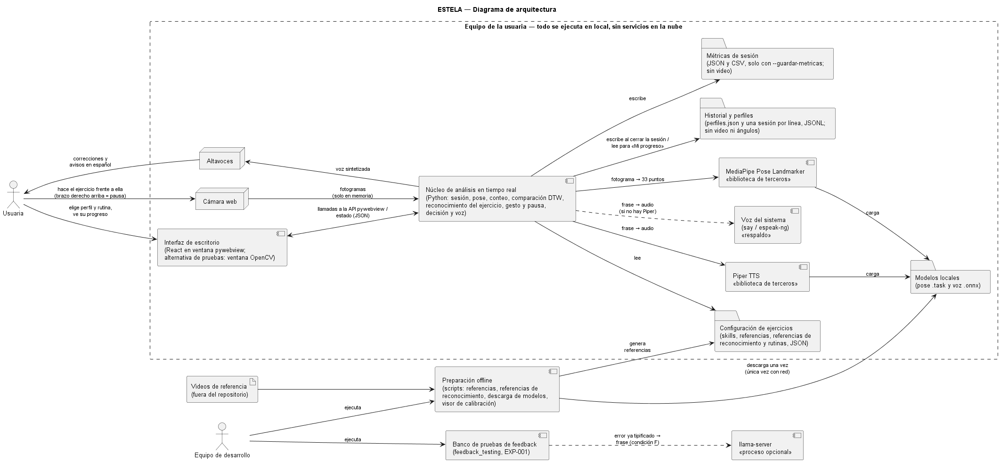
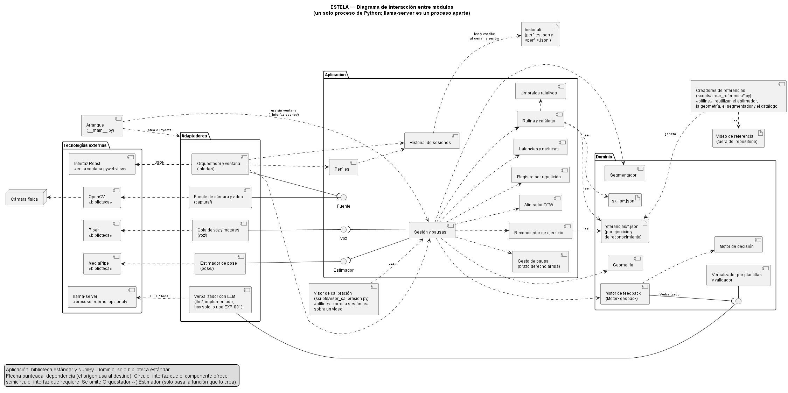
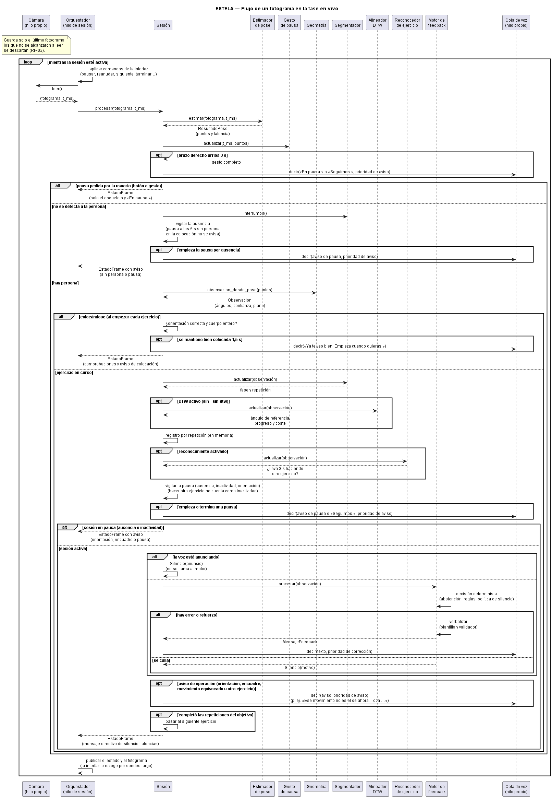
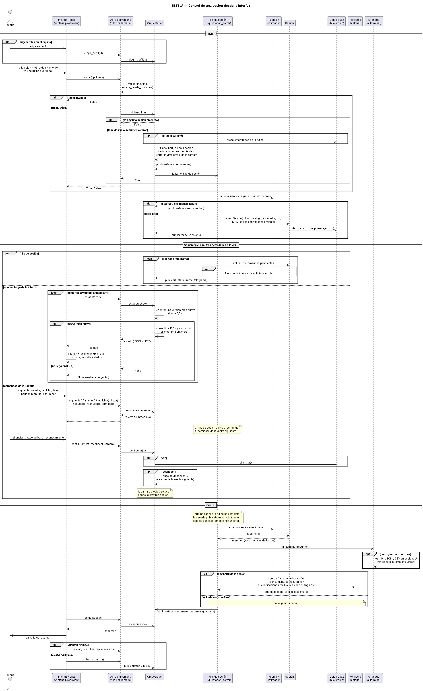
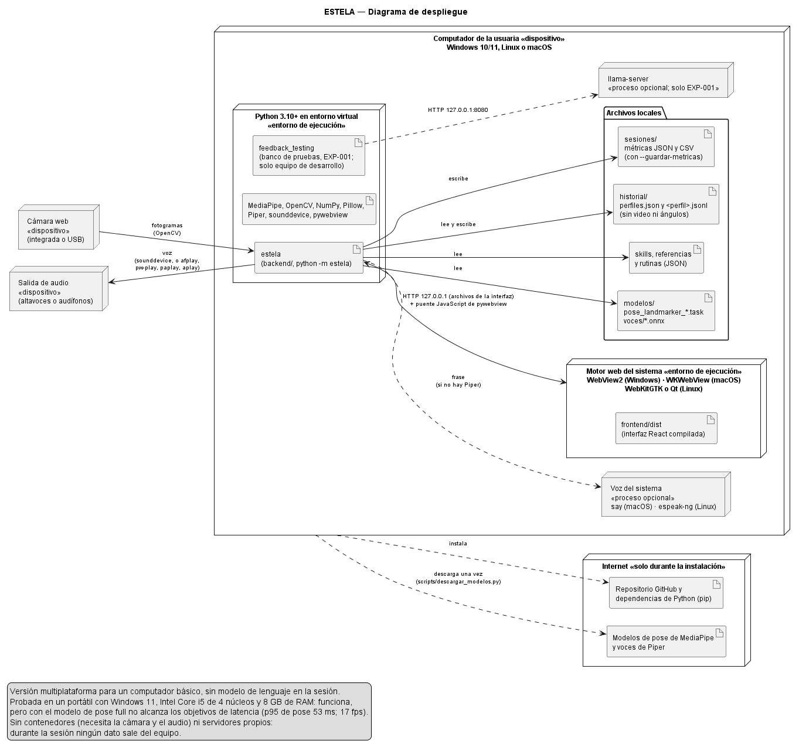

# ESTELA — Informe final

**Proyecto final · Ingeniería de Sistemas · Universidad del Norte · periodo 202630**

**Estudiantes:** Isabella Arrieta Juliao · Natalia Carpintero Leal · Paula Núñez Zarante
**Tutores:** Ph.D. Margarita Gamarra · Augusto Salazar Silva

> **Nota para el equipo.** Los recuadros marcados como **[ESPACIO PARA COMPLETAR]** reservan el lugar de resultados que el equipo debe incorporar: las sesiones con participantes, las mediciones en el Mac Studio y la mejora de voz en curso. Las cifras que ya aparecen en el texto son las medidas hasta ahora y se indica en qué equipo y con qué datos se obtuvieron.

## Resumen / Abstract

Muchas personas hacen ejercicio por su cuenta, siguiendo videos o rutinas aprendidas, sin nadie que observe si lo están haciendo bien. Los videos no ven a quien los sigue, las aplicaciones de conteo dicen cuántas repeticiones se hicieron pero no cómo, y los productos que sí analizan la técnica suelen requerir hardware propio, pertenecen al área clínica o no explican dónde procesan la imagen.

ESTELA es una aplicación de escritorio que usa una sola cámara para observar a una persona mientras realiza una rutina de calentamiento de cuatro ejercicios: *jumping jacks*, abducción de cadera de pie, zancada atrás estática y plancha sobre antebrazos. Mientras la persona se mueve, la aplicación le da indicaciones habladas en español sobre su técnica. Todo el procesamiento ocurre en el computador de la persona y el video no se guarda.

Para lograrlo, ESTELA identifica puntos del cuerpo en cada imagen, calcula ángulos y distancias, cuenta las repeticiones y compara cada repetición con una ejecución de referencia. Un motor de reglas decide si hay un error que vale la pena comunicar o si es mejor no hablar, por ejemplo cuando la cámara no ve bien la parte del cuerpo que habría que corregir. Después, una frase redactada de antemano se convierte en voz con un sintetizador local. La información de cada ejercicio vive en archivos de configuración, lo que permitió cambiar la marcha por la zancada sin modificar el núcleo del sistema. La versión final añade perfiles locales con historial de sesiones, que guardan solo datos de actividad y nunca imágenes ni medidas del cuerpo.

El proyecto se desarrolló de forma iterativa, registrando las decisiones de diseño y resolviendo las dudas técnicas con experimentos definidos antes de medir. En pruebas sobre un banco de casos sintéticos, el motor no nombró nunca una parte del cuerpo distinta de la detectada y no corrigió ejecuciones correctas. En un portátil de bajo consumo, la estimación de pose cumplió el tiempo objetivo de 33 ms. Los dos problemas de latencia encontrados, en la comparación con la referencia y en la cola de voz, tenían causas identificadas que se corrigieron. Los resultados de las sesiones con participantes y de la medición en el equipo final se presentan en la sección 14.

> **[ESPACIO PARA COMPLETAR]** Una o dos oraciones con los resultados principales de las sesiones con participantes y de la medición en el Mac Studio, cuando estén disponibles.

## 1. Introducción

La actividad física regular es importante para la salud, pero una parte considerable de la población adulta no alcanza los niveles recomendados. La Organización Mundial de la Salud estima que el 31 % de los adultos del mundo, cerca de 1 800 millones de personas, no realiza suficiente actividad física, y que la cifra podría llegar al 35 % en 2030 [1]. En Colombia, la prevalencia de actividad física insuficiente en adultos pasó del 24,8 % en 2000 al 34,5 % en 2022 [2].

Ante este panorama, la tecnología para el ejercicio ha pasado de ofrecer solo contenidos y rutinas a acompañar a la persona mientras se ejercita. Este cambio es posible porque hoy existen técnicas de estimación de pose que funcionan en tiempo real con una cámara común y un computador de uso general [12], [14], y motores de síntesis de voz que no necesitan conexión a internet [32].

Las soluciones disponibles se pueden agrupar en tres familias. Los videos y bibliotecas de rutinas muestran el movimiento, pero no observan a quien lo realiza. Las herramientas de conteo miden ángulos para contar repeticiones, pero no evalúan la técnica [16]. Por último, algunos sistemas sí analizan la ejecución con una cámara, como Kaia Health en rehabilitación [22], [33], o Tempo y Peloton Guide en entrenamiento [20], [23]. En la revisión de la sección 5 no se encontró una solución que combine indicaciones habladas en español durante el ejercicio, procesamiento local y una política explícita para no corregir cuando la medida no es confiable.

El reto de ESTELA no es solo detectar errores, sino decidir cuáles comunicar y en qué momento. La literatura señala dos riesgos. El primero es corregir algo que la cámara no podía ver, lo que produce mensajes bien redactados pero falsos [26], [27]. El segundo es hablar demasiado, lo que en el aprendizaje motor se asocia con que la persona dependa de las indicaciones [3]. Por eso, en ESTELA, callar es una respuesta válida del sistema, y el motivo de cada silencio queda registrado.

Este informe presenta el estado final del prototipo y reúne lo trabajado en los informes 1 y 2. Respecto al Informe 2 hay cuatro cambios principales. Primero, la zancada atrás estática reemplazó a la marcha con elevación de rodillas. Segundo, la aplicación guarda perfiles locales con historial de sesiones. Tercero, cada perfil puede guardar rutinas personalizadas con nombre. Cuarto, la sesión incorporó controles y avisos que respondieron a la evaluación con usuarios del Informe 2.

## 2. Marco conceptual

ESTELA resuelve una cadena de cuatro tareas. Primero debe **percibir** el cuerpo de la persona en la imagen. Luego debe **comparar** su movimiento con una referencia del ejercicio. Después debe **decidir** si alguna diferencia es un error que merece comunicarse. Por último, debe **comunicar** esa decisión en español hablado. Esta sección explica los conceptos necesarios para entender cada tarea.

Las cuatro tareas no tienen la misma dificultad. Percibir el cuerpo es hoy un problema con herramientas disponibles. En cambio, decidir qué corregir y cuándo callar sigue siendo un problema abierto, tanto en visión por computador como en aprendizaje motor. Por eso ESTELA separa estas tareas en módulos independientes que se comunican mediante estructuras de datos bien definidas, a las que en este informe llamamos *contratos*. Gracias a esa separación, el módulo que decide las correcciones se puede probar sin cámara y el estimador de pose se puede cambiar sin tocar la lógica de corrección.

### 2.1 Estimación de pose humana

La estimación de pose consiste en localizar, en una imagen, puntos del cuerpo como hombros, codos, caderas, rodillas y tobillos. A estos puntos se les llama *keypoints* o *landmarks*. ESTELA trabaja con una sola cámara convencional, sin sensores de profundidad ni marcadores en el cuerpo, lo que se conoce como estimación monocular.

El proyecto usa **MediaPipe Pose Landmarker**, un estimador de Google basado en los modelos BlazePose, diseñado para ejecutarse en el propio dispositivo [12], [13], [21]. MediaPipe entrega dos tipos de coordenadas. Las *coordenadas de imagen* indican la posición del punto en la foto. Las *coordenadas de mundo* estiman la posición en metros, con origen en el centro de la cadera. ESTELA prefiere estas últimas porque un ángulo calculado con ellas no cambia si la persona se mueve dentro del encuadre o se acerca a la cámara.

Cada punto viene acompañado de un valor de **visibilidad**, que indica qué tan confiable es su ubicación. Este valor es la base de la decisión de no corregir cuando la cámara no ve bien una articulación (sección 2.7).

Es importante aclarar que el estimador de pose no resuelve el problema de ESTELA por sí solo. Indica dónde están los puntos del cuerpo, pero no dice si el movimiento es correcto ni genera indicaciones. Además, la profundidad que entrega es una estimación hecha desde una sola vista, no una medición real, y por eso su fiabilidad depende de la orientación de la persona (sección 2.3).

### 2.2 Ángulos articulares y medidas normalizadas

Las coordenadas de los puntos no sirven para comparar a dos personas, porque dependen de la estatura, de la longitud de las extremidades y de la distancia a la cámara. Por eso ESTELA transforma los puntos en medidas que describen la forma del movimiento, como hacen otros sistemas de análisis de ejercicio [6], [7], [9].

La medida principal es el **ángulo articular**. Se calcula con tres puntos, por ejemplo cadera, rodilla y tobillo para la rodilla, y no depende del tamaño de la persona ni de su posición en la imagen. ESTELA también usa **distancias normalizadas**, que dividen una distancia entre una longitud del propio cuerpo. Por ejemplo, la separación de los pies en los *jumping jacks* se divide entre el ancho de los hombros, y la longitud del paso en la zancada se divide entre el largo de la pierna. Así, ninguna medida se expresa en píxeles ni en metros.

Cada medida tiene un nombre fijo, como `rodilla_izq` o `tronco_inclinacion`, que no depende del estimador. Este vocabulario cerrado permite que el sistema rechace cualquier mensaje que mencione una parte del cuerpo que no está en la lista, lo que protege frente al tipo de error descrito en la sección 2.7.

### 2.3 Planos del cuerpo y qué puede ver una sola cámara

La anatomía describe el movimiento sobre tres planos. El **plano sagital** divide el cuerpo en izquierda y derecha, y contiene los movimientos de flexión y extensión, como doblar la rodilla en una zancada. Se observa bien de perfil. El **plano frontal** divide el cuerpo en parte delantera y trasera, y contiene los movimientos laterales, como separar la pierna en la abducción de cadera. Se observa bien de frente. El **plano transversal** es horizontal y contiene las rotaciones, que una sola cámara no puede medir con fiabilidad porque dependen de la profundidad.

De aquí surge el concepto de **observabilidad monocular**: no todas las medidas se pueden obtener con una cámara desde cualquier posición. Una medida del plano frontal vista de perfil, o una del plano sagital vista de frente, puede tener un error tan grande como el propio umbral de corrección (sección 14.2).

Por eso, en ESTELA, la orientación de la persona es parte del diseño. Cada ejercicio indica si debe hacerse de frente o de perfil, y cada regla indica en qué plano se puede observar. Si la persona no está en la orientación correcta, el sistema no evalúa esa regla. Prefiere callar antes que afirmar algo que no puede ver.

### 2.4 Comparación con una referencia: Dynamic Time Warping

Para saber si un movimiento se parece al de referencia no basta con comparar imagen por imagen. La persona no se mueve a la misma velocidad que el video de referencia, no empieza en el mismo instante y puede bajar despacio y subir rápido. Una comparación directa mostraría diferencias que no son errores de técnica, sino de ritmo.

ESTELA usa **Dynamic Time Warping (DTW)** para resolver esto. Es una técnica creada originalmente para el reconocimiento de voz [15] que permite comparar dos movimientos aunque se realicen a velocidades diferentes. DTW encuentra qué momento del movimiento de la persona corresponde a qué momento de la referencia y entrega además un costo que resume qué tan distintos son. Con esa correspondencia, el sistema puede preguntarse, por ejemplo, qué ángulo de rodilla tenía la persona en el instante en que la referencia estaba en el punto más bajo. DTW ya se ha usado en otros sistemas de análisis de ejercicio [7], [9].

DTW se diseñó para secuencias completas, pero durante una sesión el movimiento llega imagen por imagen. Por eso ESTELA compara solo la repetición en curso y necesita saber dónde empieza y termina cada repetición, y en qué **fase** está la persona (por ejemplo, bajando, en el punto más bajo o subiendo). Esto también importa para las reglas: muchas solo tienen sentido en una fase del movimiento.

### 2.5 Reglas, umbrales y severidad

Con las medidas de la persona y las de la referencia, falta decidir qué diferencia se considera un error. ESTELA lo hace con **reglas**. Una regla relaciona una medida con una condición y un **umbral**. Por ejemplo, en los *jumping jacks*, si el ángulo máximo de los hombros en una repetición es menor de 100°, la regla identifica el error «brazos que no llegan arriba». Las reglas están en los archivos de configuración de cada ejercicio, no en el código del motor.

Elegir el umbral es un problema abierto. En AIFit, un sistema de referencia en este campo, el umbral es un valor global ajustado a mano [6]. En la literatura de aprendizaje motor aparece el mismo problema con el nombre de *bandwidth feedback*: corregir solo cuando el error supera un margen de tolerancia, sin una forma establecida de fijar ese margen [3]. Por esta razón, los umbrales de ESTELA son provisionales y deben calibrarse con datos reales.

Cada error tiene además una **severidad** (leve, moderada o alta) que depende de cuánto se supera el umbral y cambia la forma del mensaje. Si varias reglas se activan a la vez, el sistema elige solo una según una prioridad única por ejercicio. Así, ante la misma secuencia de datos, el sistema toma siempre las mismas decisiones, una propiedad que llamamos **determinismo**.

### 2.6 Retroalimentación durante el ejercicio: qué decir y cuándo callar

En aprendizaje motor, la **retroalimentación aumentada** es la información sobre el movimiento que la persona recibe de una fuente externa, como un entrenador o una aplicación. Puede referirse al resultado (cuántas repeticiones se completaron) o a la ejecución (cómo se hizo el movimiento). ESTELA se enfoca en la ejecución, que es justamente lo que no ofrecen las aplicaciones de conteo. La revisión de Sigrist et al. es la referencia principal del proyecto sobre este tema [3].

El momento también importa. La retroalimentación **concurrente** se da durante el movimiento y la **terminal**, al terminarlo. ESTELA busca la concurrente, porque el problema es que la persona no recibe correcciones mientras se mueve. Sin embargo, la literatura advierte que corregir todo el tiempo puede generar dependencia: la persona deja de prestar atención a sus propias sensaciones y rinde peor cuando la ayuda desaparece. Esto se conoce como *hipótesis de la guía*, y por eso se recomienda reducir la frecuencia de las indicaciones a medida que la persona mejora [3].

A partir de estas ideas, ESTELA define una **política de silencio**. El silencio no es la ausencia de respuesta, sino una respuesta con un motivo registrado. La política incluye un tiempo mínimo entre mensajes, un tiempo mayor antes de repetir el mismo error, la exigencia de ver el error en varias repeticiones seguidas antes de hablar, un intervalo que crece cada vez que se repite un mensaje, un máximo de repeticiones del mismo mensaje y la opción de silenciar fases enteras del movimiento.

### 2.7 Confianza, abstención y fallo silencioso

El error más peligroso de un sistema de este tipo no es un mensaje mal redactado. Es un mensaje bien redactado, que nombra la parte del cuerpo y el lado de forma convincente, pero basado en una medida que la cámara no podía ver. A este caso lo llamamos **fallo silencioso**, porque ninguna revisión del texto lo detecta. La literatura lo documenta en sistemas basados en modelos de lenguaje, que a veces confunden la parte del cuerpo [26] o tienen dificultades para distinguir izquierda y derecha [27].

ESTELA se defiende con un principio sencillo: antes de preguntar si una medida está mal, pregunta si la puede ver. Para eso usa dos señales. La primera es la **confianza** de cada medida, que se calcula como la visibilidad más baja entre los puntos que intervienen. Por ejemplo, si el tobillo está tapado, el ángulo de la rodilla no tiene confianza intermedia: no es válido. La segunda señal es la orientación de la persona respecto a la cámara (sección 2.3).

Si alguna de las dos falla, el motor se **abstiene**: no corrige y registra el motivo. Estos motivos sirven además como indicador de la calidad de la captura. Muchos silencios por orientación indican que la cámara está mal ubicada, y muchos por baja confianza indican oclusiones o mala iluminación.

### 2.8 Cómo se genera el mensaje

Hay varias formas de convertir un error detectado en una frase. Se pueden usar reglas y plantillas redactadas de antemano, un clasificador entrenado, un modelo de lenguaje, un modelo multimodal que mira directamente las imágenes, o un enfoque híbrido que separa la detección del error de su redacción [6], [26], [29], [30].

Dos hallazgos de la literatura orientaron la decisión de ESTELA. El primero es que la calidad del mensaje depende más de detectar bien el error que del tamaño del modelo de lenguaje: un modelo pequeño con una buena detección supera a uno mucho mayor que no la tiene [26]. El segundo es que los modelos multimodales de uso general todavía no son confiables para analizar posturas finas [27], [28]. Además, un modelo entrenado solo con ejemplos de errores tiende a señalar errores en ejecuciones correctas, lo que se conoce como **sobrecorrección** [26].

Por eso ESTELA separa las dos tareas. El **motor de decisión** determina el error, el lado, la parte del cuerpo y la severidad. El **verbalizador** solo convierte esa información en una frase y no tiene acceso a los ángulos ni a las imágenes, de modo que no puede inventar un error. El verbalizador principal usa plantillas en español. Como alternativa opcional, el proyecto implementó un verbalizador con un modelo de lenguaje local cuya salida está restringida por una gramática [31] y revisada por un validador. Si el mensaje del modelo no pasa la validación, el sistema usa la plantilla.

### 2.9 Voz, latencia y procesamiento local

La **síntesis de voz** (*text-to-speech*, TTS) convierte el mensaje en audio. ESTELA usa **Piper**, un motor que funciona sin conexión y tiene voces en español [32]; la voz elegida, `es_MX-claude-high`, declara licencia Apache-2.0. Piper reemplazó al candidato del Informe 1 [18], cuyo soporte de español era limitado. Para no retrasar las correcciones, la aplicación sintetiza todas las frases posibles al iniciar la sesión, y durante el ejercicio solo reproduce audio ya generado.

La **latencia** es el tiempo que tarda el sistema en responder. En ESTELA es una condición de validez: si una corrección llega cuando la repetición ya terminó, deja de ser concurrente. Por eso se mide por etapas y se reportan percentiles, no solo promedios. El percentil 95 (p95) indica el tiempo que no se supera en el 95 % de los casos y describe mejor los retrasos que la persona percibe. Como referencia para los tiempos de respuesta se usaron los límites clásicos de usabilidad [4].

El **procesamiento local** tiene dos justificaciones. Desde lo técnico, elimina la latencia y la variabilidad de la red. Desde lo legal, la Ley 1581 de 2012 clasifica los datos biométricos como datos sensibles [5], y procesar el video en el equipo sin enviarlo ni guardarlo reduce su exposición.

### 2.10 La *skill*: la configuración de cada ejercicio

Todo lo que ESTELA sabe sobre un ejercicio está en un archivo de configuración que el proyecto llama *skill*. Contiene las fases del movimiento, la orientación esperada, las medidas necesarias, la política de silencio y las reglas con sus umbrales, severidades, planos, partes del cuerpo, lados y prioridades. La idea es que **añadir un ejercicio sea añadir un archivo**, sin modificar el motor.

Como los umbrales están en estos archivos, cada uno puede indicar de dónde salió su valor: de una calibración, de una fuente bibliográfica, de la revisión de la especialista o de una estimación provisional. El cargador de *skills* revisa el archivo al iniciar y se detiene con un error si encuentra un valor desconocido o dos reglas con la misma prioridad. Así se evita ejecutar un ejercicio mal definido.

### 2.11 Glosario

| Término | Significado en ESTELA |
| --- | --- |
| *Keypoint* o *landmark* | Punto del cuerpo localizado por el estimador de pose en cada imagen. |
| Visibilidad | Valor que indica qué tan confiable es la ubicación de un punto. |
| Confianza de una medida | Visibilidad más baja entre los puntos que forman la medida. Si falta, se toma como cero. |
| Ángulo articular | Ángulo entre dos segmentos del cuerpo que comparten una articulación. |
| Distancia normalizada | Distancia dividida entre una longitud del propio cuerpo. |
| Planos frontal, sagital y transversal | Planos del cuerpo que determinan desde qué orientación se puede observar una medida. |
| Observabilidad monocular | Posibilidad de medir algo con fiabilidad usando una sola cámara en una orientación dada. |
| DTW | Técnica que compara dos movimientos aunque tengan velocidades distintas [15]. |
| Fase | Tramo del movimiento, como bajar, punto más bajo o subir. |
| Regla y umbral | Condición sobre una medida y valor a partir del cual se considera error. |
| Severidad | Nivel del error (leve, moderada o alta). |
| Error tipificado | Resultado del motor: error, parte del cuerpo, lado, severidad, fase y repetición. |
| Retroalimentación concurrente o terminal | Indicación durante el movimiento o al terminarlo. |
| Política de silencio | Reglas que deciden cuándo el sistema no habla. |
| Abstención | Decisión de no evaluar una regla por baja confianza u orientación incorrecta. |
| Fallo silencioso | Mensaje bien redactado pero basado en una medida que la cámara no veía. |
| Sobrecorrección | Señalar un error en una ejecución correcta [26]. |
| Verbalizador | Módulo que convierte el error en una frase, sin ver ángulos ni imágenes. |
| *Skill* | Archivo con toda la configuración de un ejercicio. |
| Determinismo | Las mismas entradas producen siempre las mismas decisiones. |
| p95 | Valor que no se supera en el 95 % de las mediciones. |
| Perfil local | Nombre, color, meta semanal y rutinas de una persona, guardados solo en el equipo. |
| Historial de sesiones | Registro por sesión de fecha, objetivo, repeticiones, duración, pausas e indicaciones dichas, sin datos del cuerpo. |
| Aviso de operación | Mensaje de la sesión (colocación, encuadre, pausa) que no evalúa la técnica. |

## 3. Planteamiento del problema

### 3.1 Descripción del problema

Cuando una persona sin experiencia hace ejercicio por su cuenta, no tiene cómo saber si su postura, su alineación o la amplitud de sus movimientos son correctas. Quien sigue un video en casa o repite una rutina de memoria puede cometer errores sin notarlos, y por eso tampoco sabe qué debería ajustar.

El problema tiene tres causas. La primera es que no hay nadie que observe el movimiento y lo compare con una ejecución correcta. La segunda es que la mayoría del contenido digital de ejercicio funciona en un solo sentido: muestra cómo hacer el movimiento, pero no recibe información sobre cómo lo está haciendo la persona. La tercera es la demora. Incluso si la persona se graba para revisar después, la corrección llega cuando el movimiento ya terminó, y tanto el momento como la forma de la retroalimentación influyen en el aprendizaje motor [3].

El problema afecta principalmente a adultos que empiezan a hacer ejercicio sin acompañamiento profesional, en un rango aproximado de 18 a 40 años. La relevancia de esta población se apoya en la alta prevalencia de actividad física insuficiente en Colombia, del 34,5 % en 2022 [2]. La consecuencia es que la persona pierde oportunidades de corregirse mientras se mueve y repite los mismos errores sin que nadie los señale.

Desde el punto de vista técnico, el problema no es trivial. Un estimador de pose indica dónde están las articulaciones, pero no dice si el movimiento es correcto, no lo compara con una referencia y no genera indicaciones [13], [14]. Construir esas etapas, y hacerlo sin corregir sobre medidas que la cámara no puede ver, es el núcleo de este proyecto.

### 3.2 Restricciones y supuestos de diseño

Las restricciones del proyecto se mantienen desde el Informe 1. En la versión final cambiaron dos: ahora varias personas pueden usar el mismo equipo con su propio perfil, y la aplicación guarda un historial de actividad por perfil.

| Restricción | Descripción |
| --- | --- |
| Tiempo y equipo | Un semestre académico (periodo 202630), con entrega final en la semana 16. Tres estudiantes con dedicación parcial. Por eso se priorizó tener pocos ejercicios bien resueltos y medidos. |
| Hardware | El equipo de validación es un Mac Studio con M2 Ultra y 128 GB de memoria [19]. Durante el desarrollo, cada integrante midió en su propio portátil, y esas cifras se presentan como preliminares. |
| Procesamiento local | Toda la inferencia ocurre en el equipo. Durante la sesión no se envía ninguna imagen ni dato del cuerpo a servicios externos. La red solo se usa para instalar dependencias y descargar modelos. |
| Cámara | Una sola cámara convencional. |
| Personas | Una persona frente a la cámara en cada sesión. Varias personas pueden turnarse en el mismo computador, cada una con su perfil. Los perfiles no tienen contraseña y la aplicación lo advierte. |
| Orientación | Cada ejercicio se hace de frente o de perfil, según los errores que se quieren observar. |
| Datos | El video no se guarda. Si la persona eligió un perfil, se guarda en el equipo un historial con fecha, objetivo, repeticiones, duración, pausas e indicaciones recibidas, nunca imágenes ni medidas del cuerpo. Toda grabación de personas para referencias o pruebas requiere consentimiento informado (Ley 1581 de 2012 [5]) y no se sube al repositorio. |
| Latencia | Objetivos medibles definidos en la sección 4: pose en ≤ 33 ms (p95), al menos 25 imágenes por segundo y voz en ≤ 1 s desde la detección (p95). |
| Responsabilidad | ESTELA no hace diagnósticos médicos ni fisioterapéuticos, no reemplaza a un instructor y sus mensajes no deben sugerir lo contrario. El panel de progreso tampoco evalúa la salud. |

El proyecto parte de tres supuestos:

1. **Hay una referencia utilizable para cada ejercicio.** El sistema usa seis referencias procesadas antes de la sesión: *jumping jacks*, abducción izquierda y derecha, zancada izquierda y derecha, y plancha. Las de la zancada provienen de videos grabados por el equipo a personas que dieron su autorización. Las demás provienen de videos públicos, que no indican una licencia explícita; la de abducción, además, está grabada a 18 imágenes por segundo y la persona usa una banda elástica, lo que no afecta la medida de la pierna.
2. **La técnica se puede describir con reglas sobre ángulos y distancias.** Los criterios fueron revisados por una especialista en educación física. Los valores numéricos de los umbrales siguen siendo provisionales hasta calibrarlos con datos.
3. **Es posible validar con participantes.** Se previó trabajar con cinco personas de la población objetivo realizando la rutina completa en un entorno controlado.

Las sesiones se diseñaron para las siguientes condiciones de uso:

| Condición | Valor de referencia | Motivo |
| --- | --- | --- |
| Distancia a la cámara | 2,0 m a 3,5 m | El cuerpo completo debe verse en la imagen. |
| Iluminación | 150 a 300 lux, luz difusa o frontal | Las sombras fuertes y el contraluz reducen la visibilidad de los puntos. |
| Ropa | Ajustada y con contraste respecto al fondo | La ropa holgada tapa caderas, rodillas y tobillos. |
| Personas en la imagen | Una, con el cuerpo completo visible | El prototipo analiza una sola persona. |
| Ruido ambiental | Menos de 55 dBA | La persona debe poder oír las indicaciones. |

### 3.3 Alcance

**El proyecto incluye:**

- Una aplicación de escritorio para una persona por sesión, dirigida a adultos que se inician en el ejercicio, con todo el procesamiento en el equipo.
- Cuatro ejercicios, cada uno con su orientación: *jumping jacks* (de frente), abducción de cadera de pie con una serie por pierna (de frente), zancada atrás estática con una serie por pierna (de perfil) y plancha sobre antebrazos (de perfil).
- La detección de un catálogo cerrado de dieciocho tipos de error de técnica (sección 4.3), con la opción de no corregir cuando la medida no es confiable.
- Indicaciones habladas en español durante el ejercicio, avisos de colocación y pausa, y mensajes de felicitación solo cuando todo lo que se pudo revisar estaba bien.
- Una interfaz con selección de perfil, elección o personalización de la rutina, la sesión en vivo con una guía visual animada y un resumen final.
- Perfiles locales con historial y un panel «Mi progreso», que se pueden borrar desde la aplicación.
- La medición del sistema como parte del trabajo: tiempos por etapa, imágenes por segundo, motivos de silencio y, con datos anotados, precisión y recobrado.
- La validación con participantes en un entorno controlado.

**El proyecto no incluye:**

- Diagnóstico médico, fisioterapia ni rehabilitación, ni una puntuación de la técnica en el panel de progreso.
- Otros ejercicios. La sentadilla, la rotación de tronco, la elevación de brazos y la marcha con elevación de rodillas quedaron retiradas, aunque su configuración se conserva.
- Varias personas frente a la cámara al mismo tiempo, varias cámaras, versión web o móvil, contraseñas o sincronización de perfiles entre equipos.
- Datos del cuerpo en el perfil, como edad, peso, estatura o foto.
- Servicios en la nube durante la sesión.
- Un modelo de lenguaje o multimodal que decida qué error ocurrió o si se debe hablar.
- La selección automática del ejercicio. El ejercicio lo define la rutina; el reconocedor de la sección 10 solo emite un aviso opcional.

## 4. Objetivos

### 4.1 Objetivo general

Diseñar, implementar y validar en un entorno controlado un prototipo de escritorio con procesamiento local que, con una sola cámara, analice la ejecución de cuatro ejercicios (*jumping jacks*, abducción de cadera, zancada atrás estática y plancha) y entregue retroalimentación visual y hablada en español durante su práctica, evaluando su viabilidad con métricas de desempeño técnico y de latencia.

### 4.2 Objetivos específicos

- **OE1.** Procesar la estimación de pose en tiempo real, con al menos 25 imágenes por segundo y un tiempo de estimación de pose de p95 ≤ 33 ms, midiendo el tiempo de cada etapa del sistema.
- **OE2.** Detectar las desviaciones de técnica del catálogo base de los cuatro ejercicios (sección 4.3) con una precisión de al menos 0,80 y un recobrado de al menos 0,70 por ejercicio, frente a la anotación de referencia.
- **OE3.** Implementar reglas de abstención y control de la sobrecorrección que logren 0 % de mensajes no respaldados por la medida y como máximo 10 % de sobrecorrección.
- **OE4.** Generar indicaciones habladas en español que acierten el error, el lado y la parte del cuerpo en al menos el 90 % de los casos, con un tiempo p95 ≤ 1 s entre la detección y el inicio de la voz.
- **OE5.** Desarrollar una guía visual animada (tipo *stick figure*) a partir de las referencias de movimiento, para acompañar los cuatro ejercicios en la interfaz.

Las metas numéricas son las mismas del Informe 2. Lo que cambió es el conjunto de errores del OE2, porque la marcha fue reemplazada por la zancada.

### 4.3 Errores evaluados por ejercicio

El catálogo final tiene **dieciocho tipos de error**, que se aplican mediante **veintinueve reglas** en seis archivos de configuración. La abducción y la zancada tienen un archivo por pierna, y algunos errores se revisan por separado en cada lado. Los criterios provienen de la revisión de la especialista en educación física. Los umbrales son los que usa el código actualmente y siguen siendo provisionales.

| Ejercicio y vista | Error | Cómo se mide | Catálogo |
| --- | --- | --- | --- |
| *Jumping jacks* (de frente) | Brazos que no llegan arriba | Ángulo máximo de los hombros en la repetición menor de 100° | Base |
|  | Apertura de pies insuficiente | Separación de los tobillos entre ancho de hombros menor de 0,9 | Base |
|  | Codos doblados | Ángulo del codo durante la apertura menor de 90° | Base |
|  | Sin salto | La cadera sube menos de 0,20 veces la longitud del tronco | Añadido |
| Abducción de cadera, por pierna (de frente) | Abducción insuficiente | Separación máxima de la pierna menor de 16°; no se dice si hay compensación | Base |
|  | Tronco inclinado al lado contrario | Inclinación lateral del tronco mayor de 8° | Base |
|  | Cadera que sube | Inclinación de la pelvis mayor de 6° | Base |
| Zancada atrás estática, por pierna (de perfil) | Tronco muy inclinado | Inclinación del tronco mayor de 30° al bajar | Base |
|  | Profundidad insuficiente | Ángulo mínimo de la rodilla visible mayor de 125° | Base |
|  | Paso corto | Distancia entre tobillos entre largo de la pierna menor de 0,4 | Base |
|  | Paso largo | La misma medida mayor de 1,4 | Base |
| Plancha sobre antebrazos (de perfil) | Cadera hundida | La cadera cae por debajo de la línea hombro–tobillo (> 0,07) | Base |
|  | Cadera elevada | La cadera sube por encima de esa línea (< −0,15) | Base |
|  | Hombros adelantados | Hombros por delante de los codos (> 0,20) | Base |
|  | Hombros retrasados | Hombros por detrás de los codos (< −0,20) | Base |
|  | Cabeza desalineada | Ángulo entre el tronco y el cuello mayor de 30° | Base |
|  | Codo lejos de 90° | Ángulo del codo visible fuera de 75°–105° | Añadido |
|  | Rodilla doblada | Ángulo de la rodilla visible menor de 165° | Añadido |

Los errores marcados como «base» son los que forman parte del OE2. El Informe 2 había comprometido trece errores, dos de ellos de la marcha. Al retirar la marcha salieron esos dos y entraron los cuatro de la zancada, de modo que el catálogo base queda en quince. Los tres «añadidos» se implementaron después, con umbrales provisionales y sin metas de precisión.

> **[ESPACIO PARA COMPLETAR]** Confirmación del equipo de que el catálogo base de quince errores es la referencia del OE2.

**Por qué se cambió la marcha por la zancada.** En las pruebas del equipo, la marcha con elevación de rodillas, que se graba de perfil, no captaba bien las piernas: al estar una pierna delante de la otra, el estimador confundía la izquierda con la derecha. Ese error afecta directamente a reglas que dependen del lado, como «rodilla izquierda baja». La zancada también se hace de perfil, pero sus errores principales (profundidad, inclinación del tronco y longitud del paso) se pueden medir con la pierna que la cámara ve mejor y con los dos tobillos, sin depender de distinguir cuál rodilla sube en cada momento.

**Cómo se mide la zancada.** La profundidad se mide en la rodilla que ve la cámara, sea la de adelante o la de atrás. Si el paso es demasiado corto o demasiado largo, el sistema no corrige la profundidad, porque en ese caso la causa del problema es el paso. Los umbrales se ajustaron siguiendo dos criterios de la especialista: no exigir 90° a todas las personas y no imponer una distancia fija de paso. Antes del ajuste, el límite de profundidad era 110° y el rango de paso, de 0,6 a 1,2.

Quedan fuera del alcance los criterios de dinámica compleja, como la pérdida de equilibrio o el ritmo, y la rodilla que se va hacia adentro en la zancada, que solo se puede ver de frente.

## 5. Estado del arte / soluciones relacionadas

### 5.1 Criterio de la revisión

Se revisaron veinte fuentes académicas y técnicas, entre productos comerciales, sistemas basados en reglas o en comparación con una referencia, y modelos de lenguaje y multimodales. Cada una se comparó con cuatro características de ESTELA: procesamiento local, retroalimentación durante el ejercicio, voz en español y una política explícita para no corregir cuando la medida no es confiable. Se usaron fuentes primarias, como artículos revisados por pares, *preprints* y documentación oficial. No se compararon cifras entre fuentes, porque cada una usa tareas, datos y equipos distintos.

### 5.2 Productos comerciales

**Kaia Health (Motion Coach)** es el antecedente comercial más cercano. Según un estudio publicado en el *Journal of Medical Internet Research*, usa la cámara frontal del teléfono, estima la pose en el dispositivo sin que el video salga de él y da indicaciones de audio y visuales en tiempo real, priorizadas según el riesgo de lesión [33]. En una prueba con 24 pacientes, el acuerdo entre la aplicación y fisioterapeutas fue de κ = 0,726 [33]. Sin embargo, está orientado a la rehabilitación clínica y el estudio no reporta tiempos de respuesta ni un mecanismo para dejar de corregir cuando la imagen no es confiable.

**Tempo** combina un sensor 3D con modelos de inteligencia artificial. Según su documentación, sus indicaciones aparecen en pantalla de forma intermitente, con más frecuencia cuando la persona es nueva en el ejercicio o muestra fatiga [24]. Esa idea se parece a la política de silencio de ESTELA. La documentación consultada no indica dónde se procesa la imagen ni describe indicaciones habladas, y no se encontró una evaluación independiente.

**Peloton Guide** se presentó en 2021 como una cámara con inteligencia artificial que se conecta al televisor y recomienda clases, con la opción de cubrir la cámara y apagar el micrófono [20]. No se publican detalles sobre cómo procesa la imagen ni evaluaciones independientes de su retroalimentación.

En conjunto, estos productos muestran que analizar el ejercicio con una cámara ya es una práctica establecida. Sin embargo, solo Kaia tiene una evaluación revisada por pares, y ninguno publica tiempos de respuesta de extremo a extremo ni una política para no corregir.

### 5.3 Sistemas académicos basados en reglas o en una referencia

**Pose Trainer** usa estimación de pose, geometría y DTW para comparar la ejecución con ejemplos, y reporta valores de F1 entre 0,73 y 1,00 en cuatro ejercicios; requiere un equipo con GPU [7]. **Yeh y Yang** combinan OpenPose, reglas y DTW, con cinco niveles de retroalimentación, y reportan 99,9 % en posturas estáticas y 99,0 % en movimientos dinámicos, ejecutándose en una NVIDIA Jetson Nano con cámara web, aunque con pocos datos de prueba y sensibilidad al fondo y al ángulo de la cámara [9]. Ambos son antecedentes directos del uso de DTW en ESTELA, pero miden si clasifican bien, no si el mensaje es correcto ni si llega a tiempo.

**OffiStretch** compara la pose de la persona con una pose objetivo en ejercicios de estiramiento y muestra la retroalimentación como un espejo aumentado. En su estudio, el desempeño fue similar con y sin retroalimentación, aunque esta aumentó la motivación, y los fisioterapeutas consideraron que debía mejorar [34]. Este resultado muestra que mostrar correcciones no garantiza que la persona mejore, y justifica que ESTELA mida si lo que dice es correcto.

**SiTrEx** compara secuencias de puntos con una referencia mediante una red neuronal y entrega indicadores de similitud por articulación, con una exactitud de 94,4 ± 0,8 %; no indica si funciona en tiempo real [36]. **Khadtare et al.** usan MediaPipe y OpenCV para corregir sentadillas y planchas, pero no reportan cifras de exactitud ni de tiempo [37]. **AIFit** genera retroalimentación en lenguaje natural a partir de pose 3D, con un umbral global ajustado a mano [6]. Otros trabajos de clasificación y conteo [8], [16], la revisión de Phalke et al. [10] y conjuntos de datos como FLAG3D [11] completan el panorama, pero no corrigen la técnica durante el ejercicio.

En este grupo, la retroalimentación suele ser visual, textual o una puntuación, y la incertidumbre del estimador no se usa como motivo para callar. Solo [9] funciona en un dispositivo de borde y ninguno reporta el tiempo entre la detección y la entrega del mensaje.

### 5.4 Retroalimentación en lenguaje natural y modelos multimodales

**CoachMe** genera instrucciones comparando la ejecución con una referencia. Muestra que un modelo pequeño con una detección estructurada supera a GPT-4o, y documenta dos fallos que ESTELA tomó como requisitos: se equivoca de parte del cuerpo en el 17,2 % de los casos y señala errores en el 30,4 % de las ejecuciones correctas, porque se entrenó solo con instrucciones correctivas [26]. **UbiPhysio** integra comprensión de acciones y retroalimentación en lenguaje natural [29], y **PoseFix** genera correcciones en lenguaje natural entre poses 3D estáticas [30]. Ninguno trabaja en español ni da indicaciones habladas durante el movimiento.

Los **modelos multimodales** de uso general son otra opción, pero la evidencia reciente no los recomienda para corregir en tiempo real. **QEVD** plantea la retroalimentación en vivo como un problema de qué decir y cuándo decirlo, y muestra las limitaciones de estos modelos en esa tarea [28]. **FormCoach** evalúa estos modelos con 1 700 pares de videos anotados por expertos y encuentra diferencias importantes frente a un entrenador humano [35]. **Human-MME** muestra que todos los modelos evaluados tienen dificultades para distinguir izquierda y derecha [27]. Para ESTELA este fallo es crítico: decir «tu rodilla derecha» cuando se trata de la izquierda es un mensaje bien escrito pero falso.

De este grupo se extraen dos conclusiones. La calidad del mensaje depende más de detectar bien el error que del tamaño del modelo [26], y decidir cuándo hablar sigue siendo un problema abierto [28]. Ambas respaldan el diseño de ESTELA: detección con reglas, abstención antes de hablar y, si se usa un modelo de lenguaje, solo para redactar un error ya decidido.

### 5.5 Comparación

La tabla resume lo que cada fuente documenta. «No documentado» significa que la fuente no lo menciona, no que la característica no exista.

| Antecedente | Procesamiento local | Idioma | Momento y forma | Manejo de la incertidumbre | Latencia reportada | Tipo de evidencia |
| --- | --- | --- | --- | --- | --- | --- |
| Kaia Motion Coach [33] | Sí, en el teléfono | No documentado | Durante el ejercicio, audio y visual | No documentado | No | Artículo revisado por pares (n = 24) |
| Tempo [24] | No documentado | No documentado | Durante el ejercicio, visual intermitente | Frecuencia limitada | No | Documentación del fabricante |
| Peloton Guide [20] | No documentado | No documentado | No documentado | No documentado | No | Comunicado del fabricante |
| Pose Trainer [7] | Equipo con GPU | No documentado | No documentado | No | No | Informe técnico |
| Yeh y Yang [9] | Sí, Jetson Nano | No documentado | Niveles de retroalimentación | No | No | Artículo revisado por pares |
| OffiStretch [34] | No documentado | No documentado | Durante el ejercicio, visual | No | No | Artículo con estudio de usuarios |
| SiTrEx [36] | No documentado | — | No documentado | No | No | Artículo revisado por pares |
| AIFit [6] | No documentado | Inglés | No documentado | Umbral ajustado a mano | No | Artículo revisado por pares |
| CoachMe [26] | No documentado | Inglés | Sobre el video ya grabado | No; 30,4 % de sobrecorrección | No | Artículo revisado por pares |
| QEVD [28] | No documentado | Inglés | Durante el ejercicio | Es su objeto de estudio | No comparable | Benchmark revisado por pares |
| FormCoach [35] | No documentado | No documentado | En tiempo real, según el resumen | No | No | Preprint |
| **ESTELA** | Sí, por diseño | Español, por voz | Durante el ejercicio, una corrección a la vez | Sí, con motivo registrado | Objetivo p95 ≤ 1 s | Prototipo validado con banco sintético, video y participantes (sección 14) |

### 5.6 Qué aporta ESTELA

La revisión muestra que existen soluciones locales con retroalimentación en tiempo real, sobre todo en el área clínica. Sin embargo, no se encontró ninguna que combine procesamiento local, indicaciones habladas en español, una política explícita para no corregir cuando la imagen no es confiable y un tiempo de respuesta definido como criterio de aceptación.

Cada una de estas características responde a una necesidad concreta. Las indicaciones deben llegar a tiempo para que sirvan durante el movimiento. El español responde a la población objetivo. El procesamiento local protege datos biométricos sensibles según la Ley 1581 de 2012. Además, separar la detección de la redacción permite evaluar por separado cada una de esas partes. Por estas razones, ESTELA ocupa un espacio que las soluciones revisadas no cubren.

## 6. Solución propuesta

### 6.1 Enfoque general

ESTELA es una aplicación de escritorio que observa a una persona con una cámara mientras realiza una rutina de calentamiento y le da indicaciones habladas en español sobre su técnica. En lugar de usar un único modelo que lo haga todo, la aplicación divide el trabajo en cuatro pasos: percibir el cuerpo, comparar el movimiento con una referencia, decidir si hay algo que corregir y comunicarlo. Cada paso se puede desarrollar, probar y mejorar por separado.

La idea central de la solución es que **solo el motor de reglas decide qué error ocurrió**. El verbalizador, que redacta el mensaje, recibe únicamente el error ya decidido y no puede añadir información propia. Además, el motor prefiere no hablar cuando no está seguro de lo que ve. Esta combinación busca que las indicaciones sean pocas, oportunas y correctas.

Toda la solución se ejecuta en el computador de la persona. Ninguna imagen ni dato del cuerpo sale del equipo, lo que responde tanto a la necesidad de responder rápido como a la protección de los datos biométricos.

### 6.2 Qué se construyó

Al abrir ESTELA, la aplicación pregunta «¿Quién entrena hoy?». La persona puede elegir su perfil, crear uno con su nombre, un color y una meta semanal, o entrenar sin perfil. En este último caso no se guarda nada. Después puede empezar la rutina recomendada, elegir una rutina que haya guardado o armar una nueva escogiendo ejercicios y repeticiones.

Antes de cada ejercicio, la aplicación indica si la persona debe ponerse de frente o de perfil y verifica que su cuerpo completo se vea en la cámara. Durante el ejercicio, la pantalla muestra la imagen de la cámara con el esqueleto detectado, una figura animada que muestra cómo debe hacerse el movimiento, el conteo de repeticiones correctas y con error, y la última indicación, con la parte del cuerpo resaltada. Si el sistema no está evaluando, la pantalla explica por qué. La persona puede pausar con un botón, con la barra espaciadora o levantando el brazo derecho durante tres segundos, y puede pasar al ejercicio siguiente o volver al anterior.

Al terminar, el resumen muestra lo realizado en cada ejercicio y las indicaciones recibidas. Si la persona entrenó con un perfil, la sesión se guarda en su historial y el panel «Mi progreso» muestra su constancia, su avance hacia la meta semanal, el tiempo en movimiento y las indicaciones que más recibió. El panel aclara que estas cifras no miden la técnica ni son una evaluación de salud.

Cada ejercicio está definido en un archivo de configuración (*skill*). El cambio de la marcha por la zancada mostró la utilidad de este diseño: bastó con mover los archivos de configuración, crear las referencias de la zancada y ajustar una medida existente, sin modificar el motor de decisión, el verbalizador ni la voz.

La aplicación también está preparada para seguir funcionando cuando algo falla. Si una articulación queda tapada, el motor deja de evaluar esa regla. Si Piper no está disponible, la voz pasa a la del sistema operativo o a texto en pantalla. Si no hay referencia para un ejercicio, se usan solo las reglas que no dependen de ella. Y si falla el guardado del historial, el resumen se muestra igual.

### 6.3 Usuarios objetivo

La usuaria principal es una persona adulta, aproximadamente entre 18 y 40 años, que empieza a hacer ejercicio por su cuenta sin un instructor. Esta persona sabe qué movimiento debe hacer, pero no tiene forma de saber, mientras lo hace, si lo está haciendo bien. La versión final considera además un caso frecuente en casa: varias personas que comparten el mismo computador y se turnan frente a la cámara, cada una con su perfil.

Existe también un rol técnico, el del equipo de desarrollo, que prepara las referencias y los archivos de configuración de cada ejercicio. Este rol trabaja antes de la sesión y no interviene durante el uso normal.

ESTELA no busca reemplazar a un entrenador ni a una plataforma de rehabilitación. Atiende el espacio intermedio entre no tener ninguna observación y necesitar supervisión profesional.

### 6.4 Propuesta de valor

ESTELA ofrece **indicaciones habladas en español durante el ejercicio, con todo el procesamiento en el computador de la persona**. Esta propuesta se apoya en tres decisiones:

1. **Usar bien los recursos del equipo.** El único modelo pesado que se ejecuta en cada imagen es el estimador de pose; las demás etapas son reglas y cálculos simples.
2. **No depender de internet.** La voz se genera localmente con Piper, y los perfiles y el historial también se guardan en el equipo.
3. **Preferir callar antes que equivocarse.** El sistema no corrige cuando no ve bien una articulación o cuando la persona no está en la orientación adecuada, y registra el motivo.

Como se vio en la sección 5, existen antecedentes clínicos con procesamiento local e indicaciones de audio [33], pero no se encontró uno que combine español, una política explícita de abstención y un tiempo de respuesta medido como criterio de aceptación.

### 6.5 Relación con el problema y el alcance

La solución responde a las tres causas del problema descritas en la sección 3.1. La falta de un observador se cubre con la cámara y el estimador de pose funcionando durante toda la sesión. El contenido que funciona en un solo sentido se reemplaza por un ciclo que observa, compara, decide y responde. La demora se elimina porque las indicaciones se dan mientras ocurre el movimiento.

El historial y el panel de progreso no forman parte de esa respuesta, sino de una necesidad que señalaron los participantes en las pruebas del Informe 2: ver su evolución entre sesiones. Se añadieron sin cambiar el análisis de cada imagen y sin guardar información del cuerpo.

La solución también respeta los límites del alcance. ESTELA no diagnostica, no analiza a varias personas a la vez, no depende de la nube y no puntúa la técnica. Estas exclusiones permitieron concentrar el trabajo en un problema que se pudiera resolver y medir en un semestre.

## 7. Metodología de desarrollo

### 7.1 Enfoque

El proyecto se desarrolló con **prototipado iterativo guiado por evidencia**. Se eligió este enfoque porque había muchas dudas técnicas, como qué se puede medir con una sola cámara o qué tiempos de respuesta son alcanzables, y un plazo fijo de un semestre. Por eso cada decisión importante debía apoyarse en datos y poder cambiarse si aparecía nueva evidencia.

El trabajo se organizó en un tablero Kanban en ClickUp. En el repositorio de GitHub, una regla automática rechaza los *commits* que no incluyen el identificador de su tarea, lo que permite rastrear cada cambio. El código se integró mediante *pull requests* hacia una rama de pruebas llamada `test`.

Las decisiones de diseño se registraron en documentos llamados ADR (*Architecture Decision Records*), que explican el contexto, las alternativas y las consecuencias de cada decisión. El proyecto tiene nueve, del ADR-001 al ADR-009. Las preguntas que necesitaban datos se trataron como experimentos (EXP), con la hipótesis y el criterio de decisión definidos antes de medir, para evitar acomodar las conclusiones a los resultados.

Por último, el sistema se dividió en módulos que se comunican con estructuras de datos bien definidas. Esto permitió que el equipo trabajara en paralelo en la percepción, en el motor de decisión y en la aplicación, y que cada módulo se probara con datos simulados.

### 7.2 Iteraciones

| Iteración y fechas | Qué se construyó o decidió | Cómo se validó | Qué cambió por lo encontrado |
| --- | --- | --- | --- |
| 0 · agosto – 3 sep. | Investigación, Informe 1 y enfoque del módulo de retroalimentación (ADR-001) | Revisión de literatura | Se separó la detección de la redacción y se descartó usar un modelo multimodal para decidir errores [26], [27] |
| 1 · hasta 18 sep. | Contrato de datos del módulo (ADR-002), motor de reglas, plantillas y banco de casos sintéticos | EXP-001 con plantillas y EXP-002 sobre observabilidad | El motor revisa la confianza y la orientación antes de buscar errores; se decidió usar una cámara con orientación por ejercicio |
| 2 · 23–24 sep. | Primera versión de la aplicación completa (ADR-003) | Tiempo de pose en un portátil | El objetivo de 33 ms se fijó para verificarse en el equipo final |
| 3 · 3–5 oct. | Conjunto de ejercicios para una cámara (ADR-005), uso de la referencia y papel del modelo de lenguaje (ADR-004), motor único (ADR-006) | Nueva ejecución de EXP-001 y EXP-008 | Se corrigió un error de la herramienta de medición; se descartó SpinePose; se decidió felicitar solo lo que se pudo comprobar |
| 4 · 6–11 oct. | Catálogo de errores revisado por la especialista, referencias, DTW, interfaz y arquitectura en capas (ADR-007) | Revisión de la especialista | Umbrales de amplitud más permisivos; la zancada se retiró temporalmente por falta de referencia |
| 5 · 12–13 oct. | Herramienta de medición del sistema | Medición sobre 21 videos públicos | Se identificaron el DTW y la cola de voz como causas de retraso |
| 6 · 13–21 oct. | DTW incremental, guía visual animada, selección de ejercicios, reconocedor de ejercicio (EXP-010) | Medición del nuevo DTW sobre diez videos | El tiempo del DTW dejó de crecer con la duración de la repetición |
| 7 · 22 oct. – 6 nov. | Fase de colocación, motivo visible cuando no se evalúa, repeticiones correctas y con error, pausa manual y por gesto, ejercicio anterior, elección de cámara, cambio en la cola de voz | Pruebas automáticas y revisión de la interfaz | Respuesta a los hallazgos de la evaluación con usuarios del Informe 2 |
| 8 · 6–16 nov. | Zancada en lugar de la marcha, perfiles, historial, «Mi progreso» y rutinas guardadas (ADR-008, ADR-009) | Pruebas automáticas; ajuste de umbrales de la zancada con videos | Umbrales de la zancada más permisivos, según los criterios de la especialista |

> **[ESPACIO PARA COMPLETAR]** Fila o filas con las sesiones con participantes, la medición en el Mac Studio y la mejora de voz, con sus fechas.

### 7.3 Validaciones y ajustes

Cuatro tipos de validación guiaron la evolución del prototipo. La primera fue **geométrica**. El experimento EXP-002 mostró que medir un movimiento tridimensional sobre una imagen plana puede producir errores de hasta 79° en un ángulo, según la orientación. Este resultado llevó a elegir ejercicios observables con una cámara, a definir una orientación para cada uno y a crear la regla que suspende la evaluación cuando la persona no está en la posición correcta.

La segunda fue la **revisión técnico-deportiva**. Una especialista en educación física revisó el catálogo de errores y los umbrales. A partir de sus observaciones se dejaron de lado los umbrales estrictos e iguales para todos, y se adoptaron límites mínimos más permisivos. El mismo criterio se aplicó después a la zancada.

La tercera fue la **validación de rendimiento**. La herramienta de medición reprodujo videos a través de la aplicación real y encontró las dos causas de retraso del sistema, que se corrigieron en el código. La cuarta fue la **validación con usuarios**, que orientó la mayoría de los cambios de la interfaz y se presenta en la sección 13.

## 8. Requerimientos

Los requerimientos RF-01 a RF-15 y RNF-01 a RNF-10 vienen del Informe 2 y se actualizaron al catálogo final. Los requerimientos RF-16 a RF-20 y RNF-11 se añadieron con los cambios de la versión final. La sección 13 explica cómo se verificó cada uno.

### 8.1 Funcionales

| ID | El sistema debe… | Cómo se verifica | Prioridad |
| --- | --- | --- | --- |
| RF-01 | Permitir elegir la rutina (recomendada, guardada o personalizada) antes de empezar, sin depender de un reconocimiento automático. | Elección en la interfaz antes de activar la cámara. | Alta |
| RF-02 | Capturar video de una cámara o un archivo y descartar imágenes viejas si el análisis se atrasa. | Medición de imágenes descartadas y retraso acumulado. | Alta |
| RF-03 | Estimar la pose y calcular ángulos y distancias con nombre fijo y confianza. | Pruebas con coordenadas conocidas. | Alta |
| RF-04 | Identificar las fases y contar repeticiones (o segundos en la plancha), distinguiendo las correctas de las que tuvieron error. | Pruebas del segmentador y de la sesión. | Alta |
| RF-05 | Comparar la repetición en curso con la referencia mediante DTW. | Pruebas con DTW activado y desactivado. | Media |
| RF-06 | Evaluar durante el ejercicio los errores del catálogo de los cuatro ejercicios. | Banco sintético y sesiones anotadas. | Alta |
| RF-07 | No corregir cuando la confianza es baja o la orientación no permite ver la medida. | Registro del motivo de silencio. | Alta |
| RF-08 | Controlar la frecuencia de las correcciones (tiempo entre mensajes, evidencia, máximo de repeticiones). | Pruebas de la política de silencio. | Alta |
| RF-09 | Generar indicaciones en español con plantillas, verificando que el lado y la parte del cuerpo coincidan con el error. | Validación automática del mensaje. | Alta |
| RF-10 | Sintetizar la voz con Piper en el equipo, con respaldo a la voz del sistema o a texto. | Prueba de respaldo ante fallo. | Alta |
| RF-11 | Dar avisos de operación (colocación, encuadre, pausa, ejercicio que sigue) separados de las correcciones. | Pruebas de la sesión. | Media |
| RF-12 | Mostrar pantallas de inicio, sesión y resumen, con la indicación actual y el motivo cuando no se evalúa. | Pruebas del contrato con la interfaz. | Alta |
| RF-13 | Mostrar una guía visual animada creada a partir de la referencia de cada ejercicio. | Revisión de la interfaz. | Media |
| RF-14 | Felicitar solo cuando todas las reglas que se pudieron revisar estaban bien. | Banco sintético. | Media |
| RF-15 | No guardar imágenes ni puntos del cuerpo; solo métricas generales. | Revisión de los archivos generados. | Alta |
| RF-16 | Permitir crear, editar, elegir y borrar perfiles locales, y entrenar sin perfil. | Pruebas de perfiles. | Media |
| RF-17 | Guardar por perfil un historial mínimo de cada sesión, mostrarlo en «Mi progreso» y permitir borrarlo. | Pruebas de historial. | Media |
| RF-18 | Permitir guardar hasta diez rutinas con nombre por perfil. | Pruebas de perfiles. | Baja |
| RF-19 | Permitir pausar y reanudar (botón, tecla o gesto), ir al ejercicio anterior o siguiente, reiniciar y terminar. | Pruebas de la sesión y del orquestador. | Media |
| RF-20 | Avisar, de forma opcional, cuando el movimiento no corresponde al ejercicio elegido. | Experimento EXP-010. | Baja |

### 8.2 No funcionales

| ID | Atributo | El sistema debe… | Criterio medible |
| --- | --- | --- | --- |
| RNF-01 | Rendimiento | Analizar la pose con fluidez y sin acumular retraso. | Al menos 25 imágenes por segundo y pose en ≤ 33 ms (p95). |
| RNF-02 | Oportunidad | Dar la indicación mientras ocurre el error. | ≤ 1 s entre la detección y el inicio de la voz (p95). |
| RNF-03 | Exactitud | Coincidir con la evaluación humana. | Precisión ≥ 0,80, recobrado ≥ 0,70 por ejercicio y ≥ 90 % de mensajes correctos. |
| RNF-04 | Seguridad del mensaje | Evitar correcciones falsas o con el lado equivocado. | 0 % de mensajes no respaldados y ≤ 10 % de sobrecorrección. |
| RNF-05 | Privacidad | Procesar las imágenes solo en el equipo. | Ninguna imagen ni dato biométrico enviado fuera. |
| RNF-06 | Disponibilidad | Funcionar sin conexión. | Sesión completa sin red. |
| RNF-07 | Determinismo | Tomar las mismas decisiones ante las mismas entradas. | 100 % de coincidencia al repetir. |
| RNF-08 | Mantenibilidad | Permitir añadir o cambiar ejercicios con configuración. | Un ejercicio nuevo sin modificar el motor. |
| RNF-09 | Usabilidad | Dar indicaciones claras, sin lenguaje clínico y de una en una. | Frases cortas y comprensibles en español. |
| RNF-10 | Portabilidad | Funcionar en los sistemas operativos del proyecto. | Windows, Linux y macOS. |
| RNF-11 | Protección de datos locales | Guardar solo lo necesario, con aviso y opción de borrar. | Lista cerrada de campos, sin datos del cuerpo y borrado por perfil. |

## 9. Evaluación de alternativas

Antes de construir el sistema se compararon varias formas de implementar sus partes principales: el estimador de pose, la voz, la comparación con la referencia, la redacción de los mensajes y la respuesta ante fallos. Como ESTELA funciona en un solo equipo y para una persona por sesión, los criterios fueron el uso eficiente de los recursos del computador, la independencia entre componentes y la capacidad de terminar una sesión con indicaciones válidas aunque algo falle.

Ver detalle completo en el [Segundo Informe](./SegundoInforme.md#9-evaluación-de-alternativas).

La siguiente tabla resume las alternativas elegidas, incluidas las decisiones tomadas después del Informe 2.

| Pregunta | Opciones evaluadas | Opción elegida | Motivo |
| --- | --- | --- | --- |
| ¿Qué estimador de pose usar? | MediaPipe, RTMPose | MediaPipe | Entrega coordenadas 3D y la visibilidad de cada punto, que el sistema necesita, y está pensado para funcionar en el dispositivo. |
| ¿Qué variante de MediaPipe? | *lite*, *full*, *heavy* | *lite* por defecto | Cumple el tiempo objetivo con margen en un portátil; las otras se pueden elegir. |
| ¿Qué motor de voz? | Kokoro, Piper | Piper | Tiene mejor soporte para español y funciona sin conexión. |
| ¿Cómo comparar con la referencia? | DTW clásico, DTW con banda, DTW incremental | DTW incremental | Su tiempo no crece con la duración de la repetición. |
| ¿Cómo redactar los mensajes? | Plantillas, modelo de lenguaje local | Plantillas | Son predecibles y rápidas. El modelo de lenguaje queda como opción sujeta a EXP-001. |
| ¿Qué umbrales usar? | Fijos, relativos a la referencia | Fijos por defecto | Los relativos necesitan calibrarse con datos anotados. |
| ¿Qué ejercicio de perfil usar? | Marcha, zancada | Zancada | En la marcha, el estimador confundía la pierna izquierda con la derecha. |
| ¿Dónde guardar el historial? | Almacenamiento del navegador, archivos de experimentos, SQLite, archivos JSON Lines | JSON Lines, un archivo por perfil | Guarda solo lo necesario, no mezcla datos de experimentos y no requiere una base de datos. |
| ¿Cómo proteger los perfiles? | Contraseña o PIN, un solo perfil, perfiles sin contraseña | Perfiles sin contraseña, con aviso | Una contraseña sería desproporcionada para un prototipo local, y un PIN sin cifrado daría una seguridad aparente. |

Los perfiles y el historial amplían el alcance del Informe 2, que los dejaba fuera. Por eso se registraron en ADR-008 y ADR-009.

> **[ESPACIO PARA COMPLETAR]** Estado de aceptación de ADR-008 y ADR-009 por parte del equipo y la dirección del proyecto.

## 10. Diseño y arquitectura

### 10.1 Arquitectura

#### 10.1.1 Descripción general de la arquitectura

ESTELA es una **aplicación de escritorio que se ejecuta completa en el computador de la persona**. No sigue un modelo cliente-servidor, no usa servicios en la nube y no tiene una base de datos. La lógica está escrita en Python y la interfaz está hecha en React, y se muestra en una ventana nativa gracias a pywebview. Los perfiles y el historial se guardan en archivos dentro del mismo equipo.

Internamente, el código se organiza en tres capas siguiendo el patrón de **puertos y adaptadores** (*Ports and Adapters*). La idea de este patrón es que la lógica principal no dependa de las herramientas externas. La capa de **dominio** contiene lo esencial: el cálculo de medidas, el conteo de repeticiones, el motor de decisión, el verbalizador y los archivos de configuración de cada ejercicio. La capa de **aplicación** coordina la sesión, la rutina, las pausas, la comparación con DTW, el reconocedor de ejercicio, el historial y los perfiles. La capa de **adaptadores** conecta el sistema con la cámara, MediaPipe, la voz, la interfaz y el modelo de lenguaje opcional. Una prueba automática verifica que el dominio y la aplicación nunca dependan directamente de estas herramientas (ADR-007).

Durante una sesión, ESTELA funciona como una cadena de pasos que se repite con cada imagen de la cámara. Primero estima la pose, luego calcula las medidas, identifica la fase y la repetición, compara con la referencia, decide si hay algo que decir y, si es así, lo envía a la voz. La captura de la cámara y la voz trabajan en hilos separados para no detener el análisis.

Antes de las sesiones hay una preparación que se hace una sola vez por ejercicio. Un programa procesa el video de referencia, extrae las repeticiones y elige la más representativa. En la plancha, que es un ejercicio estático, se usa la postura promedio. La referencia también guarda los puntos del cuerpo con los que la interfaz anima la figura de guía.

Esta arquitectura es consecuencia directa de las alternativas elegidas en la sección 9. Como MediaPipe se conecta mediante un adaptador, se podría cambiar de estimador sin tocar el dominio. Como el verbalizador se conecta por una interfaz común, las plantillas se pueden reemplazar por el modelo de lenguaje sin cambiar la decisión. Además, el DTW y las reglas relativas a la referencia se pueden activar o desactivar al iniciar la aplicación. El verbalizador con modelo de lenguaje está implementado, pero la aplicación no lo usa por defecto, porque su adopción depende del experimento EXP-001.

#### 10.1.2 Componentes del sistema e interacción

##### 10.1.2.1 Descripción de componentes

La siguiente tabla presenta los componentes principales, su ubicación en el código y los requerimientos con los que se relacionan.

| Componente | Capa | Qué hace | Requerimientos |
| --- | --- | --- | --- |
| Fuente de video | Adaptador | Lee la cámara o un archivo de video y entrega siempre la imagen más reciente. | RF-02 |
| Estimador de pose | Adaptador | Usa MediaPipe para obtener 33 puntos del cuerpo con su visibilidad. | RF-03 |
| Geometría | Dominio | Calcula ángulos y distancias con su confianza y estima la orientación de la persona. | RF-03, RF-07 |
| Segmentador | Dominio | Identifica la fase del movimiento y cuenta las repeticiones o los segundos. | RF-04 |
| Alineador DTW | Aplicación | Compara la repetición en curso con la referencia. En la plancha usa la postura promedio. | RF-05 |
| Reconocedor de ejercicio | Aplicación | Avisa si la persona parece estar haciendo otro ejercicio. Está desactivado por defecto. | RF-20 |
| Motor de decisión | Dominio | Revisa la confianza y la orientación, evalúa las reglas y aplica la política de silencio y de felicitaciones. | RF-06 a RF-08, RF-14 |
| Verbalizador y validador | Dominio | Convierte el error en una frase en español y rechaza mensajes con el lado o la parte del cuerpo equivocados. | RF-09 |
| Verbalizador con modelo de lenguaje | Adaptador | Redacta el error con un modelo local; si falla, se usa la plantilla. Opcional. | EXP-001 |
| Cola y motor de voz | Adaptador | Reproduce las frases con Piper, que se sintetizan al iniciar; las correcciones no esperan detrás de los avisos. | RF-10, RNF-02 |
| Sesión y rutina | Aplicación | Coordina cada imagen, la colocación, las pausas, el paso entre ejercicios y el resumen. | RF-01, RF-11, RF-19 |
| Historial | Aplicación | Guarda una línea por sesión con los campos permitidos y calcula el panel de progreso. | RF-17, RNF-11 |
| Perfiles | Aplicación | Crea, edita y borra perfiles y guarda sus rutinas. | RF-16, RF-18 |
| Orquestador e interfaz | Adaptador e interfaz | Ejecuta la sesión, envía su estado a la interfaz y muestra las pantallas de perfil, inicio, sesión, resumen y progreso. | RF-12, RF-13 |
| *Skills* y referencias | Archivos de configuración | Contienen todo lo que el sistema sabe de cada ejercicio. | RNF-08 |
| Creación de referencias | Programa independiente | Construye la referencia de un ejercicio a partir de un video. | RF-05, RF-13 |

La Figura 1 muestra la arquitectura completa a alto nivel. En ella conviene observar tres aspectos. Primero, todos los componentes, incluidos MediaPipe, Piper y el servidor opcional del modelo de lenguaje, funcionan dentro del computador de la persona. Segundo, la interfaz y el núcleo de análisis solo intercambian órdenes y estados. Tercero, las referencias se preparan antes de la sesión. Los perfiles y el historial se añadieron después de elaborar la figura: son archivos locales que la capa de aplicación lee al empezar y escribe al terminar la sesión.

> **[ESPACIO PARA COMPLETAR]** Actualizar las figuras 1, 3 y 6 con los componentes de historial y perfiles, o conservar la aclaración anterior.



**Figura 1. Diagrama de arquitectura del sistema.** Actores, componentes principales y servicios de terceros. Todo se ejecuta en el equipo de la usuaria y la preparación de referencias ocurre fuera de la sesión.

##### 10.1.2.2 Interacción entre módulos

Los módulos se comunican pasándose estructuras de datos con un formato fijo. El estimador entrega los puntos del cuerpo y su visibilidad. La geometría los convierte en una **observación** con ángulos, distancias, confianza y orientación. El segmentador y el DTW añaden la fase, la repetición y los valores de la referencia. Con esto, el motor de decisión produce uno de tres resultados: un **error tipificado**, una **felicitación** o un **silencio** con su motivo. Si hay un error, el verbalizador lo convierte en un mensaje. Por último, la sesión reúne todo en un estado que se envía a la interfaz. Los módulos del dominio no se conocen entre sí: es la sesión la que pasa la información de uno a otro.

En el sistema hay tres flujos de datos con ritmos diferentes. El primero ocurre con cada imagen de la cámara y va desde la pose hasta la voz. El segundo envía el estado a la interfaz; si la interfaz va más lenta, se salta estados en lugar de acumular retraso. El tercero ocurre una vez por sesión: al empezar se cargan el perfil, la rutina y las referencias, y al terminar se guarda el historial.

En cuanto a las dependencias, el dominio no depende de ninguna herramienta externa. La aplicación define las interfaces que necesita, como el estimador, la voz y la fuente de video, y los adaptadores las implementan. Gracias a esto, el acoplamiento entre módulos es bajo: el motor se probó con datos sintéticos, la sesión con un estimador y una voz simulados, y la interfaz con un backend simulado.

El principal punto de acoplamiento está entre los archivos de configuración y la geometría. Una regla solo puede usar las medidas que la geometría sabe calcular, así que una medida nueva obliga a modificar ambos. Por ejemplo, para la zancada fue necesario corregir la forma de calcular la longitud del paso. Además, hoy el sistema no comprueba al iniciar que cada medida mencionada en una regla exista: si no existe, la regla simplemente no se evalúa.

La Figura 2 muestra qué módulos dependen de cuáles, obtenido directamente del código. Lo más importante es que ninguna flecha sale del dominio hacia las otras capas, lo que confirma la separación descrita.


**Figura 2. Dependencias entre módulos.** Cada flecha indica que un módulo usa a otro, y su etiqueta muestra el dato que pasa entre ellos. El color indica la capa.

La Figura 3 muestra cómo colaboran los módulos dentro de cada capa. En ella se puede ver que solo los adaptadores usan tecnologías externas y que la sesión accede al estimador y a la voz únicamente a través de sus interfaces.



**Figura 3. Diagrama de interacción entre módulos.** Tecnologías externas, adaptadores, aplicación y dominio, con las interfaces que cada componente ofrece o necesita.

##### 10.1.2.3 Comportamiento

La secuencia más importante es lo que ocurre con **cada imagen de la cámara**, que muestra la Figura 4. El orquestador toma la imagen más reciente y se la entrega a la sesión. Si no hay una persona, la sesión muestra un aviso y no llama al motor. Si hay una persona, calcula las medidas, actualiza el conteo y la comparación con la referencia. Si la persona se está colocando o la sesión está en pausa, el motor no corrige. En cualquier otro caso, el motor decide y, si hay un mensaje, lo deja en la cola de voz sin esperar a que se pronuncie.



**Figura 4. Secuencia del análisis de una imagen.** Orden de las llamadas, hilo que ejecuta cada parte y casos en que no se llama al motor.

La segunda secuencia es el **control de la sesión desde la interfaz**, que muestra la Figura 5. Al pulsar «Comenzar», la interfaz envía la rutina elegida. El orquestador la valida, prepara las frases de voz y abre la cámara. Si algo falla, por ejemplo porque la cámara está ocupada, la interfaz muestra el motivo. Durante la sesión, la interfaz pide el estado de forma continua, y las órdenes de la persona, como pausar o pasar al siguiente ejercicio, se aplican en la siguiente imagen. Al terminar, el sistema cierra la cámara, calcula el resumen y lo guarda en el historial del perfil con el que empezó la sesión.



**Figura 5. Secuencia del control de una sesión.** Inicio, consulta del estado, órdenes de la usuaria y cierre con el resumen.

**¿El flujo es eficiente?** Cada imagen se analiza una sola vez. La conversión de la imagen para la interfaz se hace en un hilo distinto al del análisis, y el historial se guarda una única vez al final. No se encontraron pasos innecesarios en el camino principal.

**¿Hay problemas de latencia o cuellos de botella?** Las mediciones de la sección 14.3 mostraron tres. El primero es la estimación de pose, que es la etapa más lenta, aunque cumple el tiempo objetivo en un portátil. El segundo era el DTW, que recalculaba toda la repetición en cada imagen y se volvía más lento cuanto más larga era. Se reemplazó por una versión incremental, cuyo tiempo no crece. El tercero era la cola de voz, en la que una corrección podía esperar varios segundos a que terminara el anuncio del ejercicio. Se modificó para que las correcciones no esperen detrás de los avisos. El efecto de estas dos mejoras en la sesión completa se presenta en la sección 14.

**¿La interacción refleja un buen desacoplamiento?** Sí. El motor se probó sin cámara, la sesión con componentes simulados y la interfaz con un backend simulado. Además, los perfiles y el historial se añadieron al final sin modificar el análisis de cada imagen ni el dominio.

## 11. Implementación

### 11.1 Stack tecnológico

| Tecnología | Uso en ESTELA | Por qué se eligió |
| --- | --- | --- |
| Python 3.10 o superior | Toda la lógica | Tiene herramientas maduras de visión y audio. El dominio usa solo la biblioteca estándar, para que sea fácil de probar. |
| MediaPipe Pose Landmarker | Estimación de pose | Funciona en el dispositivo y entrega coordenadas 3D y visibilidad por punto [12], [13]. |
| NumPy | DTW, reconocedor y métricas | Permite cálculos numéricos rápidos. |
| OpenCV | Lectura de la cámara y de videos | Es la herramienta más usada para captura de video. |
| Piper con la voz `es_MX-claude-high` | Voz | Voz en español que funciona sin conexión, con licencia Apache-2.0 [32]. |
| pywebview, React, TypeScript y Vite | Interfaz | Permiten una interfaz moderna dentro de una ventana nativa, sin un servidor web propio. |
| Archivos JSON y JSON Lines | Perfiles e historial | El volumen de datos es pequeño, los archivos se pueden revisar con un editor y no requieren una base de datos. |
| llama.cpp (`llama-server`) | Verbalizador con modelo de lenguaje, opcional | Ejecuta modelos de lenguaje en el equipo y permite limitar su salida [31]. |
| pytest y el ejecutor de pruebas de Node | Pruebas | Pruebas del backend y de la lógica de la interfaz. |
| Git, GitHub y ClickUp | Gestión | Control de versiones y seguimiento de tareas. |

La elección de estas tecnologías siguió tres criterios: que todo funcione en el equipo, que cada etapa se pueda medir por separado y que las herramientas pesadas queden aisladas en los adaptadores. El único modelo de inteligencia artificial que se ejecuta en cada imagen es el estimador de pose.

### 11.2 Componentes

La tabla resume el estado de cada componente al cierre del proyecto.

| Componente | Estado | Diferencia con el diseño |
| --- | --- | --- |
| Captura de cámara y video | Completo. La cámara se elige desde Ajustes. | — |
| Estimador de pose | Completo, con tres variantes. | — |
| Geometría | Completa. La longitud del paso se corrigió para la zancada. | La interfaz oculta los ángulos de puntos poco visibles. |
| Segmentador | Completo, con conteo de repeticiones correctas y con error. | — |
| Referencias | Seis referencias activas, incluidas las de la zancada. | La zancada no tenía referencia en el Informe 2. |
| DTW incremental | Completo y desactivable. | Reemplazó a la versión que recalculaba toda la repetición. |
| Motor de decisión | Completo. | — |
| Configuración de ejercicios | Completa: 18 tipos de error y 29 reglas, con umbrales provisionales. | La marcha se retiró y la zancada volvió al catálogo. |
| Umbrales relativos a la referencia | Implementados, desactivados por defecto. | Falta calibrarlos con datos anotados. |
| Verbalizador por plantillas | Completo. | — |
| Verbalizador con modelo de lenguaje | Implementado, no activado en la aplicación. | Depende de EXP-001. |
| Voz | Completa. Las correcciones no esperan detrás de los avisos y la voz se puede silenciar. | Cambio hecho para reducir el tiempo de respuesta. |
| Sesión y rutina | Completas, con colocación, pausas manual y por gesto, y ejercicio anterior. | Cambios tras la evaluación con usuarios. |
| Reconocedor de ejercicio | Implementado, desactivado por defecto. | Daba falsas alarmas con variaciones del ejercicio correcto. |
| Historial y «Mi progreso» | Completos. | No estaban en el alcance del Informe 2. |
| Perfiles y rutinas guardadas | Completos. | No estaban en el alcance del Informe 2. |
| Interfaz | Completa: perfiles, inicio, sesión, resumen con panel técnico y progreso. | — |
| Guía visual | Completa para los cuatro ejercicios. | — |
| Herramienta de medición | Completa. | — |

> **[ESPACIO PARA COMPLETAR]** Estado de la mejora de voz en curso: qué se añadió, en qué componente y qué cambia para la persona.

El 16 de noviembre de 2026, en Windows 11 con Python 3.11.9, el backend pasó **434 pruebas automáticas sin fallos**. Otras 12 pruebas, que miden el rendimiento con videos, se ejecutan por separado. La interfaz tiene 24 pruebas propias. En el Informe 2 el backend tenía 269 pruebas; el aumento corresponde sobre todo a los perfiles, el historial, las rutinas guardadas, el reconocedor y los nuevos controles de la sesión.

Hay cuatro diferencias importantes entre el diseño y lo implementado. El verbalizador con modelo de lenguaje y los umbrales relativos a la referencia están construidos, pero desactivados hasta que los experimentos confirmen su valor. El reconocedor de ejercicio también quedó desactivado por defecto, porque avisaba en situaciones en las que no debía. Por último, se añadieron componentes que no estaban previstos en el Informe 2, el historial y los perfiles.

### 11.3 Integraciones

ESTELA no se conecta con servicios en la nube, bases de datos remotas ni sistemas de inicio de sesión. Es una decisión de diseño para proteger los datos biométricos y evitar los retrasos de la red. Todas sus integraciones son locales:

- **MediaPipe:** el adaptador de pose traduce los 33 puntos de MediaPipe a los nombres que usa el resto del sistema. Funciona.
- **Piper:** la cola de voz pide a Piper que genere todas las frases al iniciar la sesión y luego solo las reproduce. Funciona, con respaldo a la voz del sistema o a texto.
- **Interfaz:** pywebview permite que la interfaz llame a funciones de Python para iniciar, pausar, avanzar o terminar la sesión y para gestionar perfiles, historial y rutinas. Funciona.
- **Archivos de perfiles e historial:** los perfiles se guardan en `backend/historial/perfiles.json` y el historial de cada perfil en un archivo propio. Ninguno se sube al repositorio. Funciona.
- **Servidor del modelo de lenguaje (opcional):** se comunica por HTTP dentro del mismo equipo y, si no responde a tiempo, se usa la plantilla. Está implementado y depende de EXP-001.

## 12. Despliegue y operación

ESTELA no se instala en un servidor. Es una aplicación de escritorio que se ejecuta desde el repositorio en Windows, Linux o macOS. No usa contenedores, porque necesita acceso directo a la cámara y al audio. Solo necesita internet durante la instalación; las sesiones funcionan sin conexión. La guía detallada está en `Instalación.md`.

### 12.1 Requisitos

- Python 3.10 o superior y Git.
- Una cámara web, o un video si se quiere probar sin cámara.
- Salida de audio. En Linux puede requerir PortAudio.
- El componente de ventanas del sistema: WebView2 en Windows, el del sistema en macOS, y WebKitGTK o Qt en Linux. Si no está disponible, se puede usar una ventana simple con `--interfaz opencv`.
- No hace falta Node.js para ejecutar la aplicación, porque la interfaz ya compilada está en el repositorio.

### 12.2 Instalación y puesta en marcha

La primera vez se descarga el repositorio, se crea un entorno de Python, se instalan las dependencias y se descargan los modelos de pose y de voz:

```bash
git clone https://github.com/isaAJ05/ESTELA.git
cd ESTELA/backend
python3 -m venv .venv
source .venv/bin/activate            # En Windows: .venv\Scripts\Activate.ps1
pip install -e ".[voz,interfaz,dev]"
python scripts/descargar_modelos.py
python -m estela
```

Las siguientes veces basta con activar el entorno y ejecutar `python -m estela`. En Windows, si PowerShell no permite activar el entorno, se habilita una vez con `Set-ExecutionPolicy -Scope CurrentUser RemoteSigned`.

### 12.3 Operación

Al abrir la aplicación, la persona elige quién entrena. Si usa un perfil, cada sesión con la cámara se guarda en su historial; si entrena sin perfil, no se guarda nada. Luego elige la rutina y sigue los avisos de colocación y la figura de guía.

Algunas opciones útiles al iniciar la aplicación:

| Comando | Qué hace |
| --- | --- |
| `python -m estela` | Abre la aplicación con perfiles y la rutina recomendada. |
| `python -m estela --ejercicio zancada_atras_izq --repeticiones 6` | Practica un solo ejercicio. En la plancha, el número son segundos. |
| `python -m estela --video archivo.mp4` | Usa un video en lugar de la cámara, sin perfiles ni historial. |
| `python -m estela --modelo full` | Cambia la variante del estimador de pose (`lite` por defecto). |
| `python -m estela --voz texto` | Muestra las indicaciones en pantalla sin audio. |
| `python -m estela --sin-dtw` | Desactiva la comparación con la referencia. |
| `python -m estela --sin-historial` | Desactiva los perfiles y el historial. |
| `python -m estela --guardar-metricas` | Guarda un resumen técnico de la sesión para experimentos, sin imágenes ni puntos del cuerpo. |
| `pytest` | Ejecuta las pruebas automáticas, sin cámara. |

Durante la sesión, la barra espaciadora pausa o reanuda, `N` y `P` pasan al ejercicio siguiente o anterior, `R` reinicia el ejercicio, `Esc` termina y `D` muestra información técnica, como las imágenes por segundo y el tiempo de cada etapa. Si la voz de Piper no está disponible, la aplicación usa la voz del sistema y, si tampoco existe, muestra las frases en pantalla.

La aplicación solo escribe dos tipos de archivos: los perfiles e historiales, que se pueden borrar desde «Mi perfil» y «Mi progreso», y los resúmenes técnicos de experimentos, si se piden. Ninguno contiene imágenes ni puntos del cuerpo.

La Figura 6 muestra dónde se ejecuta cada parte. Todo ocurre en un único computador. La interfaz y el servidor opcional del modelo de lenguaje se comunican con Python dentro del mismo equipo, y la cámara y los parlantes se conectan directamente a él.



**Figura 6. Despliegue de ESTELA.** Componentes en ejecución, dispositivos conectados y archivos locales. Durante la sesión ningún dato sale del equipo.

## 13. Validación

ESTELA se validó en cuatro niveles. Primero se probó cada componente por separado. Después se probó la sesión completa, tanto con componentes simulados como con videos reales. Luego se evaluó la experiencia de uso con participantes. Por último, las preguntas que necesitaban datos se resolvieron con experimentos definidos antes de medir.

Para medir el sistema, el proyecto construyó una herramienta propia en `backend/feedback_testing/`. Esta herramienta reproduce videos a través de la aplicación real y calcula las imágenes por segundo, el tiempo de cada etapa, el retraso acumulado, los motivos de silencio y, cuando hay anotaciones, la precisión y el recobrado. Los resultados se presentan en la sección 14.

### 13.1 Pruebas por componentes

El criterio de éxito de estas pruebas es que todas pasen sin cámara, sin tarjeta gráfica y sin conexión, y que den el mismo resultado cada vez que se ejecutan. La tabla resume qué se probó en cada componente.

| Componente | Qué se probó |
| --- | --- |
| Geometría | Ángulos y distancias con coordenadas conocidas, puntos tapados y la longitud del paso de la zancada. |
| Segmentador | Conteo de repeticiones y cambios de fase en ejercicios cíclicos, alternantes y estáticos. |
| DTW | Que la versión incremental dé el mismo resultado que la clásica, y el uso de la postura promedio en la plancha. |
| Motor de decisión | No corregir con baja confianza u orientación incorrecta, exigir evidencia, respetar prioridades y tiempos entre mensajes, y felicitar solo cuando corresponde. |
| Configuración de ejercicios | Que los archivos sean válidos, que no haya prioridades repetidas y que el catálogo activo sea el correcto. |
| Verbalizador | Que los mensajes tengan el lado y la parte del cuerpo correctos, sin lenguaje clínico ni frases demasiado largas. |
| Historial | Que solo se guarden los campos permitidos, que una sesión vacía no se registre y que el cálculo de rachas y semanas sea correcto. |
| Perfiles | Crear, editar y borrar perfiles, validar nombres y metas, respetar el límite de ocho perfiles y guardar las rutinas. |
| Arquitectura | Que el dominio y la aplicación no dependan de la cámara, la voz, la ventana ni la red. |

El 16 de noviembre de 2026 se ejecutaron las 434 pruebas del backend y todas pasaron. Las 24 pruebas de la interfaz verifican la lógica de perfiles, progreso, rutina y ajustes.

Además, el motor se probó con un **banco de casos sintéticos**. Cada caso simula directamente las medidas que recibe el motor: errores de distinta severidad, articulaciones tapadas, orientaciones incorrectas y ejecuciones correctas. Este banco no simula a una persona real; sirve para comprobar que el motor hace lo que sus reglas indican. También se ejecutó el experimento de **observabilidad** (EXP-002), que giró esqueletos 3D sintéticos para ver qué medidas se pueden obtener con una cámara desde cada orientación.

### 13.2 Pruebas de integración

Las pruebas de integración revisan que los módulos funcionen bien juntos. Se hicieron de cuatro formas.

La primera usa un estimador de pose y una voz simulados, que reproducen secuencias conocidas. Con ellas se verificó el avance de la rutina, la colocación, las pausas, los avisos, el conteo de repeticiones y la emisión de mensajes. La segunda revisa la comunicación con la interfaz: que lleguen las indicaciones y los motivos de silencio, que la sesión se guarde en el perfil correcto aunque se cambie de perfil a mitad de camino, que sin perfil no se guarde nada y que un error al guardar no impida ver el resumen.

La tercera reproduce videos a través de la aplicación con MediaPipe real. Se usaron 21 videos públicos, que permiten medir tiempos y estabilidad, pero no la exactitud, porque no tienen anotados los errores. La cuarta revisa las pantallas de la interfaz con un backend simulado, en tema claro y oscuro.

Durante estas pruebas se comprobó cómo responde el sistema a los errores. Si la cámara está ocupada, la interfaz muestra el motivo. Si la voz no está disponible, usa la del sistema o texto. Si falta la referencia, solo se aplican las reglas que no dependen de ella. Si una articulación está tapada, el motor no corrige y registra el motivo. Y si el archivo de perfiles está dañado, la aplicación empieza sin perfiles en lugar de detenerse.

Para medir la exactitud, la herramienta compara los mensajes del sistema con los errores que una persona anotó en cada repetición. Un mensaje es correcto si el error, la parte del cuerpo y el lado coinciden con lo anotado. El recobrado se calcula por episodios de error, es decir, repeticiones seguidas con el mismo error, porque la política de silencio no obliga a corregir en cada repetición.

> **[ESPACIO PARA COMPLETAR]** Prueba completa en la aplicación real con cámara, incluidos perfiles e historial: fecha, equipo y resultado.

### 13.3 Pruebas de usabilidad

#### 13.3.1 Evaluación cualitativa del Informe 2

En el Informe 2 se hizo una evaluación cualitativa con cinco participantes de la población objetivo, con diferentes estaturas, contexturas y niveles de experiencia. El equipo observó las sesiones y registró los comentarios de las personas mientras hacían los ejercicios. Como el objetivo era encontrar fortalezas y problemas, no se usó una escala numérica.

Los participantes valoraron especialmente la figura animada de guía, sobre todo quienes no tenían experiencia. También pidieron ver los puntos del cuerpo que el sistema estaba evaluando, y esa función se añadió durante las mismas pruebas.

Los principales problemas fueron cuatro. A veces el contador se detenía y la persona no sabía si había hecho algo mal o si el sistema no estaba funcionando. Algunos errores muy pequeños no se detectaban. En la plancha casi no había mensajes cuando todo iba bien, y la experiencia se sentía solitaria. Por último, algunas indicaciones y avisos de cámara podían ser más claros.

Las personas sugirieron felicitar más, poder ocultar las líneas de guía, mostrar el tiempo de actividad, dar una puntuación por ejercicio, tener en cuenta el ritmo, guardar un historial e incluir más ejercicios.

#### 13.3.2 Cambios hechos a partir de esos hallazgos

| Hallazgo o sugerencia | Qué se hizo |
| --- | --- |
| Ver los puntos que evalúa el sistema | Se resaltan las articulaciones de la parte del cuerpo corregida y se ocultan los ángulos de puntos poco visibles. |
| El contador se detenía sin explicación | Se añadió una fase de colocación y un mensaje que explica por qué no se está evaluando. |
| Elegir ejercicios y repeticiones | Se puede personalizar la rutina y guardarla con un nombre. |
| Guardar un historial | Se añadieron perfiles, historial y el panel «Mi progreso». |
| Puntuación por ejercicio | Se cuentan las repeticiones correctas y con error. El panel de progreso no puntúa la técnica, porque menos correcciones no siempre significa mejor técnica: el sistema puede callar por baja visibilidad o para no repetir mensajes (ADR-008). |
| Controlar la sesión | Se añadieron pausa manual, por tecla y por gesto, y la opción de volver al ejercicio anterior. |
| Ritmo del ejercicio, más ejercicios, versión móvil | Quedan como trabajo futuro. |

> **[ESPACIO PARA COMPLETAR]** Estado de las sugerencias sobre la claridad de las frases, los mensajes en la plancha, el tiempo de actividad y la opción de ocultar las líneas de guía.

#### 13.3.3 Evaluación con participantes de la versión final

Para la versión final, la evaluación se planteó con un cuestionario breve al terminar la rutina. El cuestionario pregunta si las correcciones se entendieron, si llegaron a tiempo para corregir el movimiento, si el sistema habló demasiado o muy poco y si los avisos de colocación fueron claros.

> **[ESPACIO PARA COMPLETAR]** Metodología y resultados de las sesiones con participantes: fecha, número de participantes, equipo y cámara, cuestionario aplicado, resultados por pregunta, hallazgos principales y nivel de cumplimiento de los criterios de aceptación. Indicar qué sesiones quedan pendientes.

### 13.4 Experimentos

Cada experimento definió su pregunta, sus alternativas, sus datos, sus métricas y su criterio de decisión antes de medir. La tabla resume su estado. El detalle de cada uno está en `docs/experimentos/`.

| Experimento | Pregunta | Estado y resultado |
| --- | --- | --- |
| EXP-001 | ¿Redacta mejor un modelo de lenguaje local que las plantillas, sin introducir errores ni retrasos? | Las plantillas se evaluaron con el banco sintético. La comparación con el modelo de lenguaje depende del servidor local en el Mac Studio. Mientras tanto se mantienen las plantillas. |
| EXP-002 | ¿Cuánto error produce medir sobre la imagen según la orientación de la persona? | Ejecutado. Definió los ejercicios y la orientación de cada uno. Falta repetirlo con la abducción, la plancha y la zancada. |
| EXP-004 | ¿Qué variante de MediaPipe cumple el tiempo objetivo con mejor calidad? | Medición preliminar en un portátil; medición en el Mac Studio en la sección 14. |
| EXP-005 | ¿Cómo calibrar los umbrales? | Depende de las sesiones anotadas. |
| EXP-006 | ¿Funcionan mejor las reglas relativas a la referencia que las fijas? | Implementado; depende de las sesiones anotadas. |
| EXP-007 | ¿Cumple el sistema completo los tiempos de respuesta? | Medición preliminar en un portátil, antes de las mejoras del DTW y de la voz; medición final en la sección 14. |
| EXP-008 | ¿Mejora SpinePose la medida del tronco? | Ejecutado. Se descartó SpinePose. |
| EXP-009 | ¿Deja el sistema de corregir a quien se mueve bien, sin dejar de corregir los errores claros? | Exploratorio. Llevó a umbrales más permisivos y se usó para ajustar la zancada. |
| EXP-010 | ¿Se puede avisar cuando la persona hace otro ejercicio, sin falsas alarmas? | Integrado y desactivado por defecto. En la validación no avisó en ninguno de 8 casos correctos y avisó en 4 de 5 cambios de ejercicio, pero en las pruebas del equipo avisaba ante variaciones del ejercicio correcto. |
| EXP-011 | ¿Una red neuronal propia reconocería mejor el ejercicio? | Solo planteado; no se adoptó. |

Las sesiones con participantes siguen un protocolo común (V-01). Cada participante hace la rutina completa con consentimiento informado. En cada ejercicio realiza cuatro bloques de unas seis repeticiones, o unos 20 segundos en la plancha: una ejecución correcta, una ejecución cómoda con menos amplitud, una con amplitud claramente insuficiente y una con una compensación provocada a propósito. Una persona anota los errores de cada repetición según el catálogo y, cuando anotan dos, se calcula su nivel de acuerdo con el índice κ de Cohen. Los videos se guardan fuera del repositorio y solo se usan para anotar.

> **[ESPACIO PARA COMPLETAR]** Sesiones V-01 realizadas y pendientes: fechas, participantes, equipo, repeticiones anotadas y quién anotó.

## 14. Resultados, discusión y conclusiones

### 14.1 Resultados del motor en el banco sintético

El 16 de noviembre de 2026 se ejecutó el banco sintético con el catálogo final, que ya incluye la zancada. El banco tiene 163 casos y cada uno se repitió diez veces para comprobar el determinismo.

| Métrica | Resultado | Casos |
| --- | --- | --- |
| Coincidencia entre el error simulado y el señalado | 100 % | 87 casos |
| Mensajes no respaldados por la medida | 0 % | 174 mensajes |
| Sobrecorrección en ejecuciones correctas | 0 % | 18 casos |
| Determinismo | 100 % | 163 casos × 10 |
| Felicitación con un error visible | 0 % | 87 casos |
| Felicitación con un error que la cámara no ve | 13,8 % | 58 casos |
| Silencio con la articulación tapada | 100 % | 29 casos |
| Silencio con la orientación incorrecta | 100 % | 29 casos |
| Mensajes por minuto | 2,67 correcciones y 0,40 felicitaciones | — |
| Tiempo de decisión y de redacción (p95) | 0,057 ms y 0,347 ms | — |

Estos resultados muestran que el motor cumple lo que promete. Nunca nombró una parte del cuerpo o un lado que no detectó, no corrigió ejecuciones correctas, tomó siempre las mismas decisiones y calló cuando no podía ver la medida.

El 13,8 % de felicitaciones con un error no visible es un costo conocido. Ocurre en reglas que solo pueden revisar el lado que ve la cámara, como en la plancha y la zancada: el sistema felicita por lo que sí pudo comprobar. En el Informe 2 este valor era 16,7 % (8 de 48 casos), y el cambio se debe a la actualización del catálogo.

Es importante no confundir estas cifras con la exactitud sobre personas reales. El banco entrega directamente las medidas al motor y no reproduce los errores del estimador de pose. Por ejemplo, el 0 % de sobrecorrección indica que el diseño no tiene el sesgo de un modelo entrenado solo con errores, como el 30,4 % que reporta CoachMe [26], pero no garantiza que el sistema nunca corrija de más a una persona real.

### 14.2 Qué puede ver una sola cámara

El experimento de observabilidad mostró que medir sobre la imagen puede producir errores tan grandes como los umbrales. Por ejemplo, el ángulo de la rodilla en una sentadilla vista de frente puede tener un error de hasta 79°, cuando el umbral de profundidad era de 15°. En la sentadilla, ninguna orientación permite evaluar a la vez si la rodilla se va hacia adentro (solo se ve de frente) y la profundidad (solo se ve de perfil), y por eso se retiró. En cambio, los *jumping jacks* se pueden evaluar entre 0° y 70° de giro.

Estos resultados explican por qué cada ejercicio tiene una orientación definida. La zancada se hace de perfil porque sus errores principales, como la profundidad y la inclinación del tronco, se ven mejor de lado. El experimento también mostró que una tolerancia de orientación igual para todas las reglas, de 30°, no es la más adecuada, y queda pendiente ajustarla por regla.

### 14.3 Tiempos de respuesta

Las primeras mediciones se hicieron el 12 de octubre de 2026 en un portátil con procesador Intel Core i5-1235U, Linux y el modelo *full* de MediaPipe, usando 21 videos públicos de los ejercicios del Informe 2. Sirven para conocer los tiempos y la estabilidad del sistema, no su exactitud.

| Métrica (objetivo) | Resultado en el portátil | Lectura |
| --- | --- | --- |
| Pose, p95 (≤ 33 ms) | 28,7 ms a velocidad real; 20,1 ms con *lite* | Cumple a velocidad real. |
| Imágenes por segundo (≥ 25) | Mínimo de 23,1 por video; 4 de 13 videos por debajo de 25 | No cumplía. La causa era el DTW, que se corrigió después. |
| Detección hasta la voz, p95 (≤ 1 s) | 3,66 s; 0,043 s cuando la cola de voz estaba libre | No cumplía. La causa era la cola de voz, que se modificó después. |
| Mensajes no respaldados (0 %) | 0 % de 21 correcciones | Cumple. |

La estimación de pose fue la etapa más lenta, con un p95 de 28,7 ms. La geometría, el conteo, la decisión y la redacción tardaron menos de 0,4 ms cada una. El DTW de esa versión llegó a 20,9 ms de p95, porque recalculaba toda la repetición en cada imagen y su tiempo crecía cuanto más larga era. La versión incremental que lo reemplazó, medida sobre diez videos, tardó entre 0,09 y 0,71 ms de p95 por imagen, con las mismas repeticiones y los mismos mensajes.

El retraso de la voz se debía a que la cola tenía un solo espacio y no interrumpía lo que estaba sonando. En 8 de las 21 correcciones, el mensaje esperó a que terminara el anuncio del ejercicio. Cuando la cola estaba libre, la voz empezó en 43 ms. Por eso se modificó la cola para que las correcciones no esperen detrás de los avisos. Piper, por su parte, no es un problema: genera el audio unas doce veces más rápido de lo que dura.

En cuanto a los silencios, el 67,4 % de las imágenes evaluadas no tenía errores, el 15,3 % se descartó porque la persona no estaba en la orientación correcta y el 13,3 % por el tiempo mínimo entre mensajes. Solo el 0,3 % produjo un mensaje. Los silencios por orientación se concentraron en la marcha (44,7 % de sus imágenes), lo que indica que en varios videos la persona no estaba de perfil. Este dato muestra cómo los motivos de silencio sirven para detectar problemas de captura.

> **[ESPACIO PARA COMPLETAR]** Mediciones en el Mac Studio M2 Ultra con la versión final: imágenes por segundo, tiempo de pose por variante de MediaPipe, tiempo de cada etapa (incluido el DTW incremental) y tiempo entre la detección y la voz con audio real. Indicar fecha y configuración.

> **[ESPACIO PARA COMPLETAR]** Resultado de la mejora de voz en curso y su efecto en el tiempo de respuesta.

### 14.4 Resultados de las sesiones con participantes

> **[ESPACIO PARA COMPLETAR]** Precisión, recobrado, sobrecorrección y porcentaje de mensajes correctos por ejercicio, calculados con la herramienta de medición a partir de las sesiones anotadas, con el número de repeticiones y el acuerdo entre anotadores si aplica. Incluir una breve interpretación por ejercicio.

### 14.5 Cumplimiento de los objetivos

| Objetivo | Meta | Resultado |
| --- | --- | --- |
| OE1 · Pose en tiempo real | ≥ 25 imágenes por segundo y pose ≤ 33 ms (p95) | En un portátil, la pose cumple a velocidad real. La causa de las imágenes perdidas se corrigió. **[Completar con el Mac Studio]** |
| OE2 · Detección de errores | Precisión ≥ 0,80 y recobrado ≥ 0,70 por ejercicio | Los dieciocho errores están implementados. **[Completar con las sesiones anotadas]** |
| OE3 · Abstención y sobrecorrección | 0 % de mensajes no respaldados y ≤ 10 % de sobrecorrección | 0 % y 0 % en el banco sintético; 0 % de mensajes no respaldados en video. **[Completar con las sesiones anotadas]** |
| OE4 · Indicaciones en español | ≥ 90 % de mensajes correctos y voz en ≤ 1 s (p95) | La causa del retraso de la voz se corrigió. **[Completar con las sesiones y el Mac Studio]** |
| OE5 · Guía visual | Figura animada para los cuatro ejercicios | Cumplido. Implementada para los cuatro ejercicios y valorada positivamente por los participantes. |

### 14.6 Discusión

Los resultados permiten afirmar que los principales riesgos técnicos del proyecto se enfrentaron con evidencia. El riesgo de medir lo que una cámara no puede ver se redujo al elegir ejercicios observables y definir su orientación. El riesgo de dar mensajes falsos se controló con la regla de revisar primero si la medida es visible y con un verbalizador que no puede inventar errores: en todas las mediciones hubo 0 % de mensajes no respaldados. La sobrecorrección que documenta la literatura [26] no apareció en el banco, que incluye a propósito ejecuciones correctas. Además, la estimación de pose cumplió el tiempo objetivo incluso en un portátil de bajo consumo.

Las decisiones de diseño también mostraron su valor. Separar la decisión de la redacción permitió validar el motor sin cámara y dejar el modelo de lenguaje como mejora opcional, sin riesgo para el contenido de los mensajes. Definir los ejercicios en archivos de configuración permitió cambiar la marcha por la zancada sin modificar el motor. Y la organización en capas permitió añadir perfiles e historial al final del semestre sin tocar el análisis de cada imagen.

El cambio de la marcha por la zancada también deja un aprendizaje. La marcha cumplía en teoría la condición de ser observable de perfil, pero en la práctica el estimador confundía las piernas cuando una tapaba a la otra. Esto muestra que, además de analizar los planos del movimiento, es necesario probar cada ejercicio con el estimador real antes de incluirlo.

> **[ESPACIO PARA COMPLETAR]** Discusión de los resultados de las sesiones con participantes y del Mac Studio: qué objetivos se cumplieron, cuáles no y por qué.

El proyecto también tiene limitaciones. Las referencias provienen de una sola persona por ejercicio y, en algunos casos, de videos públicos con baja tasa de imágenes o sin licencia explícita. Los umbrales siguen siendo provisionales hasta calibrarlos con datos anotados. Los perfiles no tienen contraseña, de modo que en un equipo compartido cualquiera puede ver el progreso de otra persona, aunque la aplicación lo advierte. Y el reconocedor de ejercicio no alcanzó una tasa de falsas alarmas aceptable, por lo que quedó desactivado.

### 14.7 Conclusiones

1. Es posible dar indicaciones habladas en español sobre la técnica de ejercicios de calentamiento con una sola cámara, en un computador de uso general y sin enviar datos fuera de él. La estimación de pose cumplió el tiempo objetivo en un portátil, y las demás etapas tardan menos de un milisegundo por imagen después de la mejora del DTW.
2. Separar la detección de errores de la redacción de los mensajes, y revisar primero si la medida es visible, permitió que el sistema no afirmara lo que no ve: hubo 0 % de mensajes no respaldados en todas las mediciones.
3. Definir cada ejercicio en un archivo de configuración permitió cambiar el catálogo sin modificar el núcleo, como ocurrió al reemplazar la marcha por la zancada.
4. Es posible ofrecer seguimiento entre sesiones sin guardar información del cuerpo, si lo que se guarda se limita a una lista cerrada de datos de actividad y la persona puede borrarlo.

> **[ESPACIO PARA COMPLETAR]** Conclusión sobre el cumplimiento de los objetivos de exactitud y tiempo de respuesta, según los resultados de las sesiones y del Mac Studio.

## 15. Trabajo futuro

Las líneas que quedan abiertas se agrupan en validación, desempeño y extensión del sistema.

### 15.1 Validación con personas y calibración de umbrales

Los umbrales de los ejercicios son provisionales: provienen de la revisión con la licenciada en educación física y de vídeos públicos, y los seis skills permanecen en estado `candidato`. El paso siguiente es grabar y anotar sesiones con participantes (protocolo V-01), con lo que se podrán medir la precisión, el recobrado y la sobrecorrección del feedback, que hoy están pendientes, y calibrar el factor `k` de los umbrales relativos a la referencia (EXP-005). Hasta entonces, los umbrales relativos y el alineamiento con DTW están implementados pero desactivados por defecto.

### 15.2 Latencia de la voz

En las mediciones preliminares del segundo informe, el tiempo entre la detección de un error y el inicio de la voz (p95 de 3,66 s) no cumple el objetivo de 1 s. La línea de trabajo prevista es sintetizar por adelantado las frases de las plantillas, de modo que durante la sesión solo se reproduzcan, y repetir la medición en el equipo final.

### 15.3 Incorporación de nuevos ejercicios

El sistema define cada ejercicio de forma externa: un archivo de skill con sus reglas, una referencia grabada y sus frases, sin modificar el motor de decisión. Solo se requiere programar cuando un ejercicio necesita una medida geométrica que aún no se calcula. Lo que falta es un procedimiento que indique cuándo un ejercicio está listo. Se dejó propuesto, sin adoptar, un protocolo de alta con seis pasos (filtro de observabilidad con una cámara, grabación de calibración, skill y referencia, revisión con el visor, revisión de la licenciada y puerta de adopción), documentado en `experimentos/PROTOCOLO-ALTA-EJERCICIO.md` del repositorio de documentación.

### 15.4 Modo entrenador

La arquitectura separa una fase de autoría, en la que se crean y ajustan los ejercicios, de la sesión en tiempo real. La sesión cuenta con interfaz; la autoría se hace hoy con herramientas de consola. Como primer paso se desarrolló un visor de calibración (`backend/scripts/visor_calibracion.py`, rama `feature/visor-calibracion`) que, a partir de un vídeo, grafica lo que mide cada regla, su umbral, los instantes en que detecta un error y aquellos en que el sistema lo dice en voz alta.

Queda como trabajo futuro llevar esa herramienta a la interfaz, en una vista para quien da de alta los ejercicios: primero un vídeo anotado que resalte sobre el esqueleto el segmento con error, luego una pantalla de consulta con el vídeo y las curvas sincronizados y, por último, la edición de umbrales desde la propia pantalla. El detalle, las etapas y las decisiones abiertas están en `TRABAJO-FUTURO-modo-entrenador.md` del repositorio de documentación.

### 15.5 Verbalización y reconocimiento

El uso de un modelo de lenguaje local como verbalizador en vivo no se adoptó; queda sujeto al experimento EXP-001 con criterios acordados de antemano, manteniendo las plantillas deterministas como respaldo. El reconocimiento del ejercicio que se está realizando está integrado como función opcional y desactivada por defecto; sus tasas de acierto se midieron con un conjunto pequeño de vídeos anterior a la incorporación de la zancada, por lo que deben volver a medirse.
Hay varias líneas para continuar el proyecto. La primera es **completar y ampliar la validación**: terminar las sesiones con participantes que quedan pendientes, calibrar los umbrales con los datos anotados (EXP-005), comparar las reglas fijas con las relativas a la referencia (EXP-006), repetir el experimento de observabilidad con la abducción, la plancha y la zancada, y decidir si el modelo de lenguaje mejora la redacción de los mensajes (EXP-001).

La segunda es **mejorar el producto**. Conviene grabar referencias de varias personas por ejercicio, con consentimiento, para que la comparación no dependa de un solo estilo de movimiento. También se puede evaluar el ritmo en los ejercicios cíclicos, añadir el tiempo restante y mensajes de ánimo en la plancha, y mejorar el reconocedor de ejercicio con videos propios grabados en la orientación correcta, con la meta de que tenga como máximo 5 % de falsas alarmas. Otra mejora sencilla es que la aplicación compruebe al iniciar que todas las medidas usadas por las reglas existen.

La tercera es **ampliar el alcance**. Se pueden añadir ejercicios observables con una cámara, aprovechando que cada uno requiere solo un archivo de configuración y una referencia. También se podría adaptar el motor a cada persona según su nivel, lo que requeriría una decisión de diseño propia porque cambiaría lo que el motor decide. Por último, se podría empaquetar la aplicación para instalarla más fácilmente y estudiar si las indicaciones de ESTELA ayudan a aprender el movimiento a largo plazo, algo que la literatura todavía no ha evaluado en sistemas con cámara [3].

## 16. Referencias

[1] World Health Organization, "Physical activity," *Fact sheets*, 26 de junio de 2024. [En línea]. Disponible: https://www.who.int/news-room/fact-sheets/detail/physical-activity

[2] World Health Organization, "Prevalence of insufficient physical activity among adults aged 18+ years (age-standardized estimate) — Colombia," *Global Health Observatory*, indicador NCD_PAC, serie anual 2000–2022. [En línea]. Disponible: https://ghoapi.azureedge.net/api/NCD_PAC?$filter=SpatialDim eq 'COL'

[3] R. Sigrist, G. Rauter, R. Riener y P. Wolf, "Augmented visual, auditory, haptic, and multimodal feedback in motor learning: A review," *Psychonomic Bulletin & Review*, vol. 20, n.º 1, pp. 21–53, 2013, doi: 10.3758/s13423-012-0333-8.

[4] J. Nielsen, "Response times: The 3 important limits," *Nielsen Norman Group*, 1993 (extraído de *Usability Engineering*, 1993). [En línea]. Disponible: https://www.nngroup.com/articles/response-times-3-important-limits/

[5] Congreso de la República de Colombia, *Ley Estatutaria 1581 de 2012, por la cual se dictan disposiciones generales para la protección de datos personales*, 17 de octubre de 2012, arts. 5 y 6 (datos sensibles, incluidos los biométricos). [En línea]. Disponible: https://sidn.ramajudicial.gov.co/SIDN/NORMATIVA/TEXTOS_COMPLETOS/7_LEYES/LEYES 2012 (1505-1607)/Ley 1581 de 2012 (Protecciòn de datos personales).pdf/Ley%201581%20de%202012%20(Protecci%C3%B2n%20de%20datos%20personales).pdf)

[6] M. Fieraru, M. Zanfir, S. C. Pirlea, V. Olaru y C. Sminchisescu, "AIFit: Automatic 3D human-interpretable feedback models for fitness training," en *Proc. IEEE/CVF Conf. on Computer Vision and Pattern Recognition (CVPR)*, 2021, pp. 9919–9928, doi: 10.1109/CVPR46437.2021.00979.

[7] S. Chen y R. R. Yang, "Pose Trainer: Correcting exercise posture using pose estimation," Dept. of Computer Science, Stanford University, arXiv:2006.11718, 2020.

[8] R. Riccio, "Real-time fitness exercise classification and counting from video frames," arXiv:2411.11548 [cs.CV], 2024.

[9] S.-C. Yeh y C.-K. Yang, "Yoga pose recognition and motion analysis for a home-based fitness monitoring and health management system," *Signal, Image and Video Processing*, vol. 19, art. 841, 2025, doi: 10.1007/s11760-025-04436-6.

[10] D. A. Phalke, V. Kotipalli, P. Ranjan, Y. Pawar y P. Bharat, "Artificial intelligence in fitness: Pose estimation and movement correction," *Cureus Journal of Computer Science*, vol. 2, n.º 1, 28 de marzo de 2025, doi: 10.7759/s44389-024-00747-w.

[11] Y. Tang *et al.*, "FLAG3D: A 3D fitness activity dataset with language instruction," en *Proc. IEEE/CVF Conf. on Computer Vision and Pattern Recognition (CVPR)*, 2023, arXiv:2212.04638.

[12] V. Bazarevsky, I. Grishchenko, K. Raveendran, T. Zhu, F. Zhang y M. Grundmann, "BlazePose: On-device real-time body pose tracking," *CVPR Workshop on Computer Vision for Augmented and Virtual Reality*, 2020, arXiv:2006.10204.

[13] Google, "Pose landmark detection guide," *MediaPipe Solutions documentation*, actualizado el 17 de agosto de 2026. [En línea]. Disponible: https://developers.google.com/edge/mediapipe/solutions/vision/pose_landmarker

[14] T. Jiang, P. Lu, L. Zhang, N. Ma, R. Han, C. Lyu, Y. Li y K. Chen, "RTMPose: Real-time multi-person pose estimation based on MMPose," arXiv:2303.07399 [cs.CV], 2023.

[15] H. Sakoe y S. Chiba, "Dynamic programming algorithm optimization for spoken word recognition," *IEEE Transactions on Acoustics, Speech, and Signal Processing*, vol. 26, n.º 1, pp. 43–49, 1978.

[16] Ultralytics, "Workouts monitoring using Ultralytics YOLO," *Ultralytics Docs*. [En línea]. Disponible: https://docs.ultralytics.com/guides/workouts-monitoring/

[17] Google AI Edge, "Issue #5842: `num_poses` and single-person support," *google-ai-edge/mediapipe*, GitHub, 2025. [En línea]. Disponible: https://github.com/google-ai-edge/mediapipe/issues/5842

[18] hexgrad, "Kokoro-82M," *Hugging Face*. Modelo de síntesis de voz de 82 millones de parámetros, pesos bajo licencia Apache 2.0. [En línea]. Disponible: https://huggingface.co/hexgrad/Kokoro-82M

[19] Apple, "Apple introduces M2 Ultra," *Apple Newsroom*, 5 de junio de 2023. [En línea]. Disponible: https://www.apple.com/newsroom/2023/06/apple-introduces-m2-ultra/

[20] Peloton Interactive, "Peloton introduces Peloton Guide, first connected strength product," comunicado de prensa, 9 de noviembre de 2021. [En línea]. Disponible: https://investor.onepeloton.com/news-releases/news-release-details/peloton-introduces-peloton-guide-first-connected-strength/

[21] I. Grishchenko *et al.*, "BlazePose GHUM Holistic: Real-time 3D human landmarks and pose estimation," arXiv:2206.11678, 2022.

[22] Kaia Health, sitio oficial. [En línea]. Disponible: https://kaiahealth.com/ (consultado el 24 de agosto de 2026).

[23] Tempo, sitio oficial. [En línea]. Disponible: https://www.tempo.fit/ (consultado el 24 de agosto de 2026).

[24] Tempo, "3D Tempo Vision form feedback," *Tempo Support*. [En línea]. Disponible: https://support.tempo.fit/support/solutions/articles/151000154714-3d-tempo-vision-form-feedback (consultado el 12 de octubre de 2026).

[25] Google AI Edge, "MediaPipe Pose (documentación *legacy*)," *google-ai-edge/mediapipe*, GitHub. [En línea]. Disponible: https://github.com/google-ai-edge/mediapipe/blob/master/docs/solutions/pose.md

[26] W.-H. Yeh, Y.-A. Su, C.-N. Chen, Y.-H. Lin, C. Ku, W.-H. Chiu, M.-C. Hu y L.-W. Ku, "CoachMe: Decoding sport elements with a reference-based coaching instruction generation model," en *Proc. 63rd Annual Meeting of the Association for Computational Linguistics (ACL), vol. 1: Long Papers*, Viena, 2025, pp. 29126–29151, doi: 10.18653/v1/2025.acl-long.1413.

[27] Y. Liu *et al.*, "Human-MME: A holistic evaluation benchmark for human-centric multimodal large language models," arXiv:2509.26165, 2025, doi: 10.48550/arXiv.2509.26165.

[28] S. Panchal, A. Bhattacharyya, G. Berger, A. Mercier, C. Bohm, F. Dietrichkeit, R. Pourreza, X. Li, P. Madan, M. Lee, M. Todorovich, I. Bax y R. Memisevic, "What to say and when to say it: Live fitness coaching as a testbed for situated interaction," en *Advances in Neural Information Processing Systems (NeurIPS), Datasets and Benchmarks Track*, 2024, arXiv:2407.08101.

[29] C. Wang, Y. Feng, L. Zhong, S. Zhu, C. Zhang, S. Zheng, C. Liang, Y. Wang, C. He, C. Yu y Y. Shi, "UbiPhysio: Support daily functioning, fitness, and rehabilitation with action understanding and feedback in natural language," *Proc. ACM on Interactive, Mobile, Wearable and Ubiquitous Technologies (IMWUT)*, vol. 8, 2024, doi: 10.1145/3643552.

[30] G. Delmas, P. Weinzaepfel, F. Moreno-Noguer y G. Rogez, "PoseFix: Correcting 3D human poses with natural language," en *Proc. IEEE/CVF International Conference on Computer Vision (ICCV)*, 2023, arXiv:2309.08480.

[31] ggml-org, "GBNF grammars" (`grammars/README.md`) y "LLaMA.cpp HTTP server" (`tools/server/README.md`), *llama.cpp*, GitHub. [En línea]. Disponible: https://github.com/ggml-org/llama.cpp

[32] OHF-Voice, *piper1-gpl* (motor de síntesis Piper), GitHub, https://github.com/OHF-Voice/piper1-gpl; y rhasspy, "es_MX-claude-high — MODEL_CARD" (voz en español, licencia Apache-2.0), *piper-voices*, Hugging Face, https://huggingface.co/rhasspy/piper-voices/blob/main/es/es_MX/claude/high/MODEL_CARD (consultado el 12 de octubre de 2026).

[33] J. T. Biebl, M. Rykala, M. Strobel, P. K. Bollinger, B. Ulm, E. Kraft, S. Huber y A. Lorenz, "App-based feedback for rehabilitation exercise correction in patients with knee or hip osteoarthritis: Prospective cohort study," *Journal of Medical Internet Research*, vol. 23, n.º 7, e26658, 2021, doi: 10.2196/26658.

[34] J. Adolf *et al.*, "Offistretch: camera-based real-time feedback for daily stretching exercises," *The Visual Computer*, vol. 41, 2025, doi: 10.1007/s00371-024-03450-y.

[35] X. Zuo, N. Athanasiou, G. Delmas, Y. Huang, X. Fu y L. Liu, "FormCoach: Lift smarter, not harder," arXiv:2508.07501 [cs.CV], 2025 (preprint, sin revisión por pares a la fecha de consulta).

[36] A. Sellam, D. Kassimi, A. Djebana y S. Mokhtari, "SiTrEx: Siamese transformer for feedback and posture correction on workout exercises," *Neurocomputing*, vol. 658, art. 131703, 2025, doi: 10.1016/j.neucom.2025.131703.

[37] A. Khadtare, V. Ved, H. Kotak, A. Jain y P. Vishwakarma, "Real-time machine learning-based posture correction for enhanced exercise performance," *International Journal of Electrical and Computer Engineering (IJECE)*, vol. 15, n.º 4, pp. 3843–3850, 2025, doi: 10.11591/ijece.v15i4.pp3843-3850.

**Fuentes declaradas por la licenciada, pendientes de verificación bibliográfica antes de citarse:** A. Barba Martínez *et al.*, *Manual de Actividad Física y Salud*, UNAM–CCH, 2025; F. Robles-Palazón y P. Sainz de Baranda, «Programas de entrenamiento neuromuscular para la prevención de lesiones en jóvenes deportistas», *SPORT TK*, 6(2), 115–126, 2017; Universidad de La Sabana, *Guía básica de actividades físicas en casa*.
