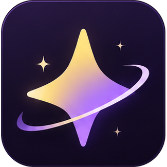

<p align="center">
  
</p>

<h1 align="center">estela</h1>

<p align="center"><strong>Tu sesión, a tu ritmo.</strong><br>
Analizo tus movimientos en tiempo real y te doy indicaciones por voz para ayudarte a mejorar tu técnica.</p>

<p align="center"><em>Entrenador personal · inferencia local · voz en español</em></p>

---

> 🔊 **Brazos · leve** — «Sube un poco más los brazos, hasta donde te resulte cómodo.»
>
> `brazos_no_llegan_arriba` → `rango_brazos_insuficiente` · leve (jumping jacks)

Antes de empezar:

- Aléjate unos 2,5–3 m de la pantalla
- Que se vea tu cuerpo entero
- Busca un lugar con buena luz

ESTELA te da indicaciones sobre tu técnica; no reemplaza a un profesional ni hace diagnósticos.

## Del frame a la voz

**Cámara → pose → DTW → decisión → voz.** Todo ocurre en el equipo. El frame viaja en memoria como JPEG de 640 px y no se guarda en ningún lado.

| | Etapa | Qué hace |
|---|---|---|
| **01 · Ver** | Cámara | Un solo usuario, una sola cámara. Sin almacenamiento de vídeo. |
| | MediaPipe Pose Landmarker | Puntos articulares de cada frame, estimados en local. |
| | Ángulos articulares | La pose se normaliza en ángulos como `hombro_medio` o `codo_medio`. |
| **02 · Medir** | Fases y conteo | `cerrado → apertura → abierto → cierre`: cuenta la repetición y marca cuándo evaluar. |
| | DTW contra la referencia | Umbral = k × max(σ referencia, jitter). Sin referencia o con coste alto, las reglas se abstienen. La plancha usa la postura media. |
| **03 · Decidir** | Motor de feedback determinista | De un catálogo cerrado de errores por ejercicio decide cuál, con qué prioridad y severidad, y si se habla. |
| **04 · Decir** | Verbalizador | Plantillas en español; la variante se elige por el índice de repetición, no al azar. |
| | Voz local | Síntesis Piper en el equipo, sin servicios externos. |

> **Decidir y decir están separados.** El motor determinista elige el error, su prioridad y si se habla; el verbalizador solo pone en palabras un error ya tipificado. Ningún modelo de lenguaje decide qué error hubo.

## La rutina: cuatro ejercicios, cada uno con sus errores

Primero los de frente y después los de perfil, para cambiar de orientación una sola vez; la plancha al final porque es en el suelo. Cada ejercicio es un skill en JSON (`backend/estela/dominio/feedback/skills/`): añadir uno no toca el núcleo. Rutina: `backend/rutinas/calentamiento_basico.json`.

### 1. Jumping jacks — de frente · 10 repeticiones · `ciclo`

Abre y cierra brazos y piernas a la vez, con un pequeño salto.

| Error | Descripción |
|---|---|
| `brazos_no_llegan_arriba` | Los brazos no alcanzan la posición alta en la apertura. |
| `apertura_pies_insuficiente` | La separación de pies en la apertura es menor que la de referencia. |
| `sin_salto` | Abre piernas y brazos sin despegar los pies del suelo. |
| `codos_flexionados` | Los codos permanecen flexionados durante la apertura. |

### 2. Abducción de cadera de pie — de frente, por pierna · 8 + 8 repeticiones · `ciclo`

De pie, eleva la pierna hacia el lado sin inclinar el tronco. Una serie y un skill por pierna (`abduccion_cadera_izq` / `_der`).

| Error | Descripción |
|---|---|
| `tronco_inclinado_der` · `_izq` | Al elevar la pierna, el tronco se inclina hacia el lado contrario. |
| `cadera_izq_sube` · `cadera_der_sube` | La cadera de ese lado sube en lugar de quedar nivelada. |
| `abduccion_insuficiente_izq` · `_der` | La pierna no se separa lo suficiente hacia el lado. |

### 3. Marcha con elevación de rodillas — de perfil · 16 repeticiones · `alternante`

Marcha en el sitio subiendo las rodillas, con el tronco erguido.

| Error | Descripción |
|---|---|
| `tronco_muy_inclinado` | El tronco se inclina hacia atrás o hacia delante al elevar la rodilla. |
| `rodilla_izq_baja` · `rodilla_der_baja` | La rodilla no alcanza la altura objetivo. |
| `rodilla_izq_extendida` · `_der` | La pierna sube con la rodilla estirada en lugar de doblarla. |

### 4. Plancha — de perfil · 20 s · `isometrico`

Sostén el cuerpo en línea recta apoyado en antebrazos y puntas de los pies.

| Error | Descripción |
|---|---|
| `cadera_hundida` · `cadera_elevada` | La cadera cae o sube respecto a la línea hombro-tobillo. |
| `cabeza_desalineada` | La cabeza cae o se levanta en lugar de seguir la línea del tronco. |
| `hombros_adelantados` · `hombros_retrasados` | Los hombros no quedan sobre los codos. |
| `codo_izq_fuera_de_90` · `_der` | El codo visible no está a 90°. |
| `rodilla_izq_flexionada` · `_der` | La rodilla visible se dobla: se pierde la línea recta. |

## Cuándo habla y cuándo calla

Si la medida está ocluida, el plano no se ve desde la cámara o no hay evidencia suficiente, el motor se abstiene en lugar de adivinar. Política de silencio de jumping jacks:

| Parámetro | Valor |
|---|---|
| `refractario_ms` | 3000 |
| `refractario_mismo_error_ms` | 8000 |
| `repeticiones_evidencia` | 2 |
| `max_emisiones_mismo_error` | 3 |
| `confianza_minima` | 0,6 |
| `tolerancia_orientacion_grados` | 30 |

**Motivos de silencio** — EXP-001, piloto A (banco sintético, no vídeo real; ver `backend/feedback_testing/resultados/EXP-001-piloto-A.md`):

| Motivo | Veces |
|---|---:|
| `sin_error` | 4723 |
| `periodo_refractario` | 381 |
| `plano_no_observable` | 368 |
| `evidencia_insuficiente` | 117 |
| `confianza_baja` | 24 |

**Latencia por etapa (ms):**

| Etapa | p50 | p95 |
|---|---:|---:|
| Decisión | 0,016 | 0,126 |
| Verbalización | 0,262 | 1,111 |

Medido en el entorno de desarrollo, no en el hardware del proyecto. No incluye pose, DTW ni TTS.

## Cómo ejecutar la v1

`frontend/dist/` está versionado: para correr la aplicación basta Python. La interfaz se abre en una ventana nativa con pywebview y no decide nada; muestra lo que manda el backend. Instalación detallada en [Instalación.md](./Instalación.md).

```bash
cd backend
# una vez
python3 -m venv .venv && source .venv/bin/activate
pip install -e ".[voz,interfaz,dev]"
python scripts/descargar_modelos.py

# rutina de entrenamiento en la interfaz de escritorio
python -m estela
python -m estela --interfaz opencv
python -m estela --ejercicio marcha_rodillas --repeticiones 8
python -m estela --ejercicio plancha --repeticiones 30   # segundos

pytest   # todos los tests del backend, sin cámara
```

| Tecla | Acción |
|---|---|
| `n` | Siguiente ejercicio |
| `r` | Reiniciar el ejercicio |
| `Esc` | Terminar |
| `d` | Depuración: motivo de silencio |

---

Prototipo para una persona y una cámara. Sin almacenamiento de vídeo y sin diagnóstico médico ni fisioterapéutico.

**Estudiantes:** Isabella Arrieta Juliao ([@isaAJ05](https://github.com/isaAJ05)) · Natalia Carpintero Leal ([@carpinteron](https://github.com/carpinteron)) · Paula Núñez Zarante ([@pzarante](https://github.com/pzarante))

**Tutores:** Ph.D. Margarita Gamarra · Augusto Salazar Silva
