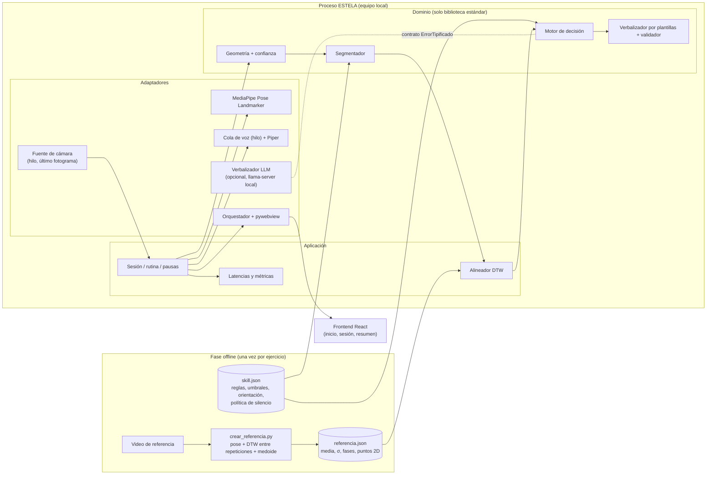
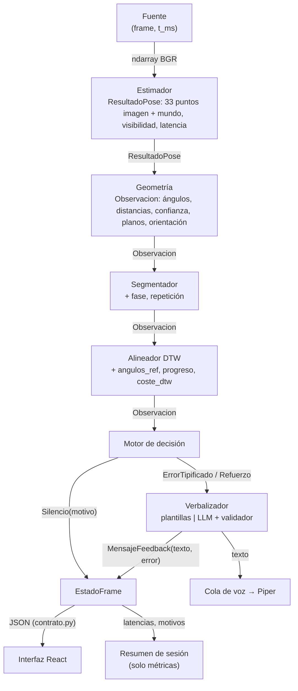
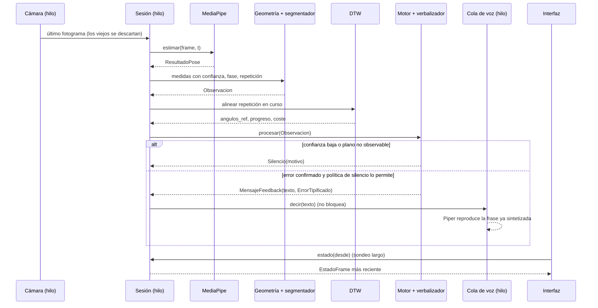
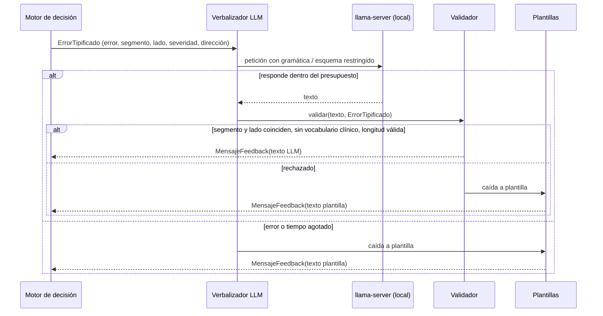

# ESTELA Informe N.º 2

## Resumen / Abstract

Las personas que practican ejercicio por su cuenta ejecutan los movimientos sin una verificación externa de su técnica: el video pregrabado no las observa, las aplicaciones de conteo informan cuántas repeticiones se hicieron pero no cómo, y los productos que sí analizan la ejecución dependen de hardware propietario, de un dominio clínico o de documentación que no permite saber dónde se procesa la imagen. ESTELA es un prototipo de aplicación de escritorio que observa a una persona con una sola cámara mientras ejecuta cuatro ejercicios —jumping jacks, abducción de cadera de pie, marcha con elevación de rodillas y plancha sobre antebrazos— y le entrega, en español y durante la ejecución, retroalimentación hablada sobre trece desviaciones de técnica definidas de antemano, con toda la inferencia ejecutándose en el equipo local y sin almacenar video.

La solución se organiza como una cadena de etapas separadas por contratos de datos: un estimador de pose (MediaPipe Pose Landmarker) convierte cada fotograma en puntos articulares tridimensionales; un módulo de geometría los transforma en ángulos y distancias normalizadas con una confianza por medida; un segmentador identifica fases y repeticiones; un alineador DTW compara la repetición en curso con una referencia del ejercicio; un motor de decisión determinista decide si hay un error que comunicar, si debe callar —y por qué— o si corresponde un refuerzo; un verbalizador por plantillas convierte la decisión en una frase en español, y un motor de síntesis local (Piper) la pronuncia. Todo el conocimiento de cada ejercicio vive en archivos de configuración externos (*skills*), de modo que añadir un ejercicio no exige modificar el código.

## 1. Introducción

La práctica regular de actividad física es un componente importante de la salud de la población; sin embargo, una proporción significativa de los adultos no alcanza los niveles recomendados. La Organización Mundial de la Salud estima que el 31 % de la población adulta mundial, cerca de 1 800 millones de personas, no alcanza esos niveles, una cifra que podría llegar al 35 % en 2030 si la tendencia continúa [1]. En Colombia, la serie del Observatorio Mundial de la Salud muestra un aumento de la prevalencia de actividad física insuficiente entre adultos, del 24,8 % en 2000 al 34,5 % en 2022 [2]. Frente a este panorama, las tecnologías aplicadas a la actividad física han pasado de ofrecer únicamente contenidos y rutinas a intervenir durante la ejecución, incorporando seguimiento y retroalimentación. Esta evolución se apoya en técnicas de estimación de pose humana que hoy pueden ejecutarse en tiempo real con una sola cámara en equipos de propósito general [12], [14], y en motores de síntesis de voz que funcionan sin conexión [32].

Las soluciones disponibles pueden agruparse en tres familias: los videos y bibliotecas de rutinas, que muestran el movimiento pero no observan a quien lo ejecuta; las herramientas de conteo de repeticiones, que miden ángulos articulares contra umbrales para contar, pero no interpretan la técnica [16]; y los sistemas que sí analizan la ejecución con una cámara, como Kaia Health en el dominio clínico de la rehabilitación [22], [33] o dispositivos comerciales de entrenamiento como Tempo y Peloton Guide [20], [23]. La sección 5 contrasta en detalle estos antecedentes y la evidencia publicada sobre cada uno; el resultado relevante aquí es que la combinación que este proyecto persigue —retroalimentación concurrente y hablada, en español, con ejecución local y con una política explícita de abstención cuando la medida no es fiable— no se localizó en las fuentes revisadas, y que el único antecedente que comparte varias de esas características pertenece a un dominio clínico, en otro idioma y sin cifras publicadas de latencia.

El desafío técnico es observar el movimiento, compararlo con una referencia, decidir qué desviación merece comunicarse y comunicarla mientras el movimiento todavía ocurre. Esa decisión tiene dos riesgos que la literatura documenta: corregir sobre una medida que la cámara no podía ver, lo que produce mensajes bien redactados pero falsos [26], [27], y hablar demasiado, lo que la literatura de aprendizaje motor asocia con dependencia de la retroalimentación [3]. Por eso ESTELA trata el silencio como una salida de primera clase, con motivo registrado, y mide la latencia por etapa como criterio de aceptación.

Este segundo informe documenta el estado del prototipo ESTELA al finalizar la semana 11 del semestre y presenta los avances realizados respecto al Informe 1. Durante este periodo se introdujeron cambios en el alcance funcional y en la arquitectura del sistema, sustentados en decisiones de diseño y experimentos preliminares. El documento describe el planteamiento actualizado del problema, los objetivos medibles, la solución propuesta, la arquitectura y el estado de implementación, así como las pruebas realizadas, los resultados parciales y las actividades pendientes para completar la validación del prototipo.

## 2. Marco conceptual

ESTELA aborda una cadena de cuatro problemas técnicos interrelacionados, cada uno con su propio vocabulario y sus propios modos de fallo. El sistema debe primero **percibir** el cuerpo del usuario a partir de una imagen convertir píxeles en una descripción geométrica del esqueleto; luego **comparar** esa descripción con una referencia del ejercicio, teniendo en cuenta que el usuario no ejecuta a la misma velocidad que el video de referencia; después **decidir** si alguna de las diferencias observadas constituye un error que merezca ser comunicado, y si este es el momento adecuado para comunicarlo; y finalmente **comunicar** esa decisión en español hablado. Comprender el proyecto exige distinguir estas cuatro etapas, porque la evidencia disponible en la literatura indica que no son igual de difíciles ni igual de maduras: la percepción es hoy un problema con soluciones de ingeniería disponibles, mientras que la decisión sobre *qué* corregir y *cuándo* callar sigue siendo un problema abierto tanto en visión por computador como en la literatura de aprendizaje motor.

Esta separación no es solo expositiva: es la decisión arquitectónica central del proyecto. Cada frontera entre etapas se define como un contrato de datos explícito, de modo que un módulo pueda desarrollarse, probarse y sustituirse sin que los demás se enteren. El módulo de retroalimentación, por ejemplo, no accede a la cámara ni al estimador de pose: recibe una estructura de medidas ya calculadas y produce una frase o un silencio. Esto permite que ese módulo se pruebe de forma automatizada sin ninguna imagen real, y permite también cambiar de estimador de pose sin tocar la lógica de corrección. La contrapartida es que los contratos deben especificarse con precisión qué unidades, qué nombres, qué garantías de fiabilidad, y esa especificación es en sí misma un objeto de diseño del proyecto.

### 2.1 Estimación de pose humana monocular

La **estimación de pose humana** es la tarea de localizar, a partir de una imagen o un video, un conjunto predefinido de puntos anatómicos del cuerpo llamados *keypoints* o *landmarks* habitualmente hombros, codos, muñecas, caderas, rodillas y tobillos, junto con puntos de la cara y de conectarlos según una topología esquelética fija. El caso relevante para este proyecto es el **monocular**: una sola cámara RGB convencional, sin sensor de profundidad y sin marcadores adheridos al cuerpo. El proyecto adopta **MediaPipe Pose Landmarker** como estimador, basado en la familia de modelos BlazePose y su evolución BlazePose GHUM, diseñada explícitamente para inferencia en el dispositivo y no en un servidor remoto [12], [13], [21]. La alternativa considerada, RTMPose [14], se documenta en la sección 9 junto con los criterios de comparación empleados.

MediaPipe Pose Landmarker entrega dos salidas que no son intercambiables y cuya distinción condiciona el resto de la arquitectura. Los *image landmarks* son coordenadas en el plano de la imagen, normalizadas al ancho y alto del fotograma; los *world landmarks* son coordenadas métricas tridimensionales con origen en el centro de la cadera. ESTELA trabaja preferentemente sobre los segundos, porque un ángulo calculado en ese espacio no depende de la posición del usuario dentro del encuadre ni de su distancia a la cámara, mientras que el mismo ángulo calculado sobre coordenadas de imagen sí depende de ambas. Cada punto se acompaña además de un valor de **visibilidad**, que indica cuán fiable es su localización, y que es la materia prima de la política de abstención descrita en la subsección 2.7.

Un punto conceptual que condiciona todo lo que viene después es que un estimador de pose no resuelve el problema de ESTELA, solo lo habilita. El estimador entrega dónde están los puntos articulares en cada fotograma; no dice si la ejecución es correcta, no compara con ninguna referencia y no genera ninguna instrucción. La arquitectura del proyecto aísla esta dependencia detrás de un contrato de datos, de modo que el mapeo entre nombres anatómicos e índices del modelo vive en el módulo de percepción: si en el futuro el estimador se sustituye, el módulo de retroalimentación no cambia. Conviene advertir también que la tridimensionalidad de los *world landmarks* es una estimación inferida de una sola vista, no una medición de profundidad, y que su fiabilidad no debe suponerse: la subsección 2.3 desarrolla las consecuencias de esta limitación.

### 2.2 Representación del movimiento: ángulos articulares y normalización

Los puntos articulares crudos no son una representación adecuada para comparar la ejecución de dos personas distintas, ni siquiera de la misma persona en dos sesiones. Dos usuarios con estatura, longitud de extremidades o posición frente a la cámara diferentes producirán coordenadas numéricamente muy distintas aunque estén ejecutando el mismo movimiento de forma equivalente. Por eso la práctica habitual en los sistemas de análisis de ejercicio es transformar los puntos en una **representación normalizada**, es decir, en un conjunto de magnitudes que describan la *forma* del movimiento con independencia de la escala corporal, de la traslación dentro del encuadre y, en lo posible, de la orientación del sujeto. Los sistemas de referencia del área construyen esta representación a partir de ángulos articulares y de distancias relativas [6], [7], [9].

El **ángulo articular** es la magnitud central de esta representación. Se define sobre una terna ordenada de puntos por ejemplo cadera, rodilla y tobillo para el ángulo de rodilla y corresponde al ángulo que forman los dos segmentos que comparten el vértice. Su ventaja es que es invariante a traslación y a escala por construcción: no importa dónde esté la persona ni cuán larga sea su pierna, la flexión de la rodilla es la misma magnitud. Junto a los ángulos, ESTELA utiliza **distancias normalizadas por la escala corporal**, obtenidas dividiendo una distancia entre dos puntos por una longitud de referencia del propio sujeto, típicamente la distancia entre el punto medio de los hombros y el punto medio de las caderas. Esto permite expresar medidas que no son angulares la separación entre los pies, o el desplazamiento lateral de una rodilla respecto a la línea del pie, que caracteriza el *valgo de rodilla* en unidades comparables entre personas. La regla general del proyecto es que ninguna medida se expresa en píxeles y ninguna se expresa en metros absolutos.

Esta representación es también la unidad sobre la que se construyen los **nombres canónicos** del sistema. Cada ángulo y cada distancia tiene un nombre estable `rodilla_izquierda`, `tronco_inclinacion` que es independiente del estimador de pose que los produzca. Ese vocabulario cerrado cumple una función que va más allá del orden: permite que un validador posterior rechace cualquier mensaje que nombre un segmento corporal que no figure en el contrato, lo que constituye la defensa del sistema contra la clase de error descrita en la subsección 2.7. La contrapartida es que el vocabulario debe ampliarse de forma deliberada cada vez que se incorpore un ejercicio con una medida nueva, y que esa ampliación es una modificación del contrato, no un detalle de implementación.

### 2.3 Planos anatómicos y observabilidad monocular

La anatomía describe el movimiento humano sobre tres **planos** ortogonales. El *plano sagital* divide el cuerpo en mitad izquierda y mitad derecha, y contiene los movimientos de flexión y extensión: la profundidad de una sentadilla o la inclinación del tronco se leen en este plano, y se observan bien desde un perfil. El *plano frontal* divide el cuerpo en parte anterior y posterior, y contiene los movimientos de abducción y aducción: el desplazamiento lateral de una rodilla hacia dentro, o la separación de los pies, se leen aquí, y se observan bien desde el frente. El *plano transversal* es horizontal y contiene las rotaciones alrededor del eje longitudinal del cuerpo. Cada criterio técnico que ESTELA evalúa pertenece a uno de estos planos, y esa pertenencia determina desde qué orientación puede observarse.

De aquí surge el concepto de **observabilidad monocular**, que permite establecer qué movimientos y criterios técnicos pueden evaluarse de forma más adecuada según la orientación del usuario respecto a la cámara. Aunque una sola cámara representa una escena tridimensional en una imagen bidimensional, la relación entre los planos anatómicos y la perspectiva de observación permite definir condiciones específicas para analizar cada movimiento.

La consecuencia de diseño es que la orientación del usuario deja de ser un detalle del montaje y pasa a ser un parámetro del sistema. Cada regla declara el plano en el que es observable, cada ejercicio declara una **orientación preferida**, y el motor de decisión compara la orientación estimada del sujeto con la que la regla necesita antes de evaluarla. Cuando la orientación no es compatible, la regla no se evalúa: el sistema calla en lugar de afirmar algo que no puede ver. Esta salvaguarda tiene un límite conocido y explícito: las medidas del plano transversal no son observables desde ninguna orientación con una sola cámara, porque dependen íntegramente de la profundidad estimada, y por esa razón los ejercicios cuyos criterios técnicos viven en ese plano quedan fuera del conjunto validado del prototipo.

### 2.4 Comparación temporal: Dynamic Time Warping

Comparar la ejecución del usuario con la referencia del ejercicio no es una comparación fotograma a fotograma. El usuario no ejecuta a la misma velocidad que el video de referencia, no empieza en el mismo instante, y ni siquiera mantiene una velocidad constante dentro de una misma repetición: puede descender despacio y subir rápido. Una comparación que emparejara el fotograma *n* del usuario con el fotograma *n* de la referencia reportaría diferencias enormes que no corresponden a ningún error de técnica, sino simplemente a un desfase temporal. El problema que hay que resolver es el de **alineamiento temporal no lineal** entre dos series de longitudes y velocidades distintas.

**Dynamic Time Warping (DTW)** es el algoritmo clásico para este problema. Formulado originalmente para reconocimiento de voz [15], DTW busca, mediante programación dinámica, la correspondencia entre los índices de dos series temporales que minimiza el coste acumulado de emparejarlas, permitiendo que un elemento de una serie se empareje con varios de la otra. El resultado es doble: un **camino de alineamiento** (*warping path*), que indica qué instante de la ejecución del usuario corresponde a qué instante de la referencia, y un **coste de alineamiento**, que resume cuán distinta es la ejecución de la referencia una vez descontadas las diferencias de velocidad. Para ESTELA, el camino es lo que permite preguntar «en el instante en que la referencia estaba en el fondo del movimiento, ¿qué ángulo de rodilla tenía el usuario?», y esa pregunta es la que convierte una medida instantánea en una **desviación** respecto a la referencia. DTW cuenta con precedentes documentados en sistemas de análisis de ejercicio y de postura [7], [9].

Aplicar DTW en tiempo real introduce consideraciones adicionales que el algoritmo clásico no contempla. DTW se define sobre secuencias completas, mientras que durante una sesión la ejecución del usuario llega fotograma a fotograma y no se conoce su final. Esto obliga a trabajar sobre ventanas típicamente la repetición en curso y hace necesario un mecanismo de **segmentación de repeticiones** que determine dónde empieza y dónde termina cada ciclo del movimiento, así como en qué **fase** dentro del ciclo se encuentra el usuario en cada instante. La fase no es un adorno: muchos criterios técnicos solo tienen sentido en una parte del movimiento, y evaluarlos fuera de ella produce falsos positivos. El coste computacional de DTW, cuadrático en el caso general, y la existencia de variantes restringidas o aproximadas que lo reducen, forman parte de los criterios de evaluación de alternativas de la sección 9.

### 2.5 Detección de desviaciones: reglas, umbrales y severidad

Una vez disponibles los ángulos del usuario, los de la referencia alineada y las distancias normalizadas, falta el paso que convierte números en juicios: decidir qué diferencia constituye un error. ESTELA lo resuelve mediante **reglas declarativas**. Una regla asocia una medida un ángulo, una distancia, una desviación respecto a la referencia, un agregado dentro de la repetición como el mínimo o el rango, o una asimetría entre dos medidas homólogas con una condición de comparación y un **umbral**. Cuando la condición se cumple, la regla identifica un error tipificado, con un identificador estable, un segmento corporal, un lado y una fase del movimiento. Las reglas viven en el archivo de configuración de cada ejercicio, no en el código del motor, lo que permite añadir o ajustar criterios técnicos sin modificar la lógica del sistema.

El **umbral** es, en la literatura, el problema abierto de esta etapa, y conviene nombrarlo con precisión porque condiciona cualquier afirmación de exactitud que el proyecto pueda hacer. En AIFit, el sistema de referencia en generación automática de retroalimentación de fitness, el umbral que decide si una diferencia se reporta es un parámetro global ajustado manualmente, del que depende directamente la exactitud del feedback y que no se deriva de ninguna consideración biomecánica [6]. En la literatura de aprendizaje motor, el mismo problema aparece bajo el nombre de *bandwidth feedback* corregir únicamente cuando el error supera un margen de tolerancia, descrito como una estrategia eficaz pero cuyo ajuste concreto se señala como problema práctico no resuelto [3]. Dos disciplinas distintas, con años de diferencia, describen la misma laguna. Desde la perspectiva metodológica, los umbrales actuales corresponden a una configuración inicial ajustada mediante pruebas preliminares. En consecuencia, las métricas de desempeño obtenidas hasta el momento se presentan como resultados de partida , destinados a ser refinados cuantitativamente durante las sesiones de prueba con ejecuciones reales.

Sobre el umbral se construye además la noción de **severidad**. No toda desviación que cruza el umbral merece el mismo tratamiento: el exceso sobre el umbral se clasifica en niveles leve, moderada, alta— que después modulan tanto la prioridad del error como la formulación del mensaje. Y cuando varias reglas se activan simultáneamente, el sistema debe elegir **una sola**, porque comunicar tres correcciones a la vez durante la ejecución de un movimiento no es retroalimentación, es ruido. Esa elección se resuelve mediante un orden de prioridad declarado por ejercicio y obligatoriamente único, condición que garantiza que el comportamiento del motor sea **determinista**: ante la misma secuencia de entradas, la misma secuencia de decisiones.

### 2.6 Retroalimentación aumentada en aprendizaje motor: qué decir, cuándo y cuándo callar

La literatura de aprendizaje motor denomina **retroalimentación aumentada** a la información sobre la ejecución que un aprendiz recibe de una fuente externa, en contraposición a la retroalimentación *intrínseca*, que proviene de sus propios sentidos y, en particular, de la propiocepción. Dentro de la aumentada se distingue el *conocimiento de resultados* información sobre el desenlace, como cuántas repeticiones se completaron del *conocimiento de la ejecución*, que describe cómo se realizó el movimiento. ESTELA se sitúa deliberadamente en el segundo: el vacío que el proyecto identifica es precisamente que las aplicaciones de conteo de repeticiones informan el resultado pero no la ejecución. La revisión de Sigrist et al. sobre retroalimentación aumentada visual, auditiva, háptica y multimodal constituye la referencia central del proyecto en esta materia [3].

La dimensión temporal de la retroalimentación es tanto o más importante que su contenido. La retroalimentación *concurrente* se entrega durante el movimiento; la *terminal*, después de completarlo. La concurrente es la que ESTELA persigue, porque el problema que motiva el proyecto es que el usuario no dispone de corrección mientras ejecuta. Pero la literatura advierte de un efecto contrario: la retroalimentación permanente durante la fase de adquisición puede generar **dependencia del feedback**, llevando al aprendiz a ignorar su propia propiocepción y a rendir peor cuando la ayuda se retira lo que se conoce como *hipótesis de la guía* y recomienda que la frecuencia de la retroalimentación **disminuya** a medida que aumenta el nivel de habilidad, aunque la tasa óptima de ese desvanecimiento se reconoce como desconocida [3]. Conviene matizar que esta advertencia se ha estudiado sobre todo en tareas simples, y que en tareas complejas y en fases tempranas del aprendizaje la retroalimentación concurrente resulta más prometedora; los ejercicios de complejidad controlada y las usuarias principiantes de ESTELA se sitúan del lado favorable de esa distinción, pero no existe ningún estudio que traslade la hipótesis de la guía a sistemas de corrección por cámara y mida retención motora, de modo que se trata de un vacío en la literatura y no de un aval.

De estas consideraciones se deriva un objeto de diseño propio del proyecto: la **política de silencio**. En lugar de tratar el silencio como la ausencia de salida, ESTELA lo trata como una salida de primera clase, con un motivo asociado y contabilizable. La política se articula mediante varios mecanismos: un *periodo refractario* que impone un tiempo mínimo entre dos mensajes cualesquiera y otro, más largo, antes de repetir el mismo error; una *política de evidencia* que exige que el error se observe en un número mínimo de repeticiones consecutivas antes de hablar, lo que traslada la idea de *bandwidth feedback* al eje temporal y evita corregir por un fotograma ruidoso; un *factor de desvanecimiento* que alarga progresivamente el intervalo entre repeticiones del mismo mensaje; un tope de emisiones por sesión; y la posibilidad de silenciar fases enteras del movimiento. Que el sistema hable menos no es una limitación: es un requisito derivado de la evidencia.

### 2.7 Confianza, abstención y el fallo silencioso

El modo de fallo más peligroso de un sistema de retroalimentación por cámara no es un mensaje mal redactado. Es un mensaje **correctamente** redactado, con el segmento y el lado adecuados y un tono competente, emitido sobre una medida que la cámara no podía ver. Un mensaje así es formalmente impecable, y por tanto ningún mecanismo de validación lingüística lo detecta; el usuario, que no tiene forma de saber que la medida era inválida, lo trata como una corrección legítima. Este es el **fallo silencioso**, y la literatura consultada lo documenta en la generación de retroalimentación por modelos de lenguaje: la evaluación de instrucciones generadas automáticamente reporta identificación errónea de la parte del cuerpo en una fracción no trivial de los casos [26], y los benchmarks de comprensión visual centrada en el cuerpo humano muestran que los modelos multimodales de propósito general tienen dificultad sistemática para distinguir izquierda de derecha en manos y pies [27].

La defensa de ESTELA frente a este fallo es un principio de orden: **la abstención se resuelve antes que la detección**. Antes de preguntar «¿está mal esta medida?», el motor pregunta «¿puedo ver esta medida?». La respuesta se construye sobre dos señales. La primera es la **confianza por medida**, un valor entre cero y uno que acompaña obligatoriamente a cada ángulo y cada distancia entregados por el módulo de percepción. Su semántica es deliberadamente pesimista: la confianza de una medida compuesta es el **mínimo** de la visibilidad de los puntos que intervienen en ella, no la media, porque un ángulo de rodilla calculado con el tobillo ocluido no es un ángulo con confianza intermedia, es una medida inválida; y una medida que llega sin confianza declarada se trata como confianza cero, nunca como uno. La segunda señal es la **orientación** del sujeto, que habilita la salvaguarda de plano descrita en 2.3.

Cuando cualquiera de estas comprobaciones falla, el sistema emite un silencio con motivo explícito confianza insuficiente, plano no observable, evidencia insuficiente, periodo refractario, fase silenciada en lugar de una corrección. Esto tiene una consecuencia que conviene subrayar porque convierte una limitación en un instrumento de medición: la frecuencia con que el sistema calla por cada motivo es una **métrica de calidad de la captura**. Una tasa alta de silencios por plano no observable indica que la cámara está mal colocada o que el ejercicio necesita otra orientación; una tasa alta de silencios por confianza baja indica oclusión o iluminación insuficiente. Ninguna de estas dos señales existiría si el sistema se limitara a corregir siempre que detectara una diferencia.

### 2.8 Generación y verbalización de la retroalimentación

Existen al menos cinco enfoques documentados para convertir una desviación numérica en una instrucción comprensible, y conviene distinguirlos porque el proyecto adopta uno y descarta explícitamente otro que figuraba en el planteamiento inicial. El primero es el enfoque **determinista de reglas y plantillas parametrizadas**: la desviación se tipifica mediante reglas y el mensaje se produce rellenando una plantilla de texto redactada de antemano. El segundo es el **clasificador estadístico** entrenado sobre un corpus etiquetado de errores de ejecución. El tercero es el uso de un **modelo de lenguaje** que recibe datos de pose y redacta la instrucción. El cuarto son los **modelos multimodales** (VLM), que reciben directamente fotogramas de la ejecución. El quinto son los **enfoques híbridos**, que separan la detección del error de su verbalización, y que constituyen el patrón dominante en los sistemas verificados de la literatura [6], [26], [29], [30].

Dos hallazgos de esa revisión ordenan la decisión del proyecto. El primero es que **la detección del error, y no la verbalización, es el cuello de botella**: un modelo de lenguaje pequeño alimentado por una detección estructurada supera de forma sustancial, tanto en evaluación automática como humana, a un modelo generalista muy superior en tamaño que trabaja sin esa estructura [26]. La calidad de la retroalimentación no proviene del tamaño del modelo de lenguaje, sino de que la detección sea correcta antes de verbalizar. El segundo es que los modelos multimodales de propósito general **todavía no son fiables para postura fina**: además de la dificultad con izquierda y derecha ya mencionada [27], su desempeño en evaluación de ejecución de ejercicio en condiciones no supervisadas es bajo [28]. Existe además un tercer hallazgo, de signo contrario al intuitivo: entrenar o instruir un modelo únicamente con ejemplos correctivos produce **sobrecorrección**, es decir, señalar errores en ejecuciones que eran correctas, en una proporción que la literatura cuantifica como sustancial [26]. De ahí se deriva un requisito de diseño del banco de evaluación del proyecto: debe incluir obligatoriamente ejecuciones correctas, porque sin ellas la sobrecorrección es invisible.

En consecuencia, ESTELA adopta una arquitectura en la que **el motor determinista decide el contenido y el verbalizador decide únicamente la forma**. El motor produce una estructura tipificada identificador de error, segmento, lado, severidad, fase, repetición, magnitud y confianza que constituye un contrato estable, y el verbalizador recibe esa estructura sin acceso alguno a ángulos ni a imágenes. Por construcción, el verbalizador no puede inventar el contenido: solo puede redactarlo mal. Esta frontera admite dos implementaciones intercambiables: un **verbalizador por plantillas**, determinista y de latencia despreciable, que es la línea base obligatoria y el mecanismo de respaldo permanente del sistema; y un **verbalizador por modelo de lenguaje local pequeño** con **salida restringida** mediante gramáticas formales o esquemas que acotan lo que el modelo puede producir [31] seguido de un **validador determinista** que rechaza todo mensaje que nombre un segmento o un lado distinto del recibido en el contrato, que emplee vocabulario clínico prohibido o que exceda la longitud admitida. Un mensaje rechazado cae automáticamente a la plantilla, de modo que el sistema habla siempre, incluso cuando el componente incierto falla. 

### 2.9 Síntesis de voz y ejecución local: latencia y privacidad

La **síntesis de voz** (*text-to-speech*, TTS) es la etapa final de la cadena: convertir el mensaje textual en audio en español. Los conceptos relevantes para evaluar un motor de TTS en este contexto son tres. La **conversión grafema-fonema** (G2P) determina cómo el sistema deduce la pronunciación a partir del texto escrito y es el punto donde el soporte de un idioma se degrada con más frecuencia. El **factor de tiempo real** (RTF) expresa cuántos segundos de cómputo cuesta producir un segundo de audio, y es la métrica que decide si el TTS cabe dentro del presupuesto de latencia del ciclo. Y el **modelo de licenciamiento** de los pesos y del código determina si el componente puede utilizarse en el marco académico del proyecto, cuestión que no siempre coincide entre uno y otro.

La **latencia** merece tratarse como concepto propio y no como un atributo genérico de rendimiento, porque en este sistema no es una molestia sino una condición de validez: una corrección que llega después de que la repetición terminó ya no es retroalimentación concurrente, es retroalimentación terminal, y pertenece a otra categoría pedagógica (2.6). El proyecto la mide por **etapas** percepción, comparación, decisión, verbalización y síntesis y reporta percentiles, no solo promedios: el percentil 95 describe el comportamiento en el peor caso habitual, que es el que el usuario percibe como fallo, mientras que el promedio puede ocultarlo por completo. Como referencia de diseño para los umbrales de percepción de respuesta inmediata en interacción, el proyecto se apoya en los límites clásicos de tiempo de respuesta descritos en la literatura de usabilidad [4].

La **inferencia local** es, por último, una restricción de diseño con doble justificación. Desde el punto de vista técnico, ejecutar todos los modelos en el mismo equipo elimina la latencia de red y la variabilidad asociada a un servicio remoto, y hace que el presupuesto de latencia dependa únicamente de hardware bajo control del proyecto. Desde el punto de vista normativo, la Ley 1581 de 2012 clasifica los datos biométricos como datos sensibles sujetos a un régimen especial de protección [5], y procesar el video durante la sesión sin transmitirlo a terceros ni almacenarlo de forma permanente reduce la exposición de esa información. Ambas justificaciones convergen en la misma decisión, pero son independientes: la primera sobreviviría aunque la segunda no existiera.

**Sobre el motor de síntesis de voz.** El prototipo adopta Piper, que ofrece voces en español peninsular y latinoamericano y se ejecuta localmente [32]; la voz en uso, `es_MX-claude-high`, declara licencia Apache-2.0 en su tarjeta de modelo. Piper desplaza al candidato propuesto en el Informe 1 [18], cuyo soporte de español se limita a un número muy reducido de voces y cuya propia documentación advierte de la posible debilidad del soporte para idiomas distintos del inglés. Para retirar la síntesis del camino crítico, la aplicación sintetiza al iniciar la sesión todas las frases que la rutina puede llegar a decir, de modo que en vivo solo se reproduce audio ya generado. 

### 2.10 La *skill* como unidad de conocimiento por ejercicio

Todo el conocimiento específico de un ejercicio se concentra en una unidad de configuración externa al código que el proyecto denomina **skill**. Una *skill* contiene el identificador del ejercicio, la secuencia de fases del movimiento, la orientación preferida, las medidas requeridas, la política de silencio aplicable y el conjunto de reglas con sus umbrales, severidades, planos, segmentos, lados y prioridades. El principio de diseño es que **añadir un ejercicio sea añadir un archivo**, no modificar el motor. Esto materializa el criterio de extensibilidad declarado en el planteamiento del proyecto y, de forma más inmediata, permite que las decisiones técnicas sobre criterios de ejecución se revisen y ajusten sin tocar la lógica del sistema.

Esta separación tiene además una consecuencia metodológica sobre la honestidad del prototipo. Como los umbrales viven en el archivo de *skill* y no dispersos en el código, cada uno puede llevar anotado el **origen de su valor**: si procede de una calibración con datos propios, de una fuente bibliográfica o de una estimación provisional. En el estado actual del proyecto, todos los umbrales están marcados como provisionales y sin calibrar, y esa marca es visible en el propio archivo de configuración. El cargador de *skills* valida el esquema y falla de forma ruidosa ante un archivo mal formado, en lugar de cargarlo parcialmente: un ejercicio mal definido no se ejecuta a medias.

El cargador impone además dos reglas de higiene que no son arbitrarias. La primera es que el segmento corporal declarado en cada regla debe pertenecer al vocabulario cerrado del sistema, condición que es precisamente la que habilita al validador de salida a rechazar mensajes que nombren otra parte del cuerpo (2.8). La segunda es que las prioridades no pueden repetirse dentro de un mismo ejercicio, porque un empate dejaría el desempate indefinido y el motor perdería el determinismo, que es una garantía explícita del contrato (2.5). Ambas reglas ilustran el mismo patrón de diseño presente en toda la arquitectura: las propiedades que el sistema promete se sostienen en restricciones verificables, no en la disciplina de quien escribe la configuración.

### 2.11 Tabla de términos

| Término | Definición operativa en ESTELA |
| --- | --- |
| **Keypoint / landmark** | Punto anatómico localizado por el estimador de pose en cada fotograma. |
| **Image landmarks** | Coordenadas del punto en el plano de la imagen, dependientes del encuadre y la distancia. |
| **World landmarks** | Coordenadas métricas 3D con origen en el centro de la cadera, independientes de la posición en el encuadre. |
| **Visibilidad** | Valor asociado a un keypoint que indica la fiabilidad de su localización. |
| **Confianza de una medida** | Valor 0–1 por ángulo o distancia; se define como el **mínimo** de la visibilidad de los keypoints que intervienen. Su ausencia se interpreta como cero. |
| **Ángulo articular** | Ángulo formado por dos segmentos que comparten un vértice, definido sobre una terna ordenada de keypoints. Invariante a traslación y escala. |
| **Distancia normalizada** | Distancia entre dos puntos dividida por una longitud de referencia del propio sujeto (escala corporal). Nunca en píxeles ni en metros absolutos. |
| **Plano frontal / sagital / transversal** | Planos anatómicos que determinan desde qué orientación es observable un criterio técnico. |
| **Orientación** | Ángulo del sujeto respecto a la cámara; 0° de frente, 90° de perfil. Habilita la salvaguarda de plano. |
| **Error de proyección** | Discrepancia entre una magnitud medida en el plano de imagen y su valor tridimensional real, dependiente de la orientación. |
| **Observabilidad monocular** | Condición de que una medida pueda obtenerse con fiabilidad desde una sola cámara en la orientación disponible. |
| **DTW (Dynamic Time Warping)** | Algoritmo de alineamiento temporal no lineal entre dos secuencias de velocidades distintas [15]. |
| **Warping path** | Correspondencia de índices entre la ejecución del usuario y la referencia producida por DTW. |
| **Desviación** | Diferencia entre una medida del usuario y la de la referencia en el instante alineado por DTW. |
| **Fase** | Tramo del ciclo del movimiento (p. ej. descenso, fondo, ascenso) en que se encuentra el usuario. |
| **Repetición** | Ciclo completo del movimiento, delimitado por el segmentador. |
| **Regla** | Asociación declarativa entre una medida, una condición y un umbral, que tipifica un error. |
| **Umbral** | Valor a partir del cual una desviación se considera error. Problema abierto tanto en visión por computador como en aprendizaje motor [3], [6]. |
| **Severidad** | Nivel (leve, moderada, alta) derivado del exceso de la medida sobre el umbral. |
| **Error tipificado** | Estructura de salida del motor de decisión: `{error_id, segmento, lado, severidad, fase, repetición, magnitud, confianza}`. |
| **Retroalimentación aumentada** | Información sobre la ejecución procedente de una fuente externa al aprendiz [3]. |
| **Conocimiento de la ejecución / de resultados** | Retroalimentación sobre *cómo* se hizo el movimiento frente a *qué* se consiguió. |
| **Retroalimentación concurrente / terminal** | Entregada durante el movimiento frente a entregada después de completarlo. |
| **Hipótesis de la guía** | Efecto por el cual la retroalimentación permanente genera dependencia y degrada el rendimiento al retirarla [3]. |
| **Bandwidth feedback** | Estrategia de corregir solo cuando el error supera un margen de tolerancia [3]. |
| **Política de silencio** | Conjunto de mecanismos (refractario, evidencia, desvanecimiento, tope de emisiones, fases silenciadas) que determinan cuándo el sistema no habla. |
| **Abstención** | Decisión de no evaluar una regla por confianza insuficiente o plano no observable. Se resuelve **antes** que la detección. |
| **Fallo silencioso** | Mensaje correctamente formulado emitido sobre una medida no observable; indetectable por validación lingüística. |
| **Sobrecorrección** | Señalar un error en una ejecución que era correcta [26]. |
| **Verbalizador** | Componente que convierte el error tipificado en texto. No accede a ángulos ni imágenes. |
| **Salida restringida** | Limitación formal (gramática o esquema) de lo que un modelo de lenguaje puede generar [31]. |
| **Validador de salida** | Componente determinista que rechaza mensajes incompatibles con el contrato y fuerza la caída a plantilla. |
| **Skill** | Archivo externo que concentra todo el conocimiento de un ejercicio: fases, orientación, reglas, umbrales y política de silencio. |
| **Determinismo** | Garantía de que la misma secuencia de entradas produce la misma secuencia de decisiones. |
| **RTF (factor de tiempo real)** | Segundos de cómputo por segundo de audio sintetizado. |
| **G2P (grafema-fonema)** | Conversión de texto escrito a representación fonética; punto habitual de degradación del soporte por idioma. |
| **Inferencia local** | Ejecución de todos los modelos en el equipo del usuario, sin transmisión a servicios remotos. |

## 3. Planteamiento del problema

ESTELA aborda la falta de retroalimentación en tiempo real sobre la técnica en la práctica autónoma de ejercicio. A continuación, la sección 3.1 detalla el problema y sus causas; la 3.2 reconfigura los supuestos y restricciones de diseño según la evolución del prototipo; y la 3.3 establece el alcance actualizado.

### 3.1 Descripción del problema

En la práctica autónoma de actividad física, las personas sin experiencia previa en ejercicio estructurado no disponen de mecanismos suficientes para evaluar su propia ejecución mientras se mueven. Quien sigue un video de rutina en casa, o repite de memoria una secuencia que vio antes, no tiene un medio objetivo para saber si su postura, su alineación o su amplitud corresponden a la referencia. Las desviaciones pasan inadvertidas durante la práctica, y la persona no identifica a tiempo qué aspecto de su movimiento debería ajustar.

El problema tiene tres causas. La primera es la ausencia de un observador: la práctica autónoma no cuenta con nadie que analice la ejecución mientras ocurre y la contraste con un patrón. La segunda es que la mayor parte del contenido digital de apoyo —videos, imágenes, descripciones— es unidireccional: entrega una referencia, pero no recibe información sobre cómo se está ejecutando. La tercera es la demora: incluso cuando existe algún mecanismo de revisión, como grabar la sesión para analizarla después, la retroalimentación llega cuando el movimiento ya terminó, y tanto el momento como la forma de entrega de la retroalimentación aumentada influyen en su efecto sobre el aprendizaje motor [3].

El problema afecta principalmente a personas adultas que se inician en la actividad física sin acompañamiento profesional, en el rango aproximado de 18 a 40 años que delimita la validación del prototipo. La relevancia de esta población la sustenta la prevalencia de actividad física insuficiente en Colombia, del 34,5 % en 2022 [2]. Las consecuencias son dos: la persona dispone de menos oportunidades para ajustar su ejecución en el momento en que la realiza, pese a que la retroalimentación aumentada puede favorecer el aprendizaje de habilidades motoras [3]; y los errores de técnica se repiten sin que nadie los señale. A esto se suma un componente técnico que hace al problema no trivial: un estimador de pose entrega posiciones articulares, pero no decide si la ejecución es correcta, no la compara con una referencia y no genera instrucciones [13], [14]; construir esas etapas, y hacerlo de forma que no corrijan sobre medidas que la cámara no puede ver, es el núcleo del proyecto.

### 3.2 Restricciones y supuestos de diseño

Las restricciones del proyecto se mantienen en lo esencial respecto al Informe 1, pero varias se concretaron con datos. La tabla resume las vigentes.

| Restricción | Descripción |
| --- | --- |
| Tiempo y equipo | Un semestre académico (periodo 202630); entrega final y sustentación en la semana 16 (15 de noviembre de 2026). Tres estudiantes con dedicación parcial. Se prioriza profundidad sobre cobertura: pocos ejercicios funcionando y medidos. |
| Hardware de inferencia | Equipo final: Mac Studio con M2 Ultra y 128 GB de memoria unificada [19]. Durante el desarrollo, cada integrante mide en su propio portátil y con su propia cámara; esas cifras se reportan como preliminares y con el equipo identificado (sección 12). |
| Ejecución local | Toda la inferencia se ejecuta en el equipo. Ningún fotograma ni derivado biométrico se envía a servicios externos durante la sesión. La red solo se usa para instalar dependencias y descargar modelos. |
| Cámara | Una sola cámara RGB. Dos cámaras se descartaron para la sesión en vivo; solo se admiten como instrumento de medición offline. |
| Orientación | Cada ejercicio declara una orientación (de frente o de perfil) porque el error de proyección monocular puede igualar o superar los umbrales de las reglas. |
| Almacenamiento y datos | El video no se almacena. Solo se conservan métricas derivadas (conteos, mensajes, motivos de silencio, latencias). Las grabaciones para referencias o validación requieren consentimiento informado (Ley 1581 de 2012 [5]) y nunca se incluyen en el repositorio. |
| Presupuesto de latencia | Definido como objetivo medible en la sección 4: p95 de pose ≤ 33 ms y p95 desde la detección hasta el inicio de la voz ≤ 1 s. |
| Responsabilidad | El sistema no realiza diagnóstico médico, fisioterapéutico ni rehabilitación, y sus mensajes no deben sugerirlo. No reemplaza a un instructor. |

Los **supuestos de trabajo** que fundamentan el desarrollo y la evaluación del prototipo son los siguientes:

1. **Disponibilidad de secuencias de referencia:** Se asume la existencia de un patrón de ejecución técnicamente utilizable para cada ejercicio. Actualmente, el sistema emplea cinco videos públicos procesados fuera de línea. Como ejercicio de transparencia metodológica, se declaran dos limitaciones conocidas: la referencia de abducción de cadera procede de un video a 18 fotogramas por segundo en el que la persona utiliza una banda elástica (factor no incidente en la medición de la pierna) y las fuentes carecen de licencia explícita. En caso de requerir mayor precisión, el equipo prevé su sustitución por grabaciones propias bajo consentimiento informado.
2. **Cuantificación biomecánica de la técnica:** Se asume que los criterios de correcta ejecución son expresables mediante reglas sobre ángulos articulares y distancias normalizadas. Dichos criterios cuentan con la revisión de una especialista en educación física como propuesta técnica, manteniéndose sus umbrales numéricos como parámetros preliminares hasta su calibración empírica.
3. **Factibilidad de la validación con usuarios:** Se asume la viabilidad de convocar a cinco participantes representativos de la población objetivo para ejecutar la rutina completa en un entorno experimental controlado.

Las restricciones del entorno de uso se formalizan mediante parámetros de control operacional para las sesiones de prueba:

| Parámetro de entorno | Métrica / Rango operacional | Justificación técnica |
| --- | --- | --- |
| Distancia de captura | 2,0 m a 3,5 m desde la cámara | Garantiza la captura del cuerpo completo dentro del encuadre vertical para estimadores monoculares. |
| Luminancia ambiental | 150 lux a 300 lux (luz difusa o frontal) | Evita zonas de sombra severa o contraluz que degraden la visibilidad de los keypoints en MediaPipe. |
| Indumentaria y contraste | Ropa de ajuste anatómico y contraste respecto al fondo | Previene la oclusión visual de los vértices articulares (caderas, rodillas, tobillos) provocada por ropa holgada. |
| Sujeto en encuadre | 1 persona (cuerpo completo visible) | Límite del modelo MediaPipe Pose Landmarker en modo de alta fiabilidad. |
| Nivel de ruido auditivo | < 55 dBA (ambiente residencial/laboratorio) | Permite la clara perceptibilidad y comprensión de las alertas sintetizadas en español por voz. |

### 3.3 Alcance actualizado

**Incluye:**

- Una aplicación de escritorio de ejecución e inferencia locales para un único usuario, dirigida a personas adultas (aproximadamente 18–40 años) que se inician en la práctica de ejercicio.
- Cuatro ejercicios fijos, cada uno con su vista: jumping jacks (de frente), abducción de cadera de pie, una pierna por serie (de frente), marcha con elevación de rodillas (de perfil) y plancha sobre antebrazos (de perfil, isométrica).
- Detección de trece desviaciones de técnica definidas por ejercicio (tabla de la sección 4), con abstención explícita cuando la medida no es fiable o el plano no es observable.
- Retroalimentación hablada en español durante la ejecución, por plantillas, con síntesis de voz local; avisos de operación (orientación, encuadre, pausa); y refuerzo positivo solo cuando todas las reglas aplicables pudieron comprobarse.
- Interfaz de escritorio con pantallas de inicio, sesión y resumen, y un resumen de métricas por sesión.
- Instrumentación y medición del sistema como actividad propia del proyecto: latencia por etapa, fotogramas por segundo, retraso acumulado, silencios por causa, precisión y recobrado frente a anotación humana.
- Validación en ambiente controlado con cinco participantes ejecutando la rutina completa.

**No incluye:**

- Diagnóstico médico, fisioterapéutico o rehabilitación clínica.
- Ejercicios distintos de los cuatro anteriores. Quedan retirados —con su configuración conservada como historial— la sentadilla, la rotación de tronco, la elevación de brazos y la zancada atrás estática.
- Varios usuarios simultáneos, varias cámaras en vivo, versión web o móvil.
- Dependencia de servicios en la nube durante la sesión.
- Un modelo multimodal (VLM) o de lenguaje que decida qué error ocurrió o si debe hablarse.
- Reconocimiento automático del ejercicio: el ejercicio lo fija la rutina o la selección de la usuaria.
- Generación de rutinas a partir de instrucciones libres, modos por entorno físico y despliegue productivo.

## 4. Objetivos

### 4.1 Objetivo general

Diseñar, implementar y validar , en ambiente controlado, un prototipo de escritorio con inferencia local que analice con una sola cámara la ejecución de cuatro ejercicios físicos ( jumping jacks , abducción de cadera, marcha y plancha) para proporcionar retroalimentación visual y hablada en español durante su práctica, evaluando su viabilidad mediante métricas de desempeño técnico y latencia de procesamiento.

### 4.2 Objetivos específicos

- **Procesar la estimación de pose en tiempo real** a una tasa de procesamiento ≥ 25 fps y con una latencia en la estimación de pose ≤ 33 ms, midiendo el tiempo de respuesta por etapa del sistema.
- **Detectar las trece desviaciones de técnica** definidas para los cuatro ejercicios de la rutina (*jumping jacks*, abducción de cadera, marcha y plancha), alcanzando una precisión ≥ 0,80 y un recobrado ≥ 0,70 frente a la anotación de referencia.
- **Implementar reglas de abstención y control de sobrecorrección** mediante una política de silencio que garantice un 0% de aserciones no soportadas y mantenga la sobrecorrección en ≤ 10%.
- **Generar retroalimentación hablada en español** sobre las desviaciones detectadas, logrando ≥ 90% de coincidencia en el nombramiento del error, lado y segmento corporal, con una latencia ≤ 1 s entre la detección y el inicio de la voz.
- **Desarrollar una guía visual animada (tipo *stick figure*)** derivada de las referencias de movimiento para acompañar la interfaz del usuario durante los cuatro ejercicios.

### 4.3 Desviaciones comprometidas por ejercicio

Para garantizar una evaluación rigurosa y comprobable en la fase de validación, el prototipo ESTELA evalúa un catálogo cerrado de **cuatro ejercicios físicos** mediante **trece tipos de desviaciones técnicas**. Criterios y umbrales fueron definidos junto con una especialista en educación física como línea base de referencia biomecánica, orientada a su posterior calibración empírica en las pruebas con usuarios.

| Ejercicio (vista) | Desviación | Medida y criterio actual | Plano |
| --- | --- | --- | --- |
| Jumping jacks (frente) | Brazos que no llegan arriba | ángulo máximo de hombro en la repetición < 100° | frontal |
|  | Apertura de pies insuficiente | separación de tobillos / separación de caderas, máximo < 1,45 | frontal |
|  | Codos flexionados | ángulo mínimo de codo < 135° | frontal |
| Abducción de cadera, por pierna (frente) | Abducción insuficiente | ángulo máximo de abducción < 16°; no se dice si hay compensación | frontal |
|  | Tronco inclinado al lado contrario | inclinación lateral del tronco > 8° | frontal |
|  | Cadera del lado que se eleva sube | oblicuidad de la pelvis > 6° | frontal |
| Marcha con elevación de rodillas (perfil) | Rodilla baja (izquierda o derecha) | ángulo mínimo de cadera de ese lado > 125° (180° = pierna extendida); solo se evalúa el lado visible | sagital |
|  | Tronco muy inclinado | inclinación del tronco respecto a la vertical > 20° | sagital |
| Plancha sobre antebrazos (perfil) | Cadera hundida | distancia vertical de la cadera a la recta hombro–tobillo / distancia hombro–cadera > 0,10 | sagital |
|  | Cadera elevada | la misma medida < −0,15 | sagital |
|  | Hombros adelantados | desplazamiento horizontal hombro − codo / distancia hombro–cadera > 0,20 | sagital |
|  | Hombros retrasados | la misma medida < −0,20 | sagital |
|  | Cabeza desalineada | ángulo entre el eje del tronco y el del cuello > 30° | sagital |

**Nota operacional:** Los trece tipos de desviación se despliegan operacionalmente en diecisiete reglas de evaluación, dado que las desviaciones de abducción de cadera y elevación de rodilla se evalúan de forma independiente para cada extremidad (izquierda y derecha). 

El alcance del proyecto se limita a la detección comprobable de estas trece desviaciones en ambiente controlado. Criterios adicionales de dinámica compleja (como pérdida de equilibrio o coordinación intersegmentaria) quedan definidos como trabajo futuro fuera de la línea base del prototipo.

## 5. Estado del arte / soluciones relacionadas

### 5.1 Criterio de la revisión

Esta revisión analiza veinte fuentes académicas y técnicas —incluyendo productos comerciales, sistemas basados en reglas o secuencias de referencia, y modelos de lenguaje multimodales— contrastándolas frente a los cuatro pilares fundamentales de ESTELA: **ejecución local en el dispositivo**, **retroalimentación concurrente en tiempo real**, **síntesis hablada en español** y una **política explícita de abstención**. La evaluación se fundamenta en fuentes primarias (artículos revisados por pares, *preprints* y documentación técnica oficial), examinando las capacidades documentadas en cada literatura de forma cualitativa, sin realizar comparaciones métricas directas entre entornos, tareas o plataformas de hardware distintas.

### 5.2 Productos comerciales

**Kaia Health (Motion Coach).** Constituye el antecedente comercial más cercano a ESTELA. Un estudio prospectivo publicado en *Journal of Medical Internet Research* describe Motion Coach como un sistema que utiliza la cámara frontal de un dispositivo móvil, ejecuta la estimación de pose de forma local («ningún dato de video sin procesar sale del dispositivo») y emite retroalimentación audiovisual en tiempo real ante violaciones de movimiento, priorizando mensajes según el riesgo de lesión [33]. En una prueba con 24 pacientes, el acuerdo entre la aplicación y el consenso de fisioterapeutas alcanzó un índice k= 0,726 [33]. No obstante, su dominio es exclusivamente clínico (rehabilitación musculoesquelética), la literatura no reporta métricas de latencia de extremo a extremo ni describe un mecanismo explícito de abstención ante oclusiones o problemas de encuadre [33].

**Tempo.** Combina un sensor 3D con modelos de IA para dar indicaciones de forma durante clases de fuerza. Su documentación de soporte indica que esas indicaciones aparecen en pantalla de forma **intermitente**, no en cada repetición, y con más frecuencia cuando la persona es nueva en el ejercicio o muestra fatiga [24]: una política de frecuencia análoga, en intención, a la política de silencio de ESTELA. La página consultada no indica dónde se procesa la imagen ni describe retroalimentación hablada; una página de privacidad del fabricante, indexada por buscadores, afirma procesamiento en el dispositivo, pero no pudo recuperarse para verificarla y no se usa como evidencia. No se localizó una evaluación independiente del sistema.

**Peloton Guide.** El fabricante lo presentó en noviembre de 2021 como un dispositivo con cámara e inteligencia artificial que se conecta al televisor, recomienda clases según la actividad corporal registrada y permite cubrir la cámara y desactivar el micrófono [20]. Si bien la documentación del fabricante destaca la posibilidad de desactivar la cámara y el micrófono, no se publican detalles sobre la arquitectura de procesamiento de imagen ni evaluaciones independientes sobre la calidad de la retroalimentación.

En conjunto, los productos comerciales confirman que el análisis de ejercicio por cámara es una práctica establecida, pero la evidencia pública sobre su funcionamiento es heterogénea: solo Kaia cuenta con una evaluación revisada por pares, y ninguno de los tres publica, en las fuentes revisadas, latencias de extremo a extremo ni una política de abstención.

### 5.3 Sistemas académicos de corrección basados en reglas o en comparación con una referencia

**Pose Trainer** usa estimación de pose, geometría vectorial y DTW como distancia entre secuencias, con un clasificador de vecino más cercano, y reporta F1 de 0,73 a 1,00 en cuatro ejercicios sobre un conjunto propio de más de cien videos; requiere un equipo con GPU [7]. **Yeh y Yang** combinan OpenPose, reglas y DTW sobre trayectorias dinámicas, con cinco niveles de retroalimentación, y reportan 99,9 % en posturas estáticas y 99,0 % en acciones dinámicas en cinco ejercicios, ejecutándose en una NVIDIA Jetson Nano con webcam —es decir, en el borde—, aunque con un conjunto de prueba limitado y sensibilidad al fondo y al ángulo de cámara [9]. Ambos trabajos son el precedente directo del uso de DTW en ESTELA, pero miden exactitud de clasificación o puntuación, no la calidad ni la oportunidad de un mensaje.

**OffiStretch** usa una sola cámara para comparar la pose de la persona con una pose objetivo por ejercicio de estiramiento, con medidas de ángulo y posición, y presenta la retroalimentación en un «espejo aumentado» visual. En su estudio con usuarios, el desempeño fue similar con y sin retroalimentación en vivo, aunque esta aumentó la motivación; fisioterapeutas que evaluaron la guía concluyeron que la retroalimentación debía mejorar para asegurar un estiramiento correcto [34]. Es evidencia valiosa por una razón incómoda: mostrar correcciones no garantiza un efecto sobre la ejecución, lo que justifica medir en ESTELA no solo si el sistema detecta, sino si lo que dice es correcto.

**SiTrEx** compara secuencias de *landmarks* con una referencia mediante un transformador siamés y produce indicadores de similitud por articulación, generalizables a ejercicios no vistos, con una exactitud de 94,4 ± 0,8 % en validación cruzada; la fuente no declara funcionamiento en tiempo real [36]. **Khadtare et al.** usan MediaPipe y OpenCV para dar retroalimentación correctiva inmediata en sentadillas y planchas, pero el resumen no reporta cifras de exactitud ni de latencia [37]. **AIFit** reconstruye pose y movimiento 3D y genera retroalimentación en lenguaje natural con un «entrenador estadístico» cuyo umbral global se ajusta a mano, sobre el conjunto Fit3D [6]; su exactitud depende de la reconstrucción 3D. Los trabajos de clasificación y conteo [8], [16], la revisión de Phalke et al. [10] y los conjuntos de datos con instrucciones en lenguaje natural como FLAG3D [11] completan el panorama, pero no corrigen la técnica durante la ejecución.

El patrón común de este grupo es que la retroalimentación es visual, textual o basada en puntuaciones; se evalúa con métricas de clasificación; y la incertidumbre del estimador no se trata como motivo para callar. De los trabajos de este grupo, solo [9] documenta ejecución en un dispositivo de borde, y ninguno reporta la latencia desde la detección hasta la entrega del mensaje.

### 5.4 Generación de retroalimentación en lenguaje natural

**CoachMe** (ACL 2025) genera instrucciones de entrenamiento comparando la ejecución con una referencia. Muestra que un modelo pequeño (T5-base) con detección estructurada supera a GPT-4o en evaluación automática y humana, y documenta dos fallos que ESTELA toma como requisitos: identifica erróneamente la parte del cuerpo en el 17,2 % de los casos y señala errores en el 30,4 % de las ejecuciones técnicamente correctas, porque todas sus instrucciones de entrenamiento eran correctivas [26]. **UbiPhysio** (IMWUT 2024) integra comprensión de acciones y retroalimentación en lenguaje natural para actividades diarias, fitness y rehabilitación [29]. **PoseFix** (ICCV 2023) genera correcciones en lenguaje natural entre pares de poses 3D estáticas [30]. Ninguna de las tres fuentes documenta retroalimentación en español ni entrega hablada durante el movimiento.

Los **modelos multimodales de propósito general** representan una alternativa para la evaluación de movimiento, aunque la evidencia científica reciente desaconseja su uso en bucles de tiempo real. **QEVD** (NeurIPS 2024, Datasets and Benchmarks) plantea la retroalimentación en vivo como un problema de *qué decir y cuándo decirlo* y muestra las limitaciones de los modelos de visión y lenguaje de última generación en esta interacción asíncrona [28]. **FormCoach**, una preprint de 2025, evalúa modelos de visión y lenguaje sobre 1 700 pares de videos usuaria–referencia anotados por expertos en 22 ejercicios y reporta brechas sustanciales frente a un entrenador humano [35]. **Human-MME** documenta que todos los modelos evaluados tienen dificultad para distinguir izquierda de derecha en manos y pies [27]. Este último fallo es crítico para ESTELA: «tu rodilla derecha» dicho sobre la rodilla izquierda es un mensaje bien formado y falso.

La lectura de este grupo es doble. Por un lado, la calidad del mensaje depende más de que la detección sea correcta que del tamaño del modelo de lenguaje [26]. Por otro, decidir cuándo hablar es un problema abierto, incluso para los modelos más capaces [28]. Ambos hallazgos sostienen la arquitectura de ESTELA: detección determinista y abstención antes de verbalizar, y un modelo de lenguaje, si se usa, solo para redactar un error ya decidido (sección 2.8).

### 5.5 Contraste

La tabla resume qué documenta cada fuente sobre las cuatro características de ESTELA. «No documentado» significa que la fuente revisada no lo menciona, no que la característica no exista.

| Antecedente | Ejecución local | Idioma de la retroalimentación | Momento y modalidad | Abstención o manejo de la incertidumbre | Latencia reportada | Tipo de evidencia |
| --- | --- | --- | --- | --- | --- | --- |
| Kaia Motion Coach [33] | Sí, en el teléfono | No documentado (participantes germanohablantes) | Concurrente, audiovisual, con priorización | No documentado | No («tiempo real», sin cifras) | Artículo revisado por pares, n = 24 |
| Tempo [24] | No documentado en la fuente verificada | No documentado | Concurrente, visual intermitente | Frecuencia limitada por diseño | No | Documentación del fabricante |
| Peloton Guide [20] | No documentado | No documentado | No documentado | No documentado | No | Comunicado del fabricante |
| Pose Trainer [7] | Equipo con GPU | No documentado | No documentado | No | No | Informe técnico (arXiv) |
| Yeh y Yang [9] | Sí, Jetson Nano | No documentado | Niveles de retroalimentación | No | No | Artículo revisado por pares |
| OffiStretch [34] | No documentado | No documentado | Concurrente, visual (espejo) | No | No | Artículo revisado por pares con estudio de usuarios |
| SiTrEx [36] | No documentado | — (indicadores por articulación) | No documentado | No | No | Artículo revisado por pares |
| AIFit [6] | No documentado | Inglés | No documentado | Umbral global ajustado a mano | No | Artículo revisado por pares |
| CoachMe [26] | No documentado | Inglés | Sobre el clip ya ejecutado | No; documenta 30,4 % de sobrecorrección | No | Artículo revisado por pares |
| QEVD [28] | No documentado | Inglés | Concurrente (en *streaming*) | El problema de «cuándo hablar» es su objeto | No comparable | Artículo revisado por pares (benchmark) |
| FormCoach [35] | No documentado | No documentado | En tiempo real, según el resumen | No | No | Preprint |
| **ESTELA** | Sí, restricción de diseño | Español, por voz | Concurrente, hablada, una corrección a la vez | Sí, con motivo registrado y medido | Criterio de aceptación (p95 ≤ 1 s) | Prototipo con validación planificada (sección 13) |

### 5.6 Qué distingue a ESTELA y por qué se justifica implementarlo

La revisión de antecedentes confirma que, aunque existen soluciones locales con retroalimentación en tiempo real, no se identificó en las fuentes evaluadas un sistema que combine ejecución local, retroalimentación hablada en español, politica de abstención explícita ante oclusiones y un presupuesto de latencia extremo a extremo como criterio formal de aceptación.

Esta propuesta se fundamenta en evidencias operacionales e institucionales: la concurrencia exige respuestas inmediatas para evitar que el mensaje llegue como retroalimentación terminal; el idioma responde a la población objetivo; y el procesamiento local protege los datos biométricos sensibles conforme a la Ley 1581 de 2012. Adicionalmente, el prototipo permite aislar experimentalmente el impacto de la verbalización mediante una etapa de detección determinista. 

Por tanto, la propuesta de ESTELA se justifica al ocupar un espacio no cubierto en la literatura mediante una arquitectura local, transparente y éticamente diseñada para la práctica autónoma de ejercicio.

## 6. Solución propuesta

### 6.1 Enfoque general

ESTELA es un prototipo de aplicación de escritorio que observa a una persona a través de una cámara mientras ejecuta un ejercicio físico y le entrega, en español y en tiempo real, retroalimentación hablada sobre su técnica. El sistema no analiza la imagen de un extremo a otro con un único modelo: la organiza como una cadena de cuatro etapas, percibir, comparar, decidir y comunicar, separadas por contratos de datos explícitos, de modo que cada una pueda desarrollarse, medirse y sustituirse sin obligar a rediseñar las demás (subsección 2.1). Esta separación es la decisión arquitectónica central del proyecto: cada frontera entre etapas está especificada con precisión, y esa especificación permite razonar sobre el sistema componente por componente, como hace la sección 9.

En la configuración construida, un estimador de pose (MediaPipe Pose Landmarker [12], [13], [21]) convierte cada fotograma en coordenadas articulares tridimensionales; un mecanismo de comparación temporal alinea esa secuencia con la de un video de referencia procesado una única vez; un motor basado en reglas decide, a partir de las desviaciones observadas, si hay algo que comunicar y en qué momento, siguiendo una política de silencio que prioriza abstenerse antes que corregir sobre una medida incierta (2.6-2.7); y un verbalizador convierte esa decisión en una frase, sintetizada como voz con Piper [32]. Toda la inferencia ocurre en el equipo local: ningún fotograma ni derivado biométrico se transmite a un tercero durante la sesión, lo que responde tanto a una restricción de diseño del proyecto como al tratamiento de los datos biométricos como datos sensibles bajo la Ley 1581 de 2012.

El motor de decisión basado en reglas explícitas es la única etapa que interpreta las desviaciones del movimiento, y su salida, un error tipificado con segmento, lado, severidad y fase, es lo único que recibe el verbalizador, que no accede a ángulos ni a imágenes y por construcción no puede introducir contenido que el motor no haya decidido (sección 2.8). La identificación del ejercicio se resuelve mediante selección explícita de la usuaria a partir de la rutina definida en las skills, de modo que el sistema siempre aplica el conjunto correcto de reglas antes de empezar a observar. Esta combinación, reglas deterministas, verbalización acotada y selección explícita, es la que sostiene, dentro del presupuesto de latencia y de recursos del proyecto, la retroalimentación en tiempo real que define a ESTELA.

### 6.2 Qué se construye

Concretamente, ESTELA es una aplicación de escritorio para un único usuario, pensada para ejecutarse en su equipo sin dependencia de red durante la sesión. El prototipo se valida sobre cuatro ejercicios (jumping jacks, abducción de cadera de pie, marcha con elevación de rodillas y plancha sobre antebrazos), cada uno con sus fases, su orientación preferida y sus reglas de desviación definidas en un archivo de skill independiente. Al iniciar una rutina, la persona selecciona el ejercicio desde ese catálogo; el sistema mostrará en pantalla una guía visual del movimiento esperado, una representación tipo stick figure derivada del video de referencia, y comienza a observar la ejecución con una sola cámara, para la cual cada ejercicio declara la orientación en que debe colocarse. Mientras el usuario se mueve, el sistema compara su ejecución contra la referencia, detecta desviaciones relevantes según reglas y umbrales definidos por ejercicio, y decide si corresponde hablar, callar o esperar, de modo que la corrección llegue mientras el movimiento todavía se está ejecutando y no después.

Todo el conocimiento específico de cada ejercicio, fases, orientación esperada, reglas, umbrales y política de silencio, vive en archivos de skill externos al código, lo que permite incorporar ejercicios nuevos sin modificar la lógica del sistema. Esta decisión es también la que hace posible que el catálogo de ejercicios crezca sin que el motor de decisión, el verbalizador o el motor de voz tengan que cambiar.

Además de observar y corregir, ESTELA construye un panel de información de la sesión que resume las métricas derivadas de la ejecución, repeticiones detectadas, desviaciones emitidas y motivos de silencio por sesión, de modo que la instrumentación no es un añadido posterior sino parte de lo que se construye desde el inicio. Este panel cumple una función doble: le da al usuario un cierre visible de la sesión y le da al equipo la evidencia para validar el prototipo. La arquitectura está además preparada para degradarse en lugar de detenerse: si una articulación queda ocluida, si el motor de voz falla o si el verbalizador por modelo de lenguaje no llega a tiempo, el sistema sigue observando y recurre a un respaldo determinista antes que interrumpir la sesión, de modo que lo que se construye no es solo el camino en el que todo funciona, sino también el comportamiento previsto ante cada fallo parcial.

### 6.3 Usuarios objetivo

ESTELA está dirigido a una usuaria principal: una persona adulta, aproximadamente entre 18 y 40 años, sin experiencia previa en ejercicio estructurado, que inicia una práctica de actividad física por su cuenta y ejecuta los movimientos sin la presencia de un instructor. Es precisamente esta ausencia de acompañamiento, y no la falta de acceso a contenido de ejercicio, que abunda en video y aplicaciones de conteo, la que define al usuario objetivo: alguien que ya sabe qué movimiento debe hacer, pero no cuenta con un mecanismo que le indique, mientras lo hace, si lo está haciendo bien.

Existe además un rol de configuración técnica, correspondiente al equipo de desarrollo, que prepara los recursos de referencia y la definición de cada ejercicio nuevo mediante los archivos de skill. Este rol no participa de la interacción habitual del usuario final: opera antes de la sesión, sobre los recursos que el sistema usará durante ella, y es independiente de cómo la usuaria principal interactúa con el prototipo.

Este perfil de usuario no se eligió por conveniencia técnica, sino porque es ahí donde pesa más el problema descrito en la sección 3.1: quien empieza a ejercitarse por su cuenta, sin instructor ni comunidad de práctica alrededor, es también quien menos mecanismos tiene para notar cuándo su técnica se aleja de la referencia, y quien más se beneficia de una corrección que llegue mientras el movimiento todavía ocurre. ESTELA no compite con un entrenador personal ni con una plataforma de rehabilitación clínica, ambas explícitamente fuera de su alcance, sino que atiende el tramo intermedio, hoy desatendido, entre no tener ninguna observación y necesitar supervisión profesional continua.

### 6.4 Propuesta de valor

El vacío que **ESTELA** aborda radica en que la práctica autónoma de ejercicio no dispone, actualmente, de un mecanismo que observe la ejecución en tiempo real y emita correcciones oportunas sin requerir la presencia de un instructor ni la transmisión de datos de video a la nube. Los videos de entrenamiento tradicionales son unidireccionales, las aplicaciones de conteo automático informan el número de repeticiones pero no la calidad del movimiento, y los sistemas comerciales con análisis de técnica exigen hardware propietario, pertenecen al dominio clínico o no documentan el lugar de procesamiento de la imagen.

La propuesta de valor de **ESTELA** se define específicamente frente a ese escenario: **retroalimentación hablada, en español, durante la ejecución y con inferencia 100 % local en el dispositivo**.

Esta promesa se sostiene en tres decisiones concretas de la arquitectura:

1. **Priorización de recursos de cómputo:** Exclusión del bucle en tiempo real de componentes que exijan inferencia continua sobre fotogramas, evitando la competencia por recursos con el estimador de pose.
2. **Independencia de la nube:** Síntesis vocal mediante el motor local *Piper*, eliminando la latencia de red y garantizando la privacidad biométrica.
3. **Fiabilidad mediante abstención:** Implementación de una *política de silencio* que prioriza la abstención ante la duda frente a la emisión de correcciones sobre medidas con baja confianza visual.

La comparación con el estado del arte precisa este aporte. Si bien la ejecución local con retroalimentación concurrente por audio cuenta con antecedentes en el ámbito clínico [33], la revisión de la literatura no identificó la convergencia entre **retroalimentación en español**, **política de abstención con registro explícito de motivo** y **presupuesto de latencia extremo a extremo como criterio de aceptación**.

Por tanto, la contribución de **ESTELA** radica en ocupar un punto no cubierto en el espacio de soluciones y evaluarlo bajo métricas definidas de antemano.

### 6.5 Relación con el problema y el alcance definidos

La solución responde de manera directa a las tres causas del problema descritas en la sección 3.1: la ausencia de un observador durante la práctica autónoma se resuelve con la cámara y el estimador de pose corriendo de forma continua durante la sesión; el carácter unidireccional del contenido digital de ejercicio se resuelve con el ciclo completo de comparación, decisión y comunicación, que sí recibe y responde a la ejecución del usuario; y la demora entre el error y su corrección se resuelve por diseño, al emitir la retroalimentación mientras el movimiento todavía ocurre, en vez de al final de la sesión.

La solución construida respeta, sin ampliarlo ni reducirlo, el alcance fijado en la sección 3.3. Se trata de un prototipo para un único usuario, validado sobre un conjunto delimitado de cuatro ejercicios de complejidad controlada, con la precisión de la comparación de movimiento y la latencia por etapa como criterios de aceptación medidos y no como subproducto. La sección 9 documenta, componente por componente, la evidencia que sostiene esa arquitectura dentro del mismo alcance y del mismo presupuesto de tiempo, y deja señaladas las validaciones que todavía faltan antes de dar por cerrada cada decisión.

La relación con el alcance es, además, una relación de exclusión deliberada: ESTELA no ofrece diagnóstico médico ni rehabilitación clínica, no atiende a varios usuarios a la vez y no depende de la nube para funcionar durante la sesión. Cada una de esas exclusiones simplifica un problema que, sin ellas, sería demasiado amplio para resolverse con la evidencia y el tiempo disponibles en el semestre, y es lo que permite afirmar que la solución construida responde exactamente al problema y al alcance que este informe define, y no a uno más ambicioso ni a uno distinto.

## 7. Metodología de desarrollo

### 7.1 Enfoque

El desarrollo del proyecto se rige por un marco de **prototipado iterativo conducido por evidencia** (*Evidence-Driven Prototyping*), diseñado para fundamentar cada decisión técnica en datos cuantitativos y asegurar la trazabilidad del proceso. Este enfoque se estructura sobre tres pilares operacionales:

1. **Gestión del flujo de trabajo y trazabilidad:** El trabajo se administra mediante un tablero Kanban en ClickUp. La trazabilidad entre tareas y código se garantiza mediante un *hook* en el repositorio de GitHub que rechaza cualquier *commit* que no incluya el identificador de la tarea correspondiente. La integración de código se realiza a través de *pull requests* dirigidos hacia la rama de integración y pruebas.
2. **Toma de decisiones respaldada por evidencia (ADR y EXP):** Ninguna decisión de arquitectura relevante se adopta sin registro formal. Las decisiones de diseño se documentan mediante registros de decisiones de arquitectura (**ADR**, *Architecture Decision Records*), detallando el contexto, las alternativas evaluadas y las consecuencias. Por su parte, las preguntas técnicas con incertidumbre empírica se resuelven mediante **experimentos numéricos (EXP)**, cuyas hipótesis y criterios de aceptación se formulan formalmente *a priori* antes de la recolección de datos, evitando el sesgo de confirmación.
3. **Desacoplamiento modular mediante contratos de interfaz:** La arquitectura se organiza en tres módulos principales desarrollados en paralelo: **Percepción** (pose, geometría, segmentación y alineación DTW), **Motor de decisión y retroalimentación** (catálogo de errores, *skills*, reglas de abstención y sintaxis vocal) e **Integración y aplicación** (orquestación de sesión, interfaz gráfica y eventos). El establecimiento formal de contratos de datos entre capas (sección 10.3) permite la ejecución de pruebas unitarias sobre cada módulo utilizando entradas simuladas.

### 7.2 Iteraciones realizadas

| Iteración (fechas) | Qué se construyó o decidió | Validación ejecutada | Ajuste introducido por el hallazgo |
| --- | --- | --- | --- |
| 0 · agosto – 3 sep. | Investigación, Informe 1, enfoque del módulo de retroalimentación (ADR-001) | Revisión de literatura sobre generación de retroalimentación | Se separa detección y verbalización; el VLM queda bajo sospecha por la evidencia [26], [27] |
| 1 · hasta 18 sep. | Contrato de entrada del módulo (ADR-002); motor determinista y plantillas; banco sintético | EXP-001 (piloto sintético, condición plantillas); EXP-002 (observabilidad monocular) | Abstención por confianza y por plano antes de detectar; se decide estudiar una sola cámara con orientación por ejercicio (IC-001) |
| 2 · 23–24 sep. | Aplicación v1: cámara → pose → geometría → segmentación → motor → voz (ADR-003) | Latencia de pose en x86 (≈ 40 ms p50, ≈ 50 ms p95 con el modelo *full*) | El presupuesto de 33 ms de p95 no se cumple en portátil; se fija como objetivo a verificar en la Mac |
| 3 · 3–5 oct. | Conjunto de ejercicios con una cámara (ADR-005); referencia con DTW y papel del LLM (ADR-004); motor único, retiro de la BiLSTM y política de refuerzo (ADR-006) | Re-ejecución de EXP-001; EXP-008 (puntos de tronco con SpinePose) | Se corrige un defecto del arnés que inflaba la sobrecorrección al 80 %; se descarta SpinePose; se felicita solo lo comprobado (M8′ de 39,5 % a 0 %) |
| 4 · 6–11 oct. | Catálogo de errores v2 enviado a la licenciada; *skills* nuevas; script de referencias offline; DTW integrado y desactivable; interfaz de escritorio; arquitectura en capas (ADR-007) | EXP-001 con el catálogo v2 (156 episodios); revisión de la licenciada | Umbrales de amplitud relajados a un piso permisivo (EXP-009); la zancada se retira por falta de referencia (enmienda de ADR-005) |
| 5 · desde 12 oct. | Métricas de validación instrumentadas y este informe | Ejecución del arnés de métricas sobre videos disponibles (sección 14) | Pendiente: sesiones anotadas con cinco participantes y medición en la Mac |

### 7.3 Validaciones y ajustes

La evolución del prototipo ha sido guiada por tres ciclos de retroalimentación y validación empírica:

1. **Validación geométrica y tecnológica:** Los experimentos de observabilidad monocular (EXP-002) demostraron que la proyección de movimientos tridimensionales sobre un plano bidimensional introduce errores de medición de hasta 79° en ángulos articulares (como la flexión de rodilla en vista frontal). Este hallazgo motivó la redefinición del catálogo a cuatro ejercicios de alta observabilidad y la creación de la *salvaguarda de plano*, la cual suspende la evaluación si la persona no adopta la orientación requerida.
2. **Validación del dominio técnico-deportivo:** La definición de reglas y umbrales se sometió a la revisión de una especialista en educación física mediante un catálogo estructurado de errores y preguntas técnicas. A partir de sus observaciones, se descartaron los umbrales rígidos universales y se adoptaron *pisos permisivos* de amplitud articular, parametrizados directamente en los archivos de configuración para garantizar su trazabilidad biomecánica.
3. **Validaciones experimentales finales:** El cierre del prototipo contempla dos actividades de validación clave (sección 13): el protocolo experimental con cinco participantes de la población objetivo (EXP-009 / V-01) para evaluar la precisión y el recobrado del sistema frente a anotaciones humanas, y la caracterización cuantitativa de la latencia por etapa (p95 ≤ 1s) sobre el hardware definitivo de pruebas.

## 8. Requerimientos

### 8.1 Funcionales

| ID | Requerimiento / Descripción | Criterio de Aceptación / Verificación | Prioridad |
| --- | --- | --- | --- |
| **RF-01** | **El sistema debe permitir** la selección explícita de un ejercicio o rutina completa antes de iniciar la sesión, fijando las reglas de evaluación sin depender de un clasificador automático. | Selección previa mediante la interfaz gráfica antes de activar la captura. | Alta |
| **RF-02** | **El sistema debe capturar** secuencias de video desde una cámara en vivo o archivo local, descartando fotogramas antiguos si el procesamiento de la pipeline se retrasa. | Verificación del descarte de fotogramas acumulados en el buffer de entrada para evitar retraso latente. | Alta |
| **RF-03** | **El sistema debe estimar** la pose corporal y calcular los ángulos articulares y distancias normalizadas con nombres canónicos y un nivel de confianza por medida. | Evaluación de las pruebas unitarias del módulo de geometría frente a coordenadas e hiperparámetros conocidos. | Alta |
| **RF-04** | **El sistema debe segmentar** las fases del movimiento y contabilizar las repeticiones en ejercicios cíclicos/alternantes o bloques de tiempo en ejercicios isométricos. | Ejecución correcta de la lógica de estados del segmentador según la señal articular de control. | Alta |
| **RF-05** | **El sistema debe realizar** la alineación temporal de la repetición en curso con la secuencia de referencia del ejercicio mediante la técnica DTW (*Dynamic Time Warping*). | Prueba de comparación de series de tiempo con el módulo DTW activado y desactivado. | Media |
| **RF-06** | **El sistema debe evaluar** en tiempo real las trece desviaciones técnicas definidas para los cuatro ejercicios mediante las reglas parametrizadas en las *skills*. | Verificación mediante el banco sintético de pruebas y sesiones anotadas por expertos. | Alta |
| **RF-07** | **El sistema debe aplicar** una política de abstención, omitiendo la emisión de mensajes cuando la confianza visual sea insuficiente o el usuario no adopte el plano requerido. | Verificación del registro del motivo de silencio ante pérdida de visibilidad de puntos clave o desviación del plano. | Alta |
| **RF-08** | **El sistema debe regular** la frecuencia de las correcciones mediante una política de silencio que gestione la evidencia consecutiva, periodo refractario y límites de emisión. | Comprobación del bloqueo de mensajes repetidos dentro del intervalo refractario configurado. | Alta |
| **RF-09** | **El sistema debe generar** retroalimentación hablada en español utilizando plantillas predefinidas y verificando la consistencia anatómica del mensaje (lado y segmento). | Validación automática de que la frase sintetizada coincida exactamente con el lado y segmento anatómico detectados. | Alta |
| **RF-10** | **El sistema debe sintetizar** la voz localmente mediante el motor *Piper*, contando con mecanismos de respaldo hacia la voz del sistema operativo o texto. | Emisión fluida del archivo de audio generado localmente y activación del respaldo ante simulación de fallo. | Alta |
| **RF-11** | **El sistema debe emitir** avisos de operación (indicaciones de inicio, colocación, encuadre y pausas) fuera del bucle de evaluación técnica. | Separación transparente entre eventos del orquestador de sesión y correcciones del motor biomecánico. | Media |
| **RF-12** | **El sistema debe desplegar** una interfaz gráfica con pantallas de inicio, sesión en vivo y resumen, mostrando la corrección emitida y el motivo de silencio. | Renderizado correcto en pantalla del texto de retroalimentación y de la causa del silencio en la interfaz. | Alta |
| **RF-13** | **El sistema debe presentar** una guía visual animada (tipo *stick figure*) derivada de la referencia del ejercicio para orientar la ejecución del usuario. | Visualización sincrónica del modelo de referencia en el componente designado de la interfaz gráfica. | Media |
| **RF-14** | **El sistema debe emitir** mensajes de refuerzo positivo únicamente cuando se verifique la ejecución correcta del 100% de las reglas aplicables en la repetición. | Otorgamiento de felicitación condicionado a la ausencia total de banderas de error en el ciclo completo. | Media |
| **RF-15** | **El sistema debe registrar** únicamente métricas agregadas al final de la sesión (conteos, latencias, mensajes y silencios), sin almacenar imágenes ni puntos articulares. | Inspección del archivo de resumen generado al cerrar la sesión, confirmando la ausencia de datos biométricos. | Alta |

### 8.2 No funcionales

| ID | Atributo de Calidad | Requerimiento / Condición de Operación | Criterio Medible de Aceptación |
| --- | --- | --- | --- |
| **RNF-01** | **Rendimiento** | **El sistema debe procesar** la estimación de pose a una velocidad suficiente para mantener la fluidez visual sin acumular latencia. | Tasa de procesamiento ≥ 25 fps sostenidos y un tiempo de inferencia de pose p95 ≤ 33 ms. |
| **RNF-02** | **Oportunidad** | **El sistema debe entregar** la retroalimentación hablada de forma concurrente mientras la repetición o el error están ocurriendo. | Tiempo total p95 ≤ 1 s desde la detección del error hasta el inicio de la reproducción de voz. |
| **RNF-03** | **Exactitud** | **El sistema debe clasificar** correctamente las ejecuciones con un alto grado de concordancia frente a la evaluación humana. | Precisión ≥ 0,80, recobrado ≥ 0,70 por ejercicio y ≥ 90% de acierto en el nombramiento del error. |
| **RNF-04** | **Seguridad del mensaje** | **El sistema debe prevenir** correcciones falsas o anatómicamente contradictorias que confundan al usuario. | 0% de aserciones no soportadas (error de lado/segmento) y sobrecorrección ≤ 10%. |
| **RNF-05** | **Privacidad** | **El sistema debe ejecutar** todo el procesamiento de imágenes e inferencia de manera estrictamente local en el dispositivo. | 0% de datos biométricos o imágenes transmitidas fuera del equipo, cumpliendo la Ley 1581 de 2012. |
| **RNF-06** | **Disponibilidad** | **El sistema debe operar** de forma totalmente autónoma sin requerir conectividad a redes externas. | Funcionamiento continuo y sin interrupciones ante la desconexión total de las interfaces de red. |
| **RNF-07** | **Determinismo** | **El sistema debe garantizar** la repetibilidad de sus decisiones ante las mismas secuencias de entrada. | 100% de coincidencia en las decisiones emitidas al procesar repetidamente la misma secuencia de video de prueba. |
| **RNF-08** | **Mantenibilidad** | **El sistema debe permitir** la adición o modificación de ejercicios y reglas mediante archivos de configuración estructurados. | Incorporación de una nueva *skill* mediante la adición de un archivo JSON sin recompilar la aplicación. |
| **RNF-09** | **Usabilidad** | **El sistema debe comunicar** instrucciones claras, concisas y no clínicas, emitiendo una sola corrección a la vez. | Mensajes de texto y audio redactados en frases cortas en español con lenguaje comprensible para público general. |
| **RNF-10** | **Portabilidad** | **El sistema debe ser ejecutable** en los sistemas operativos definidos para el desarrollo y la evaluación final. | Compilación y ejecución verificada en entornos Linux (x86_64) y macOS (Apple Silicon). |

## 9. Evaluación de alternativas

Dado que ESTELA es una aplicación de escritorio de inferencia local proyectada para un único usuario por sesión, la evaluación de alternativas se realiza en función de la eficiencia en el uso de los recursos del dispositivo y la extensibilidad de la arquitectura, en lugar de los criterios de un sistema cliente-servidor con tráfico en red.

#### **¿Cuál alternativa ofrece mejor desempeño bajo la carga esperada?**

Al no existir concurrencia de usuarios, la carga del sistema está determinada por el flujo continuo de imágenes (30 a 60 fotogramas por segundo) y la ejecución simultánea de los módulos del pipeline en el hardware local. El desempeño se evalúa en términos del tiempo de procesamiento por etapa (percepción, comparación, decisión, verbalización y síntesis de voz), la tasa de fotogramas sostenida y el comportamiento de la latencia cuando los componentes compiten por los recursos del procesador.

Respecto a la estimación de pose, aunque alternativas como RTMPose reportan una alta velocidad en aislamiento, se adopta **MediaPipe Pose Landmarker** debido a su diseño optimizado para ejecución en el dispositivo compartiendo recursos con otros procesos. Además, proporciona de forma nativa coordenadas tridimensionales de mundo y métricas de visibilidad por articulación, las cuales son requeridas por el contrato de datos del módulo geométrico. La evaluación de alternativas se enfoca en medir el comportamiento de las distintas variantes de MediaPipe (*lite*, *full* y *heavy*) bajo la ejecución del pipeline completo para equilibrar precisión articular y latencia.

En el módulo de voz, el desempeño se evalúa mediante el factor de tiempo real (tiempo de cómputo por segundo de audio generado). El prototipo adopta **Piper** por su optimización local y soporte en español, retirando la síntesis del camino crítico mediante la pre-generación de audio al inicio de la rutina para garantizar la máxima fluidez durante el movimiento.

En cuanto a la comparación temporal, el algoritmo DTW clásico ofrece máxima flexibilidad pero con un costo computacional cuadrático. Dado que el sistema compara únicamente la repetición en curso y no la sesión completa, la longitud reducida de las secuencias permite evaluar tanto la formulación clásica como variantes acotadas (como la banda de Sakoe-Chiba) para controlar el crecimiento del tiempo de cálculo a medida que avanza la repetición.

### ¿Qué grado de acoplamiento introduce cada opción?

Al operar sin dependencias de la nube, la evaluación analiza la independencia entre componentes y la flexibilidad para incorporar nuevas capacidades de procesamiento sin reestructurar el sistema.

El generador de mensajes determinista (basado en reglas y plantillas) opera con un desacoplamiento total al ejecutarse como una función interna dentro del mismo proceso. Por su parte, la integración de un **modelo de lenguaje local (LLM)** introduce una conexión con un motor de inferencia externo al proceso principal.

Para conciliar ambos enfoques, la arquitectura se diseña de manera **abierta y modular**: la opción determinista actúa como **línea base de estabilidad y seguridad**, mientras que el modelo de lenguaje se plantea como una **capa de verbalización extensible e intercambiable**. Ambos componentes comparten exactamente el mismo contrato de interfaz (reciben únicamente el tipo de error, segmento corporal, lado y severidad), lo que permite al equipo evolucionar progresivamente el sistema hacia una generación de lenguaje más natural e inteligente a medida que se validen los recursos del hardware local, sin comprometer la estructura del motor de decisión.

### ¿Qué nivel de disponibilidad y tolerancia a fallos ofrece cada alternativa?

Al no existir un servidor que deba mantenerse disponible de forma continua, lo relevante aquí es si ESTELA logra completar una sesión entregando retroalimentación válida incluso cuando algún componente falla o produce un resultado poco confiable, más que un porcentaje de tiempo en operación.

El generador de mensajes preescritos tiene un modo de fallo mucho más acotado que el basado en modelo de lenguaje: al limitarse a completar una estructura fija con datos ya validados, el margen de error se reduce prácticamente al de un fallo de programación, no al de una generación de contenido impredecible. El generador basado en modelo de lenguaje sí puede fallar de forma propia de su naturaleza, nombrando un segmento corporal o un lado incorrecto, excediendo la longitud permitida, o empleando vocabulario no autorizado, y frente a ese tipo específico de fallo, en lugar de depender de reintentos o redundancia, su mecanismo de recuperación consiste en un validador determinista que revisa el mensaje y, si no cumple las condiciones establecidas, lo descarta y recurre a la opción preescrita correspondiente (sección 2.8). Esta cobertura, sin embargo, es explícita solo para fallos de contenido: el comportamiento del sistema ante un fallo total del proceso de inferencia, por ejemplo, si el motor de lenguaje no responde dentro del presupuesto de latencia o el proceso deja de estar disponible, no está aún especificado, y queda como validación pendiente.

De manera análoga, cuando el sistema no cuenta con suficiente confianza sobre una medida de entrada, sea por una articulación ocluida o por una orientación de la cámara incompatible con la regla que se quiere evaluar, responde con silencio en lugar de emitir una corrección sobre datos poco confiables (sección 2.7). Este mecanismo cubre un tipo de fallo distinto al del verbalizador: no es que el componente que genera el mensaje falle, sino que la información que recibiría no es lo bastante confiable para actuar sobre ella, y el sistema lo trata igual, absteniéndose en vez de arriesgar una afirmación.

Toda la arquitectura privilegia este tipo de manejo controlado de errores por encima de mecanismos clásicos de redundancia, porque el fallo que más compromete a ESTELA no es que el sistema se detenga, sino que comunique una corrección incorrecta con apariencia de certeza, lo que la sección 2.7 define como fallo silencioso. La caída a la opción preescrita y la abstención por baja confianza son los dos mecanismos con los que el proyecto contiene ese riesgo antes de que llegue al usuario, cada uno frente a un tipo de fallo distinto y ya especificado; su cobertura frente a un fallo de disponibilidad del propio proceso de inferencia, en cambio, no se ha definido todavía y se documenta como pendiente.

## 10. Diseño y arquitectura


ESTELA es una **aplicación de escritorio monolítica de ejecución local, organizada por capas y basada en principios de puertos y adaptadores** (*Ports and Adapters*). La lógica principal se ejecuta en Python, mientras que la interfaz, desarrollada en React, se integra en una ventana nativa mediante pywebview. La aplicación no utiliza una arquitectura cliente-servidor propia, servicios en la nube ni una base de datos. pywebview utiliza un servidor HTTP local en `127.0.0.1` para servir la interfaz, mientras que `llama-server` constituye un proceso externo opcional para la generación de retroalimentación mediante un modelo de lenguaje. Esta organización responde a las restricciones de la sección 3.2 —un único usuario, procesamiento local y ausencia de almacenamiento permanente de video— y a las características de la carga de trabajo descritas en la sección 9, centrada en el procesamiento continuo de fotogramas y no en la gestión de usuarios concurrentes. El sistema utiliza Python por su ecosistema de herramientas para visión por computador, procesamiento numérico y audio local, lo que facilita la integración de tecnologías como MediaPipe y NumPy. Además, MediaPipe realiza la estimación de pose mediante componentes nativos, por lo que esta etapa no depende exclusivamente de la ejecución de código Python.

En su dimensión estructural, el sistema se divide en tres capas con responsabilidades diferenciadas. El **dominio** contiene la geometría, la segmentación, el motor de decisión, el verbalizador y las *skills*, y utiliza únicamente la biblioteca estándar de Python. La capa de **aplicación** coordina las sesiones, las rutinas, las pausas, la comparación mediante *Dynamic Time Warping* (DTW) y las métricas, y puede utilizar NumPy. Por último, la capa de **adaptadores** integra las tecnologías externas, como la cámara, MediaPipe, la síntesis de voz, la interfaz y el modelo de lenguaje. Las dependencias entre estas capas siguen una regla estricta, documentada en el ADR-007 y respaldada por una prueba automatizada que impide que el dominio y la aplicación importen adaptadores o librerías de cámara, pose, voz, ventana y red. Los puertos permiten desacoplar la lógica central de las implementaciones tecnológicas, facilitando su sustitución y la realización de pruebas con componentes simulados.

En su dimensión operativa, ESTELA funciona como un pipeline local de procesamiento en tiempo real. La captura proporciona el fotograma más reciente y descarta los anteriores que hayan quedado pendientes de procesamiento. Sobre cada fotograma se encadenan la estimación de pose, el cálculo de medidas, la segmentación del movimiento, la comparación con la referencia, la toma de decisiones y la comunicación de la retroalimentación. La captura y la síntesis de voz se ejecutan en hilos propios para evitar bloquear el flujo principal de análisis. Las etapas intercambian estructuras de datos explícitas, lo que permite delimitar sus responsabilidades y evaluar su comportamiento individualmente.

El funcionamiento de ESTELA se complementa con una fase de preparación *offline*, ejecutada previamente para cada ejercicio. Un script procesa el video de referencia, extrae las secuencias de ángulos de las repeticiones y las alinea mediante DTW. A partir de estas secuencias, selecciona el medoide —la repetición más representativa del conjunto— y calcula estadísticas de referencia por instante. Para la plancha, debido a su carácter isométrico, se utiliza la postura media. Aunque este proceso ya cuenta con una implementación, la generación de la guía visual mediante figuras esquemáticas (*stick figures*) continúa pendiente.

La arquitectura permite sustituir o configurar determinados componentes sin modificar toda la lógica del sistema. Por ejemplo, MediaPipe se integra mediante el puerto `Estimador`, lo que permite cambiar el estimador de pose sin alterar el dominio. Asimismo, el verbalizador se inyecta en el motor de feedback (`MotorFeedback`), que une la decisión con la verbalización, lo que permite comparar, mediante EXP-001, el uso de plantillas predeterminadas con la generación de mensajes asistida por un modelo de lenguaje. Este último recibe un error previamente tipificado y propone su formulación verbal, pero no determina qué error ocurrió ni cuándo debe emitirse una indicación. Si falla o supera el presupuesto de ejecución establecido, el sistema puede recurrir a las plantillas. Por su parte, el alineador DTW puede desactivarse mediante el parámetro `--sin-dtw`, lo que permite comparar reglas absolutas y relativas a la referencia sobre las mismas secuencias.

En conjunto, la arquitectura combina una separación estructural por capas y adaptadores con un pipeline de análisis del movimiento en tiempo real. La evaluación tecnológica de la sección 9 aporta el contexto para comprender los componentes seleccionados, mientras que el ADR-007 documenta las consideraciones y alternativas arquitectónicas examinadas. El objetivo es mantener una solución local, modular y reproducible, con una complejidad acorde con las necesidades del proyecto.

### 10.2 Componentes del sistema

| Componente | Capa / ubicación | Responsabilidad | Requerimientos |
| --- | --- | --- | --- |
| Fuente de video | Adaptador `captura/` | Leer la cámara en un hilo propio y entregar solo el último fotograma (o un archivo de video con marcas de tiempo, para pruebas reproducibles) | RF-02, RNF-01 |
| Estimador de pose | Adaptador `pose/` | MediaPipe Pose Landmarker (*lite*, *full* o *heavy*): 33 puntos de imagen y de mundo con visibilidad; `landmarks.py` traduce esos puntos y entrega a la interfaz los de cada segmento corporal | RF-03, RNF-01 |
| Geometría | Dominio `feedback/motor/geometria.py` | Convertir puntos en ángulos y distancias normalizadas con nombre canónico, plano anatómico y confianza = mínimo de la visibilidad; estimar la orientación | RF-03, RF-07 |
| Segmentador | Dominio `conteo/` | Fase, repetición y conteo: ciclo, alternante o isométrico (bloques de tiempo) | RF-04 |
| Alineador DTW | Aplicación `dtw.py` | Alinear la repetición en curso con la referencia y añadir el ángulo de referencia, el coste y el progreso (hoy el progreso sale siempre 1,0; véase la sección 11.2) | RF-05 |
| Motor de decisión | Dominio `feedback/motor/decision.py` | Abstención por confianza y plano, evaluación de reglas, evidencia, prioridad única, política de silencio y refuerzo | RF-06, RF-07, RF-08, RF-14, RNF-04, RNF-07 |
| Motor de feedback | Dominio `feedback/pipeline.py` | Una instancia por ejercicio: recibe la observación, la pasa al motor de decisión y, si hay error o refuerzo, al verbalizador inyectado; devuelve el mensaje o el silencio y los tiempos de decisión y de verbalización | RF-06, RF-09 |
| Verbalizador y validador | Dominio `feedback/verbalizador/` | Plantillas en español por error y severidad; validador que rechaza segmento o lado distintos, vocabulario clínico o exceso de longitud | RF-09, RNF-04 |
| Verbalizador con LLM (opcional) | Adaptador `llm/` | Redactar un error ya tipado mediante `llama-server` con salida restringida; cae a plantilla si falla. Se inyecta por el mismo punto que las plantillas, pero `python -m estela` aún no lo activa: hoy lo usa el banco de EXP-001 | EXP-001, RNF-06 |
| Cola y motor de voz | Adaptador `voz/` | Hilo propio; un solo hueco pendiente (la frase nueva sustituye a la vieja; hoy los avisos de la aplicación tienen prioridad sobre las correcciones, y la sección 11.4 prevé invertirlo); Piper con frases sintetizadas al inicio; respaldo a voz del sistema o texto | RF-10, RNF-02, RNF-06 |
| Sesión y rutina | Aplicación `sesion.py`, `rutina.py`, `pausa.py` | Orquestar el bucle por fotograma, avanzar la rutina, detectar pausas y avisos de operación, medir latencias y resumir la sesión | RF-01, RF-11, RF-15 |
| Registro por repetición | Aplicación `registro.py` | Anotar, por repetición o bloque de segundos, si contó y el mínimo y el máximo de las medidas que importan al ejercicio, para revisar a mano por qué el sistema contó o corrigió; con `--guardar-metricas` se escribe como CSV, sin video ni puntos articulares | EXP-009, RF-15 |
| Orquestador e interfaz | Adaptador `interfaz/` + `frontend/` | Ejecutar la sesión en un hilo, traducir su estado a JSON y mostrarlo en las pantallas de inicio, sesión y resumen; `overlay.py` ofrece una ventana simple de OpenCV como alternativa | RF-12 (RF-13 pendiente) |
| Arranque | `__main__.py`, `config.py` | Leer las opciones de la línea de comandos, crear los adaptadores (voz, estimador, fuente, interfaz) y entregárselos a la sesión; escribir el resumen y el registro al terminar | RF-15 |
| *Skills* y referencias | Archivos JSON en `dominio/feedback/skills/` (las referencias, en `skills/referencias/`) | Todo el conocimiento del ejercicio: fases, orientación, reglas, umbrales con su origen, política de silencio, segmentación y referencia | RNF-08 |
| Creador de referencias | `scripts/crear_referencia.py` (offline) | Construir la referencia de un ejercicio a partir de un video, reutilizando el estimador, la geometría y el segmentador; guarda también los puntos 2D para la guía visual, aún sin conectar a la interfaz | RF-05 (RF-13 pendiente) |

Las rutas de la columna «Capa / ubicación» son relativas a `backend/estela/<capa>/`, salvo el creador de referencias, que está en `backend/scripts/`.

El diagrama de arquitectura muestra las dos fases y las tres capas:




### 10.3 Interacción entre módulos

Los módulos se comunican mediante **estructuras de datos inmutables** que actúan como contratos. El estimador devuelve un `ResultadoPose` (puntos de imagen y de mundo con visibilidad, y su latencia). La geometría produce una `Observacion` con ángulos y distancias por nombre canónico, su confianza, su plano y la orientación estimada. El segmentador y el alineador DTW la enriquecen con la fase, la repetición, el ángulo de referencia, el progreso y el coste de alineamiento. El motor responde con un `MensajeFeedback` —que contiene un `ErrorTipificado` con error, segmento, lado, severidad, fase, repetición, dirección y magnitud, o un refuerzo— o con un `Silencio` con su motivo. El verbalizador recibe el `ErrorTipificado` y nada más: no accede a ángulos ni a imágenes. La sesión resume cada fotograma en un `EstadoFrame`, que el orquestador traduce a JSON para la interfaz.

Las dependencias van siempre hacia el dominio: los adaptadores conocen a la aplicación y al dominio, y nunca al revés; la aplicación declara las interfaces que necesita (`Estimador`, `Voz`, `Fuente`) en un módulo de puertos. El acoplamiento entre etapas es por tanto de **datos**, no de implementación: el motor de decisión puede probarse con observaciones sintéticas, la sesión con un estimador y una voz falsos, y la interfaz en el navegador con un backend simulado. Hay tres puntos de concurrencia, todos diseñados para que el bucle de percepción nunca espere: la cámara deja solo el último fotograma, la cola de voz tiene un único hueco pendiente, y la interfaz pide el estado más reciente por sondeo largo (*long polling*), de modo que si dibuja más lento que la cámara se salta estados en lugar de acumular retraso.

El acoplamiento más fuerte que queda es el que existe entre las *skills* y la geometría: una regla solo puede usar medidas que la geometría sabe calcular, y añadir una medida nueva es un cambio del contrato, no de configuración. El cargador de *skills* lo verifica al arrancar y falla de forma ruidosa si una regla nombra una medida o un segmento desconocidos.



### 10.4 Comportamiento

La secuencia principal es el procesamiento de un fotograma. La sesión pide la pose, calcula las medidas, actualiza el segmentador y, si hay referencia, el alineador; si la persona está en pausa (fuera del encuadre o inactiva), el motor no corrige; en otro caso, el motor decide y, si emite un mensaje, lo encola para la voz sin esperar a que se pronuncie. El diagrama siguiente muestra ese ciclo y la entrega asíncrona de la voz.



La segunda secuencia relevante es la del verbalizador con modelo de lenguaje, que solo se activa en EXP-001. Su comportamiento ante fallos define la tolerancia del sistema: el motor ya decidió el error, el modelo solo redacta, y cualquier salida inválida o tardía cae a la plantilla.



**Eficiencia y cuellos de botella.** El flujo no tiene pasos redundantes: cada fotograma se estima una sola vez, y la conversión a JSON y la compresión de la imagen para la interfaz ocurren en el hilo de la interfaz, no en el de la sesión. Las mediciones preliminares (sección 14.3) identifican tres cuellos de botella. El primero es la estimación de pose, que domina el tiempo por fotograma: en un portátil de bajo consumo, MediaPipe *full* midió 28,7 ms de p95 a ritmo real y 35,0 ms procesando sin pausa, al límite del objetivo de 33 ms, por lo que la medición en el equipo final es decisiva (EXP-004). El segundo es el DTW: la implementación actual recalcula el alineamiento de todo el prefijo de la repetición en cada fotograma, con un costo de unos 0,31 ms por fotograma de prefijo que crece sin límite cuando el segmentador no cierra la repetición; es la causa de los fotogramas descartados y de la deriva observada, y EXP-010 lo compara con una banda de Sakoe-Chiba [15]. El tercero está en la voz: la síntesis no limita, porque las frases se sintetizan al arrancar (factor de tiempo real 0,085), pero la cola tiene un solo hueco y no interrumpe la frase en curso, de modo que una corrección que llega durante el anuncio del ejercicio espera varios segundos.

**Desacoplamiento.** La interacción refleja un buen desacoplamiento en tres pruebas concretas: el motor se valida sin cámara con un banco sintético de 156 episodios; la sesión completa se prueba con un estimador y una voz falsos; y la interfaz se desarrolla con un backend simulado. La política de descarte en los tres puntos de concurrencia evita que un componente lento acumule retraso en otro, a costa de saltarse fotogramas o mensajes viejos, que el sistema contabiliza (fotogramas descartados, frases descartadas) para que ese costo sea visible en las métricas.

## 11. Implementación y avance actual

### 11.1 Stack tecnológico

| Tecnología | Uso | Justificación |
| --- | --- | --- |
| Python (≥ 3.10; el entorno de desarrollo usa 3.12 y la versión validada es 3.14) | Todo el backend | Ecosistema de visión y audio local; el dominio se escribe solo con la biblioteca estándar para que sea portable y verificable sin dependencias |
| MediaPipe Pose Landmarker (`mediapipe` ≥ 1.0.1, Tasks API) | Estimación de pose | Diseñado para inferencia en el dispositivo [12], [13]; entrega puntos de mundo 3D y visibilidad por punto, que el contrato de confianza exige (sección 9) |
| numpy | DTW, métricas | Cálculo vectorial en la capa de aplicación |
| OpenCV y Pillow | Captura de cámara y video; dibujo con tildes | Estándar de facto para captura local |
| Piper (`piper-tts`) con la voz `es_MX-claude-high` | Síntesis de voz | Voz en español ejecutada localmente; la tarjeta del modelo declara licencia Apache-2.0 [32] |
| pywebview + React 19, TypeScript y Vite | Interfaz de escritorio | Interfaz moderna dentro de una ventana nativa (WebKit en macOS, WebKitGTK o Qt en Linux) sin servidor web |
| llama.cpp (`llama-server`) | Verbalizador con modelo de lenguaje, opcional | Inferencia local con salida restringida por gramática [31]; solo para EXP-001 |
| pytest | Pruebas | Pruebas unitarias, de integración y de arquitectura; marcador `metricas` para las mediciones |
| Git/GitHub, ClickUp, Notion | Gestión | Rama por tarea con su identificador; documentación de decisiones y experimentos |

La elección del stack prioriza tres propiedades: que todo se ejecute en el equipo, que cada etapa pueda medirse por separado, y que las dependencias pesadas queden confinadas en adaptadores sustituibles. Por eso no hay frameworks de aprendizaje profundo en el núcleo: el único modelo neuronal en el camino crítico es el estimador de pose, y su latencia es la que el presupuesto debe absorber.

### 11.2 Componentes implementados

| Componente | Estado | Evidencia |
| --- | --- | --- |
| Captura de cámara y de video | Completo | Pruebas de fuente; reproducción determinista de videos |
| Estimador MediaPipe (*lite*, *full*, *heavy*) | Completo | Adaptador con latencia por fotograma |
| Geometría: 31 medidas canónicas con plano y confianza, y orientación del sujeto | Completo | 31 pruebas de geometría |
| Segmentador: ciclo, alternante e isométrico | Completo | 21 pruebas |
| Referencias offline de los cuatro ejercicios (cinco archivos, la abducción por pierna) | Completo  | Script `crear_referencia.py`;  |
| Alineador DTW en la sesión, desactivable, con banda opcional | Implementado con un defecto conocido: no es de extremo abierto (el progreso sale siempre 1,0); no afecta a ninguna decisión actual | Pruebas de sesión e instrumentación |
| Motor de decisión con abstención, política de silencio y refuerzo | Completo | 43 pruebas de decisión; banco sintético de 156 episodios |
| *Skills* de los cuatro ejercicios, con los umbrales revisados por la licenciada | Completo; umbrales provisionales | 14 pruebas de carga y validación de *skills* |
| Verbalizador por plantillas y validador | Completo | 26 pruebas |
| Verbalizador con modelo de lenguaje (adaptador) | Implementado; sin medir | Requiere `llama-server`, disponible solo en la Mac |
| Cola de voz con Piper y respaldos | Completo | Pruebas de voz |
| Sesión, rutina, pausas por ausencia o inactividad, avisos de colocación | Completo | Pruebas de sesión y de pausa |
| Interfaz de escritorio: inicio, sesión (cámara, esqueleto, contador, último mensaje, motivo de silencio) y resumen | Completo | 21 pruebas del contrato y del orquestador |
| Guía visual *stick figure* | Pendiente | La interfaz tiene el espacio; falta enviar los puntos de la referencia |
| Arnés de instrumentación y evaluación | Completo  | Arnés `feedback_testing`, marcador `pytest -m metricas` |

El código fuente cuenta con **237 pruebas automatizadas** que verifican el funcionamiento del sistema. Las pruebas pertenecientes a la capa de dominio operan de manera pura (sin requerir acceso a cámaras ni GPUs), mientras que los componentes de aplicación e interfaz emplean simuladores de pose y voz para validar la orquestación completa sin depender del hardware final.

### 11.3 Integraciones realizadas

La arquitectura de **ESTELA** no contempla integraciones con servicios en la nube, bases de datos remotas ni sistemas de autenticación centralizada. Esta decisión constituye una restricción de diseño explícita para garantizar la privacidad de los datos biométricos (Ley 1581 de 2012) y eliminar la latencia de red, en lugar de una limitación del prototipo.

En su lugar, el sistema articula sus componentes mediante cuatro fronteras de integración estrictamente locales dentro del propio dispositivo:

1. **Integración con la biblioteca de percepción (MediaPipe Tasks API):** Encapsulada dentro de un adaptador dedicado de la capa de infraestructura, el cual traduce y normaliza los 33 puntos articulares de MediaPipe hacia la nomenclatura anatómica canónica definida en el contrato geométrico del sistema.
2. **Integración con el motor de síntesis de voz (Piper TTS):** Coordinada a través del gestor de la cola de voz, el cual solicita a Piper la pre-síntesis local de las instrucciones operacionales y de corrección al iniciar la sesión. Esto garantiza la reproducción inmediata de audio sin introducir latencia de generación durante la práctica.
3. **Integración entre la capa de aplicación Python y la interfaz gráfica (pywebview):** Comunicación bidireccional en el dispositivo entre la lógica del backend y la interfaz nativa en React/TypeScript. *pywebview* expone una API con métodos explícitos (info, estado, iniciar, siguiente, reiniciar, terminar, volver_al_inicio y salir) invocados desde JavaScript. Las capacidades activas se gestionan de forma dinámica mediante un contrato de datos estructurado en JSON.
4. **Integración opcional con el servidor de lenguaje local (llama-server):** Comunicación mediante peticiones HTTP locales con un proceso de inferencia en segundo plano. La integración incluye restricciones de gramática en la salida y un mecanismo de caída a plantilla (*fallback*) en caso de indisponibilidad o retraso en la generación.

### 11.4 Pendientes para la entrega final

Para completar la consolidación y validación del prototipo de cara a la entrega final, se tienen definidas las siguientes actividades técnicas y experimentales:

1. **Validación experimental con más usuarios:** Ejecución de las sesiones de prueba con participantes de la población objetivo, contemplando el protocolo de consentimiento informado, el registro de grabaciones de prueba, la anotación experta por repetición y el cálculo formal de las métricas de precisión, recobrado, sobrecorrección y porcentaje de mensajes correctos.
2. **Caracterización de rendimiento en el hardware objetivo:** Evaluación cuantitativa de la tasa de fotogramas por segundo, la latencia por etapa (pose, geometría, decisión, síntesis) y el tiempo total de extremo a extremo sobre el equipo final de pruebas (Mac Studio M2 Ultra), incluyendo la evaluación comparativa de las variantes del estimador de pose y el verbalizador con modelo de lenguaje local.
3. **Calibración empírica de umbrales biomecánicos:** Ajuste fino de los parámetros y tolerancias de amplitud articular a partir del análisis del banco de ejecuciones reales grabado durante las pruebas.
4. **Integración de la guía visual animada (stick figure):** Vinculación de los puntos articulares 2D precalculados en las secuencias de referencia con el componente de renderizado animado de la interfaz gráfica.
5. **Refinamiento de la tolerancia de orientación del sujeto:** Ajuste de los rangos de ángulo de cámara para los ejercicios de abducción de cadera y plancha sobre antebrazos, garantizando la observabilidad óptima en sus respectivos planos anatómicos.
6. **Optimización del alineamiento temporal (DTW):** Implementación de la alineación incremental con ventana acotada para mitigar el costo computacional en repeticiones extendidas, junto con la actualización de la secuencia de referencia para el ejercicio de marcha.
7. **Gestión de contingencias:** Especificación formal del mecanismo de respuesta del sistema ante la indisponibilidad total del servidor local de lenguaje.
8. **Optimización de la cola de audio:** Implementación de políticas de interrupción prioritaria en la cola de voz para que las correcciones de técnica prevalezcan de forma inmediata sobre los anuncios informativos o instrucciones de inicio.

## 12. Despliegue y operación preliminar

ESTELA no se despliega en un servidor: es una aplicación de escritorio que, por el momento, se instala y ejecuta en el computador del usuario, con Windows, Linux o macOS. No usa contenedores, porque necesita acceso directo a la cámara y al audio, ni servicios externos: la red solo se usa durante la instalación, para descargar las dependencias y los modelos, y la sesión funciona sin conexión.

### 12.1 Requisitos

- **Python 3.10 o superior.**
- **Git**, para clonar el repositorio.
- **Una cámara web.** No hace falta si se usa un video en lugar de la cámara.
- **Salida de audio.** La biblioteca de audio (`sounddevice`) ya incluye lo necesario en Windows y macOS. En Linux necesita PortAudio; si no está, ESTELA reproduce la voz con `pw-play`, `paplay` o `aplay`.
- **Ventana de escritorio.** En Windows usa el motor web de Edge (WebView2), incluido en Windows 10 y 11, y en macOS el del sistema. En Linux necesita WebKitGTK con PyGObject, o Qt. Si no están, se puede usar una ventana simple de OpenCV con `--interfaz opencv`.
- **No hace falta Node.js** para ejecutar la aplicación, porque la interfaz compilada (`frontend/dist/`) está en el repositorio; solo se necesita para modificarla.
- **No hay variables de entorno.** Las rutas de los modelos se resuelven respecto a la carpeta `backend/`.

Las dependencias de Python están en `backend/pyproject.toml`: MediaPipe, OpenCV, NumPy y Pillow, y tres grupos opcionales: `voz` (Piper y `sounddevice`), `interfaz` (pywebview) y `dev` (pytest).

### 12.2 Primera ejecución

La primera vez se clona el repositorio, se crea un entorno virtual de Python, se instalan las dependencias y se descargan los modelos: MediaPipe *lite* y *full*, y la voz en español de Piper. Todos los comandos se ejecutan desde la carpeta `backend/`.

**Linux y macOS (terminal):**

```bash
git clone https://github.com/isaAJ05/ESTELA.git
cd ESTELA/backend
python3 -m venv .venv
source .venv/bin/activate
pip install -e ".[voz,interfaz,dev]"
python scripts/descargar_modelos.py
python -m estela
```

**Windows (PowerShell):**

```powershell
git clone https://github.com/isaAJ05/ESTELA.git
cd ESTELA\backend
py -m venv .venv
.venv\Scripts\Activate.ps1
pip install -e ".[voz,interfaz,dev]"
python scripts\descargar_modelos.py
python -m estela
```

En Windows, si PowerShell no permite ejecutar `Activate.ps1`, se habilita una vez con `Set-ExecutionPolicy -Scope CurrentUser RemoteSigned`, o se usa el Símbolo del sistema (cmd) con `.venv\Scripts\activate.bat`. Para descargar también el modelo *heavy* se añade `--heavy` a `descargar_modelos.py`. Los modelos quedan en `backend/modelos/`, que no se sube al repositorio.

### 12.3 Ejecuciones siguientes

Una vez instalado, basta con activar el entorno virtual y ejecutar la aplicación.

**Linux y macOS:**

```bash
cd ESTELA/backend
source .venv/bin/activate
python -m estela
```

**Windows (PowerShell):**

```powershell
cd ESTELA\backend
.venv\Scripts\Activate.ps1
python -m estela
```

Después de actualizar el código con `git pull`, se repite `pip install -e ".[voz,interfaz,dev]"` por si cambiaron las dependencias. Los modelos no se vuelven a descargar.

### 12.4 Opciones de ejecución

`python -m estela` abre la ventana de escritorio con la rutina completa: *jumping jacks*, abducción de cadera izquierda y derecha, marcha y plancha. Estas opciones son iguales en los tres sistemas:

| Comando | Qué hace |
| --- | --- |
| `python -m estela --ejercicio marcha_rodillas --repeticiones 8` | Un solo ejercicio; en la plancha, `--repeticiones` son segundos |
| `python -m estela --video archivo.mp4` | Usa un video en lugar de la cámara |
| `python -m estela --camara 1` | Elige otra cámara si hay varias |
| `python -m estela --modelo lite` | Modelo de pose: `lite`, `full` (por defecto) o `heavy` |
| `python -m estela --voz texto` | Voz: `piper` (por defecto), `sistema` o `texto` (sin audio) |
| `python -m estela --interfaz opencv` | Ventana simple de OpenCV en lugar de la interfaz de escritorio |
| `python -m estela --sin-dtw` | Desactiva la comparación con el movimiento de referencia |
| `python -m estela --guardar-metricas` | Guarda el resumen de la sesión en `backend/sesiones/`, sin imágenes ni puntos articulares |
| `pytest` | Ejecuta las pruebas automáticas, que no necesitan cámara |

Si la voz elegida no está disponible, ESTELA pasa a la siguiente: de Piper a la voz del sistema y de esta a solo texto. La voz del sistema usa `say` en macOS y espeak-ng en Linux; en Windows solo existe si espeak-ng está instalado, así que allí la alternativa a Piper es mostrar las frases en pantalla.

### 12.5 Estado actual

ESTELA es un **prototipo en desarrollo** que el equipo ejecuta en sus propios computadores. La ejecución en el Mac Studio M2 Ultra, que es el equipo de validación final, está prevista para las sesiones con participantes (sección 15). El programa de medición registra en cada ejecución el sistema operativo, el procesador, las versiones de las bibliotecas, el modelo de pose y la fuente de video, para que las cifras de equipos distintos no se mezclen. Las grabaciones de participantes, cuando existan, se guardarán fuera del repositorio con consentimiento informado, y solo sus métricas derivadas podrán conservarse.

## 13. Validación preliminar

La validación combina tres niveles: pruebas automatizadas por componente, pruebas de integración del flujo completo sobre video, y experimentos con hipótesis y criterio de decisión fijados antes de medir. Esta sección describe lo ejecutado y especifica los experimentos pendientes; los resultados se reportan en la sección 14. Todas las métricas que exige la validación final —fotogramas por segundo sostenidos, latencia media y p95 por etapa, retraso acumulado, tasa de silencios por causa, precisión y recobrado frente a anotación humana y porcentaje de mensajes correctos— están implementadas como código en el arnés `backend/feedback_testing/` y se calculan al ejecutar `pytest -m metricas -s`, que imprime las tablas y genera un informe en Markdown y JSON. Cuando falta un insumo (anotaciones, modelo, servidor de lenguaje), la medición se omite con el motivo exacto y aparece como «pendiente de medición».

### 13.1 Pruebas por componentes

Cada módulo del dominio tiene pruebas unitarias que no necesitan cámara ni modelos: geometría (31 pruebas, incluidas medidas con puntos ocluidos y confianza nula), segmentador (21), motor de decisión (43, incluidas abstención, evidencia, prioridad, periodo refractario y refuerzo), *skills* (14, incluida la validación del esquema y la unicidad de prioridades) y verbalizador y validador (26). Las pruebas de arquitectura verifican que el dominio y la aplicación no importan adaptadores ni librerías de cámara, pose, voz, ventana o red.

El componente de decisión se validó además con un **banco sintético** (EXP-001, condición plantillas): 156 episodios generados de forma determinista a partir de las reglas, con el error inducido en tres severidades, con la medida ocluida, con el plano no observable y con ejecuciones correctas. El banco no simula biomecánica: mide si el motor hace lo que su contrato promete. Sus resultados (sección 14) son la línea base contra la que se medirá la condición con modelo de lenguaje.

El segundo experimento por componente fue EXP-002, que cuantificó el error de proyección monocular de cada medida según la orientación del sujeto, con esqueletos sintéticos rotados de 0° a 90°. Su resultado fijó qué ejercicios son evaluables con una cámara y desde qué vista.

### 13.2 Pruebas de integración

La sesión completa se prueba con un estimador y una voz falsos que reproducen secuencias de pose conocidas: avance de la rutina, pausas por ausencia o inactividad, avisos de orientación y encuadre, conteo de repeticiones y emisión de mensajes. El orquestador y el contrato JSON de la interfaz tienen sus propias pruebas (21), que verifican que la interfaz recibe el feedback tipado y el motivo de silencio.

La integración con los componentes reales se verifica reproduciendo videos por la sesión real con MediaPipe (`--video … --sin-ventana --guardar-metricas`). El arnés del Informe 2 automatiza esa reproducción y mide, sobre los mismos videos, fotogramas por segundo sostenidos, latencia por etapa (media, p50, p95 y máximo), retraso acumulado frente al ritmo real del video, fotogramas descartados, tasa de silencios por causa y frases descartadas por la cola de voz. Estas mediciones usan videos públicos de jumping jacks y marcha, sin anotación de errores, por lo que sirven para latencia y estabilidad, pero no para exactitud.

La verificación de exactitud requiere las sesiones anotadas descritas en 13.4. El arnés ya implementa el cálculo: cada anotación marca por tiempo los intervalos de repetición y los errores presentes en cada una; un mensaje es correcto si su error, segmento y lado coinciden con un error anotado en esa repetición; y el recobrado se calcula por episodios de error —repeticiones consecutivas con el mismo error—, porque la política de silencio impide, por diseño, hablar en cada repetición.

### 13.3 Pruebas de usabilidad

No se han realizado pruebas de usabilidad con participantes externos. Las pruebas internas del equipo motivaron ajustes concretos: avisos de colocación hablados cuando la orientación no coincide con la del ejercicio, aviso de encuadre cuando faltan articulaciones, pausa automática cuando la persona sale del encuadre o deja de moverse, y una pantalla de resumen con el motivo de fin de cada ejercicio.

Se propone incorporar la evaluación de usabilidad a las sesiones con los cinco participantes, sin sesiones adicionales: al terminar la rutina, cada participante responde un cuestionario breve sobre la comprensión de las correcciones, su oportunidad («¿llegó a tiempo para corregir?»), su frecuencia («¿habló demasiado o muy poco?») y la claridad de los avisos de colocación. El instrumento concreto y su escala quedan pendientes de definir por el equipo.

La métrica M6 de EXP-001 (naturalidad y utilidad percibida de los mensajes, con evaluadores que no saben qué verbalizador los produjo) es la parte de usabilidad que afecta a una decisión de arquitectura, y se especifica dentro de ese experimento.

* Aumentar la frecuencia de felicitaciones

Opcion de quitar las lineas para quienes ya sepas hacer ejecicio de pronto, se concisdran como distractores

Puntuacion de tu ejecicio, por cada ejericios, segun la cantidad de correciones. 

* Guardar un historico, mis sesion,primer dia y asi evolucion del avance. Con el tiempo como te va corrigiendo. * mas ejericicos ojala

poder seleccionar las repeticiones
*categorias segun ejericicios

* A veces los contadores se detienen y no se sabe si es por un error o es que no procesa nada

* Seria chevere que me mostrara que puntos son los que esta mirando cuando me dice una correccion (ya se implemento esa correccion)

* La figuras guias son necesarias, pues no conozco todos los ejecicios
* Seria chevere que tuvviera en cuenta el ritmo del ejecicio, si lo hago muy rapido o lento, al menos en cado de jumping jjack o marcha

* en la plancha se siente muy solitraio que vyaa bien, agregar mensaje en cuanto al tiempo de cuando falta o de motivacion
* no hay todavia como seleccionar lo ejecicio que quiero hacer ni cuantas repeticiones en la parte del frontend
* hay veces que falla en detectar que no estoy haciendo el ejericicio bien por movimientos muy minusculos
* ver el tiempo (de actividad) durante el ejericicio de la sesison, si uno esta en pausa el tiempo se pausa. 

*mejorar el lenguaje de las correciones o ajustes de camara

*hubiera version mobil, o pagina responsive

### 13.4 Experimentos

Cada experimento declara hipótesis, alternativas, datos, protocolo, métricas y criterio de decisión. Los criterios marcados como **propuestos** deben confirmarse con el equipo antes de medir.

**Protocolo común de sesiones con participantes (V-01).** Cinco participantes de la población objetivo ejecutan la rutina completa, con consentimiento informado y en ambiente controlado. Para cada ejercicio se siguen los cuatro bloques de EXP-009, de unas seis repeticiones cada uno (en la plancha, unos 20 s): (1) ejecución correcta; (2) ejecución cómoda con rango moderado; (3) rango claramente insuficiente; y (4) compensación inducida (inclinar el tronco o subir la cadera en la abducción, echar el tronco atrás en la marcha, codos doblados en los jumping jacks, cadera caída y luego alta en la plancha). La cámara se coloca con la orientación de cada ejercicio, y se registran el equipo, la cámara, la resolución, la iluminación y la distancia. Las sesiones se graban fuera del repositorio solo para anotarlas. Una persona anota por repetición los errores presentes según el catálogo; si anotan dos, se reporta el acuerdo entre ellas (κ de Cohen). El número de sesiones por participante y quién anota quedan por confirmar.

#### EXP-001 — Verbalizador por plantillas frente a verbalizador con modelo de lenguaje local

- **Pregunta e hipótesis.** Con la detección fija, ¿redacta mejor un modelo de lenguaje pequeño y local que una plantilla, sin introducir errores de contenido ni romper el presupuesto de latencia? Hipótesis nula: la plantilla es al menos igual de exacta y siempre más rápida.
- **Alternativas.** A: plantillas (línea base y respaldo permanente). F: modelo de lenguaje local con salida restringida y validador. F′: F con variantes de frase.
- **Datos.** El banco sintético (156 episodios, ya ejecutado para A) y los errores emitidos durante las sesiones V-01, verbalizados por A y por F a partir del mismo `ErrorTipificado`.
- **Protocolo.** Se ejecuta cada condición sobre las mismas entradas; las frases se presentan a evaluadores sin indicar su origen.
- **Métricas.** M1, exactitud de contenido (el mensaje nombra el segmento y el lado del error de referencia; doble anotación ciega con κ); M2, aserciones no soportadas; M3, sobrecorrección; M4, latencia p50 y p95 de verbalización; M5, determinismo; M6, naturalidad percibida (Likert, al menos cinco evaluadores, exploratoria); M7, tasa de caída a plantilla.
- **Criterio de decisión (fijado en ADR-001).** Se adopta F solo si M1(F) ≥ M1(A), M2(F) = 0 %, M3(F) ≤ M3(A) y el p95 de M4 cabe en el presupuesto. En cualquier otro caso se mantiene A. A gana los empates.
- **Estado.** Condición A ejecutada en el banco sintético. F programada; se medirá en la Mac, único equipo con `llama-server`.

#### EXP-002 — Observabilidad monocular de las medidas

- **Pregunta e hipótesis.** ¿Cuánto error introduce medir en el plano de la imagen según la orientación del sujeto, y a partir de qué orientación supera el umbral de cada regla? Hipótesis: para cada ejercicio existe una orientación en la que todas sus reglas son evaluables.
- **Alternativas que discrimina.** Una cámara con abstención por plano; una cámara con orientación declarada por ejercicio; protocolo partido; dos cámaras.
- **Datos y protocolo.** Esqueletos 3D sintéticos en poses representativas, rotados de 0° a 90° en pasos de 5°; cada medida se calcula en 3D (referencia) y sobre su proyección ortográfica; se reporta el error máximo.
- **Métricas.** E1, error absoluto por orientación; E2, orientación máxima utilizable por regla; E3, orientaciones válidas para todas las reglas del ejercicio.
- **Criterio.** Un ejercicio entra en el prototipo si existe una orientación válida para todas sus reglas.
- **Estado.** Ejecutado (resultados en la sección 14). Debe repetirse con poses de abducción de cadera y plancha, añadidas después.

#### EXP-004 — Variantes de MediaPipe en el equipo final

- **Pregunta e hipótesis.** ¿Qué variante de MediaPipe Pose Landmarker (*lite*, *full* o *heavy*) cumple el presupuesto de latencia con la mejor calidad de puntos? Hipótesis: *full* cumple p95 ≤ 33 ms en el M2 Ultra.
- **Por qué no se compara con RTMPose.** El equipo decidió mantener solo MediaPipe: el contrato del sistema exige coordenadas de mundo 3D y una visibilidad por punto, que MediaPipe entrega de fábrica [13], y el prototipo es de una sola persona. RTMPose [14] se reconsideraría solo si el alcance pasara a varias personas. La comparación entre variantes de MediaPipe sí se hace con las mismas secuencias.
- **Datos.** Los mismos videos para las tres variantes (videos públicos y sesiones V-01), incluido el cuerpo tumbado de la plancha y la pierna lejana de perfil.
- **Métricas.** Latencia media, p50 y p95 de pose; fotogramas por segundo sostenidos; porcentaje de fotogramas con persona detectada; visibilidad mediana de la pierna lejana de perfil; estabilidad (*jitter*) de los ángulos en tramos quietos.
- **Criterio (propuesto).** Se elige la variante más precisa que cumpla p95 ≤ 33 ms y ≥ 25 fotogramas por segundo en la Mac; si ninguna lo cumple, *lite* y se documenta el incumplimiento.
- **Estado.** Arnés implementado; medido de forma preliminar en portátil; medición en la Mac pendiente.

#### EXP-007 — Latencia de extremo a extremo

- **Pregunta e hipótesis.** ¿Cumple el sistema completo los objetivos de oportunidad? Hipótesis: p95 entre la detección y el inicio de la voz ≤ 1 s, ≥ 25 fotogramas por segundo y sin retraso acumulado creciente.
- **Datos.** Rutina completa de las sesiones V-01 en la Mac con Piper y audio real; videos públicos como control reproducible.
- **Métricas.** Latencia media y p95 por etapa (pose, geometría, segmentación, DTW, decisión, verbalización, voz); fotogramas por segundo; retraso acumulado (p95, máximo y pendiente a lo largo de la sesión); fotogramas y frases descartados; tasa de silencios por causa.
- **Criterio.** Se cumple si alcanza los umbrales de RNF-01 y RNF-02; si no, se identifica la etapa dominante y se evalúa *lite* o la banda de DTW.
- **Estado.** Instrumentado; medición preliminar en portátil con Piper sin altavoz (sección 14.3); en la Mac, con audio real, pendiente.

#### EXP-009 — Umbrales tras la revisión de la licenciada (exploratorio)

- **Pregunta e hipótesis.** Con los umbrales de amplitud relajados, ¿deja ESTELA de corregir a quien se mueve de forma cómoda y controlada, y sigue corrigiendo los errores claros y las compensaciones?
- **Datos y protocolo.** Los cuatro bloques de V-01 en cada ejercicio, con una hoja de anotación por bloque.
- **Métricas.** Falsos positivos de amplitud en el bloque 2; falsos negativos en el bloque 3; prioridad de la compensación en el bloque 4; conteos falsos; comprensión de las frases.
- **Criterio.** Exploratorio: no da cifras de exactitud ni sustituye la calibración de EXP-005; si el bloque 2 produce correcciones de amplitud, el piso se baja.
- **Estado.** Plan listo; sin resultados.

#### EXP-010 — DTW clásico frente a DTW con banda

- **Pregunta e hipótesis.** ¿Reduce una banda de Sakoe-Chiba [15] la latencia del alineamiento sin cambiar la referencia alineada que reciben las reglas? Hipótesis: con una banda adecuada, el p95 de latencia del DTW baja sustancialmente y la diferencia en el ángulo de referencia es menor que el ruido del estimador.
- **Alternativas.** DTW clásico sin restricción (implementación actual, que recalcula todo el prefijo en cada fotograma) y DTW con banda de varios anchos.
- **Datos.** Las cinco referencias y las mismas secuencias de video para ambas variantes.
- **Métricas.** Latencia por fotograma del DTW en función de la longitud de la repetición (media, p95, máximo); diferencia absoluta media y máxima del ángulo de referencia y del progreso respecto a la variante clásica; coste de alineamiento.
- **Criterio (propuesto).** Se adopta la banda más estrecha cuya diferencia media en el ángulo de referencia sea menor que la desviación típica de la referencia en ese instante; si la variante clásica ya cumple el presupuesto con margen en la Mac, se mantiene por simplicidad.
- **Estado.** Arnés implementado; medición preliminar en la sección 14.

## 14. Resultados parciales y discusión

### 14.1 Banco sintético del módulo de retroalimentación (verbalizador por plantillas)

| Métrica | Valor | n |
| --- | --- | --- |
| Coherencia entre el error inducido y el señalado (sintética) | 100,0 % | 81 episodios |
| Aserciones no soportadas | 0,0 % | 162 correcciones |
| Sobrecorrección en ejecuciones correctas | 0,0 % | 21 episodios |
| Determinismo | 100,0 % | 156 episodios × 10 ejecuciones |
| Caída a plantilla | 0,0 % | 189 mensajes |
| Elogio con un error observable | 0,0 % | 81 episodios |
| Elogio con un error presente pero no observable | 11,1 % | 54 episodios |
| Abstención con la medida ocluida o el plano no observable | 100,0 % | episodios de abstención |
| Densidad de mensajes | 2,60 correcciones + 0,43 elogios por minuto | — |

El motor hace lo que su contrato promete: nunca nombra un segmento o un lado que no detectó, no corrige ejecuciones correctas del banco y calla cuando la medida no es fiable o el plano no es observable. El 11,1 % de elogios con un error no observable es un costo conocido y aceptado por el equipo: corresponde a episodios en los que el error está en la pierna que la cámara no ve de perfil; como la marcha solo evalúa el lado visible, el sistema felicita por lo que sí comprueba. Estas cifras **no** son exactitud sobre personas: el banco genera directamente las medidas que el motor consume y no simula biomecánica. La sobrecorrección de 0 % debe leerse junto con el 30,4 % que CoachMe documenta [26]: indica que la arquitectura no tiene el sesgo estructural de un modelo entrenado solo con ejemplos correctivos, no que el sistema no vaya a sobrecorregir a personas reales.

### 14.2 Observabilidad monocular

Medir en el plano de la imagen introduce errores del mismo orden que los umbrales: el ángulo de rodilla de una sentadilla vista de frente se equivoca hasta 79°, frente a un umbral de profundidad de 15°. En la sentadilla ninguna orientación permite evaluar a la vez el valgo (válido solo a ±5° del frente) y la profundidad (válida a ±35° del perfil); en cambio, los jumping jacks son evaluables de 0° a 70° y la marcha de 25° a 90°. Estos resultados explican el conjunto actual de ejercicios y la orientación declarada de cada uno. También muestran que la tolerancia de orientación de 30° que usan todas las *skills* es demasiado permisiva para algunas reglas y demasiado restrictiva para otras, un ajuste pendiente que se resolverá al repetir el experimento con la abducción y la plancha.

### 14.3 Latencia y métricas de sesión (preliminares)

Las mediciones previas a este informe dan dos referencias en portátiles de desarrollo: MediaPipe *full* con máscara de segmentación midió 35,2 ms de p50 y 42,2 ms de p95 sobre 1 027 fotogramas, y una ejecución completa de la sesión sobre un video de jumping jacks midió una latencia total por fotograma de 50,6 ms de p50 y 86,4 ms de p95, con 10 de 10 repeticiones contadas. Para este informe se ampliaron y sistematizaron esas mediciones con un programa de medición incluido en el repositorio (`backend/feedback_testing/`), que reproduce videos a través de la sesión real y calcula las métricas; sus resultados son los siguientes.

**Equipo y datos.** Portátil Intel Core i5-1235U (12 hilos, 7,5 GB), Linux, Python 3.12, MediaPipe 1.0.1, modelo *full*, voz Piper sin altavoz; 21 videos públicos de los cuatro ejercicios (11 962 fotogramas), deduplicados, reproducidos a ritmo real por la sesión completa. Los videos no están anotados, de modo que estas cifras describen latencia, estabilidad y silencios, no exactitud. El informe completo se regenera con `pytest -m metricas -s` y está en `backend/feedback_testing/resultados/INFORME2-metricas.md`.

| Métrica (objetivo) | Medido | Estado |
| --- | --- | --- |
| p95 de pose (≤ 33 ms) | 28,7 ms a ritmo real (n = 10 753); 35,0 ms a ritmo máximo | Cumple a ritmo real; no bajo carga continua |
| Fotogramas por segundo sostenidos (≥ 25) | Mínimo por video 23,1 fps (13 videos con fuente de ≥ 25 fps, política «último fotograma») | No cumple: 4 de 13 videos quedan por debajo de 25 fps (dos por décimas, 24,7 y 24,9) |
| p95 detección → inicio de voz (≤ 1 s) | 3,66 s (n = 21); con la cola libre, 0,043 s (n = 13) | No cumple |
| Aserciones no soportadas (0 %) | 0 % (0 de 21 correcciones) | Cumple |
| Precisión, recobrado, sobrecorrección, mensajes correctos | — | Pendiente de medición: no hay sesiones anotadas |

**Latencia por etapa (ms).**

| Etapa | n | media | p50 | p95 | máx |
| --- | --- | --- | --- | --- | --- |
| Pose | 10 753 | 19,56 | 18,20 | 28,67 | 117,47 |
| Geometría | 9 908 | 0,19 | 0,17 | 0,32 | 2,47 |
| Segmentación | 9 908 | 0,03 | 0,02 | 0,04 | 0,57 |
| DTW | 9 908 | 5,79 | 2,55 | 20,89 | 71,94 |
| Decisión | 9 750 | 0,04 | 0,03 | 0,07 | 0,31 |
| Verbalización (plantillas) | 28 | 0,12 | 0,11 | 0,21 | 0,25 |
| Fotograma completo | 10 753 | 26,69 | 24,51 | 44,45 | 122,44 |

**Retraso acumulado.** Con la política de la cámara («último fotograma», que descarta los viejos), el retraso queda acotado: p50 26 ms, p95 56 ms y máximo 151 ms, a costa de descartar el 10,1 % de los fotogramas en el conjunto y hasta el 42,7 % en un video de 60 fps. Sin descarte, el retraso deriva en cuatro videos, hasta 32,5 s al final de un video de jumping jacks de 60 fps; la causa no es la pose sino el DTW (ver abajo).

**Silencios por causa** (9 750 fotogramas evaluados por el motor; además, 7,9 % sin persona y 1,5 % en pausa): sin error 67,4 %; plano no observable 15,3 %; periodo refractario 13,3 %; evidencia insuficiente 3,1 %; desvanecimiento 0,6 %; correcciones 0,2 % (21) y refuerzos 0,1 % (7). El plano no observable se concentra en la marcha (44,7 % de sus fotogramas), lo que sugiere que en varios videos la persona no está bien de perfil: es exactamente la señal de calidad de captura que la sección 2.7 anticipaba.

**Variantes de MediaPipe (preliminar, ritmo máximo).**

| Modelo | p95 de pose (ms) | Capacidad (fps) | Fotogramas con persona | *Jitter* de la cabeza en la plancha (°) |
| --- | --- | --- | --- | --- |
| *lite* | 20,1 | 43,8 | 93,8 % | 0,26 |
| *full* | 35,0 | 29,8 | 93,8 % | 0,12 |
| *heavy* | 87,1 | 12,4 | 93,8 % | 0,11 |

**DTW clásico frente a banda (preliminar).** El DTW clásico cuesta unos 0,31 ms por fotograma de prefijo: unos 14 ms con prefijos de 31–60 fotogramas y unos 90 ms con más de 240. Una banda del 10 % lo reduce unas cinco veces, pero no produce resultado en el 7–32 % de los fotogramas (prefijos cortos). Cuando ambas variantes dan resultado, coinciden. La medición reveló además un defecto: el alineamiento termina siempre en la última celda, de modo que el progreso vale 1,0 y el ángulo de referencia es el del último fotograma de la referencia en el 100 % de los casos; es decir, el DTW actual **no es de extremo abierto**. Hoy no altera ninguna decisión, porque ninguna regla usa todavía la desviación respecto a la referencia, pero debe corregirse antes de usarla.

**Voz y verbalización.** Piper sintetiza con un factor de tiempo real de 0,085 (p50 de 301 ms por frase, 76 frases), por lo que la síntesis no limita. El verbalizador por plantillas mantiene en el banco sintético 0 % de aserciones no soportadas y de sobrecorrección y 100 % de determinismo, con p95 de 0,18 ms; la condición con modelo de lenguaje queda pendiente de la Mac.

**Interpretación.** El presupuesto de pose se cumple a ritmo real incluso en un portátil de bajo consumo, aunque sin margen bajo carga continua; *lite* ofrece margen con más ruido. Los dos incumplimientos tienen causas identificadas y corregibles sin cambiar la arquitectura. El de fotogramas por segundo lo produce el DTW, que recalcula todo el prefijo y crece sin límite cuando el segmentador no cierra la repetición; la comparación con la banda confirma que una banda, o un DTW incremental de extremo abierto, lo acota. El de detección → voz lo produce la cola de voz: 8 de las 21 correcciones esperaron a que terminara el anuncio del ejercicio (3–4 s) u otra frase, porque la cola tiene un solo hueco y no interrumpe lo que suena; con la cola libre, el p95 es de 43 ms. Ninguna de estas cifras sustituye la medición en el equipo final ni con personas.

### 14.4 Avance frente a los objetivos

| Objetivo | Umbral | Estado al cierre de este informe |
| --- | --- | --- |
| Percepción en tiempo real | ≥ 25 fps; p95 de pose ≤ 33 ms | Preliminar en portátil: pose 28,7 ms de p95 (cumple a ritmo real); 4 de 13 videos bajo 25 fps por el costo del DTW; medición en la Mac pendiente |
| Detección de desviaciones | Precisión ≥ 0,80 y recobrado ≥ 0,70 por ejercicio | Las trece desviaciones están implementadas y el cálculo está listo; pendiente de las sesiones anotadas |
| Abstención y sobrecorrección | Sobrecorrección ≤ 10 %; 0 % aserciones no soportadas | 0 % y 0 % en el banco sintético; pendiente con personas |
| Retroalimentación en español | ≥ 90 % mensajes correctos; p95 detección → voz ≤ 1 s; decisión sobre el verbalizador con modelo de lenguaje | Detección → voz 3,66 s de p95 (no cumple, por la espera en la cola; 43 ms con la cola libre); mensajes correctos pendiente de anotación; condición con modelo de lenguaje pendiente en la Mac |
| Guía visual | *Stick figure* para los cuatro ejercicios | Pendiente; las referencias ya contienen los puntos 2D necesarios |

La lectura de conjunto es que el sistema está **construido e instrumentado, pero no validado con personas**. Los riesgos técnicos que podían invalidar la propuesta —la observabilidad con una cámara, el fallo silencioso y la sobrecorrección estructural— se enfrentaron con experimentos y con decisiones de diseño verificables. El riesgo que sigue abierto es empírico: si los umbrales, provisionales, separan bien a las personas que se mueven bien de las que no, y si la pose cumple el presupuesto en el equipo final. Ambos se resuelven con las sesiones planificadas y no con más desarrollo.

## 15. Plan de cierre hacia la entrega final

### 15.1 Actividades y calendario

El plan tiene tres etapas: estabilizar el sistema (semana 12), validarlo con personas en la Mac (semanas 13 y 14), y ajustar y documentar (semanas 15 y 16). Los experimentos y el protocolo de las sesiones se describen en la sección 13.4.

| Semana (fechas) | Actividades | Resultado esperado |
| --- | --- | --- |
| 12 (13–19 oct.) | Cerrar el consentimiento informado y el protocolo de las sesiones; preparar la Mac. Corregir el DTW (extremo abierto y costo acotado) y la espera de las correcciones en la cola de voz. Implementar la guía visual y repetir el experimento de observabilidad con abducción y plancha. Probar la rutina completa y corregir los errores de integración. | Sistema estable y listo para las sesiones; protocolo aprobado |
| 13 (20–26 oct.) | Antes de las sesiones, comparar las variantes de MediaPipe y medir la latencia de extremo a extremo en la Mac. Sesiones con los cinco participantes (rutina completa, cuatro bloques por ejercicio). | Variante de MediaPipe elegida; sesiones grabadas y guardadas fuera del repositorio |
| 14 (27 oct.–2 nov.) | Anotar las sesiones (una parte por dos personas, para medir el acuerdo). Calcular precisión, recobrado, sobrecorrección y mensajes correctos. Calibrar los umbrales y comparar las reglas absolutas con las relativas a la referencia. | Resultados de validación al 1 de noviembre; umbrales calibrados |
| 15 (3–9 nov.) | Validar los umbrales dejando una persona fuera (se calibra con cuatro participantes y se mide con la quinta). Comparar el verbalizador por plantillas con el de modelo de lenguaje. Redactar el informe final y la documentación técnica. | Cifras finales; decisión sobre el verbalizador; borradores del informe y la documentación |
| 16 (10–15 nov.) | Póster, versión final del código, cierre del informe y sustentación con una demostración grabada de respaldo | Entrega final (15 de noviembre) |

### 15.2 Prioridades

La prioridad es **validar lo que ya está construido antes de añadir funciones**, en este orden:

1. Las sesiones con los cinco participantes y su anotación.
2. La medición en la Mac.
3. La calibración de los umbrales.
4. La guía visual.
5. La prueba del verbalizador con modelo de lenguaje, que es opcional.

Las mejoras menores de la interfaz y de los mensajes solo se harán si no retrasan las sesiones. Las desviaciones nuevas que propuso la licenciada quedan como trabajo futuro.

### 15.3 Riesgos y mitigación

| Riesgo | Efecto | Mitigación |
| --- | --- | --- |
| Retraso en las sesiones con participantes | Sin cifras de precisión ni recobrado en la entrega | Programarlas en la semana 13; punto de control el 26 de octubre (sección 15.4) |
| Sobrecarga de la semana 12 | Retraso en cadena del resto del plan | Atender primero lo que bloquea las sesiones; la guía visual puede pasar a la semana 13 |
| La Mac no está lista a tiempo para las sesiones | Sesiones y mediciones retrasadas | Grabar las sesiones en un portátil y medir después en la Mac |
| Lesión de un participante (los *jumping jacks* son de mayor impacto) | Daño a la persona | Preguntar por lesiones antes de empezar; la persona puede detenerse cuando quiera; supervisión durante toda la sesión |
| Latencia fuera del presupuesto (pose, DTW o cola de voz) | Incumplimiento de los objetivos de tiempo real | Corregir el DTW y la cola de voz en la semana 12; elegir la variante de MediaPipe que cumpla; optimizar la etapa dominante |
| Umbrales mal calibrados | Precisión o recobrado bajos | Calibrar con las grabaciones, validar dejando una persona fuera y reportar el punto de operación |
| Anotación por una sola persona | Sin medida de acuerdo | Doble anotación de una parte de las sesiones |
| Referencias de baja calidad (abducción y marcha) | DTW poco fiable en esos ejercicios | Comparar con y sin DTW; si hace falta, grabar una referencia propia con consentimiento |
| Criterios de técnica sin validación definitiva de la licenciada | Catálogo de errores sin confirmar | Presentarlo como propuesta técnica revisada, no como validado |
| Fallo técnico durante la sustentación | Demostración incompleta | Demostración grabada de respaldo |

### 15.4 Estrategia de cierre

El alcance funcional se congela al final de la semana 12, y las semanas 13 a 15 se dedican a medir, calibrar y documentar. Hay tres puntos de control:

- **19 de octubre:** si la guía visual no está lista, se termina en la semana 13; si el 26 de octubre sigue sin estarlo, pasa a trabajo futuro.
- **26 de octubre:** si faltan sesiones, se continúan hasta el 30 de octubre; después se reporta con las que haya.
- **6 de noviembre:** si no se ha probado el verbalizador con modelo de lenguaje, se mantienen las plantillas.

Las cifras con que se evalúan los objetivos (fotogramas por segundo, latencias, precisión, recobrado, sobrecorrección y mensajes correctos) se obtendrán con el programa de medición incluido en el repositorio, de modo que cualquiera pueda reproducirlas. Si una métrica no alcanza su objetivo, se reportará así, junto con su causa.

## 16. Referencias

[1] World Health Organization, "Physical activity," *Fact sheets*, 26 de junio de 2024. [En línea]. Disponible: https://www.who.int/news-room/fact-sheets/detail/physical-activity

[2] World Health Organization, "Prevalence of insufficient physical activity among adults aged 18+ years (age-standardized estimate) — Colombia," *Global Health Observatory*, indicador NCD_PAC, serie anual 2000–2022. [En línea]. Disponible: https://ghoapi.azureedge.net/api/NCD_PAC?$filter=SpatialDim eq 'COL'

[3] R. Sigrist, G. Rauter, R. Riener y P. Wolf, "Augmented visual, auditory, haptic, and multimodal feedback in motor learning: A review," *Psychonomic Bulletin & Review*, vol. 20, n.º 1, pp. 21–53, 2013, doi: 10.3758/s13423-012-0333-8.

[4] J. Nielsen, "Response times: The 3 important limits," *Nielsen Norman Group*, 1993 (extraído de *Usability Engineering*, 1993). [En línea]. Disponible: https://www.nngroup.com/articles/response-times-3-important-limits/

[5] Congreso de la República de Colombia, *Ley Estatutaria 1581 de 2012, por la cual se dictan disposiciones generales para la protección de datos personales*, 17 de octubre de 2012, arts. 5 y 6 (datos sensibles, incluidos los biométricos). [En línea]. Disponible: https://sidn.ramajudicial.gov.co/SIDN/NORMATIVA/TEXTOS_COMPLETOS/7_LEYES/LEYES 2012 (1505-1607)/Ley 1581 de 2012 (Protecciòn de datos personales).pdf/Ley%201581%20de%202012%20(Protecci%C3%B2n%20de%20datos%20personales).pdf)

[6] M. Fieraru, M. Zanfir, S. C. Pirlea, V. Olaru y C. Sminchisescu, "AIFit: Automatic 3D human-interpretable feedback models for fitness training," en *Proc. IEEE/CVF Conf. on Computer Vision and Pattern Recognition (CVPR)*, 2021, pp. 9919–9928, doi: 10.1109/CVPR46437.2021.00979.

[7] S. Chen y R. R. Yang, "Pose Trainer: Correcting exercise posture using pose estimation," Dept. of Computer Science, Stanford University, arXiv:2006.11718, 2020.

[8] R. Riccio, "Real-time fitness exercise classification and counting from video frames," arXiv:2411.11548 [cs.CV], 2024.

[9] S.-C. Yeh y C.-K. Yang, "Yoga pose recognition and motion analysis for a home-based fitness monitoring and health management system," *Signal, Image and Video Processing*, vol. 19, art. 841, 2025, doi: 10.1007/s11760-025-04436-6.

[10] D. A. Phalke, V. Kotipalli, P. Ranjan, Y. Pawar y P. Bharat, "Artificial intelligence in fitness: Pose estimation and movement correction," *Cureus Journal of Computer Science*, vol. 2, n.º 1, 28 de marzo de 2025, doi: 10.7759/s44389-024-00747-w.

[11] Y. Tang *et al.*, "FLAG3D: A 3D fitness activity dataset with language instruction," en *Proc. IEEE/CVF Conf. on Computer Vision and Pattern Recognition (CVPR)*, 2023, arXiv:2212.04638.

[12] V. Bazarevsky, I. Grishchenko, K. Raveendran, T. Zhu, F. Zhang y M. Grundmann, "BlazePose: On-device real-time body pose tracking," *CVPR Workshop on Computer Vision for Augmented and Virtual Reality*, 2020, arXiv:2006.10204.

[13] Google, "Pose landmark detection guide," *MediaPipe Solutions documentation*, actualizado el 17 de agosto de 2026. [En línea]. Disponible: https://developers.google.com/edge/mediapipe/solutions/vision/pose_landmarker

[14] T. Jiang, P. Lu, L. Zhang, N. Ma, R. Han, C. Lyu, Y. Li y K. Chen, "RTMPose: Real-time multi-person pose estimation based on MMPose," arXiv:2303.07399 [cs.CV], 2023.

[15] H. Sakoe y S. Chiba, "Dynamic programming algorithm optimization for spoken word recognition," *IEEE Transactions on Acoustics, Speech, and Signal Processing*, vol. 26, n.º 1, pp. 43–49, 1978.

[16] Ultralytics, "Workouts monitoring using Ultralytics YOLO," *Ultralytics Docs*. [En línea]. Disponible: https://docs.ultralytics.com/guides/workouts-monitoring/

[17] Google AI Edge, "Issue #5842: `num_poses` and single-person support," *google-ai-edge/mediapipe*, GitHub, 2025. [En línea]. Disponible: https://github.com/google-ai-edge/mediapipe/issues/5842

[18] hexgrad, "Kokoro-82M," *Hugging Face*. Modelo de síntesis de voz de 82 millones de parámetros, pesos bajo licencia Apache 2.0. [En línea]. Disponible: https://huggingface.co/hexgrad/Kokoro-82M

[19] Apple, "Apple introduces M2 Ultra," *Apple Newsroom*, 5 de junio de 2023. [En línea]. Disponible: https://www.apple.com/newsroom/2023/06/apple-introduces-m2-ultra/

[20] Peloton Interactive, "Peloton introduces Peloton Guide, first connected strength product," comunicado de prensa, 9 de noviembre de 2021. [En línea]. Disponible: https://investor.onepeloton.com/news-releases/news-release-details/peloton-introduces-peloton-guide-first-connected-strength/

[21] I. Grishchenko *et al.*, "BlazePose GHUM Holistic: Real-time 3D human landmarks and pose estimation," arXiv:2206.11678, 2022.

[22] Kaia Health, sitio oficial. [En línea]. Disponible: https://kaiahealth.com/ (consultado el 24 de agosto de 2026).

[23] Tempo, sitio oficial. [En línea]. Disponible: https://www.tempo.fit/ (consultado el 24 de agosto de 2026).

[24] Tempo, "3D Tempo Vision form feedback," *Tempo Support*. [En línea]. Disponible: https://support.tempo.fit/support/solutions/articles/151000154714-3d-tempo-vision-form-feedback (consultado el 12 de octubre de 2026).

[25] Google AI Edge, "MediaPipe Pose (documentación *legacy*)," *google-ai-edge/mediapipe*, GitHub. [En línea]. Disponible: https://github.com/google-ai-edge/mediapipe/blob/master/docs/solutions/pose.md

[26] W.-H. Yeh, Y.-A. Su, C.-N. Chen, Y.-H. Lin, C. Ku, W.-H. Chiu, M.-C. Hu y L.-W. Ku, "CoachMe: Decoding sport elements with a reference-based coaching instruction generation model," en *Proc. 63rd Annual Meeting of the Association for Computational Linguistics (ACL), vol. 1: Long Papers*, Viena, 2025, pp. 29126–29151, doi: 10.18653/v1/2025.acl-long.1413.

[27] Y. Liu *et al.*, "Human-MME: A holistic evaluation benchmark for human-centric multimodal large language models," arXiv:2509.26165, 2025, doi: 10.48550/arXiv.2509.26165.

[28] S. Panchal, A. Bhattacharyya, G. Berger, A. Mercier, C. Bohm, F. Dietrichkeit, R. Pourreza, X. Li, P. Madan, M. Lee, M. Todorovich, I. Bax y R. Memisevic, "What to say and when to say it: Live fitness coaching as a testbed for situated interaction," en *Advances in Neural Information Processing Systems (NeurIPS), Datasets and Benchmarks Track*, 2024, arXiv:2407.08101.

[29] C. Wang, Y. Feng, L. Zhong, S. Zhu, C. Zhang, S. Zheng, C. Liang, Y. Wang, C. He, C. Yu y Y. Shi, "UbiPhysio: Support daily functioning, fitness, and rehabilitation with action understanding and feedback in natural language," *Proc. ACM on Interactive, Mobile, Wearable and Ubiquitous Technologies (IMWUT)*, vol. 8, 2024, doi: 10.1145/3643552.

[30] G. Delmas, P. Weinzaepfel, F. Moreno-Noguer y G. Rogez, "PoseFix: Correcting 3D human poses with natural language," en *Proc. IEEE/CVF International Conference on Computer Vision (ICCV)*, 2023, arXiv:2309.08480.

[31] ggml-org, "GBNF grammars" (`grammars/README.md`) y "LLaMA.cpp HTTP server" (`tools/server/README.md`), *llama.cpp*, GitHub. [En línea]. Disponible: https://github.com/ggml-org/llama.cpp

[32] OHF-Voice, *piper1-gpl* (motor de síntesis Piper), GitHub, https://github.com/OHF-Voice/piper1-gpl; y rhasspy, "es_MX-claude-high — MODEL_CARD" (voz en español, licencia Apache-2.0), *piper-voices*, Hugging Face, https://huggingface.co/rhasspy/piper-voices/blob/main/es/es_MX/claude/high/MODEL_CARD (consultado el 12 de octubre de 2026).

[33] J. T. Biebl, M. Rykala, M. Strobel, P. K. Bollinger, B. Ulm, E. Kraft, S. Huber y A. Lorenz, "App-based feedback for rehabilitation exercise correction in patients with knee or hip osteoarthritis: Prospective cohort study," *Journal of Medical Internet Research*, vol. 23, n.º 7, e26658, 2021, doi: 10.2196/26658.

[34] J. Adolf *et al.*, "Offistretch: camera-based real-time feedback for daily stretching exercises," *The Visual Computer*, vol. 41, 2025, doi: 10.1007/s00371-024-03450-y.

[35] X. Zuo, N. Athanasiou, G. Delmas, Y. Huang, X. Fu y L. Liu, "FormCoach: Lift smarter, not harder," arXiv:2508.07501 [cs.CV], 2025 (preprint, sin revisión por pares a la fecha de consulta).

[36] A. Sellam, D. Kassimi, A. Djebana y S. Mokhtari, "SiTrEx: Siamese transformer for feedback and posture correction on workout exercises," *Neurocomputing*, vol. 658, art. 131703, 2025, doi: 10.1016/j.neucom.2025.131703.

[37] A. Khadtare, V. Ved, H. Kotak, A. Jain y P. Vishwakarma, "Real-time machine learning-based posture correction for enhanced exercise performance," *International Journal of Electrical and Computer Engineering (IJECE)*, vol. 15, n.º 4, pp. 3843–3850, 2025, doi: 10.11591/ijece.v15i4.pp3843-3850.

**Fuentes declaradas por la licenciada, pendientes de verificación bibliográfica antes de citarse:** A. Barba Martínez *et al.*, *Manual de Actividad Física y Salud*, UNAM–CCH, 2025; F. Robles-Palazón y P. Sainz de Baranda, «Programas de entrenamiento neuromuscular para la prevención de lesiones en jóvenes deportistas», *SPORT TK*, 6(2), 115–126, 2017; Universidad de La Sabana, *Guía básica de actividades físicas en casa*.
